# Stage 2 design review

*Phases 0–3 of `STAGE2_DESIGN_REVIEW_PROMPT.md`, 8 October 2026. **Status: approved and implemented** on branch
`design-review` (October 8, 2026), following `STAGE2_DESIGN_IMPLEMENTATION_PROMPT.md`. Sections 1–7 are the review as
written; what changed, with before and after numbers, is in section 8.*

- **Screenshots** are in [`design-review/`](design-review/): `b…` files are the current site (baseline), `m…`
  files are mock-ups of proposals.
- **Mock-up sources** (small static HTML pages that draw the real aggregates) are in
  `Claude outputs/design-review-mockups/`, which git ignores. Its `README.txt` explains how to open them.
- **View addresses** are given relative to the site root, e.g.
  `#/explore?mode=one&genre=all&metric=pop_fav_per_1k_views&var=story_words&include=all`.
- **Finding IDs** (F1, F2 …) are used throughout; the full list with fixes is in section 4.

---

## 1. Verdict

The site is careful, honest and calm, and its bones are right: the question order (genre → popularity →
characteristic), shareable addresses, visible sample sizes, a restrained palette and a scrupulous
no-causation stance. The wording is unusually good for a data site. But it is not yet a pleasure to use on a
phone, which is where most visitors will be. **The chart itself is the weakest part of the page:** it is
below the fold everywhere, its labels collide on phones in the very first view, and it is outweighed by the
controls above it and the grey text below it. On desktop it is tidy but plain, closer to a well-made form
with a chart attached than to a piece of data journalism.

| Area | Grade | In one line |
|---|---|---|
| First impression and information architecture | **C−** | No chart on the first screen at any width; the headline asks a causal question; six chips cost 304 px on a phone. |
| Controls | **C** | The order is clear, but the 187-item picker is hard to browse, its tabs load arbitrary charts, and the only help for the measures can't be opened by click or tap. |
| One-genre chart | **C−** phone / **B−** desktop | Overlapping labels on phones (default view included); four encodings to learn; pale, low-contrast marks. |
| Compare genres | **C** | Colours chance variation as loudly as real patterns; sideways scrolling and hidden sample sizes on phones. |
| Words | **B−** | Plain and honest, but long and repetitive under each chart, with a misleading loading state, mixed spelling and a few slips. |
| Visual design | **B−** | Restrained and coherent; flat hierarchy, faint data marks, generic favicon. |
| Accessibility (WCAG 2.1 AA) | **C** | Contrast failures, near-invisible chart focus, chart internals hidden from screen readers, small touch targets. |
| States and edge cases | **C** | "Loading…" flashes a wrong title and a false note; layout jumps; one-group views keep a comparative title. |
| Performance | **B+** | Small and fast (126 KB first load, ~17 KB per new chart) but a cumulative layout shift of 0.92 on first load. |

**The three biggest problems**

1. **Phones get a slow, broken first view.** The first chart starts 1,282 px down a 667 px screen (1.9
   screens), and in that default chart the x-axis labels run into each other (F1, F2).
2. **Finding a characteristic is hard.** 187 options sit behind six vague tabs (three of them off-screen on a
   phone), each tab tap loads an arbitrary chart such as "We / us / our", and there is no search (F3).
3. **Honesty frays at the edges.** The comparison table colours noise from 25-story groups as vividly as
   real differences; while a chart loads the page states a wrong title and "too few stories to judge"; and a
   view with one usable group keeps a title promising a comparison (F5, F6, F17).

All three are fixable without touching the data, the methodology or the interpretation rules.

---

## 2. Baseline (Phase 0)

### 2.1 How I tested

- Built the site from commit `8b2df98` (the bundle hash `index-wKXDJhkx.js` matches your `site/dist/`), served
  it locally with gzip like a real host, and drove it with headless Chromium (Playwright) at **320×568,
  375×667, 768×1024 and 1440×900** px. "Taps", focus order and touch behaviour were scripted, not guessed.
- Speed was measured with Chromium's network and CPU throttling (fast 4G; slow 4G at 1.6 Mbps/150 ms with a
  4× slower CPU; 3G at 400 kbps/300 ms).
- `npm test` (18 tests), `npm run build` and `python -m pytest tests/test_stage2_site_data.py` (13 tests) all
  pass on the baseline.
- **Fonts caveat.** My renderer has neither Iowan Old Style nor San Francisco, so headings in the screenshots
  are in a generic fallback serif and body text in Inter. On your Mac the site looks a little better than in
  these images; on Android it looks roughly like this (Noto Serif). See F30.
- No Literotica page was opened. All data came from `site/public/aggregates/`.

### 2.2 Key views

| View | Address | What I saw | Screenshot |
|---|---|---|---|
| Home, first screen | `#/explore` | No chart above the fold at any width. At 1440×900 the chart title just peeks in at the bottom (y = 862); the plot starts at 998. At 768 the Popularity select is too narrow and cuts "Favorites per 1,000 view". | [b01](design-review/b01-first-screens-375-768-1440.png), [b02](design-review/b02-home-375-full.png), [b03](design-review/b03-home-1440-full.png), [b06](design-review/b06-home-320-full.png) |
| Ranged characteristic (default) | `…&var=story_words` | Desktop: clear rising pattern. 375 px: "2,000–3,000", "3,000–4,000", "4,000–7,000" overlap and the `n =` labels touch; 320 px: worse. | [b04](design-review/b04-default-chart-375.png) |
| Yes/no characteristic | `…&var=pov_is_first_person` | Two very wide pale bars in a mostly empty plot, no clear pattern. Fine but dull. | [b05](design-review/b05-charts-375.png) (1st) |
| 12 groups | `…&var=pub_month` | Desktop readable ([b15](design-review/b15-month-1440.png)). 375 px: month labels touch and the twelve `n =` labels merge into one unreadable string. | [b05](design-review/b05-charts-375.png) (2nd) |
| Compare genres | `#/explore?mode=compare&genre=all&metric=pop_views&var=story_words&include=all` | 31 rows of coloured ratios; only 2 arrows. On 375 px only 3 of 5 columns fit, genre names scroll away, the Pattern column is off-screen. | [b08](design-review/b08-compare-1440.png), [b09](design-review/b09-compare-375.png) |
| Compare, 12 groups | `…mode=compare…&var=pub_month` | 360 coloured cells, most from ~25 stories; values such as 0.3× and 2.8× sit side by side in one genre. | [b10](design-review/b10-compare-month-1440.png) |
| Filter leaves one group | `#/explore?mode=one&genre=erotic-letters&metric=pop_fav_per_1k_views&var=age_years&include=long` | One pale group among four "too few"; title still "How favorites … vary with story age in Letters & Transcripts". The note handles it well. | [b05](design-review/b05-charts-375.png) (4th) |
| Small genre | `#/explore?mode=one&genre=adult-how-to&metric=pop_fav_per_1k_views&var=dlg_paragraph_share&include=all` | How To has 299 stories like every genre, so it is "small" only per characteristic: here 3 of 5 groups are hidden. Title: "…vary with paragraphs with dialogue in How To" (double "with"). | [b05](design-review/b05-charts-375.png) (5th) |
| Large values | `#/explore?mode=one&genre=taboo-sex-stories&metric=pop_views&var=pace_descriptive_shift&include=y2000` | "800,000" starts 4 px from the screen edge at 320 and 375 px; every group is small, yet one 10-story group towers over the rest. | [b07](design-review/b07-large-values-320.png) |
| Methodology | `#/methodology` | 4,700 px of prose (9,000 px at 320), no contents, sections can't be linked from charts. Glossary: six collapsed lists. | [b14](design-review/b14-methodology-1440.png) |

### 2.3 Measurements

**Scroll distance to the first chart** (top of the page to the chart title / to the plot):

| Width × height | Chart title | Plot | Screens to the plot |
|---|---|---|---|
| 320 × 568 | 1,251 px | 1,423 px | 2.5 |
| 375 × 667 | 1,136 px | 1,282 px | 1.9 |
| 768 × 1024 | 866 px | 988 px | 1.0 (plot starts 36 px above the fold) |
| 1440 × 900 | 862 px | 998 px | 1.1 (entirely below the fold) |

On a 375 px phone the page above the chart is: masthead 57 px, hero 605 px (of which the six chips are
304 px), controls 425 px. **Below** the chart, the notes are 592 px and 161 words, taller than the 330 px chart.

**Taps to change each control** (phone, starting at the explorer):

| Change | Taps | Notes |
|---|---|---|
| Genre | 2 | + scrolling a 31-item native list |
| Popularity | 2 | |
| Characteristic in the current tab | 2 | |
| Characteristic in another tab | 3 | Tapping the tab first loads an arbitrary chart; for "Sexual content", "Style" and "When published" you must first swipe the tab row, which shows no sign that it scrolls. |
| Stories included | 2 | |
| One genre ↔ Compare genres | 1 | |
| A genre while comparing | 1 | Tapping a genre name returns to one-genre mode. |
| Example question | 1 | Scrolls to the explorer. |

**Touch targets** (height × width at 375 px; 44 px is the usual comfortable minimum, 24 px the WCAG 2.2 AA floor):

| Element | Size | |
|---|---|---|
| Popularity info button "i" | 17 × 17 | below even 24 px |
| Compare-table genre names | 21 high | |
| "Show the numbers", "Copy a link to this chart" | 22 high | |
| Methodology glossary headings | 25 high | |
| Nav links | 33 high | |
| Mode toggle, group tabs | 34 high | |
| Example-question chips | 36 high | |
| Selects | 40 high | |
| Chart groups (hover/tap areas) | 40–132 wide × 218–268 high | fine |

**Text sizes.** Body 16 px; notes 15 px; most supporting text 13–14 px; chart ticks and `n =` 12 px; group
labels 12.5 px; step numbers 11 px; "too few" 11.5 px italic. The compare table is 12–13.5 px. Nothing is
unreadably small, but the hierarchy is narrow: almost everything around the chart is 13–15 px grey.

**Colour contrast** (computed from the CSS; AA needs 4.5:1 for text, 3:1 for large text and for graphics):

| Pair | Ratio | |
|---|---|---|
| Body ink on background | 16.2 | pass |
| Secondary text (`--ink-2`) | 9.1 | pass |
| Muted text (`--ink-3`: subtitles, ticks, `n =`, captions) | 5.1 | pass |
| Links (`--accent-ink`) | 5.4 | pass |
| Active group tab (accent-ink on wash) | 5.1 | pass |
| **Step numbers: white on `#4a89f3`, 11 px bold** | **3.4** | **fail** |
| Median dot `#4a89f3` on background | 3.3 | pass (graphic) |
| **Middle-half bar `#d7e5fd` on background** | **1.2** | **fail (graphic)** |
| **Median dot on its bar** | **2.7** | **fail (graphic)** |
| **Small-group dot (50% opacity)** | **1.7** | **fail (graphic)** |
| **Select, tab and chip borders `#d2cec5`** | **1.5** | **fail (component boundary)** |
| Focus ring `#4a89f3` | 3.3 | pass |
| Compare cell text on any colour | 5.0–15.2 | pass |
| **Compare cell text in pale (<30 stories) cells** | **2.0–3.6** | **fail** |
| Pattern arrows ↗ ↘ | 5.4 / 5.1 | pass |

**Size and speed** (gzip, as a host would send it):

| | Size | Time: local / fast 4G / slow 4G / 3G |
|---|---|---|
| First load (HTML, JS 89.6 KB, CSS 3.4 KB, meta 17.9 KB, one chart file, favicon) | 126 KB, 6 requests | first chart at 0.24 / 0.84 / 2.16 / 4.69 s |
| Largest contentful paint | | 0.13 / 0.44 / 1.16 / 2.80 s |
| New characteristic or "Stories included" (one new file) | 16–18 KB | 0.05 / 0.15–0.20 / 0.33–0.39 / 0.72–0.82 s, with a "Loading…" flash every time |
| New genre, measure or mode (same file) | 0 KB | ≤ 0.09 s |
| **Cumulative layout shift, first load** | | **0.92** at every speed (good is < 0.1) |
| Notes block jump when the characteristic changes | | 75–122 px |

---

## 3. Walking through the five tasks (Phase 1)

### Task 1: a curious first-time visitor on a phone, two minutes

1. **0–5 s.** "Story popularity" and *What makes a Literotica story popular?* say what the site is about.
   What to *do* is less clear: the lede describes three choices whose controls start 685 px down the page, and
   the first actionable things are six pill-shaped questions. Most people will tap one, which is good, but the six chips fill
   the whole second half of the screen.
2. **Without a chip**, reaching the first chart takes two long swipes past chips, a mode toggle, four
   controls and a "Stories included" menu.
3. **The first chart** ([b04](design-review/b04-default-chart-375.png)): the headline is excellent ("Longer
   stories tend to get more favorites per 1,000 views"), but the axis labels overlap, the legend has four
   items, and the reader must work out what a dot, a pale bar, a diamond and a dashed line each mean.
4. **Tapping a group** for its numbers: in Chromium's touch emulation the band highlights but the tooltip
   opens and immediately closes, because the tap ends with a synthetic `mouseleave`
   ([b13](design-review/b13-touch-tap-375.png)). Nothing on the page says the numbers are available
   another way except the small "Show the numbers" link, 600 px further down.
5. **Exploring further:** the "Sexual co…" tab is cut off at the screen edge; tapping "Narration" loads a chart
   about "We / us / our", which the visitor didn't ask for.
6. **What does "favorites per 1,000 views" mean?** Tapping the "i" does nothing visible (F4). The definition
   *is* on the page, inside the notes block below the chart.

*Verdict:* they will understand the idea within 5 seconds and enjoy the first chip, but the second and third
charts take effort, and some will leave believing the chart is broken.

### Task 2: a writer asks whether present-tense narration goes with more favorites in their genre, and whether story age matters

Using Romance ([b12](design-review/b12-writer-romance-1440.png)):

1. Genre → Romance (2 taps and a scroll). Characteristic: they must guess that tense lives under
   "Narration" (it does, along with point of view, pronoun counts and "talking to the reader"); tapping it
   loads the "We / us / our" chart; the select lists 31 options in four sub-groups; "Present-tense narration"
   is 12th. **Five taps in all, and two pieces of guesswork.**
2. Result: present tense 29 stories (pale, under the 30 threshold) against past tense 264. The note says
   "There are too few stories here to judge whether there is a pattern." Correct and honest.
3. Story age: the note says present-tense stories here are typically 15.4 years old against 10.4. Good. To
   check, they switch "Stories included" to each period in turn: 2000–2009 shows 13 against 72; 2010–2019 and
   2020+ leave only one group ("too few" present-tense stories). The page handles this gracefully, but the
   title of those views still reads "How favorites … vary between present-tense stories and past-tense
   stories in Romance" with only one of the two groups on screen (F17).
4. The genuinely useful answer is one tap away and nobody tells them: **across all genres**, present-tense
   stories tend to get fewer favorites per 1,000 views, and the same holds within 2000–2009, 2010–2019 and
   2020+. Seeing that takes four separate views and memory, because periods can't be shown side by side
   (idea I1 in section 6.7).

### Task 3: does story length relate to views differently in different genres?

1. Tap *Compare genres*, set Popularity → Views (3 taps). Story length is the default characteristic.
2. The table ([b08](design-review/b08-compare-1440.png)) shows about 150 coloured cells and **two** arrows
   (Chain Stories ↗, Taboo/Incest ↘). The eye goes to the colours, which are mostly chance: e.g. Fetish
   "4,000–7,000" in deep orange at 0.5×.
3. The note "Totals grow with time online…" suggests views per month. Switching to it gives **19 arrows**
   (All genres and 18 genres "tend higher", none lower). That is the real answer, and it is a good one, but
   reaching it required reading a paragraph and changing a menu.
4. On a phone ([b09](design-review/b09-compare-375.png)) the genre names scroll out of sight when you swipe to
   the longer stories, and the Pattern column (the actual answer) is the last column, off-screen. Sample sizes
   are only in `title` attributes, which never appear on touch screens.
5. What does "1.3×" mean? The explanation is in 13 px grey text below 31 rows.

### Task 4: a sceptic

1. **"How was explicitness measured?"** Choosing Sexual content → Sexual language shows "Sexual terms per 1,000
   words" and a good caveat (keyword lists; not how explicit a story feels). For more, the note says "(see
   the methodology page)" as plain text, not a link. On the methodology page "Explicitness" is about 1,800 px
   down, with no table of contents.
2. **"Why does this chart say no clear pattern?"** The note gives one sentence. The actual rule (rank
   correlation, 99% level allowing for many charts, 10% gap, 30 stories at both ends) is on the methodology
   page under "When a title says 'tend to'", again not linked from the chart. A sceptic would like a "Why?"
   link right there.
3. **"How many stories is a number based on?"** Answered well in one-genre charts (`n =` under every group,
   total in the subtitle, typical age in the tooltip and table). In Compare genres, only on hover.
4. A small trust snag: the hero says 8,996 stories, the default chart 8,987. The methodology explains that a
   chart counts only stories with both measures, but nothing near the chart does.

### Task 5: keyboard-only and screen-reader users

1. **Keyboard.** Every control is reachable in a sensible order: skip link → nav → 6 chips → mode → genre →
   "i" → popularity → 6 tabs → characteristic → stories included → 5 chart groups → numbers → copy link. That
   is 23 tab stops before the chart (the skip link jumps to `main`, which still starts with the hero).
   Focus rings are visible everywhere **except on the chart groups**, where focus is shown only by a 6% blue
   tint that is practically invisible (F11). The "i" opens on focus and closes again if you press Enter.
2. **Screen reader.** The chart is `role="img"` named by its title; everything inside an image is
   presentational, so the five focusable groups and their labels ("Under 2,000: median 0.28, 2,708 stories")
   are not exposed reliably, and the tooltip is not announced (F12). The real data is in the "Show the
   numbers" table, which is collapsed and placed after all the notes. The title is an `aria-live` heading, so
   every change is announced; because of F5 it is announced twice (first the neutral title, then the pattern
   title).
3. The compare table is properly built (caption, header cells, a label per cell), but each row is read as one
   very long sentence repeated five times ("All genres, Under 2,000: median 23,400 (2,708 stories) vs. 24,700
   for all stories shown in the genre…").

---

## 4. Expert review (Phase 2) and prioritised findings

Each finding: evidence (address, width, what I saw), why it matters, the fix, then **impact / effort**.
Findings that would change wording or meaning are marked **(needs your approval)**; the rest change form
only.

### High impact

**F1. Axis labels overlap on phones, including the default view.** *High / small (repair) or medium
(redesign).*
- *Evidence.* Default view at 375 px: two pairs of group labels overlap ("2,000–3,000" runs into
  "3,000–4,000"); at 320 px four labels and four `n =` labels overlap. Publication month at 375 px: 11 `n =`
  labels overlap; Author's story count: 6 ([b04](design-review/b04-default-chart-375.png),
  [b05](design-review/b05-charts-375.png)). The wrapping code breaks labels only at spaces, and numeric
  ranges have none.
- *Why.* It is the first thing most visitors see, and it breaks a quality check named in the brief.
- *Fix.* Either repair the columns (break ranges after the en dash, print `n` only when a band is ≥ 50 px
  wide and otherwise give the range in the caption, 11 px labels below 34 px bands: concept C1), or switch to
  horizontal rows, where labels can never collide (concept C2, recommended).

**F2. No chart on the first screen at any width.** *High / medium.*
- *Evidence.* Section 2.3: the plot starts at 1,282 px on a 375 × 667 phone and at 998 px on a 1440 × 900
  desktop ([b01](design-review/b01-first-screens-375-768-1440.png)).
- *Why.* The chart is the product. A data-journalism page leads with the picture and the answer.
- *Fix.* Compact the hero to a kicker, a two-line headline and one sentence; move the example questions below
  the chart as "Try another question"; put the three main controls in one row on desktop and in a compact
  stack or a question sentence on phones; tuck "Stories included" behind "Only some stories…". Concepts A, B
  and C in section 6.1. With concept B the chart starts at about 520 px on a phone and the whole chart fits on
  a 1440 × 900 screen.

**F3. The 187-item characteristic picker is hard to browse.** *High / medium to large.*
- *Evidence.*
  - Six tabs of very different sizes (Story 54, Language 51, Style 32, Narration 31, Sexual content 14, When
    published 5). On a 375 px phone three tabs are off-screen (the row is 600 px wide in a 343 px box) and the
    cut-off "Sexual co…" is the only hint.
  - Tapping a tab loads a chart immediately, always the first item in that tab: Story → "Pages on site",
    Narration → "We / us / our", Language → "Focus on a few words", Style → "Average sentence length".
  - Sub-groups repeat across tabs: "Story basics" and "Readability & sentence complexity" appear under both
    Story and Style, "Pacing" under both Story and Sexual content. Vocabulary and Settings sit under Story.
  - Some labels are jargon ("Type–token ratio", "Zipf scale"), and "Romance" is both a genre and a
    characteristic.
  - No search, no shortlist, no descriptions in the list.
- *Why.* Browsing characteristics is the main way people play with the site for 10–20 minutes.
- *Fix.* A search-first picker with a "Popular" shortlist and plain topics (concept 2A in section 6.2). As a
  quick step: tabs that only filter the list (no chart load), wrapped tabs on phones, a "Popular" group first.

**F4. The "i" for the popularity measures can't be opened by click or tap.** *High / small.*
- *Evidence.* With a mouse, hovering opens it and clicking closes it (the click toggles the state the hover
  just set). On touch, the tap fires hover, focus and click in turn, so it ends closed. Tested in Chromium
  with mouse and with touch emulation.
- *Why.* It is the only help next to the most confusing control.
- *Fix.* Open on click/tap and on keyboard focus, close on Escape, outside tap and blur; drop the hover toggle
  (or make hover open-only). Better still, replace it with a short line under the select ("Per 1,000 views
  and per month make old and new stories easier to compare.").

**F5. While a chart loads, the page states the wrong title and a false note.** *High / small.*
- *Evidence.* Switching to Word count under throttling: the title first reads "How favorites per 1,000 views
  vary with story length across all genres", then flips to "Longer stories tend to get more favorites…"; for
  the same moment the note says "There are too few stories here to judge whether there is a pattern." The
  `aria-live` title announces both ([b11](design-review/b11-loading-state-375.png)).
- *Why.* For a site built on careful wording, briefly stating something untrue undermines trust; the flip is
  also visible on slow connections (0.4–0.8 s).
- *Fix.* Keep the previous chart, title and notes on screen (dimmed, `aria-busy`) until the new file arrives;
  compute title and notes only from loaded data; prefetch the file when a characteristic is hovered or
  focused in the picker.

**F6. The comparison table colours chance as loudly as real patterns.** *High / medium.* *(Form change, but
it alters what stands out: please confirm.)*
- *Evidence.* Every cell is coloured on a continuous scale from 0.5× to 2×, so 0.9× and 1.1× are tinted too.
  Cells with fewer than 30 stories are only made 55% transparent, which keeps their colour. Across all 187
  characteristics, 9.8% of genre cells have fewer than 30 stories. For publication month most cells hold about
  25 stories, so a single genre shows 0.3× next to 2.8× ([b10](design-review/b10-compare-month-1440.png)).
- *Why.* Readers will read the brightest cells as findings. That is exactly the over-reading the brief asks us
  to avoid, and the arrows (the honest summary) are the least prominent thing in the table.
- *Fix.* Concept D2 (small multiples: each genre's groups as dots against its own typical story, hollow dots
  for small groups, the pattern verdict in words next to the genre name). If you prefer to keep the table,
  D1: stepped colours, no colour between 0.9× and 1.1×, no colour at all below 30 stories, verdict column next
  to the genre names.

**F7. Compare genres on phones.** *High / medium.*
- *Evidence.* At 375 px three of five columns fit; the genre column scrolls away; the Pattern column is the
  last column; sample sizes are only in `title` attributes, which touch screens never show
  ([b09](design-review/b09-compare-375.png)).
- *Fix.* D2 needs no sideways scrolling (two cards per row on phones). With D1: a sticky genre column, the
  verdict second, tap a cell for its numbers.

**F8. The notes under the chart are longer than the chart.** *Medium-high / small to medium.*
- *Evidence.* At 375 px: 161 words in five paragraphs, 592 px tall, against a 330 px chart. The measure and
  characteristic definitions and the association note repeat on every chart.
- *Fix.* Concept E1: one highlighted takeaway line above the chart; the story-age warning kept visible as a
  small coloured box with a one-tap action ("Show only stories published 2020 or later", "Switch to views per
  month"); the definitions behind three one-line disclosures ("How to read this chart", "What 'Word count'
  measures", "What 'Favorites per 1,000 views' means"); the association note kept visible. On desktop, notes
  in a margin column beside the chart (E2). Story age stays visible where it matters (hard rule 3).

**F9. Chart numbers on touch screens.** *Medium-high / small.*
- *Evidence.* F4-style event ordering: the tooltip opens and closes on tap (Chromium touch emulation,
  [b13](design-review/b13-touch-tap-375.png)); I could not test a real iPhone, where it may stay until the next
  tap, but nothing deliberately supports tapping. Compare cells use `title` only.
- *Fix.* Print the median next to each dot (C2 does), so the tooltip becomes extra detail; make a tap pin the
  tooltip until the next tap or Escape; give compare cells a tap popover.

**F10. The headline asks a causal question.** *Medium-high / small.* **(needs your approval)**
- *Evidence.* "What makes a Literotica story popular?" (H1, the browser title and the README). Hard rule 3
  bans "makes readers"; "what makes … popular" invites the same reading the site then has to retract.
- *Fix.* Options: "What do popular Literotica stories have in common?" (my pick), "Which stories get read,
  saved and talked about on Literotica?", "Popularity on Literotica: what goes with what?".

### Medium impact

**F11. Chart focus is nearly invisible.** *Medium / small.* Focused group = `rgb(74 137 243 / 0.06)` fill, no
outline. Fix: a 2 px `#2b63c6` outline (inset) on the band plus a slightly stronger tint, and the tooltip
shown on focus (already done).

**F12. Screen readers get the title and not the data.** *Medium / medium.* Fix: make the chart a `figure`
with a visible caption; give the SVG `role="img"` with a one-sentence data summary
("Typical story from 0.28 for Under 2,000 to 0.89 for 7,000+, 5 groups, 8,987 stories"), take the
focusable groups out of the image (or drop them in favour of the table), and place the numbers table
directly after the chart, visually hidden but always present, with the visible "Show the numbers" toggle
for sighted users.

**F13. Contrast failures** (section 2.3). *Medium / small.* Fixes, all within the current palette:
- step numbers on `#2b63c6` (white 5.7:1);
- middle-half bars with a 1 px `#4a89f3` outline (3.3:1) and a slightly stronger fill `#c9dcfb`;
- median dots in `#2b63c6` (5.4:1 on the background, 3.9:1 on the bar);
- small groups drawn hollow with a hatched, dashed bar instead of 50% opacity (the outline keeps 3:1);
- compare cells with fewer than 30 stories: no fill, a dashed border, full-strength text;
- control borders `#8f8a80` (3.3:1).

**F14. Touch targets.** *Medium / small.* The "i" (17 px), chips (36 px), mode toggle and tabs (34 px),
"Show the numbers" and "Copy a link" (22 px) and compare genre names (21 px) should reach 44 px of tappable
height (padding, not bigger text). The mock-ups use 44 px.

**F15. First-load layout shift of 0.92.** *Medium / small.* The footer and disclaimer render under a
"Loading…" line, then jump down 2,000 px; the 320 px "Loading…" box is then replaced by a taller chart. Fix:
render the hero and the panel frame immediately (they don't need the data apart from the story count, which
can be filled in), give `main` a minimum height of one screen, and size the chart placeholder like a chart.

**F16. Layout jumps on every change.** *Medium / small.* The notes move 75–122 px when the characteristic or
filter changes and 25 px when only the genre or measure changes (title line count). Fix: F5's "keep the old
chart until the new one is ready", and a reserved title height (`min-height: 2lh`).

**F17. One-group views keep a comparative title.** *Medium / small.* **(needs your approval)**
- *Evidence.* `#/explore?mode=one&genre=adult-romance&metric=pop_fav_per_1k_views&var=narr_is_present_tense&include=y2010`
  shows one group but the title "How favorites per 1,000 views vary between present-tense stories and
  past-tense stories in Romance" ([b12](design-review/b12-writer-romance-1440.png)).
- *Fix.* Title "Too few stories to compare here" with the subtitle unchanged, and the note naming the group
  that is shown, e.g. "Only “Past tense” has enough stories in this selection (102). Try All genres or All
  stories." Make "All genres" and "All stories" buttons.

**F18. "One genre: All genres".** *Medium / small.* **(needs your approval: label wording)** The mode toggle
says *One genre* while the genre is *All genres*, and the compare mode's "1 Genre: All genres, one row each"
is a control that isn't one. Suggested: a toggle *Chart / Genre by genre*, or no toggle at all: a "Compare all
30 genres →" button under the chart and "Back to one chart" above the comparison.

**F19. Example questions promise a different measure than they open.** *Medium / small.* **(needs your
approval)** "Does story length relate to views in Romance?" opens *views per month*; "Do first-person stories
get more favorites?" opens *favorites per 1,000 views*. Suggested: "Do longer Romance stories get more views
per month?", "Do readers favorite first-person stories more often?". Also add one example that shows a genre
difference and one that shows "no clear pattern", so visitors learn that both are normal.

**F20. Spelling and terms are mixed.** *Medium / small.* **(needs your choice: US or UK)**
- UK spellings in a US-spelled site: *summarise* (methodology ×2), *humour* (methodology; characteristic
  "Humour and laughter"), *neighbouring* (3 descriptions and a label), *unrecognised* (label and descriptions),
  *favourite* ("lean more on a few favourite words"), *labelled*, *signalled*, *recognisable*, *realise*,
  *organisations*, and "published **at the weekend**" next to the label "Published on a weekend". Dates are in
  British order (1 October 2026), numbers in US style (8,996).
- The required disclaimer says *visualizations* and Literotica says *favorites*, so **US English is the
  natural choice**. Most of the UK forms come from `docs/data_dictionary.json` via `site_text()` in
  `wording.py`; they can be fixed there with a few replacements.
- Terms: "genre" on the site, "categories (genres)" in the methodology. Keep "genre" and say once that
  Literotica calls them categories. "Methodology" in the nav but "How it works" in the footer: pick one ("How
  it works" reads friendlier).

**F21. Grammar slips in generated text.** *Medium / small.* "Where action verbs **peaks**" and "Stories in which
action verbs **peaks** later" (`_PACE_NOUNS` treats every noun as singular); "vary **with** paragraphs **with**
dialogue"; "Stories with more ‘we / us / our’" style titles read oddly aloud.

**F22. Name and masthead.** *Medium / small.* **(needs your choice)** "Story popularity · an explorer" is
generic, and at 320 px the brand wraps onto two lines. See question 2 in section 7 for options.

**F23. Large numbers crowd the screen edge.** *Medium / small.* "800,000" starts 4 px from the edge at 320 and
375 px ([b07](design-review/b07-large-values-320.png)); "60,000" 12 px. Fix: compact tick labels on phones
(60k, 800k) and a left margin computed from the widest tick label.

**F24. Four encodings, one of them unexplained.** *Medium / small.* **(needs your approval: removes the mean
from the chart)** Dot = median, bar = middle half, diamond = mean, dashed line = all stories, plus a triangle
for an off-scale mean that the legend never mentions (about 1 in 10 all-genre charts has one). The mean is
pulled up by a few hits and confuses non-statisticians when it sits far from the dot. The brief asks for
"median and/or mean with some sense of the spread", so median + middle half is enough on the chart; keep the
mean in the tooltip and the table. ("About 1 in 10" is my estimate from the aggregates: 191 of 1,870 all-genre
charts.)

**F25. Number formats.** *Low-medium / small.* Ticks mix "1" and "1.5"; the table shows "0.1 – 0.66" and
"0.22 – 1". Use one decimal setting per axis ("1.0", "0.10 – 0.66") and a thin-spaced en dash without spaces.

**F26. The numbers table scrolls sideways on phones and hides behind a link.** *Low-medium / small.*
`min-width: 560px`. Fix: on phones, stack each group as a small card or drop "Typical age" into a second line.

**F27. The methodology page is a wall.** *Medium / medium.* 4,700 px at 1440 (9,000 at 320); no contents; the
hash router means sections can't be linked (`#/methodology` is the whole route). Fix: an "In short" box (five
bullets), a sticky contents list on desktop, routes such as `#/methodology/explicitness` so charts can link
"Why?" and "How was this measured?" to the exact section, and a searchable glossary (the picker's search) with
"See the chart" links.

**F28. Smooth scrolling ignores "reduce motion".** *Low / small.* The example questions call
`scrollIntoView({behavior: "smooth"})`, which the CSS rule doesn't override. Check
`matchMedia("(prefers-reduced-motion: reduce)")`.

**F29. Generic favicon.** *Low / small.* Three rising white bars on blue: the standard analytics icon, and the
most "SaaS" thing on the site. Suggest a mark drawn from the site's own chart: a dot on a short bar, or a serif
"¶" with a dot.

**F30. Fonts.** *Low-medium / small.* **(needs your choice)** The builder's note is half right: Windows ships
Palatino Linotype, so Windows gets Palatino, not Georgia. **Android** has none of the stack and falls back to
Noto Serif, and Linux to whatever serif is installed. Apple devices get Iowan Old Style. A self-hosted heading
font would make the look consistent: see section 6.6.

**F31. Tablet layout.** *Low / small.* At 768 px the three-column grid leaves the Popularity select 172 px wide
("Favorites per 1,000 view" is cut), and the third column is empty above "Story characteristic". Use two
columns between 760 and 1,000 px, or the one-row layout of concept A.

### Lower impact

- **F32. Error state.** "The data could not be loaded (Could not load meta.json (HTTP 404))" is technical and has
  no retry. Suggest "Couldn't load the data. Check your connection and try again. [Try again]".
- **F33. "Copy a link" fails silently** where the clipboard API is unavailable (plain http, some in-app
  browsers). Fall back to selecting the address in a small read-only field.
- **F34. The default view is a good one; say so.** Story length × favorites per 1,000 views is clear in all
  genres (effect 0.37) **and** within each publication period (0.40, 0.39, 0.31), so the age warning shown
  under it is answered by the data. A one-tap "Does it hold for stories of similar age?" view (idea I1) would
  turn that caveat into the site's best teaching moment. I would keep this default.
- **F35. "Stories included" can contradict the characteristic.** Story length with "Under 2,000 words" leaves
  one group. Mark conflicting options ("(only one length group will remain)") or grey them out. The label is
  also vague: "Only include" or "Which stories" reads better.
- **F36. Methodology glossary headings** are 25 px tall and show counts in grey; they could reuse the picker's
  topics.

---

## 5. Quick wins (small, safe, no change of meaning)

I would make these straight away; together they fix most of the phone breakage and the accessibility
failures without changing what any chart says.

1. **Labels:** break numeric ranges after the en dash; show `n` only when it fits and otherwise give the range
   in the caption; compute the left margin from the widest tick label; compact large ticks on phones (F1 in its
   repair form, F23).
2. **Loading:** keep the previous chart, title and notes until the new data has arrived; no "Loading…" box after
   the first load; prefetch on hover/focus (F5, F16).
3. **First load:** render the hero and a chart-sized placeholder immediately; `main` at least one screen tall
   (F15).
4. **The "i":** open on click/tap, close on Escape/outside (F4).
5. **Touch:** 44 px tap height for chips, tabs, the mode toggle, "Show the numbers", "Copy a link", compare
   genre names and a 44 px hit area round the "i" (F14); tap pins a chart tooltip (F9).
6. **Contrast:** the colour changes listed in F13.
7. **Focus:** a visible ring on focused chart groups (F11).
8. **Tabs:** tapping a tab changes only the list; the tab row wraps on phones (part of F3).
9. **Tablet:** two-column controls between 760 and 1,000 px (F31).
10. **Motion:** honour reduced motion in the example-question scroll (F28).
11. **Formats:** consistent decimals on axes and in the table (F25).
12. **Small copy fixes that don't change meaning:** "Where action verbs peak", "paragraphs that contain
    dialogue" for the double "with", nav and footer both "How it works" (F21, F20 terms).
13. **Robustness:** friendly error with retry; copy-link fallback; `white-space: nowrap` on the brand (F32,
    F33, F22).

---

## 6. Concepts for the larger changes (Phase 3)

All mock-ups use the real aggregates, the current colour tokens (with the F13 fixes), system fonts and 44 px
targets. They are drawn at 375 px and 1440 px.

### 6.1 The first screen

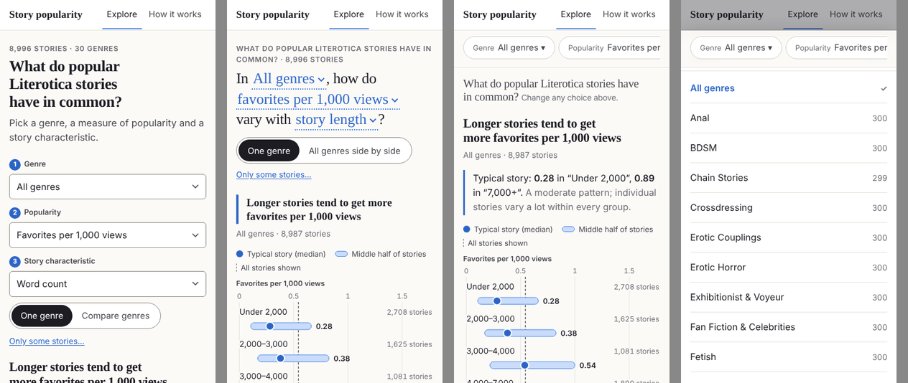

| | A · Compact stack | B · The question as a sentence | C · Chart first, settings in a bar |
|---|---|---|---|
| Idea | Kicker, two-line headline, one sentence; the three controls as a tidy stack (one row on desktop); mode toggle and "Only some stories…" underneath; example questions below the chart. | The controls *are* the question: "In [All genres], how do [favorites per 1,000 views] vary with [story length]?" Each bracket is a button. The pattern title becomes the highlighted answer right under it. | A sticky bar of four pills (Genre, Popularity, By, Stories) under the masthead; tapping one opens a bottom sheet. The chart follows a one-line intro. |
| Chart starts at (375 × 667) | ~630 px (title just above the fold) | ~520 px (first rows visible) | ~205 px |
| Desktop 1440 × 900 | whole chart visible ([m02](design-review/m02-first-screen-desktop-A.png)) | whole chart visible ([m03](design-review/m03-first-screen-desktop-B.png)) | whole chart visible ([m04](design-review/m04-first-screen-desktop-C.png)) |
| Pros | Smallest change from today; familiar; easy to test and make accessible. | Makes genre → popularity → characteristic obvious in one glance; reads like an editorial headline; distinctive and fun to play with; no numbered steps needed. | Fastest to the chart; settings always one tap away while scrolling; scales to more filters. |
| Cons | Still a form above a chart; less personality. | Long characteristic nouns make long sentences ("…vary with where descriptive and sensory language peaks"); verb agreement ("do"/"does") and a hidden label per control needed for screen readers. | Pills overflow on phones (the third is off-screen), so the flow is hidden; the sticky bar costs 60 px of a small screen; looks more like an app than a story. |

**Recommendation: B**, with A's layout as the fallback if you find the sentence too clever. It is the most
"data journalism" of the three and it teaches the interaction. The headline it implies (question 2) and the
answer line are wording changes for you to approve.

### 6.2 The characteristic picker

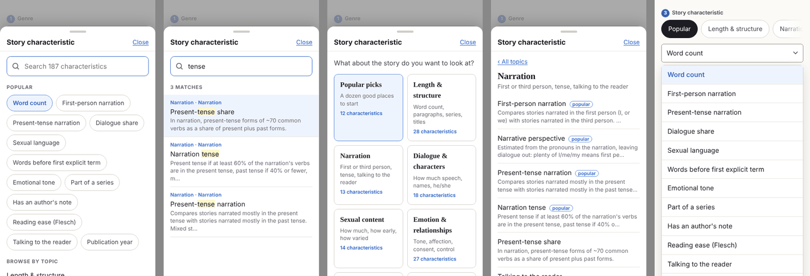

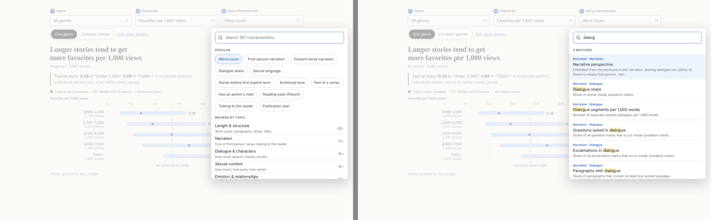

| | 2A · Search first | 2B · Topic cards, then a list | 2C · Today's tabs, repaired |
|---|---|---|---|
| Idea | One button opens a sheet (phone) or popover (desktop): a search box, a "Popular" shortlist of about 12, then 8 plain topics. Typing filters labels *and* descriptions; each result shows its topic and a one-line description. | A grid of 9 cards ("Popular picks", "Narration: first or third person, tense, talking to the reader" …); tapping one shows its characteristics with descriptions and "popular" badges. | Same tabs + select, but "Popular" first, 8 clearer topics, tabs that only change the list, 44 px pills. |
| Pros | Fastest for people who know what they want ("tense", "dialog", "explicit"); the shortlist serves people who don't; descriptions teach as you browse; the same component can search the glossary. | Very browsable; good for the 10–20 minute explorer; no typing on phones. | Small change; keeps native select (great accessibility for free). |
| Cons | A custom combobox needs care (ARIA 1.2 pattern, keyboard, focus trap in the sheet). Synonyms (POV, explicit, length) need a small list. | Two levels for every change; slower for repeat visits. | Still 187 options in a native list; no descriptions, no search. |

**Recommendation: 2A**, with 2C as the quick-win step while 2A is built. Both need a regrouping, which is
presentation only but lives in `wording.py` (question 8):

| Proposed topic | From today's sub-groups | Count |
|---|---|---|
| Popular | a hand-picked 12 (Word count, First-person narration, Present-tense narration, Dialogue share, Sexual language, Words before first explicit term, Emotional tone, Part of a series, Has an author's note, Reading ease, Talking to the reader, Publication year) | 12 |
| Length & structure | Story basics (both), Site metadata, Title & description, Series, Openings & endings | 28 |
| Narration | Narration | 13 |
| Dialogue & characters | Dialogue, Characters, Gendered language | 18 |
| Sexual content | Sexual content, its Pacing | 14 |
| Emotion & relationships | Emotion, Intimacy & relationships, Agency & control | 27 |
| Pacing & setting | Pacing (emotion, dialogue, action, description), time jumps, Settings | 20 |
| Word choice & style | Vocabulary, Readability (both), Repetition, Hedging, Distancing, Sensory, Style, Punctuation, Questions & exclamations, Writing mechanics | 62 |
| When published | Publication | 5 |

### 6.3 The one-genre chart

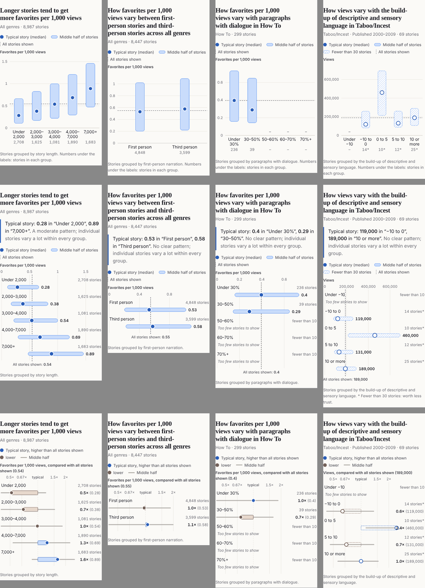

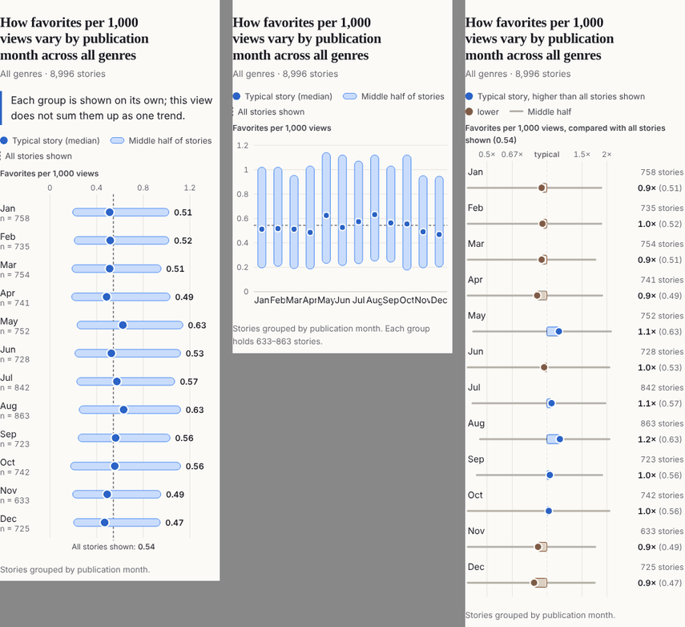

| | C1 · Columns, repaired | C2 · One row per group | C3 · Rows relative to the typical story |
|---|---|---|---|
| Idea | Today's chart with split labels, `n` only where it fits, no mean marker, outlined bars, hatched small groups. | Each group is a row: label and `n` above (phone) or to the left (desktop); the middle half as a horizontal bar, the median as a dot **with its value printed**; the dashed line for all stories. Short labels such as months sit to the left so 12 rows stay compact. | The same rows on a "× typical" scale (0.5× … 2×), blue above and orange below the typical story, with the middle half as a thin grey line and absolute values in brackets. |
| Pros | Smallest change; keeps the "up and to the right" reading of ordered groups. | Labels can never collide at any width or length; long genre-specific labels fit; values are readable without tooltips (fixes touch); works for 2 to 12 groups; reads like FT/Economist range plots. | Same language as the compare view; the size of each difference is explicit. |
| Cons | 12 groups at 375 px still need 11 px labels and no per-group `n`; still relies on tooltips for values. | Ordered groups read top-to-bottom instead of left-to-right; 12 groups take ~530 px on a phone. | Hides absolute values in brackets; log scale is harder for lay readers; adds a second colour meaning. |

**Recommendation: C2**, with two companions: the takeaway line above the chart (E1) and the mean moved to
the tooltip/table (F24). More C2 cases, including a rating chart and a one-group view:
[m09](design-review/m09-chart-C2-more-cases-phone.png); desktop comparison of all three:
[m10](design-review/m10-chart-concepts-desktop.png).

**Skewed totals and the y-axis.** I looked at a log scale for views and other totals and don't recommend it:
the chart shows medians and quartiles, not raw stories, so the spread is at most a few-fold and fits a linear
axis (e.g. 0–60,000 for all-genre views); a log axis would cost far more comprehension than it buys. The real
problem with totals is age, which E1's "Switch to views per month" button addresses.

### 6.4 Compare genres

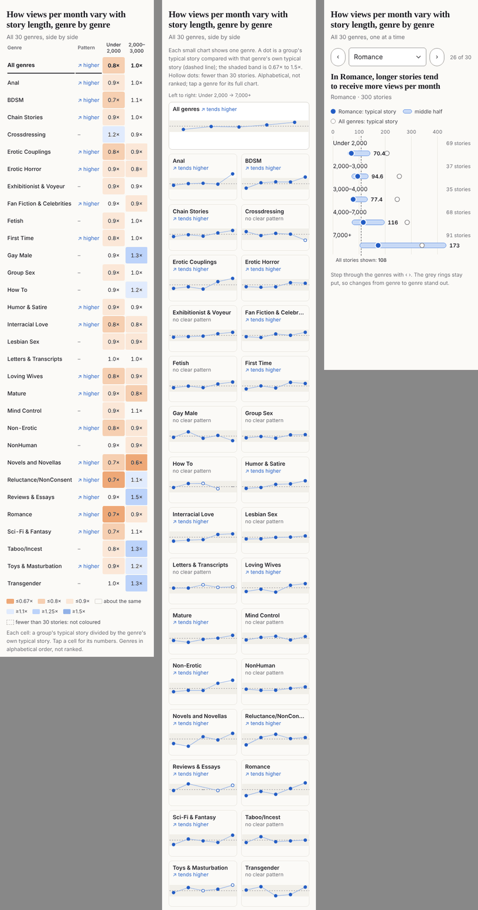

| | D1 · Table, repaired | D2 · Small multiples | D3 · One genre at a time |
|---|---|---|---|
| Idea | Stepped colours (0.67×, 0.8×, 0.9× / 1.1×, 1.25×, 1.5×), nothing between 0.9× and 1.1×, no colour below 30 stories, the verdict next to the genre, sticky genre names ([m12](design-review/m12-compare-D1-desktop.png)). | One small chart per genre (2 per row on phones, 5 on desktop): each group's typical story against the genre's own typical story; hollow dots for small groups; "↗ tends higher" / "no clear pattern" under the genre name; tap for the full chart ([m13](design-review/m13-compare-D2-desktop.png)). | The C2 chart for one genre, with the All-genres medians as grey rings and ‹ › buttons to step through genres ([m14](design-review/m14-compare-D3-desktop.png)). |
| Pros | Keeps exact numbers; compact on desktop. | The *shape* of each genre is visible at a glance, which is what the question asks; noise looks like noise (scattered hollow dots), real patterns look like slopes; no sideways scrolling; the verdict is next to the name. | Full detail for each genre; good for "how does my genre differ from the rest?". |
| Cons | Still a grid of numbers; still sideways on phones. | No exact numbers on the cards (tap for them); 31 cards are a long scroll on phones (about 2,200 px). | Comparing 30 genres takes 30 taps; weak for the actual question. |

**Recommendation: D2**, keeping D1's exact numbers one tap away. Optionally a factual summary line above the
cards, e.g. "Tends higher in 18 of 30 genres; no clear pattern in 12; tends lower in none." It counts the
existing verdicts and ranks nothing, but it is new wording (question 7).

### 6.5 The notes under the chart

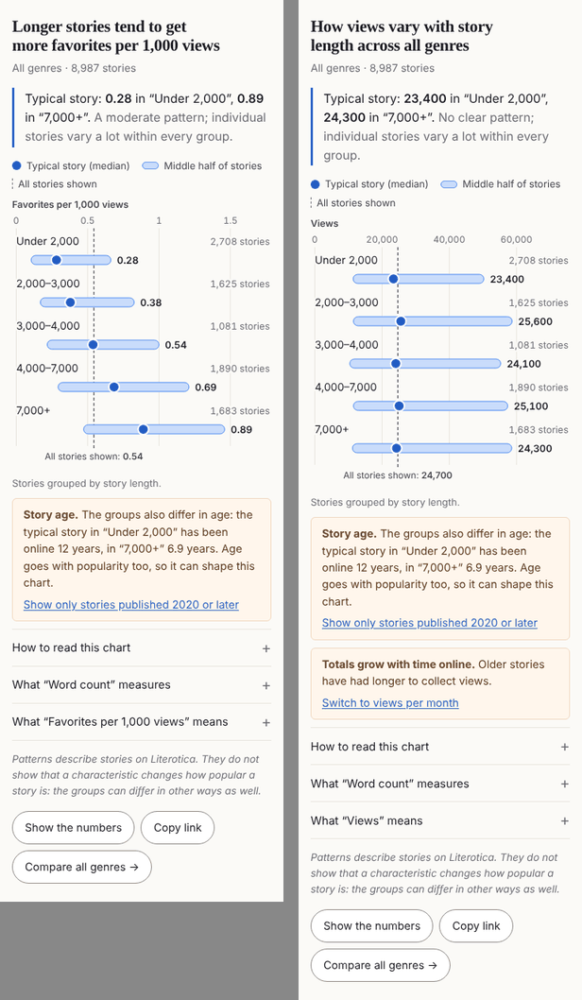

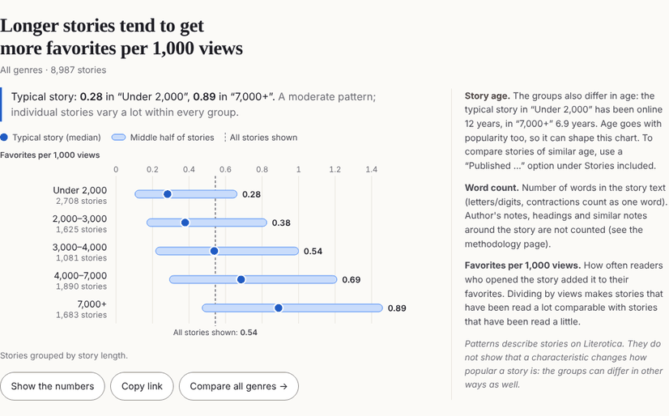

- **E1 · Takeaway, warnings, disclosures** (phone and narrow screens): a highlighted takeaway line, the story-age
  warnings as visible boxes with one-tap actions, three disclosures for definitions, the association note
  visible, then large buttons.
- **E2 · Margin notes** (desktop ≥ 900 px): the chart in two thirds of the width, the notes beside it in 14 px
  type, like a print feature.

**Recommendation: both, by width.** The takeaway text "Typical story: 0.28 in 'Under 2,000', 0.89 in '7,000+'.
A moderate pattern; individual stories vary a lot within every group." is new wording built only from medians
and the existing strength rule (question 7). For characteristics without an order (month, perspective) it falls
back to today's note. Hidden end groups must be named, not skipped.

### 6.6 Type

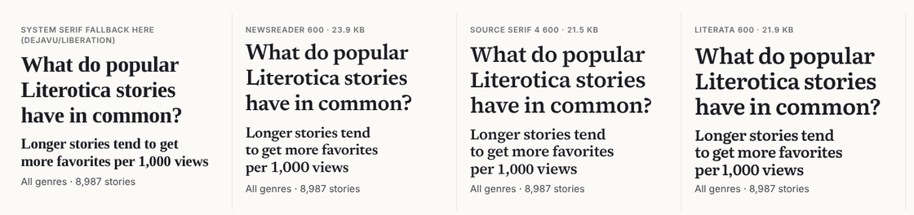

| Option | Adds | Size | Loads from |
|---|---|---|---|
| Keep the system stack | nothing | 0 | – |
| **Source Serif 4, weight 600** (my pick) | one consistent, sturdy, neutral heading face on every platform; tabular figures | 21.5 KB woff2 | `site/public/fonts/`, self-hosted, `font-display: swap`, preloaded; SIL Open Font License |
| Newsreader 600 | more editorial "newspaper" warmth; slightly narrower | 23.9 KB | same |
| Literata 600 | bookish, suits fiction | 21.9 KB | same |

Only headings would use it; body text stays on the system sans. It is a new dependency in spirit (an asset,
not a library), so it is your call (question 4).

### 6.7 Ideas for delight (each needs your yes)

- **I1. "Does it hold for stories of similar age?"** A button under any chart whose groups differ in age,
  showing the same chart for 2000–2009, 2010–2019 and 2020+ side by side. Uses the existing `y2000/y2010/y2020`
  files (three extra fetches, ~50 KB). It answers the writer's question in Task 2 in one tap and turns the age
  caveat into a check.
- **I2. "Next question" links** under each chart: the same characteristic with views per month, compare all
  genres, and two related characteristics from the same topic. Cheap, and keeps people exploring without
  inviting fishing.
- **I3. Smooth transitions.** When only the measure or the genre changes (same groups), dots and bars glide to
  their new places in 250 ms; switched off under "reduce motion".
- **I4. A pattern browser:** for a genre and a measure, every characteristic with a clear pattern, grouped by
  topic and listed alphabetically (not by strength), with the count of those without one ("71 of 187
  characteristics show a clear pattern with favorites per 1,000 views across all genres"). Guardrails: never
  sorted by effect size, always shows the "no clear pattern" count, links to the methodology note on many
  comparisons. **It needs one new aggregate file** (about 30–60 KB, the existing verdicts collected in one
  place), so it touches hard rule 2.
- **I5. Light polish:** a favicon drawn from the chart's own dot-and-bar (F29); the median value appearing as
  you hover a row; a soft fade instead of a jump when a chart changes.

---

## 7. Questions for you

1. **Spelling:** US English throughout (my recommendation: the disclaimer and Literotica's own "favorites"
   are US) or UK?
2. **Name and headline.** Headline options (F10): "What do popular Literotica stories have in common?" (my
   pick); "Which stories get read, saved and talked about?"; "Popularity on Literotica: what goes with what?".
   Masthead options: keep "Story popularity"; "The Favorites Atlas"; "Story Signals"; or simply the headline.
3. **Dark mode?** It matters to people who read at night, but it doubles every colour decision, including the
   charts. I'd leave it for a later round unless you want it now.
4. **Web font:** self-host Source Serif 4 600 (21.5 KB) for headings, another of the three, or keep system
   fonts?
5. **Default view:** keep story length × favorites per 1,000 views? (I'd keep it; F34.)
6. **The mean:** take the mean marker off the chart and keep it in the tooltip and table (F24)?
7. **New or changed wording** (none is causal, each needs your approval): the headline (F10); the
   one-group title and note (F17); the mode toggle labels (F18); the example questions (F19); the takeaway line
   (E1); the compare summary count (D2); "Only include" for "Stories included" (F35).
8. **Regrouping the characteristics** into the topics in 6.2 and the "Popular" list: happy with the topics and
   the 12 picks? This changes `GROUPS` and adds a list in `wording.py`, then `python -m litcorr site-data`.
9. **The pattern browser (I4)** needs a new aggregate file. Yes, no, or later?
10. **Concepts:** B for the first screen, 2A for the picker, C2 for the chart, D2 for comparing, E1 + E2 for the
    notes? Any you'd rather not do?
11. **Git.** My shell on your Mac can create files but not delete them, and git deletes its lock files on every
    commit, so before I create the `design-review` branch and commit I'll ask you to allow deletion in this
    project folder. Should these review screenshots (33 PNGs, 3.4 MB) be committed with this document, or
    kept out of git?

---

## Appendix: the brief's quality checks today

| Check | Today | After the recommended changes |
|---|---|---|
| No overlapping labels | **Fails on phones** (default view, months, author counts) | C2 cannot overlap |
| No unreadable charts | **Fails** for 12 groups on phones | passes |
| Long genre names don't break the layout | Passes (titles wrap to 4 lines at 375 px; compare names wrap); the brand wraps at 320 px | passes |
| The mobile layout works | **Partly**: works, but slow to reach and fiddly | B + 2A + C2 + D2 |
| Clear titles and axes | Passes, apart from the loading flip (F5) and one-group titles (F17) | passes |
| Tooltips are understandable | Desktop yes; **touch no**; compare = browser `title` only | values printed on the chart; tap to pin |
| Nothing implies causation | Charts and notes pass; **the headline frames a causal question** (F10) | passes |

---

## 8. Before and after

Implemented on branch `design-review` (16 commits, not pushed). All three checks pass at every commit:
`npm test` (64 tests, was 18), `npm run build`, `python -m pytest tests/test_stage2_site_data.py` (18 tests, was 13).
Measurements use the same method as section 2: the built site served with gzip, headless Chromium at 320×568,
375×667, 768×1024 and 1440×900, and the same throttling (fast 4G 9 Mbps/60 ms; slow 4G 1.6 Mbps/150 ms with a 4×
slower CPU; 3G 400 kbps/300 ms).

### 8.1 Headline numbers

| Measure | Before | After |
|---|---|---|
| Top of the page to the plot, 320 × 568 | 1,423 px (2.5 screens) | 575 px (1.0); first row ends at 661 px |
| Top of the page to the plot, 375 × 667 | 1,282 px (1.9 screens) | 532 px (0.8); **first chart row visible** (ends at 618 px) |
| Top of the page to the plot, 768 × 1024 | 988 px | 499 px |
| 1440 × 900 | plot starts at 998 px, below the fold | **whole default chart on screen** (plot 533–886 px) |
| Tab stops before the chart | 23 | 9 (skip link, name, 3 nav links, genre, measure, characteristic, only include) |
| Cumulative layout shift, first load | 0.92 at every speed | 0.00 at every speed (0.002 after changing views) |
| First load, gzipped | 126 KB, 6 requests | 154.7 KB (budget 155): JS 92.6 KB (+3 KB), CSS 6.2 KB, font 21.5 KB, meta 19.2 KB, chart 18.0 KB |
| First chart: local / fast 4G / slow 4G / 3G | 0.24 / 0.84 / 2.16 / 4.69 s | 0.06 / 0.89 / 2.02 / 4.68 s |
| Largest contentful paint | 0.13 / 0.44 / 1.16 / 2.80 s | 0.06 / 0.29 / 1.02 / 3.17 s (the heading font now arrives with the first screen) |
| New characteristic (one file, 17.6 KB) | 0.05–0.82 s with a "Loading…" flash and a wrong title | 0.04 / 0.11 / 0.27 / 0.69 s; the previous chart stays, dimmed, until the new one is ready |
| New genre or measure (same file) | ≤ 0.09 s, jump | ≤ 0.02 s, marks glide for 250 ms (none under reduced motion) |
| Overlapping chart labels | default view, months and author counts on phones | none: tested for every characteristic × 10 measures × 4 genres at 320 and 375 px on the real data (estimated text boxes) |
| Horizontal page scroll | compare table, numbers table, brand wrap at 320 | none at 320, 375, 768, 1440 or 200% zoom, for all the views in 2.2 plus Patterns, the age check and How it works |
| Smallest text | 11 px (step numbers) | 11.5 px (group labels under "All genres" on desktop genre cards); 12 px ticks elsewhere |

**Taps to change each control** (phone): genre 2 (unchanged, native list); measure 2 (menu, each with one-line help;
was 2 plus an "i" that did not open); characteristic 2 from Popular or search, 3 through a topic (was 2–3 plus
guesswork, and each tab loaded an arbitrary chart); only include 2; compare all genres 1; a genre while comparing 1;
back to one genre 1; example question 1; story-age check 1; switch a total to its per-month version 1.

**Touch targets** (height of the tap area): every button, chip, menu option, disclosure and nav item ≥ 44 px; the
words of the sentence and "Only include" keep their text size but have 44 px tall tap areas; How it works contents
links 40 px on desktop (44 px on phones). Was 17–36 px for the "i", chips, tabs, toggles and links.

**Color pairs** (WCAG 2.1): every text pair passes 4.5:1 (lowest: muted text 5.0, warm "tends lower" 5.1, links on the
age box 5.3); every graphical mark and control boundary passes 3:1 (median dot on its bar 4.1, bar outline 3.3,
control borders 3.3, dots on the genre-card band 4.9, small-group outlines 3.3, focus ring 5.4); compare-table text
on the stepped fills 8.1–14.1. Before: five failures (section 2.3).

### 8.2 The five tasks again

1. **First-time visitor on a phone.** The first screen states the question as a sentence, the answer in a heading and
   a takeaway with two numbers, and the first chart row. Values are printed beside each dot, so nothing needs a
   tooltip; a tap pins the details (mean, middle half, age). Exploring further is the sentence itself or "Try
   another question" below the chart.
2. **Writer in Romance.** Genre (2 taps), characteristic (2 taps: "Present-tense narration" is in Popular, or type
   "tense"). Answer: "Too few stories to judge a pattern", typical story 0.22 against 0.53, with an age box ("15 years
   against 10") and "Check stories of similar age" (1 tap) showing 2000–2009, 2010–2019 and 2020+ side by side, each
   with its count and verdict. The useful all-genres view is one tap away ("In Romance" → All genres) or through
   "Compare all 30 genres".
3. **Comparing genres.** "Compare all 30 genres" (1 tap), measure → Views (2 taps): the totals box offers "Switch to
   views per month" (1 tap), and the heading answers "Tends higher in 18 of 30 genres, tends lower in none, no clear
   pattern in 12." Cards fit two per row on a phone with the verdict under each name; no sideways scrolling.
4. **Sceptic.** "What “Sexual language” measures" → "How was this measured?" opens How it works at Explicitness;
   "Why no clear pattern?" opens "When a title says ‘tend to’"; every row shows its number of stories, and the
   numbers table (always in the page) gives median, middle half, mean and typical age.
5. **Keyboard and screen reader.** 9 tab stops to the chart; the skip link lands on the question; chart rows are
   focusable with a visible ring, each with a full spoken label; the chart is a named group with a one-sentence
   summary, the numbers table follows it; the answer is announced once, after the data has loaded; menus follow the
   combobox and listbox patterns, Escape returns focus to the slot that opened them.

### 8.3 Every finding and idea

| ID | What changed | Commit | Before → after |
|---|---|---|---|
| F1 | Rows instead of columns (C2): labels above the bars on phones, a label column wider; thinned ticks | 7387ca5 | overlaps in the default view → none on real data |
| F2 | Concept B: kicker, question sentence, answer, chart; examples below the chart | 780c733 | plot at 1,282 px → 532 px (375 × 667) |
| F3 | Search-first picker with Popular and eight topics; tabs gone; synonyms | 0702877, 4912fce | 3 taps + guesswork → 2 taps |
| F4 | Measure menu with one-line help replaces the "i" (which now also opened on click until it was removed) | 123ec67, 4912fce | help unreachable by tap → in the menu |
| F5 | The shown chart stays until the next has loaded; wording only from loaded data | 4a02284 | wrong title and "too few" flash → none |
| F6 | Genre cards (D2); repaired table with steps, a neutral band and no color under 30 stories (D1) | 95b0129 | noise colored like findings → dots against a band |
| F7 | Cards two per row on phones; sticky genre names and the verdict second in the table | 95b0129 | sideways scroll → none |
| F8 | Age warnings as boxes with actions, three disclosures, margin notes on desktop | 48bb257 | 592 px, 161 words under the chart → age box + three 48 px rows |
| F9 | Values printed on the chart; a tap pins the details; compare cells show their numbers on tap or focus | 7387ca5, 95b0129 | tooltip closed on tap → pinned |
| F10 | "What do popular Literotica stories have in common?" | d7c1c78 | causal framing → descriptive |
| F11 | 2 px focus ring on chart rows | 123ec67, 7387ca5 | 6% tint → ring |
| F12 | Named group + summary; focusable labelled rows; numbers table always present | 7387ca5 | title only → data available |
| F13 | Token fixes from section 4 (plus small-cell outlines in the control color) | 123ec67, 5ef0fc2 | 5 contrast failures → 0 |
| F14 | 44 px targets everywhere | 123ec67, 5ef0fc2 | 17–36 px → ≥ 44 px |
| F15 | Frame, headline and placeholder before the data; `main` one screen tall; width measured before paint | 4a02284, 5ef0fc2 | CLS 0.92 → 0.00 |
| F16 | No "Loading…" box after the first chart; dim instead of jump | 4a02284 | 75–122 px jumps → none during loading |
| F17 | "Too few stories to compare here" and "Only “Past tense” has enough stories in this selection (102)." with All genres / All stories buttons | 7387ca5 | comparative title on one group → honest |
| F18 | "Compare all 30 genres →" and "← Back to one genre"; "Genre by genre, how do …" | 48bb257, 4912fce | "One genre: All genres" → gone |
| F19 | Example questions name the measure they open; under "Try another question" | 0702877, 780c733 | mismatched → matched |
| F20 | US English everywhere, US dates; "How it works" in nav and footer; "genre" with one note on "categories" | 0702877, d7c1c78, 86a8007 | mixed → US; tests scan for UK spellings |
| F21 | Plural-aware pacing, "the number of …", "the use of ‘we / us / our’", "the share of dialogue paragraphs" | 0702877 | slips → read through all 935 generated titles |
| F22 | "Story Patterns", one constant, never wraps | 780c733 | wrapped at 320 px → one line |
| F23 | Compact ticks on phones (60k, 800k), margin from the first tick label | 7387ca5 | "800,000" 4 px from the edge → "800k" inside |
| F24 | No mean marker; mean in details and table | 7387ca5 | four encodings → two plus a line |
| F25 | One number of decimals per axis and column; "0.10–0.66" | 8942b1e | "1" next to "1.5" → "1.0", "1.5" |
| F26 | Numbers table: cards on phones | 7387ca5 | 560 px min width → no scroll |
| F27 | How it works: In short, contents, section routes, links from charts | 86a8007 | 4,700 px wall, unlinkable → linkable sections |
| F28 | Reduced motion honored in CSS and JS (scrolling, glide, fades) | 123ec67, 1a500b8 | smooth scroll always → only when allowed |
| F29 | Favicon from the chart's mark | 123ec67 | analytics bars → capsule and dot |
| F30 | Source Serif 4 600, self-hosted, headings only | 123ec67 | system fallbacks → the same face everywhere |
| F31 | No form grid any more; checked at 768 px | 780c733 | cut select → sentence |
| F32 | "We couldn’t load the data. Check your connection and try again." + Try again | 8942b1e | technical message → retry |
| F33 | "Link copied", or the address selected in a read-only field | 8942b1e | silent failure → fallback |
| F34 | Default kept; the similar-age check answers its age warning | 48bb257 | caveat → check |
| F35 | "Only include"; conflicting options disabled with the reason in the option | 4912fce | one-group views by accident → prevented |
| F36 | Glossary by topic, 44 px headings, filter box, "See the chart" | 86a8007 | 25 px headings → 44 px, searchable |
| I1 | Stories of similar age: three periods, one shared scale, in the address (`check=age`) | 48bb257 | |
| I2 | Next questions: per-month version of totals, next two in the topic, link to Patterns | 48bb257, b01bf2e | |
| I3 | 250 ms glide for genre and measure changes; 150 ms cross-fade for a new characteristic | 1a500b8 | |
| I4 | Patterns page and `patterns.json` (11 KB gzipped) | b01bf2e | |
| I5 | Favicon, values on the chart, row emphasis on hover/focus, fades | 123ec67, 1a500b8 | |

### 8.4 After screenshots

Each image shows 375 px (left, full size) and 1440 px (right, half size).

| View | Screenshot |
|---|---|
| First screen | [a01](design-review/a01-first-screen-375-1440.png) |
| Ranged characteristic (default) | [a02](design-review/a02-default-chart-375-1440.png) |
| Yes/no characteristic | [a03](design-review/a03-yes-no-375-1440.png) |
| 12 groups (month) | [a04](design-review/a04-month-375-1440.png) |
| Compare genres (views per month) | [a05](design-review/a05-compare-375-1440.png) |
| Compare, 12 groups | [a06](design-review/a06-compare-month-375-1440.png) |
| One group left | [a07](design-review/a07-one-group-375-1440.png) |
| Small genre (How To) | [a08](design-review/a08-small-genre-375-1440.png) |
| Large values | [a09](design-review/a09-large-values-375-1440.png) |
| Stories of similar age | [a10](design-review/a10-age-check-375-1440.png) |
| Patterns | [a11](design-review/a11-patterns-375-1440.png) |
| How it works | [a12](design-review/a12-how-it-works-375-1440.png) |
| Characteristic picker | [a13](design-review/a13-picker-375-1440.png) |

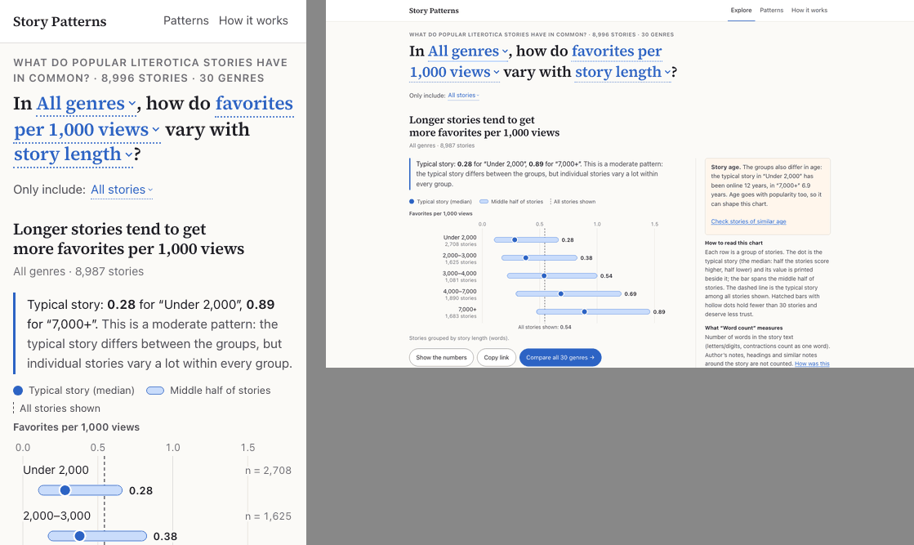

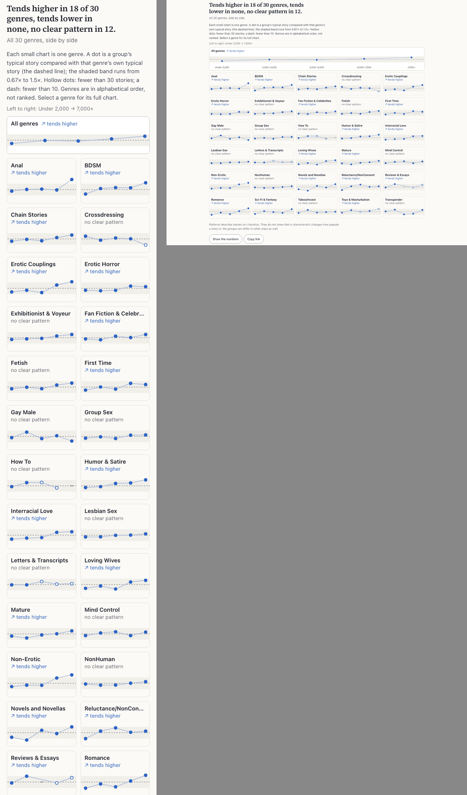

### 8.5 Judgment calls

Decisions the implementation prompt left open, with one line of reasoning each.

1. **Compare-mode heading** is the compare summary ("Tends higher in 18 of 30 genres, …"), or "Each group on its own"
   for characteristics without order: it is the answer to the question the sentence asks; the full compare title
   stays as the page title.
2. **"Compare all 30 genres"** sits once, in the action row under the chart; next questions are the per-month version
   (for totals) and the next two characteristics, plus a separate link to Patterns, to avoid three copies of one button.
3. **Label column** is `min(220, max(110, 25% of width, longest label))` px, so long labels such as "First part or
   stand-alone" never run off the left edge.
4. **Group sizes** read "2,708 stories" beside the label on wider screens and "n = 2,708" on phones (space);
   hidden groups "fewer than 10" (or "n < 10" in the 64 px column).
5. **Ticks** use steps of 1, 2, 2.5 or 5 and are thinned until their labels fit, so a narrow plot can show 3 ticks.
6. **One number of decimals** for all printed medians of a chart; the takeaway uses the same.
7. **Sentence weight**: only the 600 weight ships, so the sentence uses 600 at clamp(23 px, 3.9 vw, 37 px).
8. **"Explore" nav item** is hidden below 400 px (the name links to the explorer too), so three items never wrap.
9. **"Only include" conflicts**: the reason is in the disabled option ("Under 2,000 words (not with word count)") and a
   visually hidden note; a conflicting option in a shared address falls back to All stories.
10. **Similar-age panel** uses one value scale for the three periods, so the charts compare at a glance; it is offered
    only in one-genre mode with All stories, as specified.
11. **Age boxes order**: "groups differ in age" first, then "totals grow", matching the review's E1 mock-up.
12. **Descriptions** no longer say "(see the methodology page)", since every chart links to the right section.
13. **Topics**: Narration opens with the general characteristics (perspective, tense, talking to the reader) before
    the pronoun counts; Sexual content keeps its four pacing items (the review's table); its sub-group is called
    "Amount & variety" to avoid repeating the topic name.
14. **Renamed labels**: "Romance language" (clashed with the genre), "Word variety (type–token ratio)", "General sexual
    words" (was "Other sexual vocabulary"), "Focus on one main name", "Where action verbs peak".
15. **Patterns page**: each item shows the characteristic's name above its sentence so the alphabetical order is
    visible; "the other M don't" includes characteristics with too few stories to judge (they are named as such
    when "Show the ones with no clear pattern too" is on).
16. **patterns.json format**: one character per characteristic (`a`–`i` = direction × strength, `.` = not computed)
    in meta.json's order, with the key in the file; the smallest form that holds exactly the approved fields.
17. **Slots** are inline `span role="button"` elements, because a real `<button>` cannot wrap like text and broke the
    sentence into blocks for long characteristics.
18. **Small table cells** use the control color for their dashed outline: the specified `#b5b0a6` is 2.1:1, below the
    3:1 rule for boundaries.
19. **The synthetic handoff** gained views per month so the tests cover the totals → per-month switch.
20. **"Shared-link text"** is taken to be the page title (what a bookmark or a shared tab shows); Copy link copies the
    address only.
21. **Takeaway with a hidden end group**: "Typical story: 0.89 for “7,000+”; “Under 2,000” has too few stories."
22. **Compare summary with zero**: "tends lower in none"; "tends higher in none of 30 genres".
23. **Picker keys**: Home and End move between options (not the caret), as the prompt lists them with the arrows.
24. **First-load budget**: `meta.json` is written without indentation and the glide interpolates plain numbers, to stay
    within 155 KB with the font.
25. **Contents links** on How it works are 40 px tall in the desktop sidebar (pointer use) and 44 px on phones.

### 8.6 Still open

- **Dark mode**: not in this round, as decided; every color is a CSS variable, so it can be added.
- **Real devices and screen readers**: everything was checked in headless Chromium (with touch emulation) and with
  Testing Library; not on a physical iPhone or Android phone, and not with VoiceOver, TalkBack or NVDA.
- **Swipe down to close the bottom sheet** (optional in the prompt) is not implemented; Close, Escape and a tap on the
  dimmed page close it.
- **Story counts near the chart**: the kicker says 8,996 stories, the default chart 8,987 (stories with both
  measures). How it works explains it under "Missing data"; nothing next to the chart does yet.
- **Long genre names** are cut with an ellipsis on two-column phone cards (e.g. "Fan Fiction & Celebr…"); the full
  name is in the card's accessible name and title, and on the chart it opens.
- **Budget headroom**: the first load is 154.7 KB of the 155 KB budget.

### 8.7 Not done, on purpose

- No log scale for totals (section 6.3): the per-month and per-1,000-views switches address age instead.
- No mean marker anywhere on the chart (decision 6).
- Nothing on the Patterns page or the genre cards is ordered by a result.
