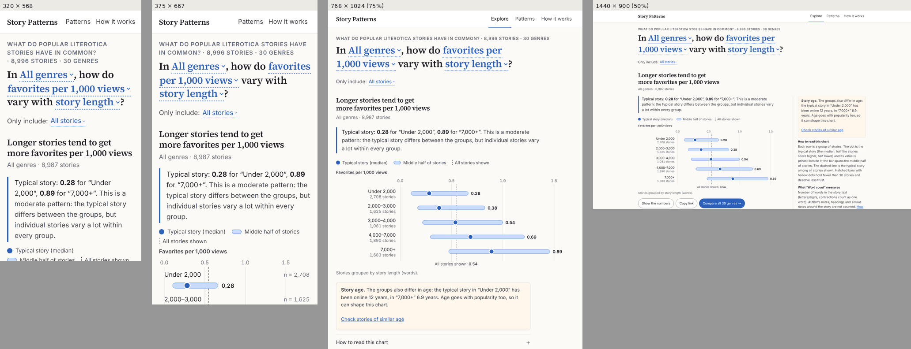
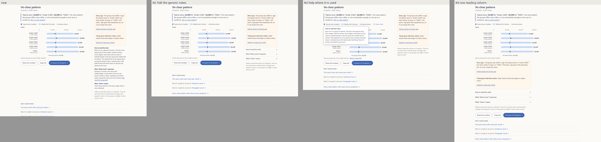
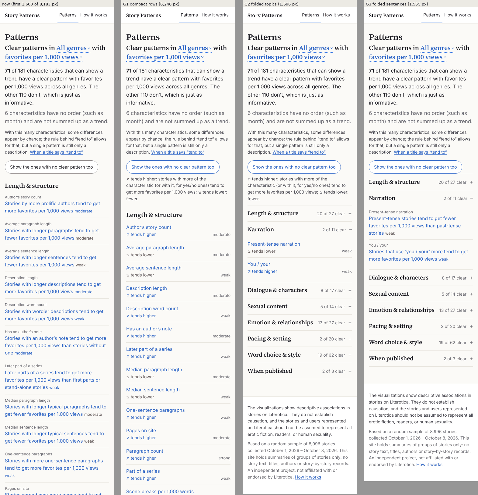
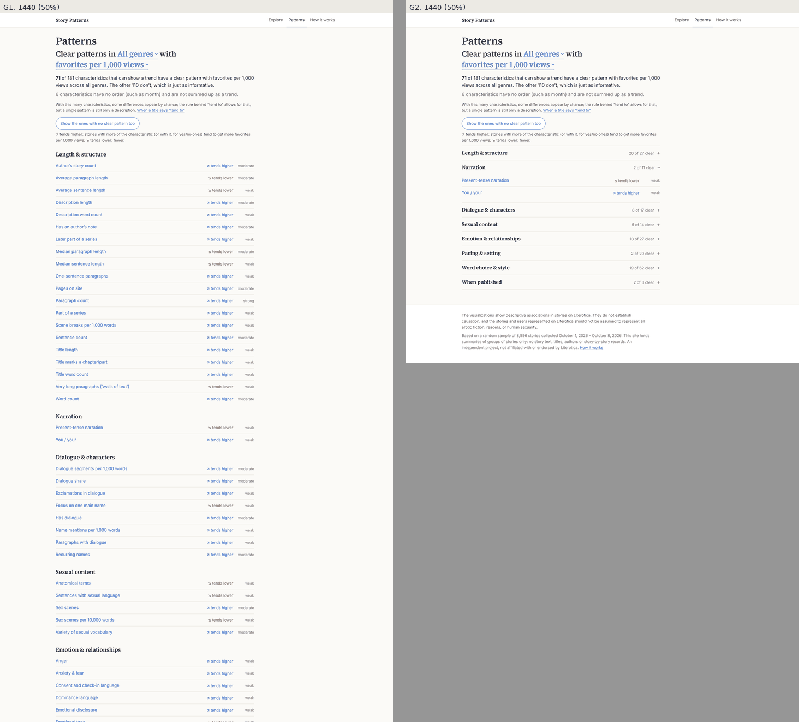
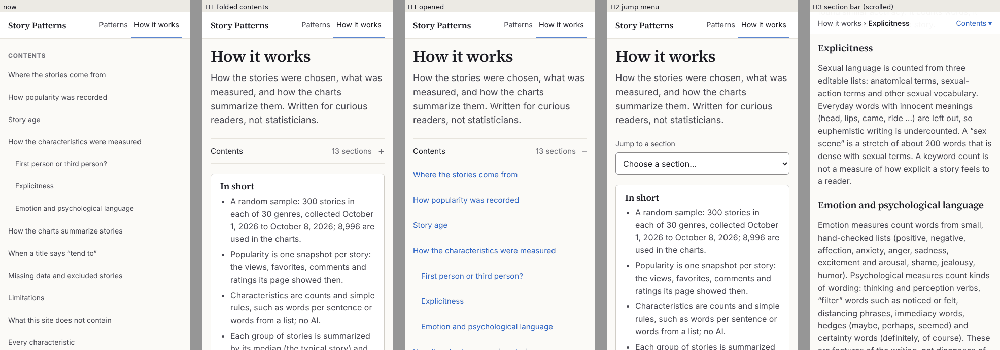
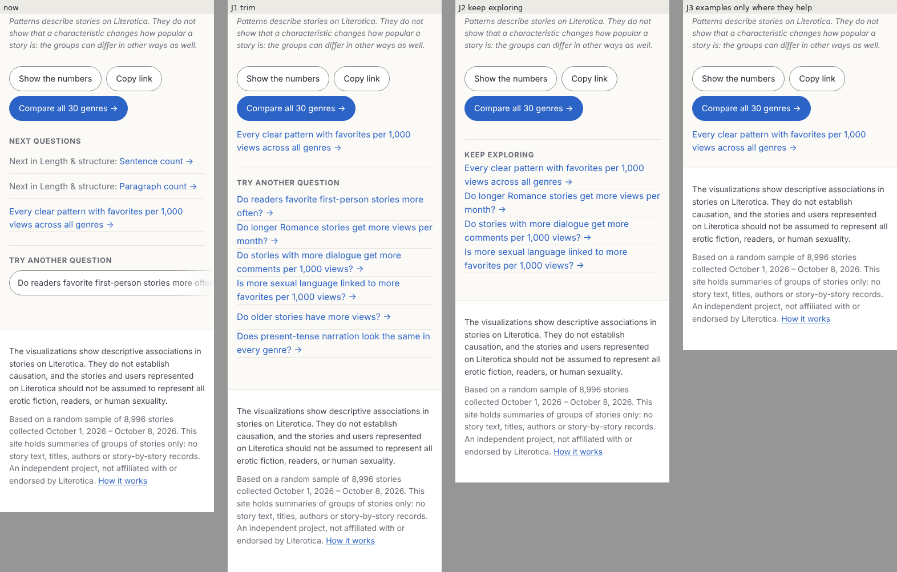
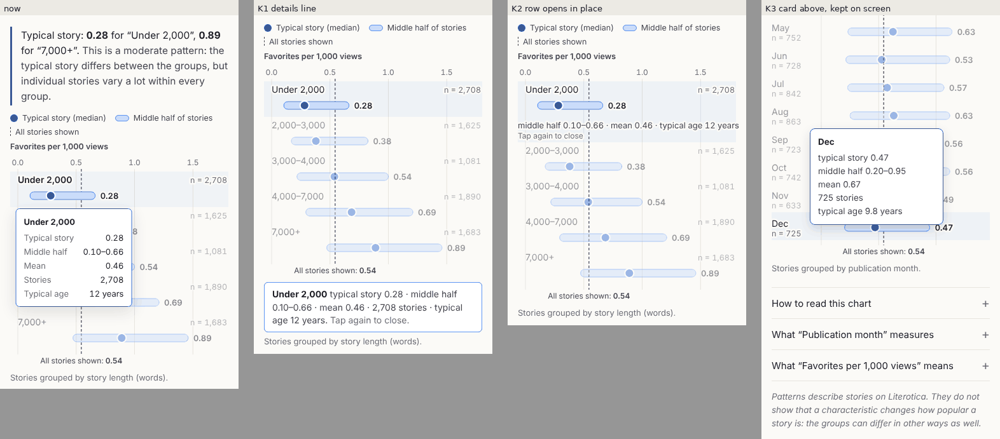
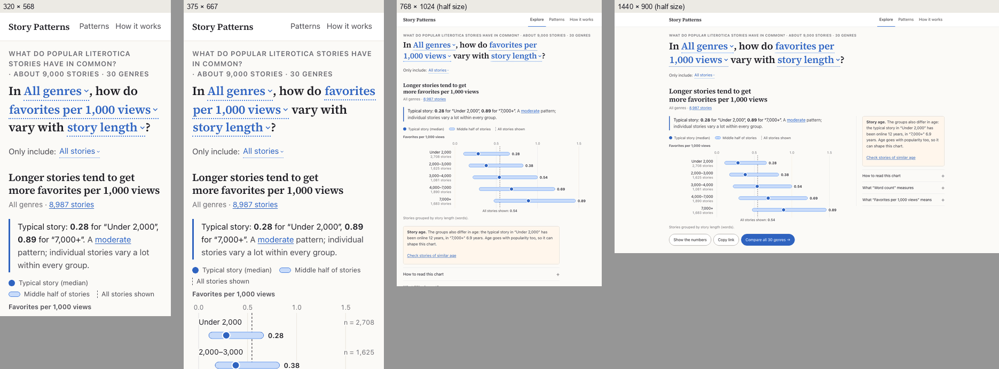
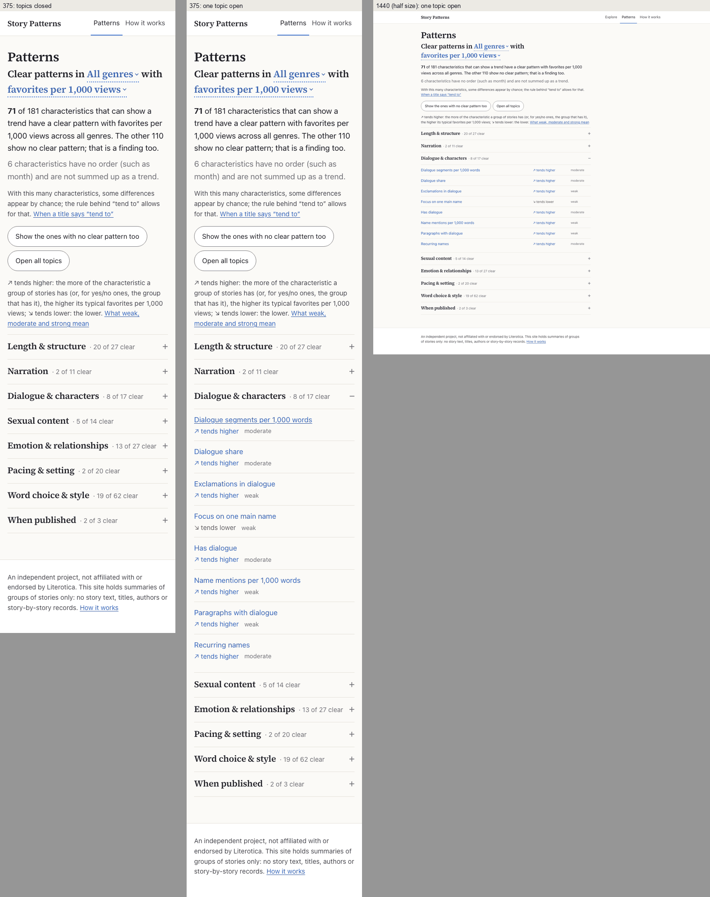

# Stage 2 design review, round 2

*Phases 0–3 of `STAGE2_DESIGN_REVIEW_2_PROMPT.md`, October 8, 2026, on branch `design-review` at `8ad75e1` (round 1).
**Status: approved and implemented** on branch `design-review-2` (October 8–9, 2026), following
`STAGE2_DESIGN_IMPLEMENTATION_2_PROMPT.md`, with the owner's decisions: no reminders that correlation is not causation
anywhere on the site (the disclaimer, the association note and their echoes go; no causal language stays the rule);
code splitting; concepts N1, G2, H3 (not H1), J2 and K1 (not K2); idea I8 only (no I6, no I7); everything else as
recommended, with Open Graph tags but no share image, no dark mode and no second font weight this round. Sections
1–9 are the review as written; what changed, with before and after numbers, is in section 10.*

- Round 1 is [`DESIGN_REVIEW.md`](DESIGN_REVIEW.md); this document links to it rather than repeating it.
- **Screenshots** are in [`design-review-2/`](design-review-2/): `b…` the site as it is now, `m…` mock-ups.
- **Mock-up sources** (scripts that change the running site in a browser, so they draw the real aggregates) are in
  `Claude outputs/design-review-2-mockups/`; the measuring scripts are in `Claude outputs/design-review-2-tools/`
  (round 1's, plus the round-2 ones listed in its `README.txt`). Both stay out of git.
- **Finding IDs** continue from round 1 (F37 onward). New concepts use the letters G, H, J, K and N (not F, which
  would read as a finding); new ideas are I6–I8.
- Measured facts and my opinions are kept apart: "measured" means a script or a screenshot backs it.

---

## 1. Verdict

Round 1 was a real redesign and most of it holds up under measurement. The chart is now the focus of the page, its
labels never collide (checked here with real glyphs in 11,220 charts and three fonts), loading is calm (layout shift
0.00), every color pair passes, and axe finds nothing serious on the explorer. It reads as data journalism, not as a
form. What is left is mostly **feedback and density**: several actions happen out of sight, and the text around
the chart (the takeaway, the desktop margin, the Patterns page, the sections after the chart) has grown back to
something people will skim past.

| Area | Round 1 before | Now | In one line |
|---|---|---|---|
| First impression and information architecture | C− | **B+** | The question sentence works and the first chart row is on a phone's first screen; the takeaway's boilerplate is the biggest block on it. |
| Controls | C | **B** | Picker and menus are good; on phones the sentence's tap areas overlap (30% of "per 1,000 views" opens the other menu); search misses "age" and "length". |
| One-genre chart | C− phone / B− desktop | **A− / A−** | Clear rows, printed values, no overlaps anywhere; a tapped row's card covers three rows or opens off-screen. |
| Compare genres | C | **B+** | Honest small multiples; for totals the story-age note sits after all 31 cards (2,412 px down on a phone). |
| Words | B− | **B** | Careful and non-causal; repetitive (the strength sentence on every chart, duplicated notes), and "weak / moderate / strong" are never defined. |
| Visual design | B− | **B+** | Calm and editorial; the desktop margin column is 2.2 times the chart's height and leaves a 280 px hole; Patterns is a wall of blue sentences. |
| Accessibility | C | **B** | Names, roles and contrast are right; "Check stories of similar age" drops focus; dark forced colors make chart text unreadable; 5–12 tab stops per chart. |
| States and edge cases | C | **B** | Loading and errors are good; the empty state offers no way out; several results appear off-screen. |
| Performance | B+ | **B** | Fast and stable, but the first load is at the budget (155.6 KiB as measured) with nothing code-split; splitting saves 8.2 KiB. |

**The three biggest remaining problems**

1. **Results that appear where nobody is looking.** "Check stories of similar age" opens its panel below the fold and
   moves focus to the page body (F37); a tapped chart row's card covers three rows or opens below the screen (F43); in
   compare mode the note that explains a totals result sits after 31 cards (F39); a tapped compare-table cell shows
   its numbers at the top of a 1,300 px table (F53).
2. **Too much repeated text around the chart.** The 21-word strength sentence on every chart is the largest text on
   a phone's first screen (and its largest paint) (F40); the desktop margin holds 204 words, most of them the same on
   every chart (F41); Patterns repeats "tend to get more favorites per 1,000 views" 71 times over 8,183 px (F42);
   "Next questions" and "Try another question" add 300–360 px of links, partly duplicates (F50).
3. **The sentence's words fight over taps on phones.** Measured with `elementFromPoint`, 30% of "per 1,000 views"
   opens the characteristic picker at 375 px, and 25% of "All genres" opens the measure menu at 320 px (F38). A
   line-height of 1.45 and no invisible tap boxes fixes it (measured: every word then owns 93–100% of itself).

None of these needs a change to the data, the methodology or the interpretation rules.

### 1.1 Your five questions, in short

1. **The text on the right of the explore page (desktop).** Not user-friendly as it is: 204 words in 789 px beside a
   354 px chart, three of its four blocks identical on every chart, and it runs 280 px below the buttons, leaving a
   hole on the left. Fold the three generic explanations into the same one-line disclosures phones already use and
   keep the age boxes and the association note open (concept **N1**, F41): 444 px, no hole, no new wording.
2. **The long list on the Patterns page.** Not user-friendly: 71 full sentences, 8,183 px on a phone (12 screens),
   the direction buried mid-sentence and the measure repeated in every line. Fold the eight topics (each with its count,
   "20 of 27 clear") and show one compact row per characteristic: name, "↗ tends higher / ↘ tends lower", strength
   (concept **G2**, F42): 1,596 px on a phone with one topic open.
3. **How it works' contents on a narrow screen.** It fills the whole first screen (13 rows of 44 px; the heading
   starts at 690 px on a 667 px phone; it is one column, not two). Fold it into one 48 px "Contents · 13 sections" row
   under the introduction (concept **H1**, F46); the heading then starts at 69 px.
4. **The text at the bottom of the explore page.** The disclaimer must stay word for word, and your original brief
   puts it in a footer with the independence statement, so the footer stays. Its second paragraph (sample size,
   dates, what the site holds) repeats the kicker and How it works; cut it to the independence statement and a link,
   in smaller type (F58, needs your approval). The italic association note under each chart is a different, chart-level
   caveat; keep it.
5. **"Next questions" and "Try another question".** They mostly add clutter. Next questions offers the two neighbors
   in the topic's list (after Word count: Sentence count, Paragraph count, i.e. the same pattern again), repeats the
   age box's "Switch to views per month", and its labels are not questions; the examples are the same six on every
   chart, and on phones a sideways strip shows one of them, cut off. Replace both with one short "Keep exploring" list:
   the Patterns link plus three example questions that differ from the chart shown (concept **J2**, F50).

---

## 2. Baseline (Phase 0)

### 2.1 How I tested

- **Code.** Branch `design-review` at `8ad75e1` (round 1's last commit; `main` is still at `8b2df98`). My build's
  bundle is `index-Cx2VYF7Z.js`, the same file as in your `site/dist/`.
- **Tests.** `npm test`: **64 passed** (7 files). `npm run build`: passes (JS 299.3 kB / 93.8 kB gzip as Vite counts
  it; CSS 25.7 / 6.4 kB). `pytest tests/test_stage2_site_data.py`: **18 passed**. Same counts as round 1 reported.
- **Serving and measuring.** The built site served with gzip by round 1's `serve.mjs`; headless Chromium 1194
  (Playwright 1.56) on Linux; round 1's widths (320 × 568, 375 × 667, 768 × 1024, 1440 × 900, 200% zoom as
  720 px at device scale 2) and throttling profiles (fast 4G, slow 4G with 4× CPU, 3G). Round 1's `perf.mjs` and
  `audit.mjs` were reused unchanged apart from the browser path; everything else was measured with new scripts.
- **Fonts.** My renderer's `system-ui` is **Inter**, a little wider than Apple's San Francisco, so body text wraps
  slightly sooner than on your Mac; the serif (Source Serif 4, self-hosted) is identical everywhere. For the label
  checks I also used Liberation Sans (Arial's widths, close to Roboto on Android) and DejaVu Sans (the widest common
  Linux fallback).
- **Not done:** a physical phone, VoiceOver/TalkBack/NVDA, Windows itself (forced colors were emulated), Lighthouse
  (axe-core 4.10 instead). No Literotica page was opened; all data came from `site/public/aggregates/`.

### 2.2 Screenshots

| View | Address | Screenshot |
|---|---|---|
| First screens at 320, 375, 768, 1440 | `#/explore` | [b01](design-review-2/b01-first-screens-320-375-768-1440.png) |
| Ranged characteristic (default) | `#/explore?mode=one&genre=all&metric=pop_fav_per_1k_views&var=story_words&include=all` | [b02](design-review-2/b02-default-375-1440.png) |
| Yes/no | `#/explore?var=pov_is_first_person` | [b03](design-review-2/b03-yes-no-375-1440.png) |
| 12 groups | `#/explore?var=pub_month` | [b04](design-review-2/b04-month-375-1440.png) |
| Rating (zoomed axis) | `#/explore?metric=pop_rating&var=story_words` | [b05](design-review-2/b05-rating-375-1440.png) |
| A total, both age warnings | `#/explore?metric=pop_views&var=story_words` | [b06](design-review-2/b06-total-two-age-boxes-375-1440.png) |
| Stories of similar age | `…&check=age` | [b07](design-review-2/b07-age-check-375-1440.png) |
| One group left, small genre, empty, large values | see section 2.2 of the prompt; empty: `#/explore?mode=one&genre=adult-how-to&metric=pop_fav_per_1k_views&var=desc_pov&include=long` | [b08](design-review-2/b08-one-group-small-genre-empty-375.png) |
| Long sentences at 320 and 375 | `var=title_has_chapter_marker`, `var=pace_descriptive_early` | [b09](design-review-2/b09-long-sentences-320-375.png) |
| Compare genres | `#/explore?mode=compare&genre=all&metric=pop_views_per_month&var=story_words&include=all` | [b10](design-review-2/b10-compare-375-1440.png) |
| Compare views; compare, 12 groups | `…metric=pop_views…`, `#/explore?mode=compare&var=pub_month` | [b11](design-review-2/b11-compare-views-age-box-375.png) |
| Compare numbers, a cell tapped | as compare, "Show the numbers" | [b12](design-review-2/b12-compare-table-cell-375.png) |
| Patterns | `#/patterns?genre=all&metric=pop_fav_per_1k_views`, `…genre=adult-romance&metric=pop_views_per_month` | [b13](design-review-2/b13-patterns-375-1440.png) |
| How it works | `#/methodology` | [b14](design-review-2/b14-how-it-works-375-768-1440.png) |
| Picker (empty, "tense", a topic) and measure menu | | [b15](design-review-2/b15-picker-and-menu-375.png) phone, [b16](design-review-2/b16-picker-and-menu-1440.png) desktop |
| A pinned row on a phone | tap "Under 2,000"; tap "Dec" | [b17](design-review-2/b17-pinned-details-375.png) |
| After tapping "Check stories of similar age" | `#/explore?genre=adult-romance&var=narr_is_present_tense` | [b18](design-review-2/b18-age-check-tap-375-1440.png) |
| Real tap areas of the sentence | | [b19](design-review-2/b19-hit-areas-375-320.png) |
| Forced colors (dark and light themes) | | [b20](design-review-2/b20-forced-colors-dark-375.png) |
| The chart mid-glide after a measure change | | [b21](design-review-2/b21-glide-on-measure-change-375.png) |
| Error (aggregates blocked); 400% zoom | | [b22](design-review-2/b22-error-and-400-zoom.png) |

### 2.3 What round 1 could not measure

**Real tap areas of the sentence** (measured: `document.elementFromPoint` every 2 px over the controls; "own" is the
share of the word's visible box that opens its own control, "tap height" the height of that control's hit area at
the word's center; [b19](design-review-2/b19-hit-areas-375-320.png)):

| Width | Word (line) | Own | Tap height | Lost to |
|---|---|---|---|---|
| 320 | "All genres" | **75%** | 30 px | the measure's invisible tap box below it |
| 320 | "favorites per 1,000 views" | 84% | 32 px | the characteristic below |
| 375 | "per 1,000 views" (2nd line) | **70%** | **24 px** | the characteristic below (444 sample points) |
| 375 | "story length" | 100% | 46 px | |
| 375, chapter marker | "favorites per 1,000 views" | 89% | 34 px | the characteristic |
| 768 | "favorites per" | 91% | 38 px | the characteristic |
| 1440 | every word | 94–100% | 50–56 px | |
| all | "Only include: All stories" | 100% | 44 px | |
| 375, Patterns page | "All genres" | 84% | 28 px | the measure select below |

The sentence's lines are 30.4 px apart on phones (23 px type at line-height 1.32), the words' boxes are 34 px tall,
and the measure and characteristic add an invisible 44 px box each, so neighboring lines overlap. WCAG 2.2's target
size rule (2.5.8) exempts targets inside a sentence, so this is not a conformance failure; it is a usability one.

**Real label boxes in the chart** (measured: `getBBox` on every text element; 187 characteristics × 10 measures ×
All genres, How To and Taboo/Incest × 320 and 375 px = 11,220 charts per font, with reduced motion):

| Body font | Text overlapping text | Text outside the chart | Notes |
|---|---|---|---|
| Inter (the site's system-ui here) | **0** | 0 | 13 charts flagged a value label touching a mark while the page settled; none reproduced on reload |
| Liberation Sans (Arial widths, ≈ Roboto) | **0** | 0 | 11 similar transient flags |
| DejaVu Sans (widest Linux fallback) | **0** | 515 charts | all 1 px: "Jan", "Jun", "Jul", "Tue", "Thu" and "All stories shown: …" start at x = −1 (the glyph's side bearing); nothing visibly clipped |

**axe-core 4.10** (WCAG 2.0–2.2 A/AA plus best practice; 20 pages and states × 375 and 1440 px: the explorer's
views, numbers shown, a pinned row, the picker empty / searching / in a topic, the measure menu, compare and its
table, Patterns with and without "show all", How it works, the glossary, the error page). Measured:
- No violations on any explorer state except **`region`** (best practice: the skip link sits outside a landmark).
- Patterns with "show all": **`link-in-text-block`** (serious, 31 links at 1440): the "no clear pattern" rows' links
  are not underlined and are 2.99:1 against the body text (3:1 needed).
- How it works: **`landmark-complementary-is-top-level`** (the disclaimer callout is an `aside` inside `main`).
- Error page: **`page-has-heading-one`**.

**Accessibility tree** (Playwright aria snapshots, measured): the sentence is a group "Choose what to compare" with a
combobox "Genre", buttons "Popularity measure: favorites per 1,000 views" and "Story characteristic: story length", and a
combobox "Only include"; the picker is a dialog with a combobox "Search 187 characteristics" and a listbox with groups
"Popular" and "Browse by topic"; the chart is a group named by the full chart title with one `img` per row
("Under 2,000: typical story 0.28, middle half 0.10–0.66, mean 0.46, 2,708 stories, typical age 12 years") and the
numbers table after it; a genre card is a button "Anal: tends higher. Under 2,000 0.9×, … Open its chart." All good.
Two blemishes: search results are named "Narration Narration tense Present tense if at least 60% of…" (topic, label
and description run together), and the notes' disclosure summaries end in "+" (CSS generated content that becomes
part of the name).

**Forced colors** (Chromium emulation, measured). Light theme: fine. **Dark theme: the chart's text is unreadable**
(each label is drawn with a forced light stroke around a gray fill), the dashed reference line is dark gray on black,
and the genre cards' light band glows ([b20](design-review-2/b20-forced-colors-dark-375.png)). Fix in F48.

**Reduced motion** (measured): a genre change moves the dots in 15 steps over 250 ms normally and in one jump under
`prefers-reduced-motion`; no CSS animations run.

**400% zoom** (320 × 256 CSS px, measured): no sideways scrolling; the picker and the measure menu open as sheets and
scroll; at that height a sheet shows one option at a time below its 100 px header, but everything is reachable
([b22](design-review-2/b22-error-and-400-zoom.png)).

**Frame times and long tasks** (measured at 375 px with the file cached; CPU slowed relative to my container):

| Action | 1× | 4× | 6× |
|---|---|---|---|
| Measure change (glide), worst frame | 17 ms | 17 ms | 50 ms, no long task |
| Genre change, 12 groups, worst frame | 17 ms | 50 ms | 83 ms, 2 long tasks (67 ms max) |
| Open the picker, tap to first paint | 21 ms | 51 ms | 118 ms (one 81 ms task) |
| Typing in the picker, per key | 26–32 ms | 17–29 ms | 4–33 ms |
| Open compare mode (31 cards), worst frame | 23 ms | 117 ms (one 98 ms task) | 167 ms (121 ms task) |

The per-frame React re-render during the glide is not a problem at these speeds.

**Link previews** (measured from `index.html`): `<title>` and `<meta name="description">` only; no Open Graph or
Twitter tags, no image. Every shared link previews the same, whatever chart it opens (hash addresses never reach a
crawler).

**Code splitting** (measured on a scratch copy outside the repository, nothing changed in `site/`): loading How it
works, Patterns, the picker, the measure menu, the age check and the compare grid and table with `React.lazy`
takes the first load from **155.6 to 147.4 KiB** (−8.2 KiB, two small extra requests). Separately, moving the 187
descriptions and synonyms out of `meta.json` would save another 6.7 KiB from the first load, but that changes an
aggregate file (hard rule 2).

**The question sentence** (measured over all 187 characteristics × 2 measures): at 320 px it takes 3–7 lines (4 in
69% of cases), at 375 px 3–5 lines; its caret (and the "?") wraps onto a line of its own in 19 of 374 sentences at
320 px, 12 at 375 px and 9 at 768 and 1440 px (for example "…the person used in the description / ⌄?").

**Search in the picker** (measured with the site's own `searchCharacteristics` on `meta.json`):

| Typed | Results | First five | |
|---|---|---|---|
| pov, point of view | 13 | Narrative perspective, First-person narration, Narration tense, Present-tense narration, … | good |
| tense | 13 | Narration tense, Present-tense narration, Present-tense share, … | good |
| dialog | 24 | Dialogue share, Dialogue segments…, … | good |
| swearing, curse, profanity | 1 | Profanity | good |
| typos, spelling | 2 | Unrecognized words, Writing slips | good |
| sex, explicit | 16 | Sexual language, Sexual-action terms, … / Explicit title, … | good |
| romance | 27 | Romance language, then the whole Emotion & relationships topic | acceptable |
| **length** | 31 | Average sentence length, Median sentence length, Average paragraph length, … | **Word count ("story length") is not in the top five** |
| **age** | 72 | Agency (deciding & trying), Word count, Sentence count, … | **"Years online" (story age) missing from the top five; "age" matches "page", "language", "average"** |
| **rating** | 0 | | it is a measure, not a characteristic: nothing says so |
| humour, 1st person, kissing, oral, orgasm, dirty talk | 0 | | "No matches" then offers the topics |

---

## 3. Round 1's claims, checked

**Section 8.1** (same scripts and settings as round 1 unless noted):

| Claim | Round 1 | Now | Verdict |
|---|---|---|---|
| Top of page to the plot, 320 × 568 | 575 px; first row ends 661 | 599; first row ends 685 | **different** (+24 px: Inter wraps the kicker and sentence sooner than San Francisco); the first row is not on the first screen at 320 × 568, as round 1 also found |
| 375 × 667: first chart row visible | 532; row ends 618 | 556; row ends 642 | **confirmed** (25 px to spare) |
| 768 × 1024 | 499 | 499 | confirmed |
| 1440 × 900: whole default chart on screen | plot 533–886 | plot 533; legend to caption 483–837 | confirmed |
| Tab stops before the chart | 9 | 9 | confirmed (then 5–12 more on the chart's rows, F54) |
| Cumulative layout shift | 0.00; 0.002 after changes | 0.000; 0.002 | confirmed |
| First load | "154.7 KB": JS 92.6, CSS 6.2, font 21.5, meta 19.2, chart 18.0 | **155.6 KiB** as Chromium counts it (bodies plus headers, the script round 1 used); 154.5 KiB of bodies | **different**: the listed parts are decimal kB and add up to 158.2 kB, while the total is KiB; by the script's own count the load is 0.6 KiB over a 155 KB budget. The budget's unit needs defining (F49) |
| First chart, local / fast 4G / slow 4G / 3G | 0.06 / 0.89 / 2.02 / 4.68 s | 0.21 / 0.92 / 2.23 / 5.01 s | confirmed within machine differences |
| Largest contentful paint | 0.06 / 0.29 / 1.02 / 3.17 s | 0.15 / 0.53 / 1.98 / 4.99 s | **different**: on phones the largest paint is now the five-line takeaway, which waits for the chart's data; the sentence (painted at 1.27 s on slow 4G) is no longer the largest element (F40) |
| New characteristic | 0.04 / 0.11 / 0.27 / 0.69 s | 0.03 / 0.10 / 0.35 / 0.75 s | confirmed |
| New genre or measure | ≤ 0.02 s | 0.01–0.08 s (throttled) | confirmed |
| No overlapping chart labels | estimated boxes | real glyphs, 3 fonts, 0 overlaps | **confirmed** |
| No horizontal scroll | | none at 320, 375, 768, 1440, 200% | confirmed |
| Smallest text | 11.5 px | 11.5 px (genre-card labels at ≥ 768 px) | confirmed |
| Every target ≥ 44 px; sentence words 44 px tall | | buttons, chips, options, disclosures and nav ≥ 44 px; **sentence words 24–46 px on phones, overlapping** | **wrong for the sentence** (F38) |
| Every color pair passes | lowest text 5.0, marks ≥ 3:1 | recomputed: lowest text 4.77 (gray on the pale blue picker highlight), marks 3.26–4.93 | confirmed; one adjacent miss: links without underline are 2.99:1 against body text (axe, Patterns) |
| Tests | 64 Vitest, 18 pytest | 64, 18 | confirmed |

**Section 8.6, "Still open":**

| Item | Now |
|---|---|
| Dark mode | still open (question 4) |
| Real devices and screen readers | still not done (I can't either); axe, emulated forced colors and 400% zoom are now done |
| Swipe down to close the sheet | confirmed not implemented; Close, Escape and a tap outside work. Fine as is |
| Story counts near the chart (8,996 vs 8,987) | confirmed open (F55) |
| Long genre names cut on phone cards | confirmed: "Fan Fiction & Celebr…", "Reluctance/NonCon…" (F59) |
| Budget headroom | confirmed, and slightly negative by the script's count (F49) |

**"Things the implementer noticed", checked:** label overlaps with real glyphs: none (above). Glide and axis: the
marks glide on a measure change while ticks, printed values and the reference line jump, so for 250 ms the dots
disagree with their own numbers (F51). Pinned details on phones: confirmed (F43). Rows as focusable `img`s: harmless
for screen readers (each row's name holds all its numbers), costly for keyboard users (F54). Slots as
`span role="button"`: the accessibility tree is right; the tap areas are the problem (F38). The bottom sheet on iOS and
the on-screen keyboard: not testable here; by measurement about 1.5 search results remain visible above a keyboard
(F57). "Explore" hidden below 400 px: showing it needs 369 px of a 343 px row, so hiding it is right. The short answer
heading: it stands on its own on screen, since the question sentence sits right above it, and the full title is the
tab's and the bookmark's name; screen readers get too little (F47). The takeaway, undefined strength words, the story
counts, "Next questions" labels, the doubled "Each group on its own": all confirmed (F40, F44, F55, F50). Compare cards
on a phone: 1,861 px of cards (533–2,394 px). The compare table existing only when opened: fine, the cards' names carry
the same numbers. Patterns: confirmed (F42, F59). How it works on phones: one column of 13 rows, not two, 630 px (F46).
Code splitting: measured (F49). Never checked before: axe, forced colors and 400% zoom now done (above).

---

## 4. Walking through the eight tasks (Phase 1)

**1. A curious first-time visitor with two minutes, on a phone** ([b01](design-review-2/b01-first-screens-320-375-768-1440.png),
[b02](design-review-2/b02-default-375-1440.png)). In five seconds they get the topic (the kicker) and a question in large
serif type with an answer under it: much better than round 1's form. The blue dotted words with small carets read as
links or choices; nothing says "tap one to change the question", and I can't test whether people try (belief; idea
I6). The biggest block on the first screen is the takeaway's 21-word strength sentence, five lines; the chart's first
row is just visible at 375 × 667 and not at all at 320 × 568. Tapping the lower half of "per 1,000 views" opens the
characteristic picker instead of the measure menu (F38). Tapping a row opens a card over the next three rows (F43).
Below the chart come the notes, three buttons, three "next" links and a sideways strip showing one example question,
cut off: about 1,000 px before the footer.

**2. A writer in Romance: does present-tense narration go with more favorites, and does story age matter?** Genre (2 taps,
the native list), characteristic (2 taps, "Present-tense narration" is a Popular chip): 4 taps, no guessing. Answer:
"Too few stories to judge a pattern", typical story 0.22 (29 present-tense stories) against 0.53. The age box says
present-tense stories here are 15 years old against 10 and offers "Check stories of similar age". **Tapping it does
nothing visible on a phone**: the panel opens below the fold (top at 709 px on a 667 px screen), the page doesn't
move, and the tapped button disappears, taking focus with it to the page body ([b18](design-review-2/b18-age-check-tap-375-1440.png),
F37). On desktop the panel starts at 1,177 px, also below the fold. After scrolling: all three periods "too few
stories to judge" (85, 111 and 97 stories). The informative answer is one change away: in All genres, present-tense
stories tend to get fewer favorites per 1,000 views, in every period. The writer will find it only by changing the
genre themselves.

**3. Does story length relate to views differently in different genres?** "Compare all 30 genres" (1 tap), measure →
Views (2 taps). Heading: "Tends higher in 1 of 30 genres, tends lower in 1, no clear pattern in 28." The note that
explains it ("Totals grow with time online… Switch to views per month") is **2,412 px down on a phone**, after all 31
cards, and below the fold on desktop ([b11](design-review-2/b11-compare-views-age-box-375.png), F39). Switching to views
per month gives "Tends higher in 18 of 30 genres, tends lower in none, no clear pattern in 12", the real answer. Cards
read well: verdict under the name, the shape visible, hollow dots for small groups, tap for the chart.

**4. A skeptic.** "How was explicitness measured?": "What 'Sexual language' measures" → "How was this measured?" → How
it works, Explicitness. Good. "Why no clear pattern?": a link right in the takeaway. Good. "How many stories?": on
every row. Good, apart from 8,996 in the kicker against 8,987 under the chart (F55). "What do weak, moderate and strong
mean?": **nowhere** (F44).

**5. Keyboard and screen reader.** Keyboard: 9 tab stops to the chart, then one per row (5 for story length, 12 for
months, F54), then the notes' links and the buttons; focus is always visible. Escape closes menus and returns focus to
their word. "Check stories of similar age" loses focus (F37). Screen reader (from the accessibility tree; not tested
with a real one): every control is named; each row's name holds all of its numbers; the numbers table follows the
chart. The live region announces only the short answer, so switching measure on a chart with "No clear pattern"
announces nothing at all (F47).

**6. A 15-minute explorer.** The picker's Popular chips and topics carry the session well. "Next questions" after Word
count offers Sentence count and Paragraph count: the same pattern twice more. The Patterns page then offers 71
patterns as 71 sentences of equal weight; the count line, the alphabetical order and the note on chance keep it
honest, but the length invites skimming for the word "strong" rather than reading (F42). Nothing ranks results.

**7. Sharing a finding.** "Copy link" says "Link copied". The friend's phone shows the kicker, the question sentence
and the answer: the answer survives out of context because the question sits right above it, and the tab is titled
with the full chart title. A link preview in a messaging app shows only the site's title and description, the same for
every chart (F59).

**8. A slow phone** (slow 4G, 4× CPU): first chart at 2.23 s, largest paint 1.98 s (the takeaway), no layout shift;
the picker opens in 51 ms and filters in under 30 ms per key; measure changes glide without dropped frames; opening
compare mode costs one 98 ms task. Fine.

---

## 5. Findings (Phase 2)

Each finding: evidence, why it matters, the fix, then **impact / effort**. "(needs your approval)" marks a change of
wording or meaning; "(revisits a round-1 decision)" marks a challenge to something round 1 decided.

### High impact

**F37. "Check stories of similar age" opens out of sight and drops focus.** *High / small.*
- *Evidence (measured).* `#/explore?genre=adult-romance&var=narr_is_present_tense` at 375 × 667: after the tap the
  page stays at scroll 597, the panel starts at 709 px (below the screen), and `document.activeElement` is the body.
  At 1440 × 900 the panel starts at 1,177 px. The tapped button is removed, so focus has nowhere to stay
  ([b18](design-review-2/b18-age-check-tap-375-1440.png)).
- *Why.* It is the site's best answer to "is it just age?", and on a phone the tap looks like it did nothing.
- *Fix.* After opening, scroll the panel's heading to the top (smooth only without reduced motion) and focus it
  (`tabIndex={-1}`); "Close" returns focus to the age box. In a shared `&check=age` address, leave the scroll alone.

**F38. The sentence's tap areas overlap on phones.** *High / small.*
- *Evidence (measured, section 2.3).* At 375 px, 30% of "per 1,000 views" opens the characteristic picker and its tap
  height at the center is 24 px; at 320 px, 25% of "All genres" opens the measure menu; on Patterns, 16% of "All genres"
  opens the measure select ([b19](design-review-2/b19-hit-areas-375-320.png)). Lines are 30.4 px apart, word boxes 34 px,
  and each menu word adds an invisible 44 px box.
- *Why.* These are the site's main controls. A wrong menu on the first tap teaches people the controls are unreliable.
- *Fix.* Below 560 px set `.sentence { line-height: 1.45 }` (33.4 px); remove `.slot-button::after`; give the
  sentence's genre select `inset: 0; height: 100%`. Measured with the fix: every word owns 93–100% of its own box, tap
  height 32–36 px, nothing loses more than 4% ([m02](design-review-2/m02-tap-areas-fixed.png)). The sentence grows by
  3 px a line (9 px at 375, 12 px at 320); with F40 the first screen still gains a chart row. The Patterns page's
  sentence gets the same rule.

**F39. In compare mode, the story-age note for totals sits after all 31 cards.** *High / small.*
- *Evidence (measured).* `#/explore?mode=compare&genre=all&metric=pop_views&var=story_words&include=all`: the
  heading says "Tends higher in 1 of 30 genres, tends lower in 1, no clear pattern in 28"; the "Totals grow with time
  online" box with "Switch to views per month" is at 2,412 px on a 375 px phone (3.6 screens) and at 1,331 px on desktop
  ([b11](design-review-2/b11-compare-views-age-box-375.png)). Per month, the answer becomes 18 of 30.
- *Why.* Hard rule 3: story age must be visible where it matters. Here it changes the answer.
- *Fix.* Move the box (same words and action) between the subtitle and the caption, above the cards. One-genre mode
  already puts it first.

**F40. The takeaway repeats a 21-word sentence on every chart; two notes repeat their headings.** *High / small.*
*(needs your approval)*
- *Evidence (measured).* "This is a moderate pattern: the typical story differs between the groups, but individual
  stories vary a lot within every group." is the largest text block on a phone's first screen (124 px, 5 lines with
  the medians) and the page's largest paint on phones (1.98 s on slow 4G, against 1.27 s for the sentence). "No clear
  pattern" is followed by "No clear pattern: the groups differ only a little…"; "Each group on its own" by "Each group
  is shown on its own; this view does not sum them up as one trend." ([b03](design-review-2/b03-yes-no-375-1440.png),
  [b04](design-review-2/b04-month-375-1440.png)).
- *Why.* Repeated sentences stop being read, including the important half ("individual stories vary a lot").
- *Fix.* Keep the medians line; shorten the note:
  - clear pattern: "A moderate pattern; individual stories vary a lot within every group." (11 words; "moderate"
    links to its definition, F44);
  - no clear pattern: "The groups differ only a little, or not consistently." plus today's "Why no clear pattern?";
  - no order: drop the note (the heading says it); How to read gains "Groups without an order, such as months, are
    shown side by side and not summed up as one trend."
  The first screen at 375 × 667 then shows two chart rows instead of one ([m01](design-review-2/m01-first-screen-phone-now-and-proposed.png)).

**F41. The desktop margin column is a wall of text (your question 1).** *High / small.*
- *Evidence (measured, 1440 × 900).* Default view: 204 words in 789 px beside a 354 px chart; the column ends at
  1,176 px while the buttons end at 897 px, leaving a 279 px hole on the left. With a total (two age boxes): 857 px,
  a 347 px hole. Three of its four blocks are the same on every chart; "How to read this chart" alone is 63 words
  ([b02](design-review-2/b02-default-375-1440.png), [b06](design-review-2/b06-total-two-age-boxes-375-1440.png)).
- *Why.* The age box, the one note that changes from chart to chart, is lost among definitions people read once.
- *Fix.* Concept N1 (section 7.1): the three explanations become the 44 px disclosures phones already have; the
  age boxes and the association note stay open. Measured: 444 px (577 px with two age boxes), no hole.

### Medium impact

**F42. The Patterns page is a 71-sentence wall (your question 2).** *Medium-high / medium.* *(revisits a round-1
decision: I4's list of pattern sentences)*
- *Evidence (measured).* `#/patterns?genre=all&metric=pop_fav_per_1k_views`: 8,183 px at 375 (12 screens), 5,914 px at
  1440, 13,519 px with "show all". Every line is a full title ("Stories with longer paragraphs tend to get fewer
  favorites per 1,000 views"), so the measure appears 71 times, the direction sits mid-sentence and the strength is a
  13 px word at the end ([b13](design-review-2/b13-patterns-375-1440.png)).
- *Why.* People skim it for "strong" instead of reading it, which is the over-reading the page tries to prevent.
- *Fix.* Concept G2 (section 7.2): topics folded with their counts; one compact row per characteristic. 1,596 px at
  375 with one topic open.

**F43. A tapped row's details cover the chart or open off-screen on phones.** *Medium / medium.*
- *Evidence (measured).* Tapping "Under 2,000" at 375 px opens a 150 px card over the next three rows and their values;
  tapping "Dec" in the month chart opens it below the screen, so only the dimming shows
  ([b17](design-review-2/b17-pinned-details-375.png)).
- *Fix.* Concept K2 (section 7.5): on phones the tapped row opens in place with one extra line. Desktop keeps the
  hover card.

**F44. "Weak", "moderate" and "strong" are never defined.** *Medium / small.* *(needs your approval)*
- *Evidence (measured).* They appear on every chart with a pattern and on every Patterns row; How it works never
  mentions them or the cut-offs (0.2 and 0.4 on the rank correlation, `strengthWord` in `wording.js`).
- *Fix.* Add to "When a title says 'tend to'": "Weak, moderate and strong describe how consistently popularity rises
  or falls across the groups, on a rank correlation from 0 (no consistent order) to 1 (a perfectly consistent one):
  weak below 0.2, moderate from 0.2 to 0.4, strong 0.4 or more. Even a strong pattern leaves individual stories
  varying widely." Link the strength word on charts and on Patterns to `#/methodology/tend-to`.

**F45. Search misses obvious words.** *Medium / small.*
- *Evidence (measured, section 2.3).* "length" doesn't put Word count (whose noun is "story length") in the top five;
  "age" returns 72 results led by "Agency", with "Years online" (noun "story age") not in the top five, as any word
  containing "age" matches; "rating" finds nothing and says nothing; "humour" and "1st person" find nothing.
- *Fix.* Rank the noun like the label ("story length", "story age" rank 2); for rank 1 match word beginnings, not
  any substring; add the synonyms "humour", "1st person", "first-person" (and, if you agree, "kissing" → Intimacy,
  "orgasm", "oral" → Sexual-action terms, which their lists contain); when a query names a measure ("rating",
  "views", "favorites"), show "This is a popularity measure: choose it with the second blue word." The UK-spelling
  test would need to skip synonyms. Requires `python -m litcorr site-data`.

**F46. How it works on phones opens with 630 px of contents (your question 3).** *Medium / small.*
- *Evidence (measured).* At 375 × 667 the 13 contents rows (44 px each, one column) fill the first screen; the "How it
  works" heading starts at 690 px. At 768 px the same. On desktop the sidebar spacing is uneven: one-line items are
  40 px apart, wrapped ones touch the next ([b14](design-review-2/b14-how-it-works-375-768-1440.png)).
- *Fix.* Concept H1 (section 7.3): one folded "Contents · 13 sections" row under the introduction below 1,000 px;
  heading at 69 px. On desktop give every contents item 6 px of padding above and below instead of a 40 px minimum.

**F47. Screen readers hear only the short answer.** *Medium / small.*
- *Evidence (code and accessibility tree).* The `aria-live` region holds `d.answer`; a chart without a pattern
  announces "No clear pattern" with no subject, and switching between two such charts (another measure, another genre)
  announces nothing, as the text doesn't change.
- *Fix.* Announce the full chart title, then the answer when it differs: "How views vary with story length across all
  genres. No clear pattern." Both strings exist already.

**F48. Charts break in dark forced colors (Windows high contrast).** *Medium for those users / small.*
- *Evidence (measured, emulated).* Chart labels become blurred outlines, the reference line disappears, the genre cards'
  band glows ([b20](design-review-2/b20-forced-colors-dark-375.png)).
- *Fix.* A `@media (forced-colors: active)` block that draws the chart with system colors (text `CanvasText` with a
  `Canvas` halo, dots `Highlight`, bars outlined in `CanvasText`, grid `GrayText`); about 1 KB of CSS
  ([m09](design-review-2/m09-forced-colors-fixed.png); the rules are in the mock-ups folder, `forced-colors.css`).

**F49. The first load is at the budget, and nothing is code-split.** *Medium / small to medium.*
- *Evidence (measured, section 2.3).* 155.6 KiB counted as round 1 counted (154.5 KiB of bodies); code splitting
  measured at −8.2 KiB.
- *Why.* Every fix that adds weight is blocked; the budget's unit is ambiguous.
- *Fix.* Lazy-load How it works, Patterns, the picker, the measure menu, the age check and the compare grid and table;
  prefetch them when the browser is idle after the first chart, so opening the picker never waits. Define the budget
  as "KiB of gzip response bodies, measured by `firstload.mjs`". (Question 3.)

**F50. "Next questions" and "Try another question" add clutter (your question 5).** *Medium / small.* *(revisits a
round-1 decision: I2)*
- *Evidence (measured).* At 375 px they take 166 + 92 px, at 1440 px 163 + 196 px. "Next questions" shows the next two
  characteristics in the topic's list, often near-copies of the one shown (Word count → Sentence count, Paragraph
  count), repeats "Switch to views per month" from the age box for totals, and reads as labels ("Next in Length &
  structure: Sentence count →"). "Try another question" shows the same six examples under every chart; on phones a
  sideways strip shows one of them, cut off ([b02](design-review-2/b02-default-375-1440.png)).
- *Fix.* Concept J2 (section 7.4): one "Keep exploring" list with the Patterns link and three example questions that
  differ from the current chart.

### Lower impact

**F51. The glide on a measure change mixes two scales.** *Low-medium / small.* *(revisits a round-1 decision: I3,
partly)* Measured ~110 ms into the 250 ms glide from favorites per 1,000 views to views per month, the axis already
reads 0–600 and the values are final, while the dots are still traveling: "7,000+" sits near 360 and reads 341; the
reference line has already jumped ([b21](design-review-2/b21-glide-on-measure-change-375.png)). Between two different
quantities, motion suggests a continuity that isn't there. Fix: glide only when the measure stays the same (a genre
change), and interpolate the axis domain so ticks, grid and the reference line move with the marks; a measure change
uses the 150 ms cross-fade.

**F52. The empty state has no way out; the error page has no heading.** *Low-medium / small.* `#/explore?mode=one&genre=adult-how-to&metric=pop_fav_per_1k_views&var=desc_pov&include=long`
says "No group has enough stories in this selection to show a chart." without the "All genres" and "All stories"
buttons the one-group state offers ([b08](design-review-2/b08-one-group-small-genre-empty-375.png)). Reuse them. The
error page fails axe's `page-has-heading-one`: make "We couldn't load the data." an `h1`.

**F53. A tapped compare-table cell shows its numbers at the top of the table.** *Low-medium / small.* On a phone the
table is 1,300 px tall; tapping a cell in a lower row updates a line that is off-screen
([b12](design-review-2/b12-compare-table-cell-375.png)). Make `.cell-detail` sticky at the bottom of the screen while
the table is in view (`position: sticky; bottom: 0`, paper background, top rule).

**F54. Every chart row is a tab stop.** *Low-medium / small.* Measured: 5 stops for story length, 12 for months, before
"Show the numbers"; Enter "pins" a card screen readers never hear (it is `aria-hidden`; the row's name already holds the
numbers). Use one tab stop for the chart with a roving `tabindex`: ↑/↓ move between rows, focus shows the card,
Escape hides it. Keep each row's `img` name.

**F55. 8,996 in the kicker, 8,987 under the chart.** *Low-medium / small.* *(needs your approval)* The difference (and
much larger ones, e.g. 8,447 for first-person narration, which leaves out second-person and mixed stories) is explained only in
How it works. Make the subtitle's story count a link to `#/methodology/missing-data`, and say "about 9,000 stories" in
the kicker, so the two numbers never look like a contradiction.

**F56. The rating axis doesn't say it is zoomed.** *Low-medium / small.* *(needs your approval)* Average-rating charts
start at 3.5 ([b05](design-review-2/b05-rating-375-1440.png)); 4.19 against 4.65 spans a third of the chart's width.
Axis title "Average rating (the axis starts at 3.5)", built from the domain.

**F57. The picker with an on-screen keyboard; scroll lock on iOS (not verified).** *Low-medium / small.* Measured in the
sheet at 375 × 667: results start at 235 px and are 100–120 px tall, so a 260–290 px keyboard leaves about one and a
half results visible. While a query is typed on a phone, show results as one line (label, then the topic in gray)
and fold "Close" into the search row (saves 40 px): about four results visible. For iOS, add
`overscroll-behavior: contain` on the sheet's list and lock `html` as well as `body`. Please try it on your phone
(question 8).

**F58. The footer's second paragraph (your question 4).** *Low / small.* *(needs your approval)* The disclaimer stays
word for word in the footer, as your brief requires. The second paragraph (about 50 words: sample size, collection dates, what
the site holds, independence, a link) repeats the kicker and How it works. Proposed: "An independent project, not
affiliated with or endorsed by Literotica. It holds summaries of groups of stories only. How it works", at 14 px.

**F59. Small polish.**
- The caret and "?" wrap onto a line of their own in 3–5% of sentences: keep the last word and the caret together
  (`white-space: nowrap` on a wrapper).
- Genre names cut on phone cards: allow two lines (`-webkit-line-clamp: 2`).
- Disclosure names end in "+": use `content: "+" / ""` so the symbol is not read.
- Search results' names run topic, label and description together: name the option by its label and describe it with
  the rest (`aria-describedby`).
- Patterns: underline the "no clear pattern" rows' links (axe, 2.99:1); put the skip link inside the header landmark.
- Patterns count line *(needs your approval)*: "The other 110 don't, which is just as informative." → "The other 110 show
  no clear pattern; that is a finding too."
- Link previews: add `og:title`, `og:description`, `og:type` and `twitter:card` (summary) with the existing title and
  description (≈ 0.4 KB of HTML, no JavaScript).

---

## 6. Quick wins

Small, safe, no change of meaning; I would make these straight away:

1. F37: scroll to the similar-age panel and focus its heading.
2. F38: sentence line-height 1.45 on phones, no invisible tap boxes (also on Patterns).
3. F39: the totals note above the genre cards.
4. F47: announce the full chart title with the answer.
5. F48: forced-colors rules for the charts and cards.
6. F51: glide only on genre changes, with the axis moving too (it narrows round 1's I3, so say if you'd rather not).
7. F52: "All genres" / "All stories" in the empty state; an `h1` on the error page.
8. F53: sticky cell details in the compare table.
9. F54: one tab stop per chart, arrow keys between rows.
10. F45 (ranking part): rank nouns like labels and match word beginnings (the synonyms need site-data).
11. F59 (all but the Patterns count line): caret, genre names, "+", option names, underline, skip link, link-preview tags.

---

## 7. Concepts (larger changes)

### 7.1 N · The notes beside the chart on desktop (your question 1)

| | N1 · Fold the generic notes | N2 · Help where it is used | N3 · One reading column |
|---|---|---|---|
| Idea | The margin keeps the age boxes and the association note open; "How to read this chart", "What … measures" and "What … means" become the 44 px disclosures phones use. | The margin keeps only the age boxes and the association note; a "?" beside the legend ("How to read"), the axis title and the caption ("What is measured?") opens each explanation in a small card. | No margin column at any width: the tablet layout (chart, age boxes, disclosures, association note, buttons) in a 720 px column. |
| Margin height, default / total | 444 / 577 px (now 789 / 857) | 296 / 429 px | none; the page grows by about 100 px |
| Pros | Same component and words as phones; no new wording; ends above the buttons, so no hole. | Each explanation sits next to the thing it explains; the margin is only what changes per chart. | Simplest; one layout to maintain; reads like a feature article. |
| Cons | Definitions are a click away (they are today on phones). | New small controls; one more popover pattern to make accessible; new labels. | Leaves the right third of a wide screen empty; the age box falls below the chart, out of the first screen. |

**Recommendation: N1.**

### 7.2 G · The Patterns page (your question 2)

| | G1 · Compact rows | G2 · Folded topics, compact rows | G3 · Folded topics, today's sentences |
|---|---|---|---|
| Idea | Every topic open; one 44 px row per characteristic: its name (linking to the chart, with the full title as its accessible name), "↗ tends higher" / "↘ tends lower", the strength. A one-line key above. | G1's rows inside eight folded topics, each showing its count ("Length & structure · 20 of 27 clear"). "Show the ones with no clear pattern too" adds the others inside each topic. | Folded topics with counts; inside, today's sentences. |
| Height at 375 (one topic open) | 6,246 px | **1,596 px** | 1,555 px |
| Pros | Scannable; the measure is said once; the direction is a column. | Whole page on one or two screens; the counts per topic give the overview; nothing is a headline until opened. | Keeps the plain-English sentences. |
| Cons | Still long on phones; loses the sentence as the visible text. | One more tap to see a topic; same loss of sentences as G1. | Sentences stay long and repetitive once a topic is open. |

The key line is new wording *(needs your approval)*: "↗ tends higher: stories with more of the characteristic (or
with it, for yes/no ones) have a higher typical number of favorites per 1,000 views; ↘ tends lower: a lower one." The
verdict words are the compare cards' approved ones. Order stays alphabetical within topics; nothing is sorted by
strength or direction. **Recommendation: G2.**

### 7.3 H · How it works on narrow screens (your question 3)

| | H1 · Folded contents | H2 · Jump menu | H3 · Section bar |
|---|---|---|---|
| Idea | One 48 px "Contents · 13 sections" row under the introduction; opens to today's list. | A native "Jump to a section" select under the introduction. | No list at the top; once you scroll, a 44 px bar sticks under the masthead naming the current section ("How it works › Explicitness"), and opens the contents. |
| Heading starts at | 69 px (now 690) | 69 px | 69 px |
| Pros | Familiar; accessible for free; same content. | Very compact; the phone's own picker. | Always shows where you are; good for a 9,000 px page. |
| Cons | The list is one tap away. | A select is a poor way to read an outline. | Scroll tracking and a sticky bar: more code and 44 px of a small screen. |

**Recommendation: H1** below 1,000 px (the desktop sidebar stays); H3 later if people get lost in the page.

### 7.4 J · After the chart (your question 5)

| | J1 · Trim | J2 · Keep exploring | J3 · Examples only where they help |
|---|---|---|---|
| Idea | No "Next questions"; the Patterns link joins the buttons as a text link; the six examples become a plain list (two columns on desktop). | One list, "Keep exploring": the Patterns link and three example questions that differ from the chart shown (the first three of the six that do, in their fixed order). | No examples under charts; the Patterns link joins the buttons. Examples appear on the default first view and in the empty and one-group states. |
| Phone page (default view) | 2,279 px (now 2,174) | 2,122 px | 1,890 px |
| Pros | No duplicates; no sideways strip. | One short block, still a path for newcomers; nothing duplicated. | Shortest; examples where a newcomer is. |
| Cons | Longer on phones (six full questions). | A new heading; examples change with the view (never with results). | Someone arriving from a shared link sees no examples. |

**Recommendation: J2.** "Keep exploring" is new wording *(needs your approval)*.

### 7.5 K · A row's details on phones

| | K1 · Details line | K2 · The row opens | K3 · A card kept on screen |
|---|---|---|---|
| Idea | A bordered line under the chart: "Under 2,000 typical story 0.28 · middle half 0.10–0.66 · mean 0.46 · 2,708 stories · typical age 12 years. Tap again to close." | The tapped row grows by one line under its bar ("middle half 0.10–0.66 · mean 0.46 · typical age 12 years"); the rows below move down. | Today's card, placed above the row when the row is in the lower half of the screen, and scrolled into view. |
| Pros | Nothing ever covers the chart; simplest. | The details sit next to their row; nothing covered; the move follows a tap, so it is not counted as layout shift. | Smallest change. |
| Cons | Far from the row in a 12-row chart. | The chart's height changes; rows jump by 40 px. | Still covers rows. |

**Recommendation: K2** on phones; the desktop hover card stays.

### 7.6 Ideas (each needs your yes)

- **I6. A one-line hint until the first change** *(needs your approval)*: under the sentence, 13 px gray, "Choose a blue
  word to ask a different question." It disappears for good after any change (kept in `localStorage`, wrapped in
  try/catch). Answers the open question of whether the dotted underline is enough on a phone.
- **I7. "Surprise me"**: a small button that opens a characteristic chosen **uniformly at random** (never weighted by
  any result). About 60% of picks will say "No clear pattern", which teaches that most characteristics don't go with
  popularity. Guardrails: the chart it opens has its own address like any other, and the button never appears on
  the Patterns page.
- **I8. A slim question bar on phones**: once the sentence scrolls away, a 44 px bar shows "Story length · favorites
  per 1,000 views · All genres", tapping it scrolls back to the sentence. Keeps the question in view on long charts.

---

## 8. What works: leave it alone

- The question sentence (concept B) and the answer under it; the kicker and the name.
- One row per group (C2): no overlaps with real glyphs in any of 33,660 renders; values printed; small and hidden groups
  clear.
- The genre cards (D2) with verdict words, and the repaired table as the numbers.
- Age boxes with one-tap actions, and the similar-age check itself (once it scrolls into view).
- The picker (2A): fast, Popular plus topics, correct combobox semantics; the measure menu with its help lines.
- Loading: no layout shift, no "Loading…" flash, no wrong titles.
- Color: every pair passes; Literotica's blue stays restrained.
- 200% and 400% zoom, reduced motion, the error state's wording and retry.
- Hiding "Explore" in the nav below 400 px (showing it needs 369 px).
- Wording: nothing causal; US spelling, enforced by tests.

---

## 9. Questions for you

1. **Concepts.** N1 for the desktop notes, G2 for Patterns, H1 for How it works, J2 after the chart, K2 for row
   details on phones? Any you'd rather not do?
2. **New or changed wording** (none causal; each passes the spelling and banned-word tests): the shorter takeaway and
   notes (F40); the strength definition (F44); "about 9,000 stories" in the kicker (F55); the rating axis note (F56);
   the shorter footer (F58); the Patterns count line (F59) and key line (G2); "Keep exploring" (J2); the hint (I6).
3. **Code splitting** (F49): yes? It is plain Vite `import()`, no new dependency, and frees 8.2 KiB. And may I define
   the budget as KiB of gzip response bodies?
4. **Dark mode now?** My advice: not yet. It needs a second set of chart colors checked for contrast, and the forced-colors
   fix (F48) covers the people who need it most.
5. **A second font weight for the sentence?** No, in my view: at 23–37 px the 600 weight reads well, and the budget
   is better spent on code you can't do without.
6. **Link previews.** The tags in F59, yes or no? And a static share image (1200 × 630 PNG, about 40 KB, fetched only by
   link-preview services, never in the first load), yes or no?
7. **Search synonyms for explicit words** (F45: "kissing", "orgasm", "oral" pointing to the existing lists): fine to
   add to `wording.py`?
8. **A real phone.** Could you try three things on your phone and send screenshots: open the characteristic picker and
   type "tense" (how many results show above the keyboard?); with the sheet open, try to scroll the page behind it;
   tap the lower edge of "per 1,000 views". And, if you use VoiceOver, swipe through one chart.
9. **Ideas** I6, I7, I8: which, if any?
10. **Git.** As in round 1, git needs to delete its lock files when it commits, so before the first commit on
    `design-review-2` I'll ask you to allow deletion in the project folder.

---

## 10. Before and after

Implemented on branch `design-review-2` (16 commits after the review's own, not pushed). All three checks pass at every
commit: `npm test` (124 tests in 15 files, was 64 in 7), `npm run build`, `python -m pytest
tests/test_stage2_site_data.py` (19 tests, was 18).

**How it was measured.** The review's scripts (`Claude outputs/design-review-2-tools/`), run from a scratch folder
with Playwright 1.56 and axe-core 4.10.3, against the built site served with gzip by `serve.mjs`, in the headless
Chromium cached on the owner's Mac. Its `system-ui` is San Francisco, not the review's Inter, so the review's own
numbers (Linux) and this Mac's differ a little for the same build. The tables therefore give three columns where it
matters: the review's number, **round 1's build (`8ad75e1`) measured again on this Mac** with the same scripts, and
round 2. The label check's wide font is Verdana, as DejaVu Sans is not installed on this Mac.

### 10.1 Headline numbers

| Measure | Review (Linux) | Round 1 on this Mac | Round 2 |
|---|---|---|---|
| Top of the page to the plot, 320 × 568 | 599 px; first row ends at 685 | 575; row ends 661 | 560; row ends 646 (still below the first screen) |
| Top of the page to the plot, 375 × 667 | 556; row ends 642 | 532; row ends 618 | 536; **first row on the first screen** (ends 622) |
| Top of the page to the plot, 768 × 1024 | 499 | 499 | 474 |
| 1440 × 900 | plot 533 | plot 533 | plot 508; whole default chart on screen |
| First load (HTML, JS, CSS, font, `meta.json`, first chart), gzip bodies | 154.5 KiB (155.6 with headers) | 154.5 KiB, 6 requests | **148.6 KiB, 6 requests**; then 4.3 KiB of picker and menu code fetched when the browser is idle after the first chart |
| First chart: local / fast 4G / slow 4G / 3G | 0.21 / 0.92 / 2.23 / 5.01 s | 0.06 / 0.90 / 2.02 / 4.68 s | 0.06 / 0.87 / 2.00 / 4.67 s |
| Largest contentful paint, same profiles | 0.15 / 0.53 / 1.98 / 4.99 s (the takeaway) | 0.06 / 0.29 / 1.02 / 3.16 s | 0.05 / 0.26 / 0.99 / 3.04 s |
| Largest paint's element (375, slow 4G) | the five-line takeaway | the sentence's placeholder | the sentence's placeholder (with San Francisco the takeaway was never the largest) |
| Cumulative layout shift, first load / after changes | 0.000 / 0.002 | 0.000 / 0.002 | 0.000 / 0.002 |
| Layout shift on a direct visit to How it works or Patterns (slow 4G) | not measured | 0.061 (a placeholder's margin collapsing through `main`) | 0.000 |
| New characteristic: local / fast 4G / slow 4G / 3G | 0.03 / 0.10 / 0.35 / 0.75 s | 0.03 / 0.10 / 0.27 / 0.69 s | 0.02 / 0.10 / 0.27 / 0.66 s |
| Sentence tap areas at 320 and 375 (`taps.mjs`) | worst: "per 1,000 views" owns 70% of its box, 24 px tall | the same | every word owns **93–100%**, 32–36 px tall |
| Caret (or "?") alone on a line (`caret.mjs`, 374 sentences) | 19 / 12 / 9 / 9 at 320 / 375 / 768 / 1440 | | **0 / 0 / 0 / 0**, also checking "?" and the genre's comma |
| Overlapping chart labels, real glyphs (`labels.mjs`, 11,220 charts per font) | 0 (Inter, Liberation Sans, DejaVu Sans) | | **0 problems** with the site's font (San Francisco). With Verdana (in place of DejaVu Sans): 0 text on text, 0 text on marks; in 995 charts "All stories shown: …" starts 1–3 px left of the chart, drawn into the page margin, not clipped (round 1's placement, which gave DejaVu Sans 1 px) |
| axe-core (WCAG 2.0–2.2 A/AA and best practice) | `region`, `link-in-text-block`, `landmark-complementary-is-top-level`, `page-has-heading-one` | | **none**, in 29 pages and states at 375 and 1440 px (58 runs; the review's 20 states plus the new ones) |
| Forced colors, dark theme | chart text unreadable | | readable: system colors throughout ([a11](design-review-2/a11-forced-colors-dark-375.png)) |
| Tab stops through the default view / the month chart / compare (`tabs.mjs`) | | 22 / 28 / 43 | 20 / 18 / 43: one stop per chart (was one per row); two new links before the chart (the story count and the strength word) |
| "Check stories of similar age", 375 × 667 | page stays at 597; panel at 709 (off screen); focus on the page | the same | panel's heading scrolled to 52 px, under the question bar; **focus on the heading** |
| The same at 1440 × 900 | panel at 1,177 | the same | the page scrolls as far as it can (604); panel 181–505 on screen; focus on the heading |
| Compare mode, views: where the totals box is (375 / 1440) | 2,412 / 1,331 px, after the 31 cards | the same | **401 / 379**, above the cards |
| Explore page height, default view (375 / 1440) | 2,174 / | 2,127 / 1,854 | **1,867 / 1,272** |
| The same with a total (two age boxes) | | 2,270 / 1,934 | 1,943 / 1,240 |
| Desktop margin column, default / a total | 789 / 857 px, 204 words, a 279 px hole | | **336 / 469 px**, 54 words, no hole |
| Patterns page (375 / 1440) | 8,183 / 5,914 | 7,892 / 5,866 | **1,328 / 1,092** with every topic closed; 1,480 / 1,196 with one open |
| How it works: where its heading starts at 375 × 667 | 690 px (below the first screen) | 690 | **114** (a sticky section bar instead of 13 rows of contents) |
| Picker sheet while typing (375 × 667) | results from 235 px, 100–120 px each: 1.5 above a keyboard | | from 187 px, 42 px each: about 4.5 above a 290 px keyboard |
| Footer at 375 | 81 words, 320 px | the same | 30 words, 158 px |
| Frame times (`perf2.mjs`, 375 px, 1× / 4× / 6× CPU) | | worst frame 17–21 ms, no long tasks | worst frame 17 ms, no long tasks; picker open 19 / 29 / 44 ms (13 / 19 / 29) |
| 400% zoom (320 × 256 CSS px) | no sideways scroll; sheets usable | | no sideways scroll on any page; the picker sheet (with Close in the search row), the question bar and How it works' contents fit and scroll ([a16](design-review-2/a16-zoom-400.png)) |
| Smallest text | 11.5 px (genre-card labels) | | 11.5 px (unchanged) |

**First load after each commit** (KiB of gzip bodies, each commit built on its own; always one script): 154.5 before
round 2 → 154.1 (no reminders) → 154.3 (forced colors) → 154.5 (tap areas, polish) → **155.5** (results in view,
keyboard, glide: 0.5 over the budget for one commit) → **147.4** (code splitting) → 147.7 (words) → 147.8 (search) →
147.7 (desktop notes) → 147.9 (details line) → 147.7 (Keep exploring) → 148.2 (question bar) → 148.4 (Patterns) →
148.5 (How it works) → 148.6 (picker while typing) → 148.6.

### 10.2 The eight tasks again

1. **First-time visitor on a phone.** The first screen holds the kicker ("about 9,000 stories"), the question, the
   answer, a three-line takeaway (was four) and the first chart row. Each word of the sentence opens its own menu (93–100% of
   its area). A tapped row's numbers appear in a line under the chart, not over it. After the chart: the notes as
   three one-line disclosures, the buttons and four "Keep exploring" links; the page is 1,867 px tall (was 2,127).
2. **Writer in Romance.** The same four taps. "Check stories of similar age" now scrolls the three periods into view
   and moves focus to their heading, which lands below the question bar ([a04](design-review-2/a04-age-check-tap-375-1440.png)).
3. **Comparing genres.** For views, the "Totals grow with time online" box with "Switch to views per month" sits
   above the cards ([a06](design-review-2/a06-compare-views-age-box-375.png)); one tap gives the per-month answer.
4. **Skeptic.** "moderate" in the takeaway links to the new definition of weak, moderate and strong; the chart's
   story count ("8,987 stories") links to "Missing data and excluded stories", and the kicker no longer gives a
   competing exact number; a rating axis says where it starts.
5. **Keyboard and screen reader.** One tab stop per chart; arrows, Home and End move between rows, each read with
   all its numbers; the live region says the whole title, so two charts without a pattern no longer sound alike;
   focus never lands under the question bar or How it works' section bar; axe finds nothing.
6. **Fifteen-minute explorer.** Patterns is one screen of topics with their counts ("Length & structure · 20 of 27
   clear"); a topic opens to compact rows, alphabetical, with the direction and strength in their own columns.
   Search finds "length", "age", "humour", "kissing", "1st person", and says that "rating" is a measure.
7. **Sharing.** Link previews get a title, a description and a type (no image); the tab keeps the full chart title.
8. **Slow phone.** First chart at 2.00 s on slow 4G (2.02 before) with 6 KiB less to load; the picker's code arrives
   while the visitor reads the first chart, and on a cold cache its sheet opens at once and fills in without moving.

### 10.3 Every finding, concept and idea

| ID | What changed | Commit | Before → after |
|---|---|---|---|
| Decision 1 | The disclaimer (footer and How it works), the association note (charts and compare mode), "…not why" and "Descriptive only" are gone; the meta description drops "Descriptive patterns only."; the Patterns note ends with the rule. Banned-word and spelling scans kept; tests check that no page holds a reminder and every page says the site is independent | 2b34ee3 | in the footer, under every chart, in compare mode and three times in How it works → none |
| F37 | Similar-age check scrolls its heading to the top and focuses it; Close returns focus to the button; not from an address | bb1c76d | off screen, focus lost → in view, focused |
| F38 | Sentence at line-height 1.45 below 560 px; no invisible 44 px boxes; the sentence's selects exactly their words (Patterns too) | f308e97 | 70% / 24 px → ≥ 93% / ≥ 32 px |
| F39 | Compare mode's totals box between the subtitle and the caption | bb1c76d | 2,412 px → 401 px (375) |
| F40 | Takeaway: medians, then "A moderate pattern; individual stories vary a lot within every group." / "The groups differ only a little, or not consistently." / "A pattern is judged only when …"; no note for groups without an order (How to read explains) | ad6524e | 30 → 20 words; 100 → 76 px at 375 |
| F41 | Concept N1: the margin keeps the age boxes open; the three explanations are 44 px disclosures | ea05e67 | 789 px, 204 words → 336 px, 54 words; no hole |
| F42 | Concept G2: topics folded with "{n} of {m} clear", compact rows (name, ↗/↘, strength), key line, Open/Close all; the toggle adds the others, muted | c38fab0 | 7,892 → 1,328 px (375, closed) |
| F43 | Concept K1: details line under the chart in the phone layout; no floating card there; also in the age check's small charts | c2b6127 | card over three rows → a line under the chart |
| F44 | Definition of weak, moderate and strong in "When a title says “tend to”"; the takeaway's strength word links there; Patterns' key line links there | ad6524e, c38fab0 | undefined → defined |
| F45 | Nouns ranked like labels; word beginnings only; synonyms (humour, 1st person, first person, kiss, kissing, orgasm, climax); a typed measure says so, with a button that switches to it; `site-data` re-run (only the synonyms changed) | 023bfc0 | "length", "age" → Word count 1st, Years online 2nd; "rating" → explained |
| F46 | Concept H3: a sticky section bar with "How it works › {section}" and a Contents panel below 1,000 px; current section marked in the desktop sidebar too; 6 px link padding; 56 px heading scroll margin | d47a8a7 | heading at 690 → 114 px (375) |
| F47 | Live region: the full title, then the answer when it differs | bb1c76d | "No clear pattern" twice → two different sentences |
| F48 | Forced-colors rules for the charts, compact charts, cards and legend keys | c74ff38 | unreadable in dark contrast themes → readable |
| F49 | Code splitting: How it works, Patterns, picker, measure menu, age-check charts, compare cards and table; idle and hover prefetch; shells that open at once; one script on first load | 148822a | 154.5 → 148.6 KiB (bodies) |
| F50 | Concept J2: "Next questions" and "Try another question" replaced by one "Keep exploring" list (Patterns link + three example questions that differ from the view and from the age box's switch) | 768cb4d | two lists, 258 px at 375 (one example cut off sideways) → one list of four, 279 px, nothing repeated |
| F51 | Measure changes cross-fade; genre changes glide scale, marks, dashed line, grid and ticks together; values fade in at the end; ticks with the same value merge | bb1c76d, 5e00f40 | dots disagreed with their axis for 250 ms → one scale per frame ([a13](design-review-2/a13-glide-on-genre-change-375.png)) |
| F52 | Empty state offers All genres / All stories; the error page keeps the kicker h1 | bb1c76d | no way out, no h1 → both |
| F53 | Compare-table cell details after the table, sticky at the bottom of the screen | bb1c76d | off screen → always in view |
| F54 | One tab stop per chart (roving tabindex), arrows/Home/End, Escape; Enter and Space no longer pin; compact charts too | bb1c76d | 5–12 stops → 1 |
| F55 | Kicker "about 9,000 stories"; the chart's count links to Missing data | ad6524e | 8,996 vs 8,987 → no contradiction |
| F56 | "Average rating (the axis starts at 3.5)"; rating axes start on a labeled tick | ad6524e | unlabeled zoom → stated |
| F57 | While typing in the phone sheet: one-line results, Close in the search row; html and body locked | 70f518c | 1.5 → about 4.5 results above a keyboard |
| F58 | Footer: one 14 px paragraph (independence statement, what the site holds, How it works) | 2b34ee3 | 81 → 30 words |
| F59 | Caret kept with the last word; "?" and "," joined; two-line genre names; "+"/"–" not read; picker options named by label; Patterns links underlined; skip link in the header; og/twitter tags; Patterns count line | f308e97, c38fab0 | 19 caret orphans → 0; axe `region`, `link-in-text-block` → none |
| I6, I7 | Not built (owner: no) | | |
| I8 | Question bar on phones once the sentence has scrolled away; one button back to it; hidden while a sheet is open; scroll padding so nothing focused ends under it | ff0cb94 | new ([a10](design-review-2/a10-question-bar-375.png)) |

### 10.4 After screenshots

Phones at full size; 768 and 1440 px at half size. Palette-compressed.

| View | Screenshot |
|---|---|
| First screens at 320, 375, 768, 1440 | [a01](design-review-2/a01-first-screens-320-375-768-1440.png) |
| The default chart (N1 on desktop) | [a02](design-review-2/a02-default-375-1440.png) |
| A total with both age boxes | [a03](design-review-2/a03-total-two-age-boxes-375-1440.png) |
| Stories of similar age after the tap | [a04](design-review-2/a04-age-check-tap-375-1440.png) |
| Compare genres; compare views with the age box first | [a05](design-review-2/a05-compare-375-1440.png), [a06](design-review-2/a06-compare-views-age-box-375.png) |
| Patterns, closed and with one topic open | [a07](design-review-2/a07-patterns-375-1440.png) |
| How it works: top, section bar, Contents open, desktop sidebar | [a08](design-review-2/a08-how-it-works-375-768-1440.png) |
| A row's details line on a phone | [a09](design-review-2/a09-details-line-375.png) |
| The question bar | [a10](design-review-2/a10-question-bar-375.png) |
| Forced colors, dark | [a11](design-review-2/a11-forced-colors-dark-375.png) |
| The picker while typing; a measure typed | [a12](design-review-2/a12-picker-typing-375.png) |
| A genre change mid-glide | [a13](design-review-2/a13-glide-on-genre-change-375.png) |
| Keep exploring; the empty state; the error page | [a14](design-review-2/a14-keep-exploring-empty-error-375.png) |
| A long sentence; the rating axis | [a15](design-review-2/a15-sentence-and-rating-axis.png) |
| 400% zoom | [a16](design-review-2/a16-zoom-400.png) |

### 10.5 Judgment calls

Decisions the implementation prompt left open, with one line of reasoning each.

1. **Phase 0's commit** already existed (`1c07991`, made before this session); it was kept as the branch's first commit.
2. **Footer** is the same on every page and no longer waits for the data, so the independence statement is there
   before the data arrives and on the error page.
3. **Live region**: the title alone when the answer is the title (a clear pattern); otherwise "{title}. {answer}." with
   the answer's own final period.
4. **F37**: the panel takes focus only when its button opened it (remembered in the explorer); an address with
   `check=age` leaves both scroll and focus alone.
5. **F38**: "Only include" keeps its 44 px tall select, as specified; at 768 px one word still owns 89% of its box (the
   1.45 line height is for phones only, as specified).
6. **Caret and "?"**: a word joiner (U+2060) before "?" and before the genre's comma keeps them on the caret's line;
   the caret check was extended to test both.
7. **Genre cards**: two-line names, and the small chart sits at each card's bottom (flex column) so the charts of a row
   stay aligned when one name wraps.
8. **Link previews**: exactly the four tags asked for; Twitter reads `og:title` and `og:description`.
9. **F51 ticks** cross-fade on the frame's own scale (old ones fade out, new ones in), rather than being recomputed per
   frame (which would make their steps jump); a value in both sets is one tick with the new label.
10. **F51 values**: the printed values and the "All stories shown" label are hidden during the 250 ms glide and fade in
    over 150 ms; a genre change in which a group appears or disappears still redraws, as before.
11. **F51 measure change**: the chart is keyed by the measure, so a new measure gets the existing 150 ms fade-in.
12. **F53**: sticky `bottom: 0` only works for an element at the end of its container, so the detail line moved after
    the table; cells get a 72 px scroll margin so keyboard focus never sits behind it.
13. **F54**: a click or tap still keeps a row's details on wider charts (pointer behavior unchanged); only Enter and
    Space no longer pin.
14. **F48**: the compare table's stepped fills are left to the system in forced colors; each cell prints its ratio.
15. **Code splitting**: a small `lazyPart` helper (`React.lazy` plus `preload`; once loaded, a part renders without
    suspending); a failed chunk shows the friendly error, and Try again fetches it anew.
16. **Chunks**: Vite 8 bundles with Rolldown, whose `output.codeSplitting.groups` replaces `manualChunks`; one group
    keeps everything but the lazy parts in the main chunk (Rolldown had split React and `format.js` into two extra
    first-load requests).
17. **Prefetch**, beyond what was asked: the compare chunks when "Compare all 30 genres" is hovered or focused, the
    age-check chunk when its button is; the sentence's words also prefetch the picker and the menu.
18. **Placeholders**: a sheet's or popover's body placeholder is as tall as the panel can be, so the panel never
    changes size; the compare grid's placeholder is computed from the grid's own rows; pages hold one screen.
19. **The page placeholder's top margin** was removed: it collapsed through `main`, which then jumped 44 px when How it
    works or Patterns arrived (a 0.061 layout shift that was already there).
20. **F40**: "Groups without an order …" is added to How to read only for characteristics without an order, where it
    replaces their note; their empty takeaway box is not drawn.
21. **F55**: "about" and the nearest thousand from 1,000 stories up (the synthetic test data has 278).
22. **F56**: rating axes now round their domain to the step of their final ticks, so the axis starts on a labeled
    tick and the title names it (some charts started at 3.6 with the first tick at 3.75); presentation only, checked
    for all 23,184 rating charts.
23. **F45 "kiss kissing"**: on Intimacy only. Affection & love's word list says that physical affection, kisses
    included, is counted as intimacy, so pointing "kissing" there would mislead (the specification turned out wrong in
    practice).
24. **F45 "1st person", "first person"**: on all the `pov_` characteristics (perspective, first-person narration, the
    pronoun counts), like "pov".
25. **F45 typed measures**: a measure is named when its label or noun equals the query or holds all its words (a plural
    counts), at least one of those words belongs to the measures only, and no other measure fits as well; the message
    uses the label ("Show ratings (number of)").
26. **F45 message placement**: between the search box and the list, in a polite live region, so the listbox keeps only
    options; highlights now prefer a match at the start of a word.
27. **N1**: the disclosures are the same component at every width, so there is one layout of notes.
28. **K1**: the phone layout is the chart's own (narrower than 560 px), so the age check's small charts use the line even
    on desktop; mouse hover shows nothing there (a line appearing would move the page under the pointer).
29. **K1**: "Tap again to close." only after a tap; a keyboard-focused row shows the line without announcing it, since
    its name already says the same.
30. **J2**: in compare mode the Patterns link is for all genres; compare views count as the same whatever genre is
    remembered; example questions keep their history entry and the scroll back to the question.
31. **J2**: "Keep exploring" is an `h3` in a navigation landmark of that name, inside the chart panel.
32. **I8**: the bar shows the characteristic's label ("Word count"), as in Copy; it hides with `visibility` after its
    fade, and with `aria-hidden` and `tabindex="-1"`.
33. **I8 scroll padding**: `scroll-padding-top: 52px` on the explore page only (`html[data-page]`); no extra
    `scroll-margin-top` on rows and headings, which would add up to 104 px. Checked in Chromium: a row focused under
    the bar lands at 53 px, the sentence and the age check at 52 px.
34. **G2**: a topic with no clear pattern ("0 of 11 clear") shows its count without a disclosure until the toggle gives
    it rows to list; topics with no characteristic that can show a trend are left out (none in the real data, one in
    the test data).
35. **G2**: the key line sits right above the topics, under the two buttons; "Open all topics" opens the topics that
    have something to list; the strength link is the key line's "What weak, moderate and strong mean" rather than 71
    identical links.
36. **H3**: the bar is outside the page's grid, so that it can stick for the whole page; the panel is the only
    "Contents" landmark below 1,000 px and exists in the accessibility tree only when open.
37. **H3**: a tap outside gives focus back to the button only if it did not land on another control; heading scroll
    margins are 56 px at every width; desktop contents links are about 31 px tall with the specified 6 px padding.
38. **F57** is not in the work plan's phases but is one of F37–F59, so it was built as the review proposed.
39. **Budget along the way**: the quick-win commits measured 155.5 KiB (0.5 over) until code splitting, the next commit,
    brought it to 147.4; the last phases' CSS and code end at 148.6.

### 10.6 Still open

- **Dark mode**: not in this round, as decided. Every color is a variable, and the forced-colors rules cover the
  people who need high contrast most.
- **A share image**: decided against; link previews carry the title and the description only.
- **Real devices and screen readers**: everything was checked in headless Chromium (touch emulation, emulated forced
  colors, 400% zoom) and with Testing Library; not on an iPhone or Android phone, not with VoiceOver, TalkBack or NVDA,
  and not in Windows itself. The review's question 8 (the keyboard over the picker, the page behind the sheet, the
  lower edge of "per 1,000 views") still needs the owner's phone.
- **The first chart row at 320 × 568** is still below the first screen (it ends at 646 px). The kicker now takes three
  lines on phones ("· about 9,000 stories · 30 genres" no longer fits after "in common?"), which costs 19 px.
- **Two new tab stops before the chart** (the story count and the strength word are links now); the chart itself went
  from 5–12 stops to 1.
- **The compare table's colored steps** are not drawn in forced colors (the ratios are printed).
- **Retrying a lazy part after a failed download**: some browsers keep a failed module download until the page
  reloads; the retry then shows the error again.
- **"All stories shown: …" in wide fonts**: its position uses estimated text widths, so in Verdana it can start 1–3 px
  left of the chart (995 of 11,220 charts; nothing clipped). A first Verdana run also flagged labels touching dots and
  bars: Chromium's `getBBox()` returned stale geometry for the marks right after a chart remounts, so the check was
  rerun reading the marks' positions from their attributes (0 overlaps).
- **`generated_at`** in `meta.json` changed when `site-data` was re-run for the synonyms (How it works now says the
  aggregates were generated on October 9, 2026, UTC); nothing else in the 1,685 files changed.

### 10.7 Not done, on purpose

- I6 (a hint under the sentence) and I7 ("Surprise me"): the owner's no.
- H1 and K2: replaced by H3 and K1, the owner's choices.
- No `scroll-margin-top` on chart rows and headings on the explore page (the page's scroll padding covers them; both
  would double the offset).
- No `twitter:title` or `twitter:description` (Twitter falls back to the Open Graph tags).
- "kiss" and "kissing" do not point to Affection & love (10.5, item 23).
- No second font weight; no share image; nothing on Patterns or the genre cards ordered by a result.
