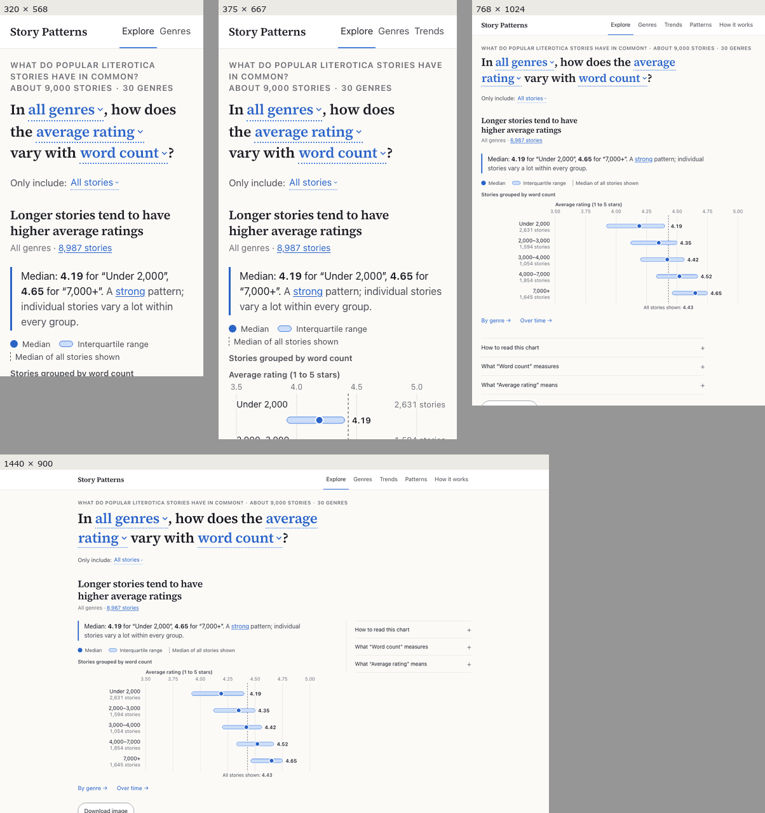
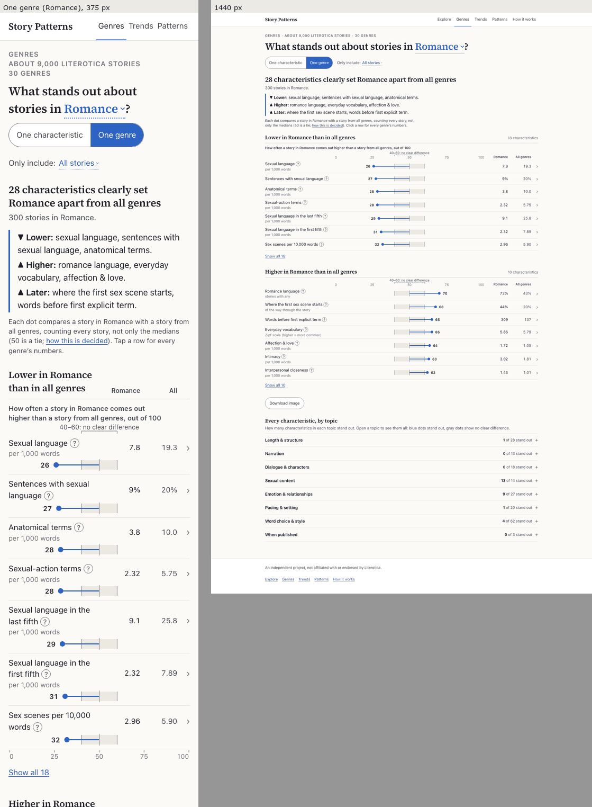
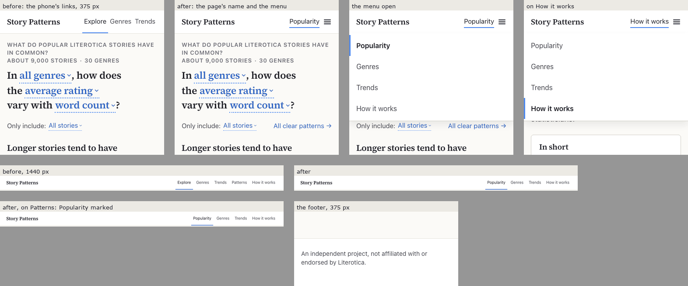
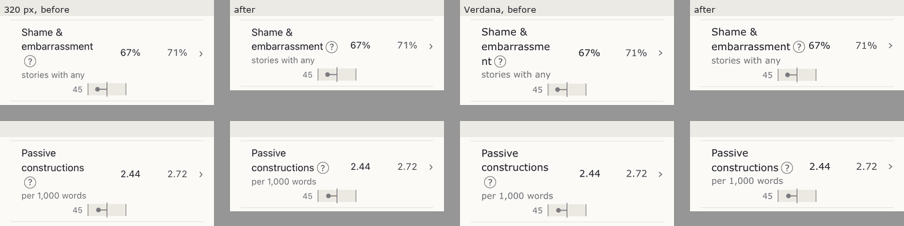

# Stage 2 design review, round 4: the whole site

*Reviewed on October 12, 2026: `main` at `3b04164` (the newest commit, pushed). Branch `design-review-4` was created
from it; nothing is committed. Earlier rounds: [round 1](DESIGN_REVIEW.md), [rounds 2 and 3](DESIGN_REVIEW_2.md),
[the Genres page](GENRES_PAGE_REVIEW.md), [One genre](ONE_GENRE_REVIEW.md), [Trends](TRENDS_REVIEW.md).*

This round looks at the five pages together, against three goals: easy to understand, user friendly, and
aesthetically pleasing. It reports what 114 stand-ins read off screenshots (48 on today's site, 66 on mock-ups),
what nine tasks cost on a phone and a desktop, and what a set of whole-site measurements found. Screenshots are in
[`design-review-4/`](design-review-4/) (`b…` today, `m…` mock-ups). The stand-ins' answers, the questions and the
answers fixed in advance are in `Claude outputs/design-review-4/fresh-eyes/`; the mock-ups and every measuring script
are in `Claude outputs/design-review-4-mockups/` and `Claude outputs/design-review-4/tools/`.

**Where the numbers come from.** Everything was measured in a Linux container: the site built from `3b04164`
(`npm run build`; the same bundle names as on `main`, `index-CBtIU3K7.js`) and served with gzip by round 2's
`serve.mjs`; Playwright 1.56 with Chromium 1194 (headless), axe-core 4.10.3; the sans text in Inter (the container's
`system-ui`) instead of San Francisco, and DejaVu Sans as the wide font instead of Verdana. So byte counts and
layout-shift numbers compare directly with earlier rounds; glyph widths and timings compare within a few percent.
**No real phone, Safari, VoiceOver, TalkBack or NVDA could be used here** (section 4).

**What the stand-ins are.** Subagents shown only screenshots (the screens a visitor scrolls through, captured at
375 × 667 and 1440 × 900 at 2× pixels), a one-line situation and the questions. Models read static images differently
from people and can't tap or scroll. Their answers show where the site is ambiguous; they don't prove it is clear.

---

## 1. Verdict

The site reads as one calm, editorial site, and its answers are found: on today's site, all 48 stand-ins got their
page's main answer right, and **every one of them rated the look 4 of 5** ("clean", "calm", "bookish",
"editorial"). The question sentence works as a control everywhere: asked what they would tap to change the genre or
measure, 6 of 6 named the blue words on every page that has them. It is fast (149.9 KiB first load), stable (worst
layout shift 0.021) and clean for machines (axe: no violations in 100 runs across 25 states at 375, 1440, 200% and
400%).

What still fails people is **reading the numbers**, not finding them. The stand-ins found the right number and
then didn't know what kind of number it was: the interquartile range (30 of 30 where it is on screen), the rating's
scale (11 of 12), the two kinds of number in a comparison row, and why a genre is marked when a bigger-looking one
isn't (6 of 6, and again 12 of 12 with two attempted fixes). The two comparison views, One genre and Trends' All
changes, are the hardest pages on the site (ease 3.2 and 3.0 of 5, where every other page scores 3.5–4.0). And one
generated sentence is plain broken: **1,146 chart titles read "… tend to are added to more reading lists"** (F97).

### Grades

Letter grades for each goal, page by page, with the earlier rounds' grades where an earlier round graded the same
thing. The earlier rounds graded areas, not goals, so they are matched by meaning.

| Page | Easy to understand | User friendly | Aesthetically pleasing | Earlier grades |
|---|---|---|---|---|
| Explore | B | B+ | B+ | Round 2: first impression B+, the chart A− (phone and desktop), words B, visual design B+ |
| Patterns | B+ | B | B− | Round 2: "Patterns is a wall of blue sentences" (in visual design, B+) |
| Genres, one characteristic | B | A− | A− | Genres review: purpose A−, the answer B−, visual design A−, accessibility B+ |
| Genres, One genre | C+ | B | B | One genre review: user-friendliness B−, aesthetic appeal C+ |
| Trends, All changes | C+ | B− | B | none |
| Trends, one characteristic | B | B+ | B+ | none |
| How it works | B+ | B (phone C+) | B+ | none |
| **The site** | **B** | **B+** | **B+** | Round 2 overall: no single grade (areas B to A−) |

The reasons, in a line each:
- **Explore.** Every answer read right, but 0 of 6 knew what the pale bar is and 6 of 6 weren't sure the rating is out
  of 5; the label "4.19" sits on the dashed line (12 of 12 noticed). The L1 mock-up fixes all three (section 8).
- **Patterns.** Every answer right and ease 4.0; its header is built differently from every other page (6 of 6 in
  the side-by-side test), and "clear", "weak", "moderate" and "strong" aren't defined on the page (6 of 6).
- **Genres.** The best page: ease 4.0, every answer right; the one puzzle (why Mind Control isn't marked) is real.
- **One genre.** Every answer right, but ease 3.2, the note talks about gray dots no one can see (6 of 6), and
  "5.86 vs 5.79" standing out puzzles everyone (6 of 6).
- **Trends, All changes.** Ease 3.0 (the lowest), and only 3 of 6 knew that a row opens its chart; "Median story or
  share" puzzles 4 of 6; the row they need for story length is called "Word count".
- **Trends, one characteristic.** Every answer right, ease 3.7; the key's marks look like form controls (3 of 3 on
  phones), and "Length options don't apply to word count" reads as a developer's note (6 of 6).
- **How it works.** Clear and well organized; on a phone it is reachable only from the footer, its bar says
  "Contents" twice, and returning to Explore by the footer is 9,870 px of scrolling.

### The three biggest problems

1. **The comparison rows carry two kinds of number and explain them late** (One genre and Trends' All changes). The
   dot's "26 out of 100" is explained after the first list on One genre and in a different wording from Trends';
   nothing says a Trends row opens its chart over time (3 of 6 found it). The W1 mock-up, which only moves and
   words the notes, raised Trends' "what would you tap" from 3 of 6 to 6 of 6 and its ease from 3.0 to 3.8
   (F100, concept W).
2. **One idea has two names, and some sentences don't read.** "Story length in words" in every question is "Word
   count" in the question bar, the notes, Trends' list, Trends' axis, the PNG and the glossary (F98); "In All genres"
   on Explore and Patterns is "across all genres" on Trends; and the reading-list titles are ungrammatical on 1,146
   charts (F97).
3. **"Where am I, and what is this?"** On a phone the masthead hides the page you are on (Explore) and How it works.
   Only the Explore page says the stories are Literotica's; on Patterns, One genre and Trends' two views 17 of 24
   stand-ins noted that only the footer says so. The Genres kicker repeats the question under it (6 of 6). Naming the page and the source in
   every kicker settled the first in the mock-up (0 of 12 asked) and nearly the second (1 of 6 noticed a doubled
   "genres", which is easy to drop; F102, concept U).

### What works, and should be left alone

- **The question sentence and its blue words.** "What would you tap" was answered right by 6 of 6 on Explore (genre,
  measure), Patterns, Genres ("By median") and Trends' one characteristic. Keep it exactly as it is.
- **The takeaway box under each heading.** Question 1 ("what is the answer") was answered right by 6 of 6 on all
  eight views.
- **The Genres page**, its A–Z order, the ▲▼≠ column and "By median" on request (ease 4.0; nobody misread it).
- **The look.** All 108 stand-ins who rated a single page rated it 4 of 5 (in the One genre review every stand-in said
  3). Restrained,
  one accent, one serif weight. Concept X tidies its tokens; it doesn't need a new look.
- **Performance and stability**: the first load, the per-page visits, layout shift and "no Loading flash" all hold
  their claims (section 4). On slow 4G with a 4× slower CPU the first chart is drawn at 1.9 s and a genre change takes
  0.09 s.
- **Accessibility as machines see it**: 100 axe runs clean, including 200% and 400% zoom; every chart row has a
  complete name; Back restores an open topic and its scroll.
- **Honesty.** No stand-in read a pattern as a cause from the page's words; three asked whether "tends higher"
  means "causes", which is the reader thinking, not the page claiming. Nothing here argues for a reminder, and
  none is proposed.

---

## 2. Fresh eyes

**Method.** Eight views, each shown to six stand-ins (three phone, three desktop): the first screen; Explore's chart;
Patterns; Genres (one characteristic); One genre (Romance); Trends' All changes; Trends' word count; How it works.
The questions and their right answers were written before any screenshot was taken
(`fresh-eyes/questions/views.md`); every view ends with the same four (ease 1–5, look 1–5 in three words, what
confused you, what looks cluttered or unfinished). The same questions were then asked about ten mock-up × view pairs
(60 stand-ins) and a side-by-side test of concept X (6). Scoring: 1 right, ½ right with "I assume" or partly right,
0 wrong or "I don't know".

### Today's site (48 stand-ins)

| View | Q1 (the answer) | Q2 | Q3 | Q4 (what to tap) | Ease (mean; phone · desktop) |
|---|---|---|---|---|---|
| V1 First screen | 6/6 what the site does | 5.8/6 which page for change over time, genres, popularity ("Explore or Patterns?") | 6/6 the question and its blue words | 6/6 "All genres" | 3.5 (4,3,3 · 3,4,4) |
| V2 Explore's chart | 6/6 | 6/6 "4.42" is the group's median rating; **6/6 unsure it is out of 5** | 5/6 the marks; **0/6 know the bar** | 6/6 "average rating" | 3.8 |
| V3 Patterns | 6/6 | 6/6 "19 of 27 clear" | 6/6 ↗ | 6/6 "average rating" | 4.0 |
| V4 Genres | 6/6 | 6/6 "1,500" and ▼ | 6/6 Group Sex not marked | 6/6 "By median" | 4.0 |
| V5 One genre | 6/6 | 6/6 "26, 7.8, 19.3" (0/6 named the medians with confidence) | 6/6 "0 of 18" | 6/6 the row (from "Tap a row …") | 3.2 |
| V6 Trends, All changes | 6/6 | 6/6 the two windows (4/6 ask where 2010–2019 went) | 6/6 "51.6 → 38.8 (−25%)" and "34" | **3/6**: all six guess | **3.0** |
| V7 Trends, word count | 6/6 | 6/6 "3,260" and "1,522" | 6/6 gray = not compared (5/6 ask why) | 6/6 "all genres" | 3.7 |
| V8 How it works | 6/6 | 6/6 300 a genre, October 1–8 | 6/6 one snapshot | 4.5/6 "Changes over time" (phones 1.5/3) | 4.0 |

Look: 48 of 48 said 4 of 5. Their three words: clean 48, calm 46, bookish 25, editorial 11, magazine-like 4,
newspaper-like 4, tidy 3, muted 2, orderly 1.

**What tripped them, counted** (the full list is in `fresh-eyes/base/scores.md`):

| Stumble | Count |
|---|---|
| "Interquartile range" not known | 30 of 30 where it is on screen (V1, V2, V4, V7, V8) |
| "Median" of an "average rating": two averages? | 18 of 18 (V1–V3) |
| The rating's scale (out of 5?) not stated | 11 of 12 (V1, V2) |
| The label "4.19" sits on the dashed line | 12 of 12 (V1, V2) |
| The view switch unclear ("One characteristic · One genre", "All changes · One characteristic") | 18 of 18 (V4, V5, V7) |
| What the stories are (Literotica) is only in the footer | 17 of 24 on Patterns, One genre and Trends' two views (1 of 6 on Genres' one characteristic); on How it works, 4 of 6 said its first screen doesn't say |
| On desktops, the question's last word alone on a line ("words ⌄?", "Romance ⌄?") | 11 of 24 desktop |
| On desktops, the right third empty, the layout lopsided | 14 of 15 desktop (V1–V4, V8) |
| "Download PNG" techy, orphaned or out of place | 18 of 36 |
| One genre: the note speaks of gray dots; none are on screen | 6 of 6 |
| Genres: Mind Control (4,640) unmarked while Anal (2,580) gets ▼ | 6 of 6 |
| One genre: "Everyday vocabulary 5.86 vs 5.79" stands out; "Zipf scale" | 6 of 6 |
| Trends: "Median story or share" over "Average paragraph length" | 4 of 6 |
| Trends: what "Touch words", "Build-up of sexual language", "Pages on site" measure | 6 of 6 |
| Trends' key: its marks look like a radio button and an empty checkbox | 3 of 3 phones |
| Trends: "Length options don't apply to word count" reads as a developer's note | 6 of 6 |
| How it works on a phone: "How it works › Contents" with "Contents" again beside it | 3 of 3 phones |

**In their words:**
- Explore: "Nothing visible says 'out of 5' or 'stars'." "Pale blue bar: the legend calls it 'Interquartile range'. I
  don't know what that means. I'd guess it shows where most stories in the group fall, but that is a guess."
- Genres: "Why are some genres marked and others not? Mind Control (4,640), Sci-Fi & Fantasy (4,420), Romance
  (4,390) and Group Sex (4,240) are all well above [3,610] …"
- One genre: "The note mentions 'gray dots, in the topics below', but no gray dots are visible because the topics are
  closed."
- Trends' All changes, asked how to see paragraph length period by period: "I don't know. Nothing on the page says
  'over time' or 'by period'. The two things that might do it are the small '›' arrow … and the 'One characteristic'
  button." (All six hedged between the row's › and the switch; none was sure.)
- Trends' word count: "The legend icons (filled blue circle, gray pill) look like radio buttons or toggles, so I
  wasn't sure if I was supposed to tap them."

### The mock-ups (66 stand-ins)

The mock-ups and their scores are in section 8; the counts are in `fresh-eyes/mock/scores.md` and
`fresh-eyes/x/scores.md`. In short:

| Mock-up | View | What changed in the answers | Ease, today → mock-up |
|---|---|---|---|
| L1 (Explore says what its numbers are) | V2 | the bar 0/6 → **6/6**; unsure of the scale 6/6 → **0/6**; the label on the line 12/12 → 1/6 | 3.8 → 4.0 |
| L2 (L1, and "star rating") | V2 | as L1; "two averages?" unchanged (6/6) | 3.8 → 4.0 |
| U1 (where am I) | V1, V4, V7 | phones name the page they are on 3/3 (today: none shown); Literotica asked about 0/12 (V4, V7); the developer's note 6/6 → **0/6** | V1 3.5 → 3.8; V7 3.7 → 4.0 |
| U2 (U1, relabeled switch, the rule spelled out) | V4, V7 | the switch still unclear 12/12; the rule sentence "hard to follow" 6/6 | V4 4.0 → **3.5** |
| W1 (one grammar for the comparisons) | V5, V6 | gray dots 6/6 → **0/6**; Trends "what to tap" 3/6 → **6/6**; "Later" misread 6/6 → 2/6 | V6 3.0 → **3.8**; V5 3.2 → 3.0 |
| W2 (W1, values first on One genre) | V5 | 6/6 call 7.8 and 19.3 medians (today 0/6 with confidence) | 3.2 → 3.2 |
| X1 + X2 (one visual system) | six first screens side by side | more like one site: 6/6; more polished: 5/6; look 3.0 → 4.0 on desktops | — |

Ease scores move by up to 0.3 between two runs of identical screens (V1's desktop screens are the same in U1 and
today: 3.7 then 4.0), so only the moves of half a point, and the stumbles that disappear, count.

---

## 3. The tasks, walked

Each task was done on a phone (375 × 667) and a desktop (1440 × 900) by a script that counts actions (a tap or click
is 1, a native select 2, typing a word 1) and scrolling, with a screenshot after every step (`tools/walk.mjs`,
[b15](design-review-4/b15-tasks.png)). The confusions are the stand-ins' and mine, marked as such.

| Task | Phone | Desktop | What happened |
|---|---|---|---|
| 1. First visit, two minutes | Genres, Trends, Patterns: 1 tap each. How it works: the footer only (616 px down from Patterns); back to Explore from How it works by the footer: 9,870 px | 1 click each | Within five seconds the kicker and question say what the site is (V1 Q1 6/6). On a phone the masthead shows no "Explore", so nothing says which page this is (3/3); "Explore" and "Patterns" sound alike (4/6 hedged) |
| 2a. What sets Romance apart? | Genres, One genre: 2 actions walked (it opens on Erotic Couplings); Romance from the genre select makes 4 (2 if Romance was chosen on Explore) | the same | A fresh visit's One genre opens on Erotic Couplings, so the genre select is needed. The answer is right there (V5 Q1 6/6) |
| 2b. Present tense and ratings in Romance | 5 actions (genre 2, the picker 1, "present" 1, the result 1); round 2 counted 4 with the Popular chip | 5 | The honest answer: "Too few stories to judge a pattern" (28 present-tense Romance stories), with both groups still drawn and counted |
| 2c. Has Romance changed? | Trends 1, then Romance 2: 3 actions | 3 | Trends opens on all genres even after Romance was chosen elsewhere (D9, by decision) |
| 3. Do genres differ in length? More dialogue? | Genres 1 (story length is the default); dialogue: picker 1, "dialogue" 1, the result 1: 4 actions | 4 | A–Z by default, ▲ "More dialogue: Novels and Novellas", ▼ five genres; nothing ranks the genres |
| 4. Did stories get longer? Within a genre? | Trends 1 (the takeaway says so); the row: 1,261 px down (1.9 screens), named "Word count"; Romance 2: 4 actions | 4 (755 px of scrolling) | The answer is on the first screen. The row needed for "story length" is called "Word count" (F98), and only 3 of 6 stand-ins knew a row opens its chart (F100) |
| 5. A sceptic | "Why no clear pattern?" (Explore), "how this is decided" (Genres, Trends' one characteristic): 1 action each to the right section of How it works | the same | Trends' All changes has no link to its rule (by decision, the note has none); the rule is two taps away through How it works. Sample sizes are on every chart |
| 6. Keyboard and screen reader | 9–12 tab stops from the top to the first answer (How it works: its section bar comes first) | 11–14 (How it works: 8) | The focus ring is visible on every kind of control ([b16](design-review-4/b16-error-focus.png)). Each page has one h1 and its answer as an h2; every chart row is named in full ("Under 2,000: median 4.19, interquartile range …"; Trends' rows say "63 in 100; 2000–2009 2,810, 2020 or later 4,100 words (+46%); clearly rose. Opens its chart") |
| 7. Fifteen minutes, all pages | — | — | Back after a row restores the open topic and the scroll (One genre: 2,070 px). Back after a view switch returns to the top, not to where the reader was (Genres: 400 → 0). Controls replace the address, so after a few changes on Explore, Back leaves Explore (as designed; it keeps the history short) |
| 8. Sharing a finding | Every address opens the same view (3 of 3 tried) | — | The PNG holds the title, key, chart and credit but not where the data come from: a friend can't tell these are Literotica stories (F111, [b11](design-review-4/b11-pngs.png)) |
| 9. A slow phone | See below | — | Fast enough everywhere; topics with many rows are the slowest thing on the site |

**Task 9 in numbers** (375 px, `tools/slowphone.mjs`; times from the action to the next frame with the new content):

| | Fast 4G | Slow 4G, 4× CPU | 3G, 4× CPU | Round 2 (slow 4G) |
|---|---|---|---|---|
| First chart drawn | 0.51 s (LCP 0.32 s) | **1.89 s** (LCP 1.21 s) | 4.92 s (LCP 3.31 s) | 2.00 s |
| Page switch: Genres (chunk and 51.7 KiB file) | 0.41 s | 0.85 s | 2.22 s | — |
| Page switch: Trends | 0.41 s | 0.65 s | 1.29 s | — |
| The picker opens | 0.07 s | 0.18 s | 0.21 s | — |
| Search "tense": matches shown | 0.43 s after the first key (5 keys at 60 ms) | 0.90 s | 0.96 s | — |
| A result picked, the new chart drawn | 0.06 s | 0.15 s | 0.45 s | — |
| A genre change on Explore | 0.02 s | 0.09 s | 0.07 s | — |
| A topic opens (One genre, Trends; 4× CPU) | — | 67–119 ms; **Word choice & style (62 rows): 203–233 ms** | — | One genre review: 66–79 ms |

No "Loading…" flash on any switch, and no layout shift above 0.021 (section 4).

---

## 4. The latest claims, checked

| Claim (source) | Measured here | Verdict |
|---|---|---|
| First load 150.0 KiB of gzip bodies in 6 requests (Trends review) | **149.9 KiB in 6** (index 0.6, CSS 6.4, font 21.0, JS 84.8, meta 19.7, the first chart 17.4); 4.9 KiB fetched while idle | confirmed |
| A visit starting on One genre: 208.9 KiB | 208.9 KiB in 9 requests | confirmed |
| … on Trends: 175.2 KiB | 175.3 KiB in 9 | confirmed |
| … on How it works: 141.3 KiB | 141.4 KiB in 7 | confirmed |
| Layout shift 0.000 on a Trends visit, worst 0.021 | 0.000 on every visit and switch; worst 0.021 (1440, word count, Romance), 20 runs | confirmed |
| No "Loading…" flash | 0 frames in all 20 runs | confirmed |
| axe: no violations in 63 runs | the Trends review's script (`axetrends2.mjs`), 42 runs here: none; **100 new runs** (25 states of every page, 375 · 1440 · 200% · 400%): none | confirmed, and wider |
| Label in name: no failures | 12 runs, none | confirmed |
| Glyph overlaps, site font: none | Trends' View 1: 21,510 charts, 0; View 2: 620 pages, 49,650 rows, 0; Explore: 11,220 charts, 0 | confirmed |
| Glyph overlaps, wide font: 13 Trends charts at 320 px in Verdana | **7 problems in 5 charts at 320 px in DejaVu Sans** (6 "pace of dialogue shift" labels on each other in 4 charts; one "−0.067" past a chart's edge); View 2: 0 | different (another wide font; the same kind of overlap, still only at 320 px) |
| Explore's labels in a wide font: only "All stories shown: …" starting 1–3 px left of the chart | 504 charts, all of that kind (a group label or "All stories shown" at x = −1) | confirmed |
| Line breaks: no "·" at a line's start or end, no value broken (Trends) | 980 states, 1,400 "·", 69,510 values: 0 problems, both fonts | confirmed |
| Forced colors: system colors on the charts | six pages legible, every mark drawn ([b12](design-review-4/b12-forced.png)) | confirmed |
| The fold at 1280 × 720: the plot 230 px, the table above 720 | plot 230 px, table bottom at 700 px | confirmed |
| Tests 509 (Vitest), 218 (pytest); the build passes | 509 in 36 files; 218; built in 1.4 s | confirmed |
| **Still open:** no real phone, Safari, VoiceOver, TalkBack or NVDA | Not possible in a Linux container. Chrome's own accessibility tree was read instead (`tools/axname.mjs`, `axname.txt`, `outline.txt`): one h1 per page, the answer an h2, every chart row named in full. Needed from you: an iPhone with Safari's "Remote Automation" on, or screenshots | still open |
| Build-up percents: 15 of 4,015 rows reach 1,000% or more, up to +149,028% | 15 rows of 9,837 checked (every genre and option, topics open), up to "0.0034 → 5.1 (+149,028%)" | confirmed |
| 5 of 6 didn't know "interquartile range"; why Trends compares only the ends is explained only in How it works | 30 of 30 didn't know it; 4 of 6 (V6) and 5 of 6 (V7) asked why only the ends | confirmed (worse) |
| "Blurb", the nine definitions and the one-sentence Trends note haven't met fresh eyes | The note: 6 of 6 read "34" right, but only 3 of 6 knew a row opens its chart. "Blurb length" unexplained to 4 of 6; the definitions (V7's "Number of words in the story text …") read right by 6 of 6 | now tested: the note works for the dot, not for the rows |
| One genre: "23% vs 17%" against "5.86 vs 5.79", "medians", "Zipf scale", uneven decimals | 6 of 6 on "5.86 vs 5.79" and "Zipf"; 6 of 6 on the decimals; 0 of 6 named the medians with confidence | confirmed |
| "Is the higher one" (One genre) where Trends says "comes out higher" | both still on screen; the census found no third wording | confirmed |
| Verdana-only overlaps in 13 Trends charts at 320 px | see above: 7 in DejaVu Sans | different |
| One-word last lines, and a "?" alone on its line | the question's last word alone on desktops: 30 of 54 desktop stand-ins mention it (today and mock-ups) | confirmed |
| The middle periods' hatching #d9d4ca, 1.41:1 | unchanged, 1.41:1 | confirmed |
| The named groups' palette; a group's color changing with the genre | The colors are fixed per group: First person is blue and Second person orange in Romance and in How To. The swatch beside the name is the group the row reports. The light fills are 1.1–2.6:1 against the page (white seams and printed shares carry them) | the color change: **wrong**; the palette's contrast: confirmed |
| A 2.4:1 outline among the Genres page's leftovers | #a5a29a, 2.44:1, unchanged | confirmed |
| Named-group rows show no verdict | still none on One genre and Trends' lists | confirmed |
| The view switches open the other view at the top | yes; and Back from it returns to the top too | confirmed |
| 0.04–0.08 layout shift after scripted changes; the keyboard-opened popover | On Trends, every change ≤ 0.021. Explore's scripted changes were not re-measured | partly re-measured |
| At 320 × 568 Explore's first chart row ends at 698 px | 698 px | confirmed |
| The question's words are 34–35 px tap targets | 33–35 px tall on phones; every word owns its own box | confirmed (33 px is new: "average rating") |
| A topic takes 66–79 ms to open at 4× CPU | 67–119 ms, and 203–233 ms for Word choice & style (62 rows) | different (slower in the container; the big topic is over 200 ms) |
| For you to decide: a grouping line for yes/no charts, dark mode, median age still in the data | Median age is still in every `v/` file's groups (e.g. 12.2 years for "Under 2,000") and never shown | still open (O17, O18) |

---

## 5. The whole site, measured

### Visual system inventory

From computed styles on 32 states (16 views × 375 and 1440, `tools/inventory.mjs`; `measurements/inventory.txt`):

| | Count | Near-duplicates |
|---|---|---|
| Font sizes in the page | **22**: 12, 12.5, 13, 13.5, 14, 14.5, 15, 15.5, 16, 17, 18, 19, 20, 21, 23, 25, 26, 28, 32, 37, 38, 44 | the half sizes beside each whole size (12.5/13, 13.5/14, 14.5/15, 15.5/16); 19/20/21; 25/26; 37/38 |
| Font sizes in charts | 5: 11.5, 12, 12.5, 13, 14 | 11.5 is only the "40–60: no clear difference" and "40–60: no clear change" labels (the site's smallest text, at every width) |
| Text styles (family, size, weight, line height) | **66** site-wide; 16 (Patterns) to 32 (One genre) per page | weights 400, 600, 650 and 700 in sans |
| Size and line-height pairs | 45 | 12.5 px alone has four line heights |
| Page headings (serif 600) | Explore and Genres 23–37 px; Patterns 28–38 px with a 21–28 px question under it; How it works 32–44 px | three heading scales for one role |
| Text colors | 4 inks (#1c1c22, #45454f, #6b6b75, accent #2b63c6), white on blue, warm #a9531d (Patterns' ↘), and the age box's #5b3a1e and #7a3f12 | none |
| Grays for marks and borders | #8f8a80 (controls), #857f75 (gray dots), #a5a29a, #d2cec5, #e7e4dd | #857f75 and #8f8a80 (3.8:1 and 3.3:1) do the same job |
| Radii | 999 px (pills), 6 px (boxes, inputs), 5 px (the key's capsule), 2 px (swatches) | 5 and 6 |
| Shadows | none | — |
| The median's dot | r 7 (Explore), r 6 (Genres, Trends), r 5 (One genre, All changes), r 3.5 (gray) | three sizes for one mark |
| The interquartile bar | 12 px (Explore), 10 px (Genres), 8 px (Genres' "with any") | three heights |
| Vertical gaps between blocks | 22 values, 4–540 px | most at 10 px (How it works) and 16 px |

The look is coherent to the eye (every stand-in who rated one page said 4 of 5, in the same words) but not in its tokens: each page was
built with its own sizes. That costs nothing a visitor names, and it makes every future page harder to get right.
Concept X proposes one scale.

### Words: the census

Every string a visitor can read in those 32 states, 1,195 distinct blocks (`tools/census.mjs`;
`measurements/census.txt`):

- **One idea, two names.**
  - "story length in words" (every question, the picker, Genres, Trends' one characteristic) and "Word count" (the
    question bar, "What 'Word count' measures", Trends' All changes row, Trends' axis title, the PNG, the glossary).
  - "story age" (sentences) and "Years online" (lists).
  - "In All genres" (Explore, Patterns) and "across all genres" (Trends).
  - The dot's score: "is the higher one" (One genre) and "comes out higher than" (Trends).
  - "n = 2,631" (Explore on phones) and "2,631 stories" (everywhere else).
  - "stand out" (One genre), "set apart" (its heading), "clearly differ" (Genres) and "clearly changed" (Trends):
    three verbs for one rule family. Each follows its own rule and reads naturally; leave them.
- **One name, two things.** None found.
- **Jargon a newcomer meets**, with the stand-ins' counts: interquartile range (30/30), median of an average (18/18),
  "in 100" (12/12 needed the note), Zipf scale (6/6), "Median story or share" (4/6), "with any", and row
  names without a definition on screen (Touch words, Build-up of sexual language, Pages on site: 6/6).
- **Arrows.** "→" on links that leave the page or change the view; "›" on rows that open a chart. Consistent.

### Real tap areas on phones

1,295 controls sampled with `elementFromPoint` every 2 px on 15 states at 320 and 375 px (`tools/taps.mjs`):

- **Under the site's 44 px bar**: the question's words, 33–35 px tall on every page (known); Patterns' two selects,
  32 px; **Patterns' characteristic rows, 36 px** (19 rows open at once). All pass WCAG 2.5.8 (24 px). (Genres'
  "A–Z / By median" is drawn 36 px tall but answers taps over 44 px.)
- **Overlaps**: no control steals a large share of another's box. At the edges a neighbor answers in 3–11% of a box
  (Trends' rows, the two halves of a switch, the question's measure slot next to the characteristic), and a
  characteristic that wraps onto two lines keeps 38–51% of its bounding box (the rest is the other words on those
  lines). The brand and "Skip to content" share a box only while the skip link is focused.

### Wayfinding

Every page reaches every other through the masthead on a desktop. On a phone the masthead drops How it works below
602 px and Explore below 414 px, so How it works is reached only through the footer or a link in the text, and
Explore through the site's name. The cross-links, page by page:

| From | To | Called |
|---|---|---|
| Explore | Patterns, Genres, Trends | "Every clear pattern with the average rating across all genres →", "How do genres differ in story length in words? →", "How has story length in words changed over time? →" (Keep exploring) |
| Explore | How it works | "8,987 stories", "strong", "Why no clear pattern?" |
| Genres (one characteristic) | Explore | "Open in Explore →" |
| One genre | Genres (one characteristic) | each row (›) |
| Trends, All changes | Trends, one characteristic | each row (›) |
| Trends, one characteristic | Trends, All changes; Genres | "See all changes →", "Compare genres →" |
| Patterns | Explore | each characteristic's name |
| Genres, Trends | How it works | "how this is decided" |

Three styles of link name: a question ("How has … changed over time? →"), an instruction ("Open in Explore →",
"Compare genres →") and a bare row. All work; idea I15 makes them one pattern.

### A screen reader, approximated

The Chrome accessibility tree (`tools/axname.mjs`, `tools/outline.mjs`): each page has one h1, the answer as the h2,
landmarks for the header, main, the page's section and the footer, and complete names on every chart row and list
row. Two inconsistencies: on Explore and Genres the h1 is the kicker (on Explore that is the site's headline, by
decision; on Genres it is "How do the genres' stories differ? · about 9,000 stories · 30 genres"), while on Trends
the h1 is the question, by decision; and Chrome passes the kickers' CSS uppercase to the tree as uppercase text
("WHAT DO POPULAR …", `axname.txt`; Playwright's own snapshot shows them in mixed case).

---

## 6. Findings

Ordered by the bar for this round: misreading first, then friction, then consistency, then polish. "(Needs your
approval)" marks a change of wording or meaning; "(revisits a decision)" names the decision it challenges.

### F97. 1,146 chart titles are ungrammatical: "tend to are added to more reading lists"

- **Evidence.** `#/explore?metric=pop_reading_lists_per_1k_views&var=story_words` at any width:
  "Longer stories tend to are added to more reading lists per 1,000 views"
  ([b13](design-review-4/b13-reading-lists.png)). The title is built as "{subject} tend to {metric.more}", and the
  reading-list measure's `more` and `less` in `litcorr/stage2/wording.py` (lines 30–31) start with "are". It reads
  wrong on every chart with a clear reading-list pattern: 64 charts with All genres chosen, and 1,146 counting each
  genre's charts as well, with all stories included (`patterns.json`; `measurements/readinglists.txt`); the "Only
  include" options add more.
- **Why it matters.** It is the chart's answer, set in the largest type on the page; it makes the site look broken.
  Goal: easy to understand.
- **Fix.** `"more": "get added to more reading lists per 1,000 views"`, `"less": "get added to fewer reading lists
  per 1,000 views"`, then `python -m litcorr site-data`. Add a test that every measure's `more` and `less` follow
  "tend to" as a base verb (no "are", "is", "has"). (Needs your approval: `wording.py` and a data rebuild.)
- **Impact** high. **Effort** small.

### F98. One idea, two names: "story length in words" is also "Word count"

- **Evidence.** The question says "story length in words"; the phone's question bar, "What 'Word count' measures",
  Trends' row and axis title, the PNG and the glossary say "Word count" ([b14](design-review-4/b14-names.png)). All
  three phone stand-ins on Explore asked whether the two are the same. In task 4 the row a reader looks for, story
  length, is the sixth row of Trends' "Rose" list, called "Word count". "Years online" and "story age" are the same
  split. Separately, "In All genres, how does …" (Explore, Patterns: a capital mid-sentence) against "across all
  genres" (Trends) was noticed by 4 of 6 in the side-by-side test.
- **Why it matters.** "One idea has one name everywhere" is the first goal's test. Goal: easy to understand.
- **Fix.** Label the characteristic "Story length in words" and "Story age (years online)" in `wording.py` (the
  `label` fields; the nouns stay); the question bar becomes "Story length in words · Average rating · All genres"
  (keep it short on phones: the L1 mock-up showed that a longer bar is cut off, 3 of 3). Show the genre option as
  "all genres" inside Explore's and Patterns' sentences, as Trends does. (Needs your approval: labels.)
- **Impact** high. **Effort** small.

### F99. Explore doesn't say what its marks and scale are

- **Evidence.** V2: 0 of 6 knew what the pale bar is; 6 of 6 weren't sure the rating is out of 5; 12 of 12 (V1, V2)
  saw "4.19" sitting on the dashed line; on phones "n = 2,631" puzzled 3 of 3. With L1 (the key glosses the marks,
  the axis gives its scale, the label clears the line, "2,631 stories"): the bar 6 of 6, the scale 0 of 6 unsure,
  the label 1 of 6, ease 3.8 → 4.0 ([m01](design-review-4/m01-L-explore.png)).
- **Why it matters.** The interquartile range is the chart's "sense of the spread" the brief asks for; unread, the
  chart shows only medians. Goal: easy to understand.
- **Fix.** Concept L1 (section 8). (Revisits a decision: P3:99–102, "median" and "interquartile range" used without
  explanation; the term stays, as O1 decided, and gains a five-word gloss. Also DR2:1150, the axis titled just
  "Average rating".) (Needs your approval.)
- **Impact** high. **Effort** small.

### F100. The comparison rows explain their dot late, in two dialects, and don't say what a row opens

- **Evidence.**
  - Trends' All changes, "what would you tap to see paragraph length period by period": 3 of 6 (all six hedged
    between the row's › and the switch; none was sure); ease 3.0, the site's lowest.
  - One genre: the note talks about gray dots while the topics are closed (6 of 6), and sits after the first list
    (5 of 6 met the dot before its explanation); "Higher: where the first sex scene starts" (6 of 6).
  - One genre's axis says "is the higher one"; Trends' says "comes out higher than".
  - With W1 (each note above the first list, in Trends' words, ending with what a tap does; "▲ Later"; the same
    decimals in a row): gray dots 0 of 6 (0 of 12 with W2), Trends' "what to tap" **6 of 6**, Trends' ease **3.8**, "Later" misread
    2 of 6 ([m03](design-review-4/m03-W-comparisons.png)).
- **Why it matters.** These two views carry most of the site's findings, and they are where readers work hardest.
  Goals: easy to understand, user friendly.
- **Fix.** Concept W1 (section 8). (Revisits a decision: Trends review 10.1, the note "exactly … with no link and no
  final period"; W1 adds a second sentence, "Tap a row for its chart over time.") (Needs your approval.)
- **Impact** high. **Effort** small.

### F101. Trends: why only the ends, and where 2010–2019 went

- **Evidence.** V6: 4 of 6 asked where 2010–2019 went (5 of 6 in the W1 run, three of whom noticed that 2,561 +
  3,346 is not "about 9,000"). V7: 5 of 6 asked why the middle periods aren't compared (12 of 12 in the U runs); 4 of 6 couldn't find "median 2,810" in either 2000s
  column. "Median story or share" over "Average paragraph length": 4 of 6 today, 6 of 6 in the W1 run.
- **Why it matters.** A reader who thinks a decade of stories was dropped starts to doubt the comparison. Goal: easy
  to understand.
- **Fix.** (Needs your approval: copy.)
  - Under All changes' heading: "2,561 stories from 2000–2009 and 3,346 from 2020 or later across all genres; the
    3,089 from 2010–2019 are shown on each characteristic's chart."
  - The brackets on the one-characteristic chart: "2000–2009 together · median 2,810".
  - The column head: "Median, or share of stories" in place of "Median story or share".
- **Impact** medium. **Effort** small.

### F102. Where am I, and what are these stories?

- **Evidence.** On a phone below 414 px the masthead hides "Explore", so the first page names no page (3 of 3).
  Only Explore's kicker names Literotica; on Patterns, One genre and Trends' two views 17 of 24 noted
  that only the footer says so. Genres' kicker
  repeats its question (6 of 6). U1 (phones keep the page being read in the masthead; each kicker names its page and
  the source) took those to 3 of 3 naming the page, 0 of 12 asking about the source, 1 of 6 (the doubled "genres")
  ([m02](design-review-4/m02-U-masthead-kicker.png)).
- **Why it matters.** Wayfinding, and the context that makes "less sexual language in Romance" make sense. Goals: easy
  to understand, user friendly.
- **Fix.** Concept U1 (section 8): on phones the masthead keeps the current page and drops the one after it; the
  kickers read "Genres · about 9,000 Literotica stories · 30 genres", "Trends · about 9,000 Literotica stories ·
  2000–2026", "Patterns · …" (Explore's headline stays). On Genres, make the question the h1 and the kicker a `p`, as
  on Trends. (Needs your approval: the kickers' words.)
- **Impact** high. **Effort** small.

### F103. Trends' word count: "Length options don't apply to word count"

- **Evidence.** V7, 6 of 6: it reads as a leftover developer's note, and "Only include" is the only one on the site
  that isn't a menu. U1 (a menu like every other, its Length options turned off inside it, as Explore does): 0 of 6
  (and 0 of 6 in U2).
- **Fix.** Render `IncludeSelect` with the Length options disabled and Explore's sentence under it ("Options that
  would leave only one group … are turned off"), instead of plain text.
- **Impact** medium. **Effort** small.

### F104. Trends' key looks like a form

- **Evidence.** V7: 3 of 3 phones took the blue dot for a radio button and the bracket for an empty checkbox; in the
  U1 and U2 runs 6 of 6 phones said so again and 6 of 6 desktops called the marks "tiny" and "misaligned"
  ([b08](design-review-4/b08-trend1.png)).
- **Fix.** Draw each key mark as the chart draws it: a 10 × 18 px capsule with its dot (blue, then gray, without the
  outline that makes it look like a pill button), and the bracket as a 16 px line with 4 px ticks, each aligned to
  the first line of its text (`align-items: start`, 2 px down).
- **Impact** medium. **Effort** small.

### F105. Why is a genre marked when a bigger-looking one isn't?

- **Evidence.** V4: 6 of 6 asked why Anal (2,580, about 1,000 below 3,610) gets ▼ and Mind Control (4,640, about
  1,000 above) doesn't. Two sentences in the key were tried: "comparing every story, not only the medians" (U1: 6 of
  6 still asked; 4 of 6 said the sentence went over their heads) and the rule in full, "against a story from all
  genres, the genre's story is the higher one at least 60 times in 100" (U2: 6 of 6 asked; 6 of 6 called the
  sentence hard; ease fell from 4.0 to 3.5). One genre's "Everyday vocabulary 5.86 vs 5.79" standing out is the same
  puzzle seen from the other side (6 of 6, three runs).
- **Why it matters.** The marks are the page's answer; a reader who can't see why one genre is marked suspects the
  marks. Goal: easy to understand.
- **Fix.** No sentence fixed it, so this goes to you as a question (O13): show each genre's "in 100" score, the
  number the mark comes from, in its details (one line: "A How To story is the longer one 21 times in 100"), or
  leave it. Untested.
- **Impact** medium. **Effort** medium.

### F106. One genre's units and words

- **Evidence.** Units are on their own line in most rows, in the name in "Sex scenes per 10,000 words", and missing
  in "Sentences with sexual language" and "Words before first explicit term" (5 of 6 today; 5 and 6 of 6 in the W
  runs). "Zipf scale (higher = more common)": 6 of 6 didn't know it. Decimals within a row differ ("10 vs 3.79",
  "5.9 vs 2.96"): 6 of 6.
- **Fix.** Every row gets a unit line ("words", "% of sentences", "per 10,000 words"); "Zipf scale (higher = more
  common)" becomes "word commonness, 1–7 (higher = more common)" (needs your approval); both values in a row take
  the same decimals (W1 does this).
- **Impact** medium. **Effort** small.

### F107. On desktops the question's last word is left alone on a line

- **Evidence.** "story length in / words ⌄?", "What stands out about stories in / Romance ⌄?": 11 of 24 desktop
  stand-ins today, 19 of 30 in the mock-up runs. The question is capped at 34 characters at 37 px. With X2 (balanced
  lines, up to 44 characters from 760 px): 3 of 3 desktops noticed and preferred it. On phones today's wrapping splits
  the blue phrase ("vary with story" / "length in words"); with balanced lines it stays whole, and the phone stand-ins
  named that as a difference in X's favor (2 of 3)
  ([m04](design-review-4/m04-X-desktop.png), [m05](design-review-4/m05-X-phone.png)).
- **Fix.** `.sentence { text-wrap: balance; }` at every width, and `@media (min-width: 760px) { .sentence { max-width:
  44ch; } }`.
- **Impact** medium. **Effort** small.

### F108. Patterns is built differently from every other page

- **Evidence.** It has no kicker, an h1 "Patterns" over a smaller question (21–28 px against 23–37 px elsewhere), and
  its count line isn't in the takeaway box. 6 of 6 in the side-by-side test named Patterns' header as the odd one
  out. "Explore" and "Patterns" sound alike: 4 of 6 hedged on V1, and 3 of 3 desktops again in the U1 run.
- **Fix.** X2: the kicker "Patterns · about 9,000 Literotica stories · 30 genres", the question at the page size as
  the h1, the count line in the takeaway's blue-ruled box. (O19 asks about the page's name.)
- **Impact** medium. **Effort** small.

### F109. How it works on a phone

- **Evidence.** The masthead drops How it works below 602 px, so on a phone it is reached from the footer (616 px
  down from Patterns), and back to Explore through the footer is 9,870 px. At the top of the page its bar reads "How
  it works › Contents" with "Contents" again as the button (3 of 3); 1.5 of 3 phones found "Changes over time".
- **Fix.** At the top, the bar shows "How it works" and a "Contents ▾" button; once a section is reached,
  "How it works › Where the stories come from". (The masthead keeps five pages and no menu, by decision.)
- **Impact** medium. **Effort** small.

### F110. Taps under 44 px on Patterns

- **Evidence.** Patterns' characteristic rows are 36 px tall and its two selects 32 px at 320 and 375 px; the
  question's words are 33–35 px on every page (known).
- **Fix.** `.pattern-row a { min-height: 44px }` (+8 px a row; a 19-row topic grows by 152 px); give Patterns'
  selects the enlarged transparent hit area the question's selects use elsewhere.
- **Impact** medium. **Effort** small.

### F111. A downloaded image doesn't say where its data come from

- **Evidence.** Task 8. Each PNG has the title, key, chart and "Chart by Nathan Nguyen, @NathanDNguyen", but not
  "Literotica" or the sample ([b11](design-review-4/b11-pngs.png)). A friend sees a chart about "stories".
- **Fix.** One gray line before the credit: "About 9,000 Literotica stories, collected October 2026 · Story Patterns".
  (Needs your approval: the image's content, SP:39.)
- **Impact** medium. **Effort** small.

### F112. One sideways scroll at 400% zoom

- **Evidence.** `#/trends?genre=chain-stories` at 320 CSS px (400%): 40 px of sideways scroll; the other 99 runs
  have none.
- **Fix.** Let the too-few state's period labels wrap (find the 40 px with the overflow script in `tools/`).
- **Impact** low. **Effort** small.

### F113. Big topics open slowly on a slow phone

- **Evidence.** At 4× CPU, Word choice & style (62 rows) takes 203–233 ms to open on One genre and Trends; the other
  topics 67–119 ms.
- **Fix.** `content-visibility: auto; contain-intrinsic-size: auto 58px` on rows inside open topics, or render the
  first 20 rows and the rest a frame later.
- **Impact** low. **Effort** medium.

### F114. The tokens: 22 font sizes, 66 text styles, three dot sizes

- **Evidence.** Section 5. Nobody named it; X1 + X2 were preferred side by side (6 of 6 "more like one site").
- **Fix.** Concept X1 (section 8).
- **Impact** low. **Effort** medium.

### F115. Back after a view switch lands at the top

- **Evidence.** Genres scrolled to 400 px, switched to One genre, then Back: the page is at 0 (`tools/backcheck.mjs`).
  Back from a row restores the scroll; Back from a switch doesn't.
- **Fix.** Store `scrollY` in the history entry the switch replaces, and restore it on `popstate`, as the rows do.
- **Impact** low. **Effort** small.

### F116. "Download PNG" reads as technical

- **Evidence.** 18 of 36 stand-ins today, and 3 to 6 of 6 in each mock-up run of V5–V7, called it techy, orphaned or
  out of place.
- **Fix.** "Download image" (the file stays a PNG). (Revisits a decision: the actions are named "Download PNG" in
  SP:115–116 and TRI:403–412; the places stay.)
- **Impact** low. **Effort** small.

### F117. "8,996 are used" of 9,000

- **Evidence.** V8, 6 of 6 asked why. The reasons are in "Missing data and excluded stories", far below.
- **Fix.** In "In short": "8,996 are used in the charts (3 may not be in English and 1 was too short)", from
  `meta.counts.excluded_reasons` (the 4 sampled stories with no text were replaced, so they don't count against the
  9,000). (Needs your approval: copy.)
- **Impact** low. **Effort** small.

### F118. Trends' summary names fewer changes than its list

- **Evidence.** "▼ Fell: average paragraph length, median paragraph length, very long paragraphs" names 3; the Fell
  list shows 5 (3 of 6 in the W1 run).
- **Fix.** End the line with "and 2 more" when the list is longer than the line.
- **Impact** low. **Effort** small.

---

## 7. Quick wins

Small, safe changes I would make straight away, none of which changes a chart's meaning:

1. F97, the reading-list verbs, with its test (once you approve the `wording.py` edit).
2. F103, Trends' "Only include" as a menu.
3. F104, Trends' key drawn as the chart's marks.
4. F107, balanced questions, up to 44 characters wide from 760 px.
5. F110, 44 px rows and selects on Patterns.
6. F112, the 400% overflow.
7. F109, How it works' phone bar.
8. From L1: "2,631 stories" on phones, and the value label clear of the dashed line (both form, not wording).
9. From W1: the same decimals in a row, units on their own line, the note above the first list, and "Later".
10. F118, "and 2 more".
11. From U1: the phone masthead keeps the page being read.

---

## 8. Concepts

Four concepts, each with its alternatives tried on fresh eyes. The mock-ups were injected into the frozen build
(`mocks.js`); the data drawn is the site's own.

### Concept L: Explore says what its numbers are

| | L0 · today | **L1 · glosses and a scale** | L2 · L1, and "star rating" |
|---|---|---|---|
| What changes | — | Key: "Median: the middle story's value", "Interquartile range: where the middle 50% of stories fall"; axis: "Average rating (1 to 5 stars)"; phones: "2,631 stories"; the value label starts clear of the dashed line; the bar and notes say "Story length in words" | L1, with "average rating" renamed "star rating" ("Star rating (readers' average, 1 to 5)") |
| V2 Q2 (4.42, with its unit) | 6/6; 6/6 unsure of the scale | 6/6; **0/6 unsure** | 6/6; 0/6 unsure |
| V2 Q3 (the marks) | 5/6 (bar: 0/6) | **6/6** | 6/6 |
| "4.19" on the line | 12/12 | 1/6 | 0/6 |
| "Median of an average?" | 6/6 | 6/6 | 6/6 ("readers' average" makes it explicit, not easier) |
| Ease | 3.8 | 4.0 | 4.0 |
| Pros | — | Fixes three stumbles with 19 words | as L1 |
| Cons | — | The longer bar is cut off on phones (3/3): keep the bar's text short | renames a measure for no gain |

**Recommendation: L1**, with the question bar kept to "Story length in words · Average rating · All genres".
([m01](design-review-4/m01-L-explore.png))

### Concept U: where am I, and what is this page?

| | U0 · today | **U1 · the page in the masthead and kicker** | U2 · U1, a relabeled switch and the rule spelled out |
|---|---|---|---|
| What changes | — | Phones keep the page being read in the masthead; kickers name the page and the source; Trends' word count keeps "Only include" a menu; Genres' key adds "comparing every story, not only the medians" | U1, and the switches read "Every genre, one characteristic · One genre, every characteristic" and "Every characteristic · One characteristic over time"; Genres' key states the 60-in-100 rule |
| Phones name the page they are on | 0/3 (nothing shown) | 3/3 | — |
| Only the footer says what the stories are (V4, V7) | 4/12 | 0/12 | 0/12 |
| The developer's note | 6/6 | 0/6 | 0/6 |
| The switch unclear | 18/18 | 12/12 | **12/12**, and it wraps on phones (2/3) |
| Why Mind Control isn't marked | 6/6 | 6/6 | 6/6; the rule "hard to follow" 6/6 |
| Ease | V1 3.5, V4 4.0, V7 3.7 | V1 3.8, V4 3.8, V7 4.0 | V4 **3.5**, V7 4.0 |
| Pros | — | Settles "where am I" and "what stories" with no new controls | none beyond U1 |
| Cons | — | Its Genres key sentence didn't help: drop it | longer labels, no clearer; costs ease |

**Recommendation: U1 without its Genres key sentence**, and without "in 30 genres" doubling up ("Genres · about
9,000 Literotica stories · 30 genres"). Leave the switches as they are (O4 stands): relabeling didn't help.
([m02](design-review-4/m02-U-masthead-kicker.png))

### Concept W: one grammar for the two comparisons

| | W0 · today | **W1 · the notes first, in one dialect** | W2 · W1, values first on One genre |
|---|---|---|---|
| What changes | — | One genre: the note above the first list, in Trends' words, ending "Tap a row for every genre's numbers."; the axis "How often a story in Romance comes out higher than a story from all genres, out of 100"; "▲ Later: where the first sex scene starts"; the same decimals in a row; units on their own line. Trends: the note adds "Tap a row for its chart over time." | W1, and One genre shows "7.8 vs 19.3" beside each name under "Median, Romance vs all genres", the plot after it, as on Trends |
| V5: gray dots | 6/6 | 0/6 | 0/6 |
| V5: medians named | 0/6 with confidence | 0/6 (4/6 guess from the note) | **6/6** (from the head) |
| V5: "Later" read as "Higher" | 6/6 | 2/6 | 1/6 |
| V6: what to tap | 3/6 | **6/6** | — |
| Ease | V5 3.2, V6 3.0 | V5 3.0, **V6 3.8** | V5 3.2 |
| Pros | — | Small; Trends' worst score fixed | names the medians |
| Cons | — | One genre's ease unchanged: the 0–100 idea stays the hardest on the site | a layout change for no gain in ease; "two kinds of number" still 5/6 |

One capture artifact: W1's One genre screens lost the takeaway's bold labels (5 of 6 noticed); W2 was captured
without it. **Recommendation: W1.** W2 only if naming the medians matters more to you than a quieter row.
([m03](design-review-4/m03-W-comparisons.png))

### Concept X: one visual system

The look already reads as one site; what differs from page to page is the tokens and the header. X proposes one
system, in two parts that can be taken separately.

**X1, the tokens.**
- **Type scale.** Sans: 12 (chart ticks, small labels), 13 (notes, units), 14 (secondary text, keys), 15 (controls,
  body on Explore), 16 (rows, lists, How it works' body), 18 (lede). Serif 600: 18 (masthead, sub-sections), 20–26
  (chart and list headings), 23–37 (the page's question). The half sizes go to the next whole size; 19 and 21 go to
  20; 25 to 26; Patterns' 28–38 and How it works' 32–44 to 23–37.
- **Color roles.** Ink #1c1c22 (text), ink-2 #45454f (secondary), ink-3 #6b6b75 (notes); accent #4a89f3 and ink
  #2b63c6 (the data and the links); warm #e8894a and ink #a9531d (story-age warnings; ↘ on Patterns); one gray for
  marks and controls, #857f75 (3.8:1); rules #e7e4dd and #d2cec5.
- **Spacing.** 4, 8, 12, 16, 24, 32, 48 px.
- **Chart grammar.** The median is a dot of radius 6 with a white 2 px ring on every range chart; the interquartile
  range a 10 px capsule in #c9dcfb with a 1 px #4a89f3 edge; "all stories" a dashed 1 px ink-2 line; a comparison's
  score a radius 5 dot on its line, blue when clear and gray (#857f75) when not; "not compared" gray capsules; ▲▼≠
  in ink; values printed in 13 px semibold ink.

**X2, the page frame.** Every page opens the same way: the kicker (page · source; Explore's headline stays), the
question as the h1 at 23–37 px with balanced lines (up to 44 characters wide on desktops), the controls, then the answer in
the takeaway's blue-ruled box. Patterns gets the kicker, the page-size question and the box; How it works' h1 drops to
23–37 px.

| | X0 · today | X1 only | **X1 + X2** |
|---|---|---|---|
| Font sizes (page · chart) | 22 · 5 | 11 · 3 | 11 · 3 |
| Text styles | 66 | — | 53 |
| Side-by-side, desktops: one coherent site | — | not tested alone | **3/3** |
| … more polished | — | — | 3/3 |
| … look, 1–5 | 3, 3, 3 | — | 4, 4, 4 |
| Side-by-side, phones: one coherent site | — | — | 3/3 ("by a small margin") |
| … more polished | — | — | 2/3 (the third preferred today for the mock's kicker, which wrapped "· 30 GENRES" onto a line of its own: a mock artifact) |
| … look, 1–5 | 3, 4, 4 | — | 3, 4, 3 |
| Pros | — | invisible to readers; every new page starts from the same scale | the differences readers named were X2's: Patterns' header, the kickers, the line breaks |
| Cons | — | touches most of the CSS; the fingerprint tests move | the kicker must keep its pieces together on phones (the mock didn't) |

**Recommendation: X1 + X2** (balanced lines at every width; the wider measure from 760 px). X1 can wait for a quiet week; X2 is small.
([m04](design-review-4/m04-X-desktop.png), [m05](design-review-4/m05-X-phone.png))

### Ideas

- **I15. One way across.** Under every chart, the same three links for the same characteristic, named the same way:
  "By genre →", "Over time →", "With popularity →" (the ones that exist for that characteristic; the page you are on
  drops out). Today the cross-links are a question on Explore, "Open in Explore →" on Genres, "Compare genres →" on
  Trends.
- **I16. Definitions in place.** Tapping a row's name on One genre and Trends shows its one-line description from
  `meta.json` (already loaded) under the row, so "Touch words" and "Pages on site" explain themselves (6 of 6 asked).
  No new data.
- **I17. Say the dot in words.** A row's details start with its score as a sentence: "In 26 of 100 pairs, the Romance
  story had more sexual language." The sentence already exists for screen readers.

None of these encourages fishing for patterns: each shows the same characteristic another way, or explains one.

---

## 9. Questions for you

- **O8.** May I change the reading-list measure's `more` and `less` in `wording.py` and rebuild the data (F97)?
- **O9.** One name for each idea: "Story length in words" and "Story age (years online)" as the labels, and "all
  genres" lowercase inside sentences (F98)?
- **O10.** Concept L1: gloss "median" and "interquartile range" in Explore's key, and give the axis its scale "(1 to
  5 stars)"? This revisits P3:99–102 and DR2:1150; the term "interquartile range" stays (O1).
- **O11.** Concept W1, including a second sentence in Trends' note ("Tap a row for its chart over time."), which
  revisits the Trends review's 10.1, and One genre taking Trends' words for its axis?
- **O12.** Concept U1: kickers that name the page and the source, the phone masthead keeping the current page, and
  Genres' question as its h1?
- **O13.** Genres' marks (F105): show each genre's "in 100" score in its details, or leave it?
- **O14.** A source line on the PNG images (F111)?
- **O15.** "Download image" in place of "Download PNG" (F116)?
- **O16.** Dark mode now? I would say not yet: no stand-in asked for it, forced colors already work, and X1 should come
  first so that dark mode has one set of tokens to invert.
- **O17.** A share image for link previews, or a second font weight? Neither has evidence this round: links open the
  right view (task 8), and no stand-in found the hierarchy flat. I'd leave both.
- **O18.** Median age is still in every `v/` file, never shown. Remove it from `site_data.py` (smaller files, no
  visible change)?
- **O19.** "Explore" and "Patterns" sound alike to newcomers (F108). X2's Patterns kicker may be enough; if not,
  would you consider renaming Patterns (for example "All patterns")? Untested.

**I'll stop here and wait for your approval.** Nothing in `site/`, `litcorr/` or `tests/` has changed.

---

## 10. Files

- This review: `docs/stage2/DESIGN_REVIEW_4.md`; screenshots in `docs/stage2/design-review-4/` (b01–b16 today,
  m01–m05 mock-ups, a01–a18 after the round (section 11), f01–f06 after the owner's follow-up (section 12);
  palette-compressed).
- Fresh eyes: `Claude outputs/design-review-4/fresh-eyes/` (`questions/`, `base/` and `scores.md`, `mock/` and
  `scores.md`, `x/` and `scores.md`).
- Mock-ups: `Claude outputs/design-review-4-mockups/` (`mocks.js`, the screenshot jobs, `shot.mjs`, `fresh.mjs`).
- Measuring scripts and their outputs: `Claude outputs/design-review-4/tools/` (with `README.txt`) and
  `Claude outputs/design-review-4/measurements/`.
- The round's implementation (section 11): `Claude outputs/design-review-4/implementation/` (`tools/` with its
  `README.txt`, `measurements/before/` and `measurements/after/`, the decimals audit) and the fresh eyes after it in
  `Claude outputs/design-review-4/fresh-eyes/after/`; the owner's follow-up (section 12) in its `follow-up/`.

---

## 11. Before and after

*Implemented on October 12–13, 2026, on branch `design-review-4`: 13 commits after the review's own (`f106e7a`), the
last one this write-up; not pushed.* The three checks pass at the last commit: `npm test` (605 tests in 45 files; 509
in 36 before), `npm run build`, and `.venv/bin/python -m pytest` (220 tests; 218 before).

**How it was measured.** The review's scripts (`Claude outputs/design-review-4/tools/`), the Trends review's
(`tglyphs2`, `tv2glyphs2`, `breaks`, `labelinname2`, `firstbodies`, `visitbytes`, `fold`) and round 3's (`labels3`,
`first4`), with this Mac's paths, Playwright 1.56 and axe-core 4.10.3 from a scratch folder, in the cached headless
Chromium (`chromium_headless_shell-1243`), against frozen builds served with gzip by `serve.mjs`. The wide font is
Verdana. **Before** is the review's build (`3b04164`) measured again on this Mac with the same scripts; **after** is
the last commit's build (`bf6c405`) unless a row says otherwise. Where the review's own (Linux) number differs, it is
given too. New scripts for this round's parts: `clsall.mjs` (layout shift on every page and switch), `defhits.mjs`
(the "?" areas), `breaks3.mjs` (unit lines, every genre and option of One genre and All changes), `waybreaks.mjs`
(I15's line), `lastword.mjs` (the questions' last word), `kickers.mjs`, `decaudit.mjs` (the decimals rule) and
`after-shots.mjs`, in `Claude outputs/design-review-4/implementation/tools/`.

### 11.1 What changed, with its commits

| Decision | What changed | Commits | Before → after |
|---|---|---|---|
| O8 | The reading-list measure's `more`/`less`: "get added to more / fewer reading lists per 1,000 views"; tests (Python, and Vitest over `meta.json`) that every measure's `more` and `less` start with a base verb; data rebuilt offline from the October 8 handoff | c9aad6c | chart titles "… tend to are added to …": 1,146 (64 with All genres) → 0 |
| O9 | `story_words`' noun "word count" (its label stays "Word count"); `age_years` labeled "Story age (years online)"; "all genres" in lowercase inside Explore's and Patterns' questions; the picker's search still finds Word count first for "length"; a test over every rendered page | c9aad6c, 7bd9aec | visible blocks with "story length in words" (the census's 46 states): 30 → 0; "In All genres": 12 → 0 |
| O18 | No median age in the `v/` cells (`[n, m0, m1, …]`) or the `genres/` files; `data.js`, the docstrings and the tests follow | c9aad6c | `v/` 25.56 → 25.08 MB gzipped; `meta.json` 20,091 → 20,093 B; `v/story_words/all.json` 18,039 → 17,681 B |
| X1 | One type scale (sans 12–18, serif 18, 20–26, 23–37) with one line height per size, one spacing scale (4–48), one gray for marks and control borders (`#857f75`), one median dot (r 6, 2 px ring) and one 10 px capsule on every range chart; `lib/tokens.js` for the charts' code; a test fails on any other size. Trends' values sized and staggered by their widths in a wide font, the last one set against the edge | a23d4f2, 52d49e2 | page font sizes 22 → 10, chart sizes 5 → 3, text styles 66 → 30, size and line-height pairs 45 → 11; Trends' View 1 glyph problems in Verdana 13 → 0 |
| O15 | "Download image" on every image button, named "… of this chart", "… of these changes", "… of what stands out"; the file is still a PNG | 7bd9aec | "Download PNG" in the census: 32 blocks → 0 |
| L1 | Explore's rating axis "Average rating (1 to 5 stars)" (page and image); "2,631 stories" beside each row on phones; a value the dashed line would cross starts 6 px right of it. No explanation of "median" or "interquartile range" (as decided) | 7bd9aec | "n = 2,631": 34 blocks → 0; values within 3 px of the dashed line: 5,555 of 231,880 layouts → 0 |
| U1 | The phone masthead keeps the page being read (the same number of links per width; the last other link makes room); kickers name the page and the source on Genres, Trends and Patterns; Genres' question is its h1; Trends' "Only include" is always a menu. How it works keeps the earlier masthead (the owner's choice at the checkpoint) | 9f02408, 54e5d9b | phones naming the page they are on (V1): none → 3 of 3; "Length options don't apply…" read as a developer's note: 6 of 6 → 0 |
| X2 | The question as the h1 at one size, balanced at every width, up to 44 characters from 760 px; Patterns opens with its kicker, its question as the h1 and the count in the takeaway's box; How it works' h1 at the question's size | 4df4e82 | questions leaving their last word alone at 768–1440 px: 194 → 0 (every characteristic, genre and measure); at 375 px 168 → 0; at 320 px 192 → 12 |
| W1 | One genre's note above the first list in the Trends page's words, with "Tap a row for every genre's numbers."; its axis "How often a story in Romance comes out higher than a story from all genres, out of 100"; "▲ Later" / "▼ Earlier" / "▼ Sooner" in the takeaway; the same decimals in a row; units on a line of their own (their last two words together, after the measuring); the Trends note's "Tap a row for its chart over time." | 3fce690, bf6c405 | V6 "what to tap": 3 of 6 (all guessing) → 6 of 6; V5 uneven decimals within a row: 6 of 6 → 0; units leaving one word alone at 320 px (site font): 132 after W1's first commit → 8 |
| I15 | "By genre →", "Over time →", "With popularity →" under every one-characteristic chart, for the pages that have the characteristic, the page being read left out, each named for the characteristic; replaces "Open in Explore →", "Compare genres →" and Keep exploring's two characteristic items | 9d910c1 | the line never breaks inside a link: 0 of 1,270 page widths per font (300–1440 px) |
| I16 | A "?" after every row's name on One genre and All changes, showing the characteristic's description in place; rows restructured around a stretched link; the "?" kept with its name's last word (after the fresh eyes) | 9d910c1, c1c8f20 | tab stops to the first row: unchanged by I16; "?" off its last word's line: 411 → 10 rows (site font), 481 → 35 (Verdana), all at 320 px |
| F104 | Trends' key draws its marks as the chart does, each centered on its words' first line | 65a315f | the key's marks taken for form controls (V7): 3 of 3 phones → 1 of 6 |
| F109 | How it works' phone bar reads "How it works" with its Contents button at the top | 65a315f | "How it works › Contents" → "How it works" |
| F110 | Patterns' rows and the question's two selects answer taps over 44 px; "Only include" back over 44 px | 65a315f | Patterns rows 36 → 44 px, selects 32 → over 44 |
| F112 | The too-few table's periods may take two lines ("2000" over "–04") | 65a315f | sideways scroll at 400% on `#/trends?genre=chain-stories`: 47 px → 0 |
| F118 | A takeaway line that names fewer changes than its list ends "and 2 more" (page and live region) | 65a315f | "▼ Fell: … very long paragraphs (‘walls of text’) and 2 more." |

### 11.2 Not done, on purpose

- **O13** (F105): Genres' ▲▼≠ marks and their key are unchanged; the fresh eyes still ask why Mind Control isn't
  marked while Anal is (6 of 6).
- **O14** (F111): no source line on the images.
- **O16**: no dark mode.
- **O17**: no share image for link previews, no second font weight.
- **O19**: Patterns keeps its name.
- **Not in this round**: F101 (Trends' window copy), F106 beyond W1 (new unit lines for rows that have none, the Zipf
  wording), F113, F115, F117, L2, U2, W2 (values first on One genre), I17, and any change to the Explore headline or
  the masthead's five pages. From the approved concepts: L1's explanations of "median" and "interquartile range", and
  U1's Genres key sentence.

### 11.3 Side by side

The `b` images are the review's; the `a` images are the same states on the after build, composed the same way and
palette-compressed to 64 colors (`compose5.py`, with a Mac font). `a17` and `a18` are new.

| View | Before | After |
|---|---|---|
| First screens at 320, 375, 768 and 1440 | [b01](design-review-4/b01-first-screens.png) | [a01](design-review-4/a01-first-screens.png) |
| Six pages' first screens at 1440 | [b02](design-review-4/b02-desktop-pages.png) | [a02](design-review-4/a02-desktop-pages.png) |
| Explore at 375 and 1440; a total | [b03](design-review-4/b03-explore.png) | [a03](design-review-4/a03-explore.png) |
| Patterns | [b04](design-review-4/b04-patterns.png) | [a04](design-review-4/a04-patterns.png) |
| Genres, one characteristic | [b05](design-review-4/b05-genres.png) | [a05](design-review-4/a05-genres.png) |
| One genre (Romance) | [b06](design-review-4/b06-onegenre.png) | [a06](design-review-4/a06-onegenre.png) |
| Trends, All changes | [b07](design-review-4/b07-trends.png) | [a07](design-review-4/a07-trends.png) |
| Trends, word count | [b08](design-review-4/b08-trend1.png) | [a08](design-review-4/a08-trend1.png) |
| How it works | [b09](design-review-4/b09-how.png) | [a09](design-review-4/a09-how.png) |
| The masthead at six widths (Explore) | [b10](design-review-4/b10-masthead.png) | [a10](design-review-4/a10-masthead.png) |
| The downloaded images | [b11](design-review-4/b11-pngs.png) | [a11](design-review-4/a11-images.png) |
| Forced colors, dark, six pages | [b12](design-review-4/b12-forced.png) | [a12](design-review-4/a12-forced.png) |
| The reading-list title | [b13](design-review-4/b13-reading-lists.png) | [a13](design-review-4/a13-reading-lists.png) |
| One name for word count | [b14](design-review-4/b14-names.png) | [a14](design-review-4/a14-names.png) |
| The phone tasks (the walk's states) | [b15](design-review-4/b15-tasks.png) | [a15](design-review-4/a15-tasks.png) |
| The error page; keyboard focus | [b16](design-review-4/b16-error-focus.png) | [a16](design-review-4/a16-error-focus.png) (four new kinds of control at 1:1) |
| I15's line on Explore, Genres and Trends, at 375 and 1440 | — | [a17](design-review-4/a17-way-across.png) |
| An open definition on One genre and Trends, at 375 and 1440 | — | [a18](design-review-4/a18-definitions.png) |

### 11.4 Measurements

| Measure | Before (this Mac) | After | Target |
|---|---|---|---|
| First load (gzip bodies) | 150.0 KiB in 6 requests | **150.5 KiB in 6** (JS 85.3, CSS 6.7, `v/story_words/all.json` 17.3); idle prefetch 4.9 → 5.0 KiB | ≤ 155 |
| A visit starting on Trends / One genre / How it works | 175.2 / 208.9 / 141.3 KiB | 176.9 / 210.3 / 142.3 KiB | — |
| Aggregates, gzip | 27.17 MB (1,818 files; `genres/` largest 56,658 B) | 26.69 MB (`genres/` largest 56,593 B; `trends/`, `patterns.json` byte for byte the same) | `genres/` ≤ 60 KB, `trends/` ≤ 16 KB |
| Layout shift, a visit to each page (slow 4G, 375 and 1440) | 0.000 (14 visits) | 0.000 (14 visits) | < 0.1 |
| Layout shift after every switch, counting shifts more than 500 ms after it | 0.000 (16 switches) | 0.000 (30 switches, the new links and definitions too) | < 0.1 |
| The same with the shifts within 500 ms of the switch (scripted changes; a visitor's tap or pick makes them "recent input", not counted) | worst 0.332 (One genre: another genre; the review's Trends switches alone: 0.021) | worst 0.325 (the same) | — |
| "Loading" frames | 0 | 0 | 0 |
| axe, WCAG 2.0–2.2 A/AA and best practice (the review's set at 375, 1440, 200% and 400%) | the review: 100 runs, 0 violations | 108 runs (with a definition open on One genre and Trends), 0 violations; 15 more on I15 and I16 at 375, 1440 and 400%, 0 | 0 |
| Sideways scroll at 400% | 47 px (`#/trends?genre=chain-stories`) | 0 in every run | 0 |
| Label in name (`labelinname2`, Trends and One genre with topics open) | 0 violations | 0 violations; axe marks every "?" "incomplete" (a symbol as the visible label) | 0 |
| Forced colors | dark: six pages legible ([b12](design-review-4/b12-forced.png)) | light and dark: seven pages, an open definition and the way across, every mark and the "?" drawn in system colors ([a12](design-review-4/a12-forced.png) for dark) | legible |
| Glyph boxes, Explore's charts (11,220 per font) | site 0; Verdana 995 (the "All stories shown" label 1–3 px past the plot's left edge at 320 and 375; the review's DejaVu Sans: 504) | site 0; Verdana 995 (the same label), the new "2,631 stories" and the moved values included | 0 overlaps |
| Glyph boxes, Trends one characteristic (21,510 charts) | site 0; Verdana 13 | site 0; Verdana 0 | 0 |
| Glyph boxes, Trends All changes (620 pages, 49,650 rows) | 0 / 0 | 0 / 0 | 0 |
| Glyph boxes, One genre (30 genres, three options, every list and topic open) | 0 / 0 (320–1440 px at four widths: 360 pages, 76,328 rows) | 0 / 0 (five widths: 450 pages, 95,410 rows) | 0 |
| Kickers: a "·" starting or ending a line, a piece broken (six pages, 300–800 px) | — | 0 | 0 |
| The questions' last word alone (every characteristic, genre and measure) | 768–1440 px: 194; 375 px: 168; 320 px: 192 | 0; 0; 12 (8 Explore, 4 Genres) | none on desktops |
| A slot's blue phrase broken across lines, 375 px | 255 questions | 200 (Explore 82 → 55, Genres 119 → 63, Trends 54 → 82) | — |
| I15's line (five states, 300–1440 px, both fonts) | — | no link broken or past the line at 1,270 widths per font; one line everywhere | — |
| Units leaving one word alone (`breaks3`, every genre and option of One genre and All changes, 320–1440 px) | — (inline units ran past their cell instead: 36 of 54 at 320 px in Verdana on All genres) | site font 8, Verdana 91: cells too narrow for two words (37–78 px at 320 px) and two-word group names; 2 Verdana words broken inside a 37 px cell | none where two words fit |
| The "?" (`defhits`: every row of three genres and two Trends views, lists and topics open, 320–1440 px) | — | 4,388 rows at 320, 375, 768 and 1440 px: every area at least 44 px wide and 44 px tall (64 on phones), inside its own row and never on the name's text, the rest of the row the link's; opening a definition moved nothing on 20 pages; at 320 px 10 rows put the "?" on the line after the name's last word ("Shame & embarrassment", "Passive constructions", "Build-up of descriptive & sensory language") | ≥ 44 px, never on the name |
| Tap areas, 1,425 controls at 320 and 375 (`taps.mjs`) | Patterns rows 36–52, its selects 32; "Only include" 45; the question's words 33–35 and its selects 34 | Patterns rows 44, its selects 46; "Only include" 47 (43 after the type scale, until 65a315f); the question's words and selects as before; each "?" 52–71 px tall and, through the circle, 34–35 px wide (its area is 44 px wide less the end of the name's last word, which opens the row); a row's link reads 0–23 px through the center of its name's box where a wrapped name's "?" sits (the name's words and the rest of the row open the row) | 44, except the question's words |
| Tab stops to the first answer, 1440 / 375 | Explore 14/12, Patterns 13/11, Genres 13/11, One genre 11/9, Trends All changes 11/9, Trends one characteristic 12/10, How it works 8/>40 | the same, except One genre 12/10 (W1's note link now above the rows) and Trends one characteristic 13/11 (U1's "Only include" menu); I16 adds none | — |
| Explore's first chart row, 375 × 667 / 320 × 568 | ends at 641 / 698 | 655 (on the first screen) / 679 (below, as before) | on the first screen at 375 × 667 |
| Trends' table at 1280 × 720 | ends at 700 | 704 | above 720 |
| Inventory: page font sizes / chart sizes / text styles / size and line-height pairs | 22 / 5 / 66 / 45 | 10 / 3 / 30 / 11 | ≤ 11 / ≤ 3 / < 66 |
| Census (46 states): "story length in words" / "Download PNG" / "In All genres" / "n = 2,631" | 30 / 32 / 12 / 34 blocks | 0 / 0 / 0 / 0 | 0 |
| Addresses (the review prompt's rule 6) | — | 36 checked, every one opens its view | all |
| Back and Forward (`backcheck2`) | as in the review; Back from Keep exploring's link landed at the top | the same: a row, a link, a view switch and a control as before; Back from a way-across link lands at the top in 5 of 6 runs (once at the line); an open definition isn't kept across Back | — |

### 11.5 Fresh eyes

48 stand-ins, as in the review: eight views × three phones and three desktops, the same questions, situation line and
screen-sized captures, on the build at `54e5d9b` (before c1c8f20 and bf6c405). The fixed answers were updated only
where the site's words changed (`answer-updates.md`). Answers verbatim and scores in
`Claude outputs/design-review-4/fresh-eyes/after/` (`scores.md`, `scoring-notes.md`).

| View | Q1 | Q2 | Q3 | Q4 | Ease (1–5) |
|---|---|---|---|---|---|
| V1 First screen | 6/6 (6/6) | 5.8/6 (5.8) | 6/6 (6/6) | 6/6 (6/6) | **4.0** (3.5) |
| V2 Explore chart | 6/6 (6/6) | 6/6 (6/6) | 4.7/6 (5/6) | 6/6 (6/6) | **4.0** (3.8) |
| V3 Patterns | 6/6 | 6/6 | 6/6 | 6/6 | 4.0 (4.0) |
| V4 Genres, one characteristic | 6/6 | 6/6 | 6/6 | 6/6 | 4.0 (4.0) |
| V5 One genre | 6/6 | 6/6 | 6/6 | 6/6 | **4.0** (3.2) |
| V6 Trends, All changes | 6/6 | 6/6 | 6/6 | **6/6** (3/6) | **4.0** (3.0) |
| V7 Trends, one characteristic | 6/6 | 6/6 | 6/6 | 6/6 | **4.0** (3.7) |
| V8 How it works | 6/6 | 6/6 | 6/6 | 4.5/6 (4.5/6) | 4.0 (4.0) |

Before in parentheses. All 48 rated the ease and the look 4 of 5 (the look was 4 everywhere before too); in three
words: clean 48, calm 48, newspaper-like 29, bookish 13.

The items the prompt asked about:

| Item | Before | After |
|---|---|---|
| V2: unsure of the rating's scale | 6/6 | **0/6** (all read "1 to 5 stars" off the axis; all six now remark that it starts at 3.5) |
| V6: what to tap to see a row over time | 3/6, all guessing | **6/6**, all from the note |
| V5: the note's gray dots, none on screen | 6/6 | **0/6** |
| V1: phones naming the page they are on | none could | **3/3** ("Explore, the page I'm on: its tab is underlined") |
| V7: "Length options don't apply…" read as a developer's note | 6/6 | **0/6** |
| Desktops: the question's last word alone on its line | 11/24 | **0/24** ("average rating" split over two lines: 3/24) |

What still trips them (all counted in `scores.md`): "interquartile range" is still unknown wherever it shows (30 of 30,
by decision) and the median of an average rating puzzles 18 of 18; the view switches stay unclear (V4 5/6, V5 4/6, V7
5/6); "Download image" alone between sections (V5 5/6, V6 5/6: which image?); on phones the kicker repeats the page's
name (V1, V3, V4 3/3, V5 2/3); the way across leaves some unsure whether it opens another page or changes this chart
(V1 3/3 desktops, V2 3/6, V4 3/6, V7 4/6); a "?" after every name adds noise for some (V5 3/6, V6 4/6); on desktops
the h1's caret sits tight against its "?" (V5 3/3, V6 3/6); on Explore the "4.19" label beside the dashed line now
reads as away from its dot (V1 4/6, V2 2/6) and the axis starting at 3.5 under "1 to 5 stars" is noticed (5/6, 6/6); One genre's
"Later" item sits in the "Higher" list (4/6) and its axis title isn't repeated over the second list (5/6); "Each dot
compares a story … with a story" is first read as one fixed pair (V6 6/6); Trends' key marks are tiny and faint (V7
6/6). One thing they found was fixed afterwards: the "?" alone on a line of its own (V5, 3 of 3 phones; c1c8f20).

### 11.6 The decimals rule's rows

Over every One genre row of every genre and option: 49,658 rows with both sides, 23,319 pairs of numbers, 5,072 of
them printed differently from before. As the rule says, a value takes the decimals the other needs, so some gain more
than one trailing zero ("0.200" beside "0.197"); and where both round to whole numbers at the pair's decimals, their
trailing zeros go and the smaller can keep a single significant digit ("9 vs 10" from 9.02 and 10). Every such value
is listed (the genre's value first, then all genres'; "was" is each value trimmed on its own).

**Below two significant digits: 10 values in 7 characteristics.**

- **Anatomical terms** (3): *All stories:* Letters & Transcripts 9 vs 10 (was 9.02 vs 10); Loving Wives 9 vs 10 (was 8.99 vs 10); Mind Control 7 vs 10 (was 7.04 vs 10)
- **Affection & love** (2): *2,000–5,000 words:* Fetish 0.9 vs 1.0 (was 0.901 vs 1); Gay Male 0.8 vs 1.0 (was 0.804 vs 1)
- **Interpersonal closeness** (1): *At least 25 ratings:* Fetish 0.8 vs 1.0 (was 0.803 vs 1)
- **Sexual language in the first fifth** (1): *5,000 words or more:* Taboo/Incest 11 vs 8 (was 11 vs 7.97)
- **Sight words** (1): *At least 25 ratings:* Reviews & Essays 5 vs 11 (was 4.99 vs 11)
- **Thinking verbs** (1): *All stories:* Non-Erotic 10 vs 8 (was 10 vs 8.04)
- **You / your** (1): *Published 2000–2009:* First Time 9 vs 10 (was 9.01 vs 10)

<strong>More than one trailing zero: 471 values in 40 characteristics</strong> (97 exact zeros, 280 round values at
the other's decimals, 94 larger values at a small one's decimals)

- **Subordinate clauses per sentence** (83): *All stories:* Anal 0.197 vs 0.200 (was 0.197 vs 0.2); BDSM 0.182 vs 0.200 (was 0.182 vs 0.2); Chain Stories 0.198 vs 0.200 (was 0.198 vs 0.2); Crossdressing 0.211 vs 0.200 (was 0.211 vs 0.2); Erotic Couplings 0.188 vs 0.200 (was 0.188 vs 0.2); Erotic Horror 0.192 vs 0.200 (was 0.192 vs 0.2); Exhibitionist & Voyeur 0.204 vs 0.200 (was 0.204 vs 0.2); Fan Fiction & Celebrities 0.176 vs 0.200 (was 0.176 vs 0.2); Fetish 0.213 vs 0.200 (was 0.213 vs 0.2); First Time 0.203 vs 0.200 (was 0.203 vs 0.2); Gay Male 0.189 vs 0.200 (was 0.189 vs 0.2); Group Sex 0.209 vs 0.200 (was 0.209 vs 0.2); How To 0.347 vs 0.200 (was 0.347 vs 0.2); Humor & Satire 0.197 vs 0.200 (was 0.197 vs 0.2); Interracial Love 0.212 vs 0.200 (was 0.212 vs 0.2); Letters & Transcripts 0.231 vs 0.200 (was 0.231 vs 0.2); Loving Wives 0.214 vs 0.200 (was 0.214 vs 0.2); Mature 0.202 vs 0.200 (was 0.202 vs 0.2); Mind Control 0.194 vs 0.200 (was 0.194 vs 0.2); Non-Erotic 0.198 vs 0.200 (was 0.198 vs 0.2); NonHuman 0.226 vs 0.200 (was 0.226 vs 0.2); Novels and Novellas 0.205 vs 0.200 (was 0.205 vs 0.2); Reluctance/NonConsent 0.184 vs 0.200 (was 0.184 vs 0.2); Reviews & Essays 0.333 vs 0.200 (was 0.333 vs 0.2); Sci-Fi & Fantasy 0.195 vs 0.200 (was 0.195 vs 0.2); Toys & Masturbation 0.202 vs 0.200 (was 0.202 vs 0.2); Transgender 0.203 vs 0.200 (was 0.203 vs 0.2) · *Published 2000–2009:* Anal 0.179 vs 0.200 (was 0.179 vs 0.2); BDSM 0.189 vs 0.200 (was 0.189 vs 0.2); Chain Stories 0.194 vs 0.200 (was 0.194 vs 0.2); Crossdressing 0.216 vs 0.200 (was 0.216 vs 0.2); Erotic Couplings 0.185 vs 0.200 (was 0.185 vs 0.2); Erotic Horror 0.195 vs 0.200 (was 0.195 vs 0.2); Exhibitionist & Voyeur 0.181 vs 0.200 (was 0.181 vs 0.2); Fan Fiction & Celebrities 0.167 vs 0.200 (was 0.167 vs 0.2); Fetish 0.217 vs 0.200 (was 0.217 vs 0.2); Gay Male 0.198 vs 0.200 (was 0.198 vs 0.2); How To 0.347 vs 0.200 (was 0.347 vs 0.2); Humor & Satire 0.205 vs 0.200 (was 0.205 vs 0.2); Interracial Love 0.189 vs 0.200 (was 0.189 vs 0.2); Lesbian Sex 0.191 vs 0.200 (was 0.191 vs 0.2); Letters & Transcripts 0.239 vs 0.200 (was 0.239 vs 0.2); Loving Wives 0.237 vs 0.200 (was 0.237 vs 0.2); Mature 0.237 vs 0.200 (was 0.237 vs 0.2); Mind Control 0.201 vs 0.200 (was 0.201 vs 0.2); Non-Erotic 0.193 vs 0.200 (was 0.193 vs 0.2); NonHuman 0.215 vs 0.200 (was 0.215 vs 0.2); Novels and Novellas 0.172 vs 0.200 (was 0.172 vs 0.2); Reluctance/NonConsent 0.193 vs 0.200 (was 0.193 vs 0.2); Reviews & Essays 0.339 vs 0.200 (was 0.339 vs 0.2); Romance 0.198 vs 0.200 (was 0.198 vs 0.2); Sci-Fi & Fantasy 0.198 vs 0.200 (was 0.198 vs 0.2); Taboo/Incest 0.214 vs 0.200 (was 0.214 vs 0.2); Toys & Masturbation 0.203 vs 0.200 (was 0.203 vs 0.2); Transgender 0.171 vs 0.200 (was 0.171 vs 0.2) · *2,000–5,000 words:* Toys & Masturbation 0.200 vs 0.199 (was 0.2 vs 0.199) · *At least 10,000 views:* Lesbian Sex 0.200 vs 0.201 (was 0.2 vs 0.201); Romance 0.200 vs 0.201 (was 0.2 vs 0.201) · *At least 25 ratings:* Anal 0.198 vs 0.200 (was 0.198 vs 0.2); BDSM 0.182 vs 0.200 (was 0.182 vs 0.2); Chain Stories 0.199 vs 0.200 (was 0.199 vs 0.2); Erotic Couplings 0.188 vs 0.200 (was 0.188 vs 0.2); Erotic Horror 0.195 vs 0.200 (was 0.195 vs 0.2); Exhibitionist & Voyeur 0.205 vs 0.200 (was 0.205 vs 0.2); Fan Fiction & Celebrities 0.176 vs 0.200 (was 0.176 vs 0.2); Fetish 0.207 vs 0.200 (was 0.207 vs 0.2); First Time 0.203 vs 0.200 (was 0.203 vs 0.2); Group Sex 0.214 vs 0.200 (was 0.214 vs 0.2); Humor & Satire 0.196 vs 0.200 (was 0.196 vs 0.2); Interracial Love 0.208 vs 0.200 (was 0.208 vs 0.2); Lesbian Sex 0.198 vs 0.200 (was 0.198 vs 0.2); Letters & Transcripts 0.247 vs 0.200 (was 0.247 vs 0.2); Loving Wives 0.214 vs 0.200 (was 0.214 vs 0.2); Mature 0.202 vs 0.200 (was 0.202 vs 0.2); Mind Control 0.191 vs 0.200 (was 0.191 vs 0.2); Non-Erotic 0.202 vs 0.200 (was 0.202 vs 0.2); NonHuman 0.224 vs 0.200 (was 0.224 vs 0.2); Novels and Novellas 0.211 vs 0.200 (was 0.211 vs 0.2); Reluctance/NonConsent 0.184 vs 0.200 (was 0.184 vs 0.2); Reviews & Essays 0.369 vs 0.200 (was 0.369 vs 0.2); Sci-Fi & Fantasy 0.196 vs 0.200 (was 0.196 vs 0.2); Toys & Masturbation 0.195 vs 0.200 (was 0.195 vs 0.2); Transgender 0.202 vs 0.200 (was 0.202 vs 0.2)
- **Interpersonal closeness** (31): *2,000–5,000 words:* First Time 1.00 vs 0.93 (was 1 vs 0.933); Mature 1.00 vs 0.93 (was 1 vs 0.933) · *5,000 words or more:* Interracial Love 1.00 vs 1.11 (was 0.998 vs 1.11) · *At least 25 ratings:* Anal 0.88 vs 1.00 (was 0.884 vs 1); BDSM 0.62 vs 1.00 (was 0.616 vs 1); Chain Stories 0.86 vs 1.00 (was 0.861 vs 1); Crossdressing 0.67 vs 1.00 (was 0.67 vs 1); Erotic Couplings 1.18 vs 1.00 (was 1.18 vs 1); Erotic Horror 0.63 vs 1.00 (was 0.627 vs 1); Exhibitionist & Voyeur 0.83 vs 1.00 (was 0.83 vs 1); Fan Fiction & Celebrities 0.89 vs 1.00 (was 0.89 vs 1); First Time 1.06 vs 1.00 (was 1.06 vs 1); Gay Male 1.08 vs 1.00 (was 1.08 vs 1); Group Sex 1.38 vs 1.00 (was 1.38 vs 1); How To 0.68 vs 1.00 (was 0.677 vs 1); Humor & Satire 0.73 vs 1.00 (was 0.727 vs 1); Interracial Love 0.91 vs 1.00 (was 0.914 vs 1); Letters & Transcripts 0.94 vs 1.00 (was 0.938 vs 1); Loving Wives 1.37 vs 1.00 (was 1.37 vs 1); Mature 1.11 vs 1.00 (was 1.11 vs 1); Mind Control 0.78 vs 1.00 (was 0.776 vs 1); Non-Erotic 0.83 vs 1.00 (was 0.828 vs 1); NonHuman 0.79 vs 1.00 (was 0.791 vs 1); Novels and Novellas 1.17 vs 1.00 (was 1.17 vs 1); Reluctance/NonConsent 0.58 vs 1.00 (was 0.584 vs 1); Reviews & Essays 0.76 vs 1.00 (was 0.759 vs 1); Romance 1.41 vs 1.00 (was 1.41 vs 1); Sci-Fi & Fantasy 0.86 vs 1.00 (was 0.857 vs 1); Taboo/Incest 1.19 vs 1.00 (was 1.19 vs 1); Toys & Masturbation 0.83 vs 1.00 (was 0.827 vs 1); Transgender 0.86 vs 1.00 (was 0.858 vs 1)
- **Physical sensation words** (31): *Published 2010–2019:* BDSM 4.18 vs 3.00 (was 4.18 vs 3); Chain Stories 2.56 vs 3.00 (was 2.56 vs 3); Crossdressing 2.48 vs 3.00 (was 2.48 vs 3); Erotic Couplings 4.07 vs 3.00 (was 4.07 vs 3); Erotic Horror 4.31 vs 3.00 (was 4.31 vs 3); Exhibitionist & Voyeur 2.31 vs 3.00 (was 2.31 vs 3); Fan Fiction & Celebrities 2.96 vs 3.00 (was 2.96 vs 3); Fetish 2.65 vs 3.00 (was 2.65 vs 3); First Time 3.78 vs 3.00 (was 3.78 vs 3); Gay Male 3.06 vs 3.00 (was 3.06 vs 3); Group Sex 2.95 vs 3.00 (was 2.95 vs 3); How To 1.05 vs 3.00 (was 1.05 vs 3); Humor & Satire 1.59 vs 3.00 (was 1.59 vs 3); Interracial Love 2.19 vs 3.00 (was 2.19 vs 3); Lesbian Sex 3.68 vs 3.00 (was 3.68 vs 3); Letters & Transcripts 3.97 vs 3.00 (was 3.97 vs 3); Loving Wives 1.87 vs 3.00 (was 1.87 vs 3); Mature 2.65 vs 3.00 (was 2.65 vs 3); Non-Erotic 1.25 vs 3.00 (was 1.25 vs 3); Novels and Novellas 2.17 vs 3.00 (was 2.17 vs 3); Reluctance/NonConsent 3.87 vs 3.00 (was 3.87 vs 3); Reviews & Essays 0.34 vs 3.00 (was 0.34 vs 3); Romance 2.24 vs 3.00 (was 2.24 vs 3); Sci-Fi & Fantasy 2.78 vs 3.00 (was 2.78 vs 3); Taboo/Incest 3.13 vs 3.00 (was 3.13 vs 3); Toys & Masturbation 5.01 vs 3.00 (was 5.01 vs 3); Transgender 2.54 vs 3.00 (was 2.54 vs 3) · *Published 2020 or later:* Letters & Transcripts 2.00 vs 2.87 (was 2 vs 2.87) · *Under 2,000 words:* Reviews & Essays 0.00 vs 3.63 (was 0 vs 3.63) · *5,000 words or more:* Romance 2.00 vs 2.74 (was 2 vs 2.74) · *At least 25 ratings:* Mind Control 3.00 vs 3.08 (was 3 vs 3.08)
- **Emotional tone** (28): *All stories:* How To 0.400 vs 0.468 (was 0.4 vs 0.468); Interracial Love 0.500 vs 0.468 (was 0.5 vs 0.468); Romance 0.500 vs 0.468 (was 0.5 vs 0.468); Taboo/Incest 0.500 vs 0.468 (was 0.5 vs 0.468) · *Published 2000–2009:* Mind Control 0.400 vs 0.514 (was 0.4 vs 0.514); Taboo/Incest 0.500 vs 0.514 (was 0.5 vs 0.514) · *Published 2010–2019:* Interracial Love 0.500 vs 0.438 (was 0.5 vs 0.438); NonHuman 0.300 vs 0.438 (was 0.3 vs 0.438) · *Under 2,000 words:* Anal 0.600 vs 0.529 (was 0.6 vs 0.529); First Time 0.500 vs 0.529 (was 0.5 vs 0.529); How To 0.400 vs 0.529 (was 0.4 vs 0.529); Lesbian Sex 0.500 vs 0.529 (was 0.5 vs 0.529); Loving Wives 0.500 vs 0.529 (was 0.5 vs 0.529); Mind Control 0.600 vs 0.529 (was 0.6 vs 0.529); NonHuman 0.400 vs 0.529 (was 0.4 vs 0.529); Taboo/Incest 0.500 vs 0.529 (was 0.5 vs 0.529); Transgender 0.500 vs 0.529 (was 0.5 vs 0.529) · *2,000–5,000 words:* Letters & Transcripts 0.500 vs 0.467 (was 0.5 vs 0.467); Loving Wives 0.500 vs 0.467 (was 0.5 vs 0.467); Non-Erotic 0.200 vs 0.467 (was 0.2 vs 0.467) · *At least 10,000 views:* Erotic Couplings 0.600 vs 0.472 (was 0.6 vs 0.472); Erotic Horror 0.200 vs 0.472 (was 0.2 vs 0.472); Taboo/Incest 0.500 vs 0.472 (was 0.5 vs 0.472) · *At least 25 ratings:* Erotic Couplings 0.600 vs 0.467 (was 0.6 vs 0.467); How To 0.400 vs 0.467 (was 0.4 vs 0.467); Interracial Love 0.500 vs 0.467 (was 0.5 vs 0.467); Novels and Novellas 0.400 vs 0.467 (was 0.4 vs 0.467); Taboo/Incest 0.500 vs 0.467 (was 0.5 vs 0.467)
- **Hedging ↔ certainty** (28): *All stories:* Erotic Couplings −0.200 vs −0.154 (was −0.2 vs −0.154); Novels and Novellas −0.200 vs −0.154 (was −0.2 vs −0.154) · *Published 2000–2009:* First Time −0.200 vs −0.143 (was −0.2 vs −0.143); How To 0.000 vs −0.143 (was 0 vs −0.143); Humor & Satire −0.100 vs −0.143 (was −0.1 vs −0.143) · *Published 2010–2019:* Erotic Couplings −0.200 vs −0.154 (was −0.2 vs −0.154); Erotic Horror −0.200 vs −0.154 (was −0.2 vs −0.154); Interracial Love 0.000 vs −0.154 (was 0 vs −0.154); Letters & Transcripts 0.000 vs −0.154 (was 0 vs −0.154); Toys & Masturbation −0.200 vs −0.154 (was −0.2 vs −0.154) · *Published 2020 or later:* Fan Fiction & Celebrities −0.100 vs −0.163 (was −0.1 vs −0.163); Novels and Novellas −0.200 vs −0.163 (was −0.2 vs −0.163) · *Under 2,000 words:* Chain Stories 0.0000 vs −0.0909 (was 0 vs −0.091); Crossdressing 0.0000 vs −0.0909 (was 0 vs −0.091); Erotic Couplings −0.200 vs −0.091 (was −0.2 vs −0.091); Fan Fiction & Celebrities 0.0000 vs −0.0909 (was 0 vs −0.091); Fetish 0.0000 vs −0.0909 (was 0 vs −0.091); Group Sex 0.0000 vs −0.0909 (was 0 vs −0.091); Mature 0.0000 vs −0.0909 (was 0 vs −0.091); Mind Control 0.100 vs −0.091 (was 0.1 vs −0.091); NonHuman −0.200 vs −0.091 (was −0.2 vs −0.091) · *2,000–5,000 words:* Exhibitionist & Voyeur −0.200 vs −0.161 (was −0.2 vs −0.161); Novels and Novellas −0.200 vs −0.161 (was −0.2 vs −0.161); Reviews & Essays 0.000 vs −0.161 (was 0 vs −0.161); Transgender −0.100 vs −0.161 (was −0.1 vs −0.161) · *At least 10,000 views:* Letters & Transcripts −0.100 vs −0.148 (was −0.1 vs −0.148); Romance −0.100 vs −0.148 (was −0.1 vs −0.148) · *At least 25 ratings:* Toys & Masturbation −0.200 vs −0.156 (was −0.2 vs −0.156)
- **Negative emotion** (28): *5,000 words or more:* Anal 2.35 vs 3.00 (was 2.35 vs 3); BDSM 3.26 vs 3.00 (was 3.26 vs 3); Chain Stories 3.57 vs 3.00 (was 3.57 vs 3); Crossdressing 3.85 vs 3.00 (was 3.85 vs 3); Erotic Couplings 2.04 vs 3.00 (was 2.04 vs 3); Erotic Horror 3.97 vs 3.00 (was 3.97 vs 3); Exhibitionist & Voyeur 2.69 vs 3.00 (was 2.69 vs 3); Fan Fiction & Celebrities 2.16 vs 3.00 (was 2.16 vs 3); Fetish 3.29 vs 3.00 (was 3.29 vs 3); First Time 2.98 vs 3.00 (was 2.98 vs 3); Gay Male 3.67 vs 3.00 (was 3.67 vs 3); How To 2.32 vs 3.00 (was 2.32 vs 3); Humor & Satire 2.95 vs 3.00 (was 2.95 vs 3); Interracial Love 2.97 vs 3.00 (was 2.97 vs 3); Lesbian Sex 3.38 vs 3.00 (was 3.38 vs 3); Letters & Transcripts 2.65 vs 3.00 (was 2.65 vs 3); Loving Wives 3.02 vs 3.00 (was 3.02 vs 3); Mature 2.75 vs 3.00 (was 2.75 vs 3); Mind Control 3.47 vs 3.00 (was 3.47 vs 3); NonHuman 3.55 vs 3.00 (was 3.55 vs 3); Novels and Novellas 2.82 vs 3.00 (was 2.82 vs 3); Reluctance/NonConsent 4.48 vs 3.00 (was 4.48 vs 3); Reviews & Essays 2.14 vs 3.00 (was 2.14 vs 3); Romance 3.21 vs 3.00 (was 3.21 vs 3); Taboo/Incest 2.72 vs 3.00 (was 2.72 vs 3); Toys & Masturbation 2.45 vs 3.00 (was 2.45 vs 3); Transgender 3.06 vs 3.00 (was 3.06 vs 3) · *At least 25 ratings:* Mind Control 3.00 vs 2.67 (was 3 vs 2.67)
- **Affection & love** (27): *2,000–5,000 words:* Anal 1.23 vs 1.00 (was 1.23 vs 1); BDSM 0.95 vs 1.00 (was 0.945 vs 1); Chain Stories 0.93 vs 1.00 (was 0.934 vs 1); Crossdressing 1.44 vs 1.00 (was 1.44 vs 1); Erotic Horror 0.61 vs 1.00 (was 0.607 vs 1); Exhibitionist & Voyeur 0.93 vs 1.00 (was 0.932 vs 1); Fan Fiction & Celebrities 1.35 vs 1.00 (was 1.35 vs 1); First Time 0.93 vs 1.00 (was 0.931 vs 1); Group Sex 1.21 vs 1.00 (was 1.21 vs 1); How To 1.34 vs 1.00 (was 1.34 vs 1); Humor & Satire 0.66 vs 1.00 (was 0.661 vs 1); Lesbian Sex 1.16 vs 1.00 (was 1.16 vs 1); Letters & Transcripts 1.49 vs 1.00 (was 1.49 vs 1); Mature 0.92 vs 1.00 (was 0.922 vs 1); Mind Control 0.78 vs 1.00 (was 0.778 vs 1); Non-Erotic 0.71 vs 1.00 (was 0.709 vs 1); NonHuman 1.12 vs 1.00 (was 1.12 vs 1); Novels and Novellas 0.72 vs 1.00 (was 0.718 vs 1); Reluctance/NonConsent 0.66 vs 1.00 (was 0.656 vs 1); Reviews & Essays 1.69 vs 1.00 (was 1.69 vs 1); Romance 1.54 vs 1.00 (was 1.54 vs 1); Sci-Fi & Fantasy 0.51 vs 1.00 (was 0.51 vs 1); Taboo/Incest 1.21 vs 1.00 (was 1.21 vs 1); Toys & Masturbation 0.91 vs 1.00 (was 0.912 vs 1); Transgender 0.93 vs 1.00 (was 0.932 vs 1) · *At least 10,000 views:* First Time 1.00 vs 1.06 (was 0.999 vs 1.06); Mature 1.00 vs 1.06 (was 0.998 vs 1.06)
- **Spoken commands** (27): *All stories:* How To 0.00 vs 1.51 (was 0 vs 1.51); Letters & Transcripts 0.00 vs 1.51 (was 0 vs 1.51); Reviews & Essays 0.00 vs 1.51 (was 0 vs 1.51) · *Published 2000–2009:* How To 0.00 vs 1.32 (was 0 vs 1.32); Letters & Transcripts 0.00 vs 1.32 (was 0 vs 1.32); Reluctance/NonConsent 2.00 vs 1.32 (was 2 vs 1.32); Reviews & Essays 0.00 vs 1.32 (was 0 vs 1.32); Toys & Masturbation 0.00 vs 1.32 (was 0 vs 1.32) · *Published 2010–2019:* How To 0.00 vs 1.51 (was 0 vs 1.51); Letters & Transcripts 0.00 vs 1.51 (was 0 vs 1.51); Reviews & Essays 0.00 vs 1.51 (was 0 vs 1.51) · *Published 2020 or later:* How To 0.00 vs 1.59 (was 0 vs 1.59); Letters & Transcripts 0.00 vs 1.59 (was 0 vs 1.59); Reviews & Essays 0.00 vs 1.59 (was 0 vs 1.59) · *Under 2,000 words:* Group Sex 0.600 vs 0.976 (was 0.6 vs 0.976); How To 0.000 vs 0.976 (was 0 vs 0.976); Letters & Transcripts 0.000 vs 0.976 (was 0 vs 0.976); Reviews & Essays 0.000 vs 0.976 (was 0 vs 0.976); Toys & Masturbation 0.000 vs 0.976 (was 0 vs 0.976) · *2,000–5,000 words:* How To 0.00 vs 1.48 (was 0 vs 1.48); Reviews & Essays 0.00 vs 1.48 (was 0 vs 1.48) · *At least 10,000 views:* How To 0.00 vs 1.48 (was 0 vs 1.48); Letters & Transcripts 0.00 vs 1.48 (was 0 vs 1.48); Reviews & Essays 0.00 vs 1.48 (was 0 vs 1.48) · *At least 25 ratings:* How To 0.00 vs 1.54 (was 0 vs 1.54); Letters & Transcripts 0.00 vs 1.54 (was 0 vs 1.54); Reviews & Essays 0.00 vs 1.54 (was 0 vs 1.54)
- **Build-up of descriptive & sensory language** (25): *All stories:* Loving Wives 1.00 vs 1.25 (was 1 vs 1.25) · *Published 2000–2009:* Gay Male 0.00 vs 1.19 (was 0 vs 1.19); How To 0.00 vs 1.19 (was 0 vs 1.19); Letters & Transcripts 4.00 vs 1.19 (was 4 vs 1.19); Romance 0.0076 vs 1.1900 (was 0.0076 vs 1.19); Toys & Masturbation 8.00 vs 1.19 (was 8 vs 1.19) · *Published 2010–2019:* Novels and Novellas 3.00 vs 1.24 (was 3 vs 1.24); Reviews & Essays 0.00041 vs 1.24000 (was 0.00041 vs 1.24); Transgender 0.00 vs 1.24 (was 0 vs 1.24) · *Published 2020 or later:* Reviews & Essays 0.0069 vs 1.3700 (was 0.0069 vs 1.37) · *Under 2,000 words:* How To 0.0000 vs 0.0545 (was 0 vs 0.055); Interracial Love 0.0700 vs 0.0545 (was 0.07 vs 0.055); Sci-Fi & Fantasy 10.800 vs 0.055 (was 10.8 vs 0.055); Toys & Masturbation 8.000 vs 0.055 (was 8 vs 0.055) · *2,000–5,000 words:* Reluctance/NonConsent 0.00 vs 1.63 (was 0 vs 1.63); Transgender 0.0061 vs 1.6300 (was 0.0061 vs 1.63) · *5,000 words or more:* Gay Male 3.00 vs 1.48 (was 3 vs 1.48); Group Sex 0.0086 vs 1.4800 (was 0.0086 vs 1.48) · *At least 10,000 views:* How To 0.016 vs 1.300 (was 0.015 vs 1.3); Mature 0.041 vs 1.300 (was 0.041 vs 1.3); Mind Control 0.043 vs 1.300 (was 0.043 vs 1.3); NonHuman 0.0083 vs 1.3000 (was 0.0083 vs 1.3); Reluctance/NonConsent 0.037 vs 1.300 (was 0.037 vs 1.3); Romance 0.015 vs 1.300 (was 0.015 vs 1.3) · *At least 25 ratings:* How To 0.0084 vs 1.4600 (was 0.0083 vs 1.46)
- **Part number** (25): *5,000 words or more:* Anal 3.00 vs 3.63 (was 3 vs 3.63); BDSM 3.00 vs 3.63 (was 3 vs 3.63); Chain Stories 3.00 vs 3.63 (was 3 vs 3.63); Crossdressing 4.00 vs 3.63 (was 4 vs 3.63); Erotic Couplings 2.00 vs 3.63 (was 2 vs 3.63); Erotic Horror 4.00 vs 3.63 (was 4 vs 3.63); Exhibitionist & Voyeur 2.00 vs 3.63 (was 2 vs 3.63); Fan Fiction & Celebrities 3.00 vs 3.63 (was 3 vs 3.63); Fetish 3.00 vs 3.63 (was 3 vs 3.63); First Time 2.00 vs 3.63 (was 2 vs 3.63); Group Sex 4.00 vs 3.63 (was 4 vs 3.63); Humor & Satire 2.00 vs 3.63 (was 2 vs 3.63); Interracial Love 3.00 vs 3.63 (was 3 vs 3.63); Lesbian Sex 3.00 vs 3.63 (was 3 vs 3.63); Loving Wives 3.00 vs 3.63 (was 3 vs 3.63); Mature 3.00 vs 3.63 (was 3 vs 3.63); Mind Control 5.00 vs 3.63 (was 5 vs 3.63); Non-Erotic 2.00 vs 3.63 (was 2 vs 3.63); Novels and Novellas 6.00 vs 3.63 (was 6 vs 3.63); Reluctance/NonConsent 3.00 vs 3.63 (was 3 vs 3.63); Romance 3.00 vs 3.63 (was 3 vs 3.63); Sci-Fi & Fantasy 5.00 vs 3.63 (was 5 vs 3.63); Taboo/Incest 4.00 vs 3.63 (was 4 vs 3.63); Toys & Masturbation 4.00 vs 3.63 (was 4 vs 3.63); Transgender 3.00 vs 3.63 (was 3 vs 3.63)
- **Build-up of action verbs** (17): *All stories:* How To 0.0034 vs 2.8800 (was 0.0034 vs 2.88); Reviews & Essays 0.00 vs 2.88 (was 0 vs 2.88) · *Published 2000–2009:* How To 0.0006 vs 3.6200 (was 0.0006 vs 3.62); Reviews & Essays 0.00 vs 3.62 (was 0 vs 3.62) · *Published 2010–2019:* Reviews & Essays 0.0036 vs 3.0300 (was 0.0036 vs 3.03) · *Published 2020 or later:* How To 0.00 vs 2.35 (was 0 vs 2.35); Mind Control 0.0065 vs 2.3500 (was 0.0065 vs 2.35); Reviews & Essays 0.00 vs 2.35 (was 0 vs 2.35) · *Under 2,000 words:* How To 0.00 vs 3.19 (was 0 vs 3.19); Reviews & Essays 0.00 vs 3.19 (was 0 vs 3.19) · *2,000–5,000 words:* Reviews & Essays 0.0021 vs 3.1200 (was 0.0021 vs 3.12) · *5,000 words or more:* Mind Control 0.0079 vs 2.6000 (was 0.0079 vs 2.6); Reviews & Essays 0.00079 vs 2.60000 (was 0.00079 vs 2.6) · *At least 10,000 views:* How To 0.0044 vs 3.0900 (was 0.0043 vs 3.09); Reviews & Essays 0.00 vs 3.09 (was 0 vs 3.09) · *At least 25 ratings:* Reluctance/NonConsent 3.00 vs 2.97 (was 3 vs 2.97); Reviews & Essays 0.00 vs 2.97 (was 0 vs 2.97)
- **Sex scenes per 10,000 words** (16): *Published 2000–2009:* Non-Erotic 0.00 vs 6.28 (was 0 vs 6.28); Reviews & Essays 0.00 vs 6.28 (was 0 vs 6.28) · *Published 2010–2019:* Non-Erotic 0.00 vs 5.76 (was 0 vs 5.76); Reviews & Essays 0.00 vs 5.76 (was 0 vs 5.76) · *Published 2020 or later:* Non-Erotic 0.00 vs 5.71 (was 0 vs 5.71); Reluctance/NonConsent 5.00 vs 5.71 (was 5 vs 5.71); Reviews & Essays 0.00 vs 5.71 (was 0 vs 5.71) · *Under 2,000 words:* Non-Erotic 0.00 vs 7.96 (was 0 vs 7.96); Reviews & Essays 0.00 vs 7.96 (was 0 vs 7.96) · *2,000–5,000 words:* Fan Fiction & Celebrities 5.00 vs 5.67 (was 5 vs 5.67); Non-Erotic 0.00 vs 5.67 (was 0 vs 5.67) · *5,000 words or more:* Non-Erotic 0.00 vs 4.94 (was 0 vs 4.94); Reviews & Essays 0.00 vs 4.94 (was 0 vs 4.94) · *At least 10,000 views:* Non-Erotic 0.00 vs 6.09 (was 0 vs 6.09); Reviews & Essays 0.00 vs 6.09 (was 0 vs 6.09) · *At least 25 ratings:* Non-Erotic 0.00 vs 5.95 (was 0 vs 5.95)
- **Intimacy** (14): *All stories:* Reviews & Essays 0.00 vs 1.81 (was 0 vs 1.81) · *Published 2000–2009:* How To 0.00 vs 1.95 (was 0 vs 1.95); Reviews & Essays 0.00 vs 1.95 (was 0 vs 1.95) · *Published 2010–2019:* Reviews & Essays 0.00 vs 1.78 (was 0 vs 1.78); Toys & Masturbation 1.00 vs 1.78 (was 0.999 vs 1.78) · *Published 2020 or later:* Reviews & Essays 0.00 vs 1.75 (was 0 vs 1.75) · *Under 2,000 words:* Exhibitionist & Voyeur 1.00 vs 1.75 (was 1 vs 1.75); First Time 3.00 vs 1.75 (was 3 vs 1.75); How To 0.00 vs 1.75 (was 0 vs 1.75); Humor & Satire 0.00 vs 1.75 (was 0 vs 1.75); Reviews & Essays 0.00 vs 1.75 (was 0 vs 1.75) · *At least 10,000 views:* Letters & Transcripts 2.00 vs 1.78 (was 2 vs 1.78); Reviews & Essays 0.00 vs 1.78 (was 0 vs 1.78) · *At least 25 ratings:* Reviews & Essays 0.00 vs 1.81 (was 0 vs 1.81)
- **Distancing phrases** (10): *Published 2000–2009:* How To 0.000 vs 0.836 (was 0 vs 0.836); Reviews & Essays 0.000 vs 0.836 (was 0 vs 0.836) · *Published 2010–2019:* Fetish 1.00 vs 0.92 (was 1 vs 0.918) · *Under 2,000 words:* Chain Stories 1.00 vs 0.66 (was 1 vs 0.663); Group Sex 0.600 vs 0.663 (was 0.6 vs 0.663); How To 0.000 vs 0.663 (was 0 vs 0.663); Novels and Novellas 1.00 vs 0.66 (was 1 vs 0.663); Reviews & Essays 0.000 vs 0.663 (was 0 vs 0.663) · *2,000–5,000 words:* BDSM 0.700 vs 0.902 (was 0.7 vs 0.902) · *At least 10,000 views:* Transgender 0.900 vs 0.891 (was 0.9 vs 0.891)
- **General sexual words** (9): *All stories:* Non-Erotic 0.00 vs 2.15 (was 0 vs 2.15) · *Published 2000–2009:* Non-Erotic 0.00 vs 2.21 (was 0 vs 2.21) · *Published 2020 or later:* Mind Control 2.00 vs 2.17 (was 2 vs 2.17); Non-Erotic 0.00 vs 2.17 (was 0 vs 2.17) · *Under 2,000 words:* Non-Erotic 0.00 vs 2.37 (was 0 vs 2.37) · *2,000–5,000 words:* Non-Erotic 0.00 vs 2.14 (was 0 vs 2.14) · *At least 10,000 views:* Non-Erotic 0.00 vs 2.27 (was 0 vs 2.27) · *At least 25 ratings:* How To 4.00 vs 2.21 (was 4 vs 2.21); Non-Erotic 0.00 vs 2.21 (was 0 vs 2.21)
- **Build-up of emotional language** (7): *Published 2010–2019:* How To 0.0062 vs 3.0800 (was 0.0062 vs 3.08) · *Published 2020 or later:* Crossdressing 4.00 vs 2.98 (was 4 vs 2.98) · *Under 2,000 words:* Chain Stories 4.00 vs 3.88 (was 4 vs 3.88); First Time 5.00 vs 3.88 (was 5 vs 3.88); Mind Control 6.00 vs 3.88 (was 6 vs 3.88); Taboo/Incest 0.00 vs 3.88 (was 0 vs 3.88) · *5,000 words or more:* Letters & Transcripts 0.0048 vs 2.6200 (was 0.0048 vs 2.62)
- **Profanity** (6): *All stories:* Loving Wives 3.00 vs 2.26 (was 3 vs 2.26) · *Published 2000–2009:* Reviews & Essays 0.00 vs 1.96 (was 0 vs 1.96) · *Published 2020 or later:* Erotic Horror 2.00 vs 2.41 (was 2 vs 2.41) · *Under 2,000 words:* How To 0.00 vs 2.04 (was 0 vs 2.04); Non-Erotic 0.00 vs 2.04 (was 0 vs 2.04); Reviews & Essays 0.00 vs 2.04 (was 0 vs 2.04)
- **Anatomical terms** (5): *All stories:* Non-Erotic 0.088 vs 10.000 (was 0.088 vs 10); Reviews & Essays 0.72 vs 10.00 (was 0.72 vs 10) · *Published 2010–2019:* Lesbian Sex 7.00 vs 9.43 (was 7 vs 9.43); NonHuman 2.00 vs 9.43 (was 2 vs 9.43) · *5,000 words or more:* Reviews & Essays 0.00 vs 8.27 (was 0 vs 8.27)
- **Sexual language in the first fifth** (5): *All stories:* Non-Erotic 0.00 vs 7.89 (was 0 vs 7.89) · *Published 2000–2009:* Non-Erotic 0.00 vs 7.41 (was 0 vs 7.41) · *Published 2020 or later:* Non-Erotic 0.00 vs 8.08 (was 0 vs 8.08) · *Under 2,000 words:* Non-Erotic 0.00 vs 8.67 (was 0 vs 8.67) · *5,000 words or more:* Erotic Horror 5.00 vs 7.97 (was 5 vs 7.97)
- **Build-up of sexual language** (4): *Published 2000–2009:* How To 0.0034 vs 19.2000 (was 0.0034 vs 19.2) · *2,000–5,000 words:* Reviews & Essays 0.0076 vs 15.7000 (was 0.0076 vs 15.7) · *At least 10,000 views:* How To 0.79 vs 15.00 (was 0.79 vs 15); Reviews & Essays 0.0043 vs 15.0000 (was 0.0043 vs 15)
- **Hedging** (4): *Published 2000–2009:* How To 4.00 vs 3.98 (was 4 vs 3.98); Reluctance/NonConsent 4.00 vs 3.98 (was 4 vs 3.98) · *Published 2010–2019:* Anal 4.00 vs 4.38 (was 4 vs 4.38) · *5,000 words or more:* Non-Erotic 5.00 vs 4.67 (was 5 vs 4.67)
- **Questions per 1,000 words** (4): *Published 2000–2009:* Fan Fiction & Celebrities 5.00 vs 3.36 (was 5 vs 3.36) · *Published 2020 or later:* Lesbian Sex 5.00 vs 4.97 (was 5 vs 4.97) · *2,000–5,000 words:* Fan Fiction & Celebrities 5.00 vs 4.26 (was 5 vs 4.26) · *5,000 words or more:* Transgender 5.00 vs 5.38 (was 5 vs 5.38)
- **Sexual-action terms** (4): *Under 2,000 words:* Non-Erotic 0.00 vs 7.21 (was 0 vs 7.21) · *2,000–5,000 words:* Mind Control 5.00 vs 5.92 (was 5 vs 5.92) · *5,000 words or more:* Loving Wives 5.00 vs 5.05 (was 5 vs 5.05) · *At least 10,000 views:* Crossdressing 7.00 vs 6.16 (was 7 vs 6.16)
- **Sound words** (4): *All stories:* Exhibitionist & Voyeur 4.00 vs 4.25 (was 4 vs 4.25); Transgender 4.00 vs 4.25 (was 4 vs 4.25) · *Published 2020 or later:* Transgender 4.00 vs 4.23 (was 4 vs 4.23) · *At least 25 ratings:* Reviews & Essays 1.00 vs 4.25 (was 1 vs 4.25)
- **Average word length** (3): *Published 2000–2009:* Taboo/Incest 4.00 vs 4.09 (was 4 vs 4.09) · *At least 10,000 views:* Gay Male 4.00 vs 4.11 (was 4 vs 4.11) · *At least 25 ratings:* Gay Male 4.00 vs 4.11 (was 4 vs 4.11)
- **Certainty** (3): *Published 2010–2019:* Fan Fiction & Celebrities 3.00 vs 3.25 (was 3 vs 3.25) · *5,000 words or more:* BDSM 3.00 vs 3.34 (was 3 vs 3.34); Group Sex 3.00 vs 3.34 (was 3 vs 3.34)
- **Sentence-length variety** (3): *Under 2,000 words:* Fetish 7.00 vs 7.54 (was 7 vs 7.54); Gay Male 8.00 vs 7.54 (was 8 vs 7.54) · *At least 25 ratings:* Taboo/Incest 8.00 vs 7.96 (was 8 vs 7.96)
- **Touch words** (3): *Published 2010–2019:* Reviews & Essays 0.00 vs 3.51 (was 0 vs 3.51) · *Under 2,000 words:* Reviews & Essays 0.00 vs 4.15 (was 0 vs 4.15) · *At least 10,000 views:* Sci-Fi & Fantasy 3.00 vs 3.75 (was 3 vs 3.75)
- **Agency (deciding & trying)** (2): *At least 25 ratings:* Letters & Transcripts 2.00 vs 2.27 (was 2 vs 2.27); Toys & Masturbation 2.00 vs 2.27 (was 2 vs 2.27)
- **Dialogue/narration alternation** (2): *Under 2,000 words:* Mature 1.00 vs 0.93 (was 1 vs 0.927); Reviews & Essays 1.00 vs 0.93 (was 1 vs 0.927)
- **He / him / his** (2): *2,000–5,000 words:* Lesbian Sex 0.81 vs 26.00 (was 0.81 vs 26) · *At least 10,000 views:* Lesbian Sex 0.69 vs 25.00 (was 0.69 vs 25)
- **They / them / their** (2): *Published 2020 or later:* Fetish 6.00 vs 5.59 (was 6 vs 5.59) · *5,000 words or more:* Fetish 6.00 vs 6.35 (was 6 vs 6.35)
- **Thinking verbs** (2): *2,000–5,000 words:* Group Sex 7.00 vs 7.91 (was 7 vs 7.91) · *At least 25 ratings:* Sci-Fi & Fantasy 8.00 vs 8.12 (was 8 vs 8.12)
- **Descriptive words** (1): *5,000 words or more:* Erotic Couplings 5.00 vs 5.24 (was 5 vs 5.24)
- **Excitement & arousal** (1): *2,000–5,000 words:* Exhibitionist & Voyeur 3.00 vs 3.03 (was 3 vs 3.03)
- **Immediacy words** (1): *At least 10,000 views:* Romance 4.00 vs 3.88 (was 4 vs 3.88)
- **Positive emotion** (1): *Under 2,000 words:* Gay Male 6.00 vs 6.95 (was 6 vs 6.95)
- **Repeated five-word phrases** (1): *Published 2010–2019:* Reviews & Essays 3.00 vs 1.16 (was 3 vs 1.16)
- **She / her / hers** (1): *Published 2020 or later:* Gay Male 0.54 vs 42.00 (was 0.54 vs 42)
- **We / us / our** (1): *Published 2020 or later:* Mature 6.00 vs 4.74 (was 6 vs 4.74)

### 11.7 Judgment calls

Details the prompt left open, with one line of reasoning each.

1. **Baseline.** Measured on this Mac against a frozen build of `3b04164` with the same scripts as the end, so before
   and after compare like with like; the review's Linux numbers are quoted where they differ.
2. **O9, search.** A synonym that only one characteristic has now ranks like its name, so "length" still finds Word
   count first once its noun no longer says "length" (6 of 90 synonym queries change their first three, each toward the
   characteristic the word names).
3. **O9, small words.** The "not with …" reasons and the select's note use the noun ("word count"), so no sentence
   names it the old way.
4. **X1, sizes by role.** 17 → 18 for the narrow masthead's name, an arrow and a phone's list titles; 17 → 16 for
   Patterns' count line (the takeaway's size); 23 → 20 for One genre's "Every characteristic, by topic" (the answer's
   other h3s); the "+" glyphs 20 → 18.
5. **X1, line heights.** One per size: 12 → 1.3, 13 → 1.4, 14 and 15 → 1.45, 16 → 1.5, 18 → 1.4, the serif 20–26 →
   1.25, the question 1.32 (1.45 on phones, where its words are tap targets).
6. **X1, spacing.** Each gap to the nearest step, ties to the larger; Trends' axis title 14 → 12 so the rail stays
   level at 16; the footer's clear space and the controls' own padding kept, as the prompt protects them.
7. **X1, the "Other" segment** keeps `#8f8a80`: dark ink on `#857f75` would be 4.3:1.
8. **X1, Trends' smallest value** is 12 px: 111 of 65,320 tables (288–720 px) now put every other value on a second
   line instead of printing 11.5 px.
9. **X1, the phone masthead's links** have 4 px at each side below 484 px (6 before), so every set still fits with
   the larger name and links.
10. **X1, Trends' values in a wide font (52d49e2).** Sized by Verdana's measured widths (digits 0.72 em, "%" 1.28)
    rather than the estimate, the last one set against the chart's edge where, centered, it would reach it: Verdana's
    13 overlapping tables (27 after the 12 px floor) went to none.
11. **L1, "runs through".** A value within 3 px of the dashed line (its halo included) starts 6 px right of it; the
    plot's right margin is the widest value's, so a moved value stays inside the chart (the glyph check finds none
    outside), and nothing else moves.
12. **L1, the scale's words** ("(1 to 5 stars)") live in `wording.js`, keyed on the measure's format, so the page and
    the image say the same.
13. **L1, phones.** A hidden group reads "fewer than 10", and the short labels' column is as wide as its stories'
    count.
14. **U1, the rule.** `navSet` keeps each width's number of links and puts the page being read in place of the set's
    last other link; How it works keeps the earlier sets (the owner's choice at the checkpoint: its own link didn't fit
    with 8 px to spare at 300–326, 352–380, 414–439 and 484–513 px, and its section bar names the page).
15. **U1, Genres' h1.** The question is the h1 in both views, named by its words, and the kicker a paragraph, as on
    Trends.
16. **X2, Patterns.** The tab keeps "Patterns · …" though the h1 is now its question; the count line sits in the
    takeaway's box at the takeaway's size.
17. **W1, Rose and Fell stay** on the Trends page: "Later" there would read as time.
18. **W1, the decimals rule** is One genre's only (`pairText`); the Trends page's two values are one characteristic in
    two windows, already printed with one number format.
19. **W1, the rule as written.** Trailing zeros included; 11.6 lists every value it pushes past one zero or under two
    significant digits.
20. **W1, units (bf6c405, after the measuring).** A unit of three words or more keeps its last two together in an
    inline block, so a wrapped unit never ends on one word where two fit; `text-wrap: pretty` was tried and left more
    words alone.
21. **I15, its place.** On Explore, in the answer's column right under the chart; on the Genres page, under the chart
    before "Download image"; on Trends, in a new cell with the chart (the rail beside it keeps the takeaway, the key and
    the actions).
22. **I15, "With popularity →"** keeps this genre and option, and the measure last used on Explore in the visit (else
    Explore's default).
23. **I15, "Over time →"** keeps the genre, and the option where the Trends page offers it (all stories otherwise).
24. **I15, Keep exploring** keeps Patterns, the chosen genre's "What stands out …?" and the three examples; its Genres
    and Trends questions went with the way across.
25. **I16, the row.** A container with the name as a stretched link (`::after`, inset 0), then the "?" (after a word
    joiner), the unit and the hidden description: one tab stop each, the row opening from anywhere but the "?".
26. **I16, the "?" area.** 44 px wide and the row's height, centered on the circle and under the name's text, so a tap
    on the name, or between a wrapped name's lines, opens the row.
27. **I16, the description** runs under the name across the row (13 px, `--ink-2`, at most 62ch), after a topic's
    mark column; a new answer or Back starts with every definition closed.
28. **I16, the "?" with its last word (c1c8f20).** The name's box doesn't wrap and holds the word joiner, its words
    wrap inside it; where the two can't share a line (a 124 px column at 320 px) the "?" takes the next line rather
    than run past the cell.
29. **F104, sizes.** The capsule 10 × 18 px with its dot, the brackets' line 16 px with 4 px ticks, the hollow dot 14,
    the swatch 16; in forced colors the capsules keep an outline, as the chart's do.
30. **F110, the selects' areas** reach up (the genre) and down (the measure), so on two lines neither covers the
    other's words.
31. **F112.** A period's label breaks only before its dash ("2000" over "–04").
32. **F118.** "and 2 more" goes to the live region too.
33. **After screenshots.** The same jobs and compositions as `b01`–`b16`; `a11` is named for its images; `a16`'s focus
    sheet adds the four new kinds of control at 1:1; `a17` and `a18` are clips around the line and the open row.
34. **Layout shift** was measured with scripted changes; a visitor's own tap or pick makes the next 500 ms "recent
    input" (not counted), so shifts in that window are reported apart, before and after alike.
35. **Fresh eyes** saw `54e5d9b`; c1c8f20 fixed what they found and bf6c405 what the measuring found. They weren't run
    again: the two commits change only where the "?" and the unit lines break.

### 11.8 Still open

- **No real phone, Safari, Firefox or screen reader.** Everything ran in headless Chromium on the Mac; the
  accessibility checks are axe and Chrome's accessibility tree. `text-wrap-style`, `:has()` and `1lh` need recent
  Safari and Firefox.
- **The "?" at 320 px**: 10 rows (site font) and 35 (Verdana) where the last word and the "?" can't share the name's
  column; the "?" takes the next line.
- **Units in the narrowest cells**: at 320–360 px, 8 rows (site font) and 91 (Verdana) still end on one word, in cells
  of 37–78 px that can't hold two, or two-word group names ("Mostly she/her"); in one 37 px Verdana cell two words
  break inside.
- **Questions at 320 px**: 12 still leave their last word alone (192 before).
- **Shifts right after a change** that reflows the question or the lists, within 500 ms of it: One genre's genre 0.325
  (0.332 before); Patterns' measure at 1440 px 0.137 (0.039 before: its question is now at the page question's size);
  Trends' word count, another genre at 375 px 0.184 (0.081 before: the question goes from three lines to two with a
  short genre name). A visitor's own tap or pick makes them "recent input", which layout shift doesn't count.
- **Back from a way-across link** lands at the top of the page (5 of 6 runs), as Back from Keep exploring's link did
  before (F115, not in this round).
- **Explore's "All stories shown"** label starts 1–3 px past the plot's left edge at 320 and 375 px in Verdana (995
  charts), as before.
- **The "?" area on the name's line**: 44 px wide above and below the name's text, but 34–35 px across the circle's
  middle, where the end of the name's last word keeps its own part (a tap on the name opens the row). Making it 44 px
  there too would take that part of the name from the row's link.
- **Taps through a row's center**: a wrapped name's link reads 0 or 23 px at its own box's center, where the "?" area
  is; the name's text and the rest of the row open the row (`defhits`).
- **Label in name**: axe marks each "?" "incomplete" (a symbol as the visible label); its name says what it does.
- **How it works at 375 px**: the first section's link is behind "Contents" (the tab count's ">40", as before).
- **What the fresh eyes still stumble on** (11.5): where the way across leads, the "?"s' noise, the phones' kicker
  repeating the page's name, "4.19" beside the dashed line, the axis's 3.5 under "1 to 5 stars", the "Later" row in
  the "Higher" list, the axis title over the first list only, "a story with a story", the key's faint marks, the caret
  against the "?", the view switches, "Download image" on its own.
- **The decimals rule** gives 471 values more than one trailing zero and 10 values fewer than two significant digits
  (11.6), as written.

## 12. The owner's follow-up, October 13

*Implemented on October 13, 2026, on branch `design-review-4`: `be5b4f9` (the site, its tests and the README) and
this write-up; not pushed.* The three checks pass at `be5b4f9`: `npm test` (616 tests in 46 files; 605 in 45 before),
`npm run build`, and `.venv/bin/python -m pytest` (220 tests).

After section 11 the owner asked for seven changes: the "?" never on a line of its own; somewhere on the Genres page's
one characteristic that defines it; a footer with only "An independent project, not affiliated with or endorsed by
Literotica."; "Popularity" for Explore in the masthead; Patterns out of the masthead, with a link to it on the
Popularity page; One genre's higher characteristics before its lower ones; and How it works' "Every characteristic"
with the definitions. Asked how a phone's masthead should hold the pages, they chose an expandable menu ("hamburger")
in the masthead; asked whether the Trends page's Rose should come first too, yes.

**How it was measured.** As in 11, with the same scripts and a few new ones (12.6). **Before** is `5ec2111`'s build
(the same code as `bf6c405`, the "after" of 11.4); **after** is the follow-up's build, measured before its last
change (the glossary count's line height, which moves no box: checked on every topic's heading at 375 and 1440 px),
with the inventory, the first load and the visits measured again on `be5b4f9`'s build.

### 12.1 What changed

| Request | What changed | Before → after |
|---|---|---|
| The "?" never alone on a line | The name's last word and the "?" share a box that doesn't wrap (`nameEnd` and `.profile-name-end` in `ComparisonProfile`): the word is drawn in a copy of the row's link, out of the tab order and hidden from screen readers, so the row's name is still read once and a tap on the word still opens the row; the name's other words wrap as before. Where the word and the "?" are wider than the name's column (at 320 px) they run into the 12 px gap beside it, on some rows past it | "?" off its last word's line (`qcheck`, 74,526 rows at six widths): site font 98 → 0, Verdana 430 → 0 |
| A definition on the Genres page's one characteristic | What the characteristic measures, from `meta.json`'s `description` as on the Trends page, right under the answer's heading (14 px, `--ink-3`, at most 62ch); left out where the description would only repeat the label | a definition under the heading: 0 → 185 of 185 characteristics |
| The footer | Its list of the five pages removed; the sentence stays | the footer 154 → 110 px tall at 375 px, 133 → 89 at 1440 |
| "Popularity" | The masthead's and the menu's name for the page, and the picker's note for a measure named in its search ("See it on the Popularity page →"); the addresses stay `#/explore…` and the code keeps "Explore" | "Explore" on screen (the census): 7 pages → 0 |
| Patterns out of the masthead; the menu | Four pages in the masthead: Popularity, Genres, Trends, How it works. "All clear patterns →" ends Popularity's "Only include" row, named for the genre and the measure on screen ("All clear patterns with the average rating across all genres"), at the row's end, or at the end of a line of its own where the row is full; Keep exploring keeps its item; on Patterns the masthead marks Popularity (`aria-current="true"`). Below 548 px the pages are a menu (`SiteNav.jsx`): a button names the page being read beside a menu icon ("Popularity, menu") and opens every page in a panel over the page, 48 px rows, the page being read marked by a bar at its start; it closes on a link, Escape (focus back on the button), a tap outside or focus leaving it | pages a phone's masthead reaches: 2 to 4 of 5, by width → 4 of 4; sideways scroll in Verdana from the old masthead's links (`qcheck`): 126 of 366 page loads → 0 |
| Higher first | One genre's takeaway (▲ Higher, ▲ Later, ▼ Lower, ▼ Earlier, ▼ Sooner, ≠ A different mix) and its lists (Higher, Lower, A different mix); the note sits above whichever list comes first. The Trends page the same way (the owner's answer): ▲ Rose, ▼ Fell, ≠ in the takeaway, the lists and what screen readers hear | Romance's takeaway: "▼ Lower, ▲ Higher, ▲ Later" → "▲ Higher, ▲ Later, ▼ Lower"; all genres' changes: "▼ Fell, ▲ Rose" → "▲ Rose, ▼ Fell" |
| Every characteristic with its definition | How it works' "Every characteristic": every topic open, as a section with its name and count as an h3 ("Length & structure (28)") and its blurb, then each characteristic, what it measures and "See the chart"; the finder box stays above them | definitions on screen without a click: 0 → 187 |

### 12.2 Measurements

| Measure | Before (`5ec2111`) | After | Target |
|---|---|---|---|
| First load (gzip bodies) | 150.5 KiB in 6 requests | **150.7 KiB in 6** (JS 85.4, CSS 6.8); idle prefetch 5.0 KiB | ≤ 155 |
| A visit starting on Trends / One genre / How it works | 176.9 / 210.3 / 142.3 KiB | 177.2 / 210.6 / 142.5 KiB | — |
| Layout shift, a visit to each page (slow 4G, 375 and 1440) | 0.000 (14 visits) | 0.000 (14 visits) | < 0.1 |
| Layout shift after every switch, counting shifts more than 500 ms after it | 0.000 (30 switches) | 0.000 (30 switches) | < 0.1 |
| The same with the shifts within 500 ms of the switch | worst 0.325 (One genre: another genre); Popularity's "Only include" at 375 px 0.008 | worst 0.325 (the same); Popularity's "Only include" → "Published 2020 or later" at 375 px **0.094** (the Patterns link takes a line of its own); a page from the masthead 0.004 → 0.001 | — |
| "Loading" frames | 0 | 0 | 0 |
| axe, WCAG 2.0–2.2 A/AA and best practice (375, 1440, 200% and 400%) | 108 runs, 0 violations; 15 more on I15 and I16, 0 | 116 runs (with the menu open on Popularity and How it works), 0 violations; the 15 more, 0 | 0 |
| Label in name (`labelinname2`) | 0 violations | 0 violations | 0 |
| The masthead's fit (`navfit`: seven pages, 300–800 px in 2 px steps) | — | the four links in a row keep 8 px to spare beside the name from 502 px (site font) and 548 (Verdana); the phone's button beside the name: at least 11 px to spare (site font; How it works at 300 px), 0 in Verdana there, where the page's name ends in "…" if it must | 8 px |
| The menu (`menuprobe`: seven pages at 300, 320, 360, 375, 414, 480, 547, 548 and 768 px, per font) | — | 63 pages per font: the button at least 44 px tall, the menu's links 48, the panel inside the screen and over the page, the page being read marked, the row from 548 px; 0 problems | 0 |
| Sideways scroll (`qcheck`: 366 page loads per font) | Verdana: 126 (the masthead's links) | 0 | 0 |
| The "?" (`qcheck`: One genre for 30 genres and All changes for all genres and each genre, lists and topics open, at 320, 360, 375, 414, 768 and 1280 px: 74,526 rows) | off its last word's line: site font 98, Verdana 430 | **0 and 0**; past the name's column: site font 99 rows (46 past the 12 px gap, at most 29 px), Verdana 459 (135, at most 54 px), all at 320 px but one at 360; on another text of its row: site font 0, Verdana 1 (Non-Human's "Shame & embarrassment", on the genre's value, at 320 px) | never alone on a line |
| Words of a name broken inside (`qcheck`) | site font 36, Verdana 169 | site font 35, Verdana 105: names wider than their column ("Dialogue/narration" in 124 px) | — |
| The "?" areas (`defhits`) | 4,388 rows: every area at least 44 × 44 px (64 tall on phones), inside its row and never on the name's text; 10 rows at 320 px with the "?" on the next line | the same 4,388 rows: every area at least 44 × 44 px (64 tall on phones), inside its row and never on the name's text, the rest of the row the links' (the last word's copy included); opening a definition moved nothing on 20 pages; at 320 px the same 10 rows now put the "?" past the name's cell, on its last word's line, instead of on the next line | ≥ 44 px, never on the name |
| Glyph boxes, One genre (450 pages, 95,410 rows) and All changes (620 pages, 49,650 rows) | 0 / 0 per font | 0 / 0 per font | 0 |
| Units (`breaks3`, every genre and option of One genre and All changes) | site font 8, Verdana 91 ending on one word | the same, row for row | none where two words fit |
| Tap areas at 320 and 375 px (`taps.mjs`) | 1,425 controls | 1,222 (the masthead's links are one button on phones, the footer's are gone), every kind as before; 10 rows' links under 44 px through their name's center, as before, where the line crosses the "?" or, now, the last word's copy, which opens the same row | 44, except the question's words |
| Tab stops to the first answer, 1440 / 375 | Explore 14/12, Patterns 13/11, Genres 13/11, One genre 12/10, Trends All changes 11/9, Trends one characteristic 13/11, How it works 8/>40 | Popularity 14/11 (with the Patterns link), Patterns 12/9, Genres 12/9, One genre 11/8, Trends All changes 10/7, Trends one characteristic 12/9, How it works 7/>40 (now the definitions' "See the chart") | — |
| Popularity's first chart row, 375 × 667 / 320 × 568 | ends at 655 / 679 | 655 (on the first screen) / 731 (below, as before: the Patterns link takes a line of its own) | on the first screen at 375 × 667 |
| Trends' table at 1280 × 720 | ends at 704 | 704 | above 720 |
| Inventory: page font sizes / chart sizes / text styles / size and line-height pairs | 10 / 3 / 30 / 11 | 10 / 3 / 30 / 11 (31 and 12 before the glossary count's line height) | ≤ 11 / ≤ 3 / < 66 |
| Addresses (the review prompt's rule 6) | 36, every one opens its view | the same | all |
| Back and Forward (`backcheck2`) | as in 11.4 | the same, run for run | — |

### 12.3 Side by side

| View | Image |
|---|---|
| The masthead: the phone's links before, the page's name and the menu after, the menu open on Popularity and on How it works; the row at 1440 px before and after, Popularity marked on Patterns; the footer | [f01](design-review-4/f01-menu.png) |
| Popularity's way to the Patterns page at 375 and 1440 px | [f02](design-review-4/f02-patterns-link.png) |
| The Genres page's one characteristic before and after at 375 px, and at 1440 | [f03](design-review-4/f03-genres-definition.png) |
| One genre (Romance) and All changes, before and after: the increases first | [f04](design-review-4/f04-order.png) |
| How it works' "Every characteristic" before and after at 1440 px, and at 375 | [f05](design-review-4/f05-glossary.png) |
| "Shame & embarrassment" and "Passive constructions" at 320 px before and after, in the site font and in Verdana | [f06](design-review-4/f06-question-mark.png) |

### 12.4 Judgment calls

1. **The "?", with the whole last word.** With only the word's last three letters in the box, the "?" kept its line
   but words broke inside ("embarrassm|ent"); with the whole word the box runs past the column instead, at 320 px
   (once at 360 in Verdana), by at most 29 px in the site font and 54 in Verdana.
2. **The word's copy.** The last word is drawn in a second link to the same chart, out of the tab order and hidden from
   screen readers, so a tap on it opens the row as one on the rest of the name does.
3. **The menu is a disclosure:** a button with `aria-expanded` and `aria-controls` over a list of links, not an ARIA
   menu (whose arrow keys a list of four links doesn't need). Its panel lies over the page, so opening it moves
   nothing.
4. **The button names the page being read** ("Popularity, menu"), as U1 had the phones' links do; its accessible name
   starts with what it shows.
5. **548 px.** The narrowest width at which the four links keep 8 px to spare beside the name on every page in
   Verdana; in the site's font they would fit from 502.
6. **300 px in Verdana:** How it works' button has no space to spare there, so the page's name ends in "…" rather than
   push the page sideways.
7. **The Patterns link's place.** At the end of Popularity's "Only include" row, under the question whose genre and
   measure it carries, set to the right as a way on rather than one more control; Keep exploring's item stays.
8. **On Patterns** the masthead marks Popularity as the section it is in (`aria-current="true"`; the page itself is
   `"page"`), and the phone's button reads "Patterns, menu".
9. **The definition on the Genres page** sits where the Trends page puts it, under the answer's heading and before the
   takeaway; `whatItMeasures` moved to `lib/genres.js`, and the Trends page uses the same one.
10. **The glossary, open.** Each topic is a section with an h3, its blurb, then its list; nothing is folded, and the
    finder box stays above them.
11. **Higher first, with its position words.** ▲ Later stays with Higher and ▼ Earlier and ▼ Sooner with Lower, as
    W1 placed them; the note above the first list goes with whichever list comes first.
12. **Rose first** wherever the Trends page lists the changes; the takeaway's word count line still leads it.
13. **The glossary count's line height** is the 15 px size's (1.45), after the inventory found a 12th pair; no box
    moved.
14. **One genre's fingerprints** (16 files) were updated for the new order and the "?"'s box; `git status` showed no
    other snapshot changed.

### 12.5 Still open

- **The "?" past its column at 320 px.** 99 rows in the site font and 459 in Verdana run into the 12 px gap beside the
  name, some beyond it (at most 29 and 54 px); once, in Verdana, the "?" touches the genre's value (Non-Human, "Shame
  & embarrassment"). This replaces 11.8's "The "?" at 320 px": the "?" no longer takes the next line.
- **The Patterns link on narrow phones** takes a line of its own below 354 px (site font, with "All stories"; 386 in
  Verdana) and below 446 px (488) with a longer option such as "Published 2020 or later": the chart then starts 52 px
  lower, and choosing such an option at 375 px moves the chart down by 52 px as it redraws (0.094 within 500 ms of the
  choice, which a visitor's own choice makes "recent input"). Set under the chart instead, it would never move the
  chart, but it would sit apart from the question it carries.
- **No real phone, Safari, Firefox or screen reader** for the menu either: it was checked in headless Chromium and
  jsdom.
- **The `a` images (11.3)** show the site before the follow-up (five pages in the masthead, "Explore", folded topics,
  Lower first); `f01`–`f06` show what changed.
- **The fresh eyes** weren't run again.
- **How it works at 375 px** is still more than 40 tab stops from its first section's text: the open topics' "See the
  chart" links now, the topics' toggles before.

### 12.6 Files

- Images: `docs/stage2/design-review-4/f01-menu.png` … `f06-question-mark.png` (palette-compressed).
- Scripts and measurements: `Claude outputs/design-review-4/implementation/follow-up/` (`tools/` with its
  `README.txt`, and `measurements/after/`, with the runs on `be5b4f9`'s build in `be5b4f9/`); the "before" is the
  round's `measurements/after/`, with `qcheck` on `5ec2111`'s build in `measurements/before/`.
