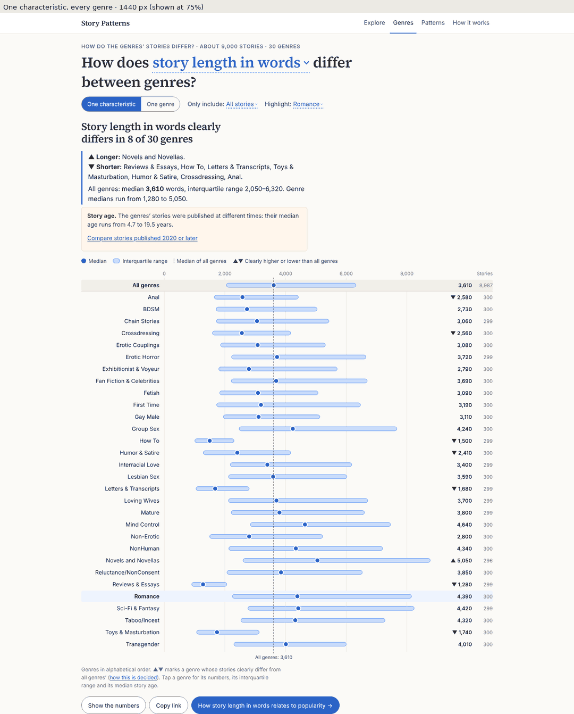
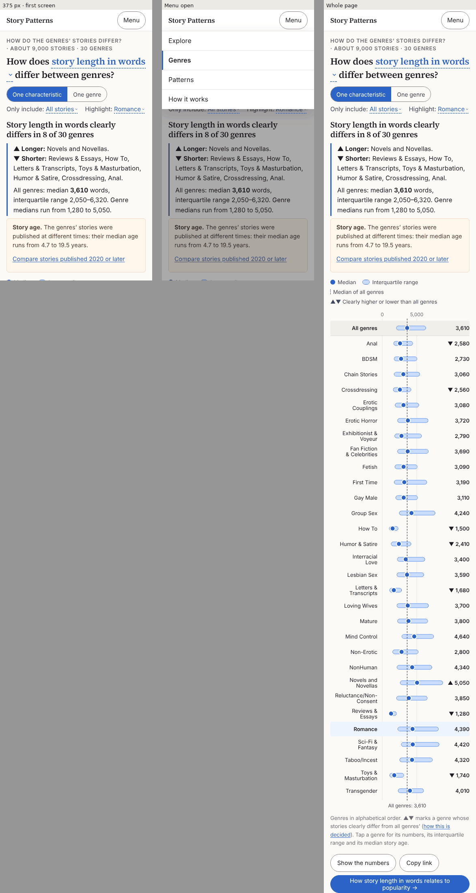
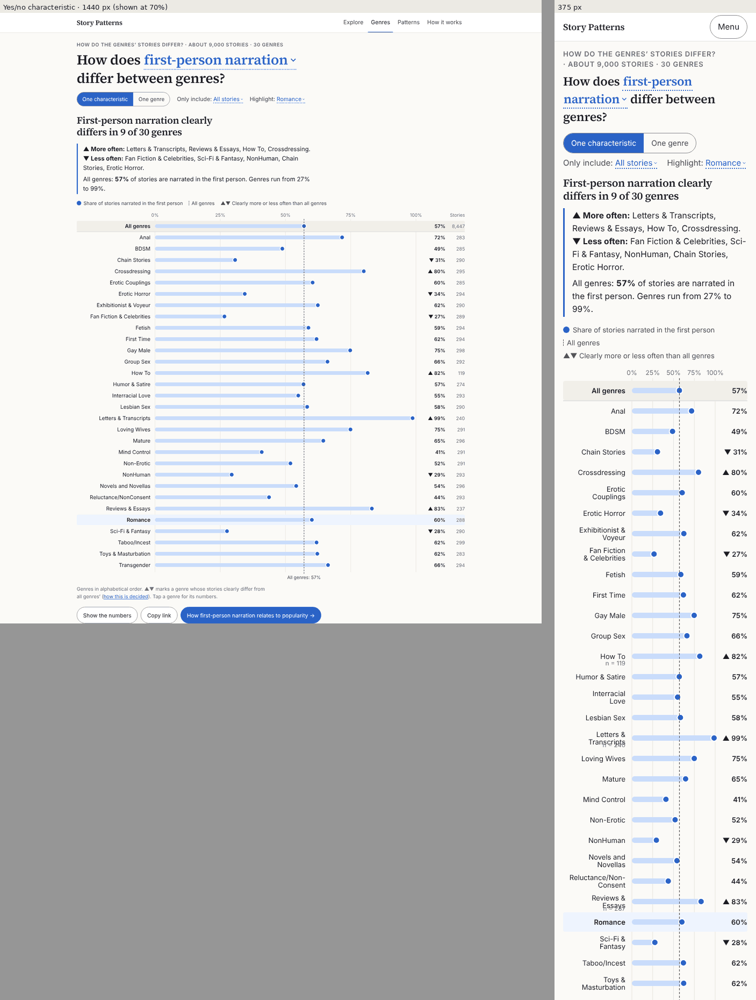
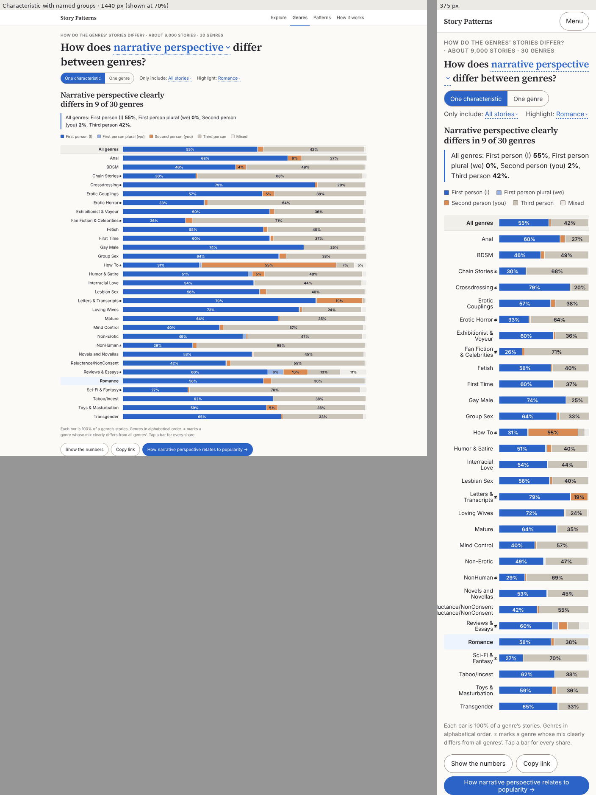
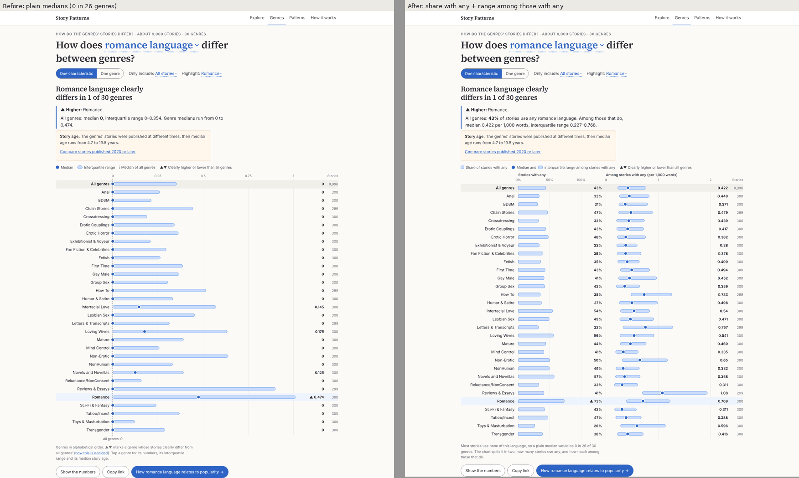
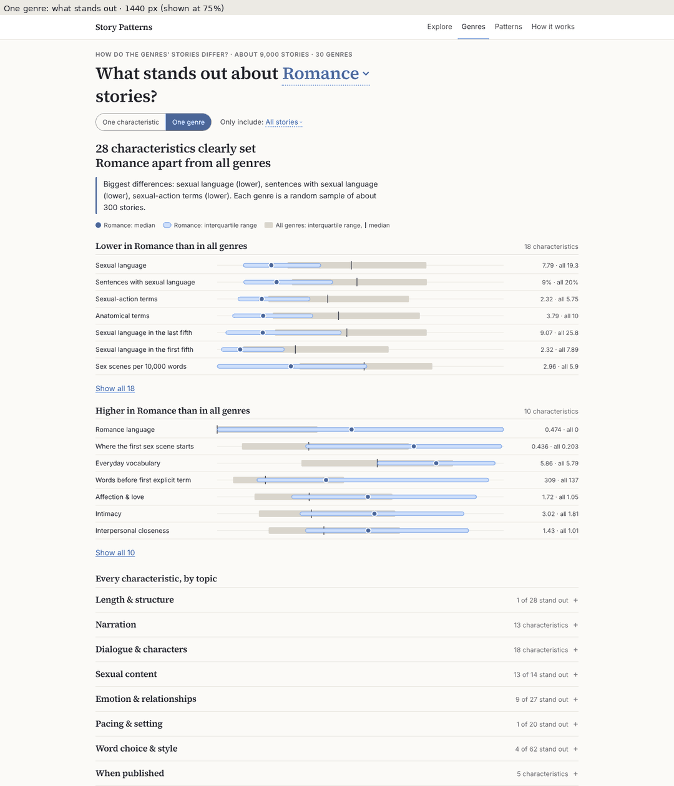
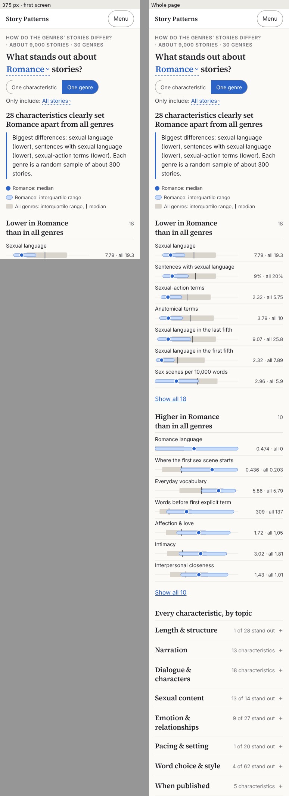
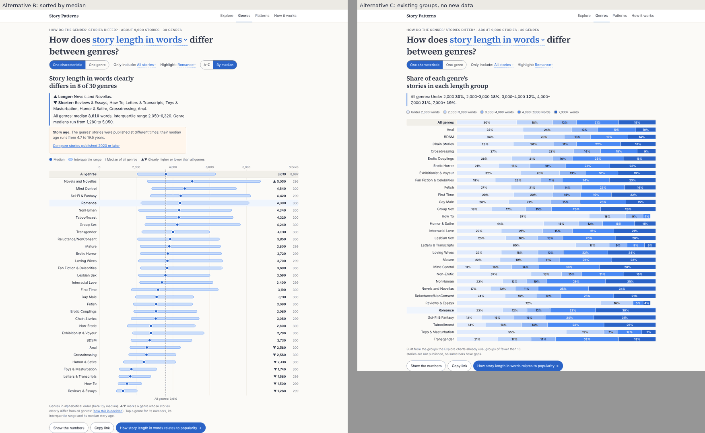
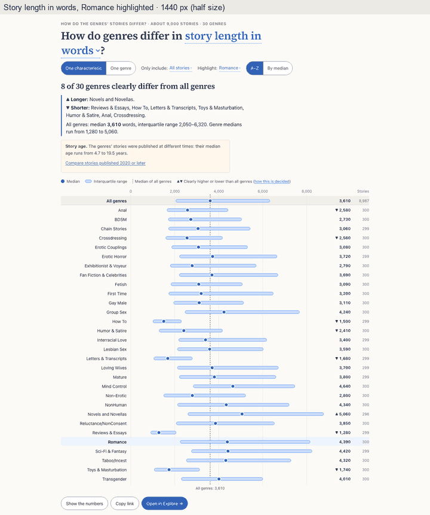
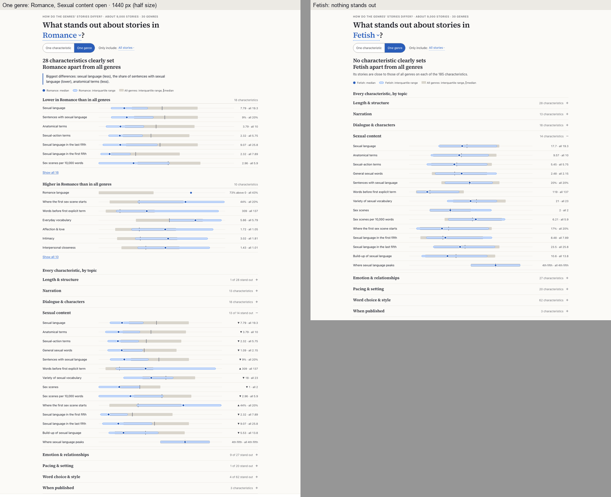

# Genres page: proposal for architecture and design

Status: proposal, approved with the owner's decisions in `STAGE2_GENRES_PAGE_PROMPT.md` and built on 2026-10-09 (section 13).
Date: 2026-10-09. Data: handoff `litcorr_stage2_handoff_20261008.zip` (read-only), 8,996 included stories in 30 genres.

Every number and chart in this proposal is real. The per-genre summaries were computed from the handoff on your laptop
with the project's own code (`make_bins`, `weighted_quantiles`, `sig`). Only group summaries were written, for groups
of 10 or more stories. The mock-ups were drawn with the site's built stylesheet. Section 12 lists the files and scripts.

---

## 1. Summary

**What the page answers.** Two questions that the site can't answer today:

1. *How does [a characteristic] differ between genres?* One characteristic, all 30 genres (figures g01, g02).
2. *What stands out about [a genre]'s stories?* One genre against all genres, every characteristic (g03, g04).

The page is about the stories themselves, not popularity. That separates it from Explore ("what goes with
popularity") and from Explore's "Compare all 30 genres", which shows one popularity pattern in each genre.

**Recommendations in brief**

| # | Recommendation |
|---|---|
| R1 | One new page, `#/genres`, with the two views above behind a "One characteristic / One genre" switch. Rows and lists link the two views to each other. |
| R2 | A verdict heading for each view, like the rest of the site: "Story length in words clearly differs in 8 of 30 genres" and "28 characteristics clearly set Romance apart from all genres". |
| R3 | A "clearly differs" rule built on the rank-biserial correlation the build already computes (`weighted_auc`, `rank_biserial_se`): \|r\| ≥ 0.20 and clear at the 99.9% level. In plain words, a genre's story beats a random story from all genres at least 60 times in 100, or loses at least 60 times in 100. |
| R4 | Four chart forms, chosen by the characteristic's kind: range rows (numbers), share rows (yes/no), 100% bars (named groups) and a split chart for mostly-zero characteristics. |
| R5 | One new lazy aggregate file per "Only include" option, `genres/<include>.json`. Each is about 170 KB raw and 47 KB gzipped, and it serves both views. First load of the site is unchanged. |
| R6 | A lazy `GenresPage` chunk that reuses `rangeLayout`, `RangeChart`, `CharacteristicPicker`, `InlineSelect`, `NumbersTable`, `CopyLink`, the K1 details line and the roving-tabindex pattern. |
| R7 | On phones, a "Menu" button that opens the page list, because four page links don't fit beside the brand at 375 px (measured below). |
| R8 | A short "Comparing genres" section in How it works, and the links between pages listed in §3.4. |

**Decisions needed from you** are collected in §11. The main one: this page needs new aggregate files, which the
hard rules say must not be added without asking.

---

## 2. What the data supports (and the facts that shaped the design)

| Fact | Number | Design consequence |
|---|---|---|
| Genres and sample | 30 genres, 296–300 stories each (random sample per genre); "All genres" = 8,996 stories weighted by genre size | Each genre row is directly comparable. The All genres row is a weighted summary, as everywhere else on the site. |
| Genre sizes on the site | 590 (Chain Stories) to 89,470 (Erotic Couplings) | All genres must stay weighted. Erotic Couplings alone is 11.7% of it (see §5.4). |
| Characteristics | 187: 168 numeric, 13 yes/no, 6 with named groups (month, weekday, narrative perspective, perspective of the description, tense, gender of pronouns) | Several chart forms are needed (§3.2). Of the 168 numeric ones, 6 are already ordered bands (author's story count, the five "peak position" fifths). They are drawn as ordered groups, not as quartiles. |
| How much genres differ | 930 of 5,607 genre × characteristic pairs clearly differ under rule R3. Per genre: from 0 (Fetish) to 116 (How To). 25 characteristics differ clearly in no genre. | The answer varies widely, so a verdict heading carries real information. The "One genre" view must handle 0 stand-outs and also 116. |
| Most-differing characteristics | Build-up of sexual language and sexual language in the last fifth (14 genres each); anatomical terms, sexual-action terms, recurring names (13 each) | These make good featured links (§3.4). |
| Mostly-zero characteristics | 30 numeric characteristics have a median of 0 in at least 3 genres; 5 have a median of 0 in every genre (e.g. consent and check-in language, talking to the reader, jealousy & envy) | Plain medians would show a column of zeros. Use the split chart (§3.2.4, g07). |
| Story age | Genre median story age runs from 4.7 years (Transgender) to 19.5 years (Chain Stories) | The age note from Explore carries over, with a one-click "Published 2020 or later" comparison. |
| Smaller subsets | With "Published 2020 or later", genres have 12 (Chain Stories) to 189 (Transgender) stories, median about 109 | The existing MIN_N = 10 / SMALL_N = 30 rules apply unchanged. The significance test matters here: 55 pairs reach \|r\| ≥ 0.20 without being clear (§5.2). |
| Missing values | e.g. first person vs third person is known for only 119 of 299 How To stories | Story counts change per characteristic, so each row keeps its own n (desktop column; details line on phones). |
| Rounding | `sig(x, 3)` turns publication year 2013 into 2010 | The builder needs year-aware rounding (§6.4). |

---

## 3. Page design

### 3.1 Structure and navigation

```
#/genres                               → View 1, default characteristic (story_words)
#/genres?var=sex_terms_per_1k&include=y2020&focus=adult-romance
#/genres?view=genre&genre=adult-romance&include=all

Masthead:  Story Patterns   Explore · Genres · Patterns · How it works
Phones:    Story Patterns                                    [Menu]

Genres page
├─ kicker:   HOW DO THE GENRES' STORIES DIFFER? · about 9,000 stories · 30 genres
├─ question: "How does [characteristic ▾] differ between genres?"   (View 1)
│            "What stands out about [genre ▾] stories?"            (View 2)
├─ controls: [One characteristic | One genre]  Only include: [All stories ▾]  Highlight: [genre ▾] (View 1 only)
└─ answer panel: verdict heading · takeaway · (age note) · legend · chart or lists · note · actions
```

* **Nav order:** Explore · Genres · Patterns · How it works. Genres sits next to Explore because both start from a
  characteristic.
* **The view switch** is a two-option segmented control (`role="radiogroup"`). It keeps the selected genre: the
  Highlight genre of View 1 becomes the genre of View 2, and the reverse.
* **Highlight** only marks a row. It never filters or reorders the chart. "None" is allowed and is the default.

### 3.2 View 1: one characteristic, every genre





From top to bottom:

1. **Question sentence** with the characteristic slot. It reuses `CharacteristicPicker` with its popularity-measure
   section hidden (a new `measures={false}` prop), and it carries over the snap fixes from round 3. The noun comes from
   the existing noun map, including "story length in words".
2. **Controls:** the view switch, "Only include" (`InlineSelect`, with the same `subsetConflict` rules as Explore) and
   "Highlight" (`InlineSelect` listing None plus the 30 genres).
3. **Verdict heading:** "[Noun] clearly differs in *k* of 30 genres". Variants: "… in none of the 30 genres" and
   "… in 1 of 30 genres" (§8).
4. **Takeaway:** two short lists followed by the All genres summary.
   * "▲ Longer: Novels and Novellas."
   * "▼ Shorter: Reviews & Essays, How To, Letters & Transcripts, Toys & Masturbation, Humor & Satire,
     Crossdressing, Anal." Each list is ordered by the size of the difference.
   * "All genres: median **3,610** words, interquartile range 2,050–6,320. Genre medians run from 1,280 to 5,050."
   * The direction words (Longer/Shorter) come from a new optional `more_word`/`less_word` pair per characteristic in
     `wording.py`. The fallback is "Higher/Lower" for numbers and "More often/Less often" for yes/no.
5. **Age note,** shown only with "All stories" and when genre median ages differ by 5 years or more (true today: 4.7
   to 19.5). The text is "The genres' stories were published at different times: their median age runs from 4.7 to
   19.5 years", followed by the button "Compare stories published 2020 or later".
6. **Legend:** median, interquartile range, median of all genres, and "▲▼ Clearly higher or lower than all genres".
7. **Chart** (§3.2.1–3.2.4). Genres are in A–Z order, with All genres first on a shaded band and a dashed line at its
   median across the plot.
8. **Note:** "Genres in alphabetical order. ▲▼ marks a genre whose stories clearly differ from all genres' (how this
   is decided). Tap a genre for its numbers, its interquartile range and its median story age."
9. **Actions:** Show the numbers (`NumbersTable`), Copy link, and "How [noun] relates to popularity →", which opens
   Explore on the same characteristic and genre.

**Row details (K1 line on phones, tooltip and focus line on desktop):** "Romance · median 4,390 words ·
interquartile range 2,250–8,150 · 300 stories · median age 10.7 years". When the genre is flagged, the line adds
"· clearly longer than all genres". It ends with the link **"What stands out about Romance →"**, which opens View 2.

#### 3.2.1 Numbers: range rows (g01)

These are the existing C2 range rows with genres in place of groups. `rangeLayout` already handles the label column
(196 px desktop, 116 px phone with two-line labels), value text, small-n notes and suppressed rows. Additions:

* An optional `mark` per row (▲/▼), drawn as text before the value so that it survives forced colors and greyscale.
* An optional `overallLine`: the dashed All genres median line with its label under the axis.
* The domain runs from 0 (when the lowest value is near 0) to the largest genre p75 × 1.04. Wide ranges are not
  clipped: Novels and Novellas reaches 16,500 words at p90, but only p25–p75 are drawn, so the scale ends near its p75 of 8,770.

#### 3.2.2 Yes/no characteristics: share rows (g05)



One bar from 0 to the share of stories with "yes", with a dot at the end. The axis runs 0–100% and the All genres
share is the dashed line. The heading for first-person narration reads "… clearly differs in 9 of 30 genres", with
"▲ More often: Letters & Transcripts (99%), Reviews & Essays, How To, Crossdressing" and "▼ Less often: Fan Fiction &
Celebrities (27%), Sci-Fi & Fantasy, …". The story column matters here: first person vs third person is known for only
119 How To stories.

#### 3.2.3 Named groups: 100% bars (g06)



* One 100% bar per genre in the groups' own order, using the five-color palette already in the mock-ups. The darkest
  color goes to the largest all-genres group.
* Percentages are printed inside segments 34 px or wider. Every share is in the details line and the table.
* "≠" marks a genre whose mix clearly differs (rule in §5.3). Narrative perspective clearly differs in 9 genres, led by
  How To, where 55% of stories are in the second person against 2% overall.
* **Ordered bands** (author's story count; the five "peak position" fifths) use the same bars with a sequential blue
  palette, as in g08 right.
* **Month and weekday:** 12 or 7 segments per bar can't be read, and genre differences in publication month are not
  a question readers ask. Recommendation: leave `pub_month` and `pub_weekday` out of this page and keep
  `pub_is_weekend` (yes/no). This is decision D5.
* The bar needs a real column for the "≠" mark. The mock squeezes it against the bar start.

#### 3.2.4 Mostly-zero characteristics: the split chart (g07)



Where most stories score 0, the plain chart (left) reports a median of 0 for 26 genres. That hides real
differences: Erotic Horror (48% of stories use any romance language) and Toys & Masturbation (26%) both show 0. The
split chart (right) answers two questions side by side:

* **Stories with any:** the share above 0 (Romance 73%, all genres 43%).
* **Among stories with any:** median and interquartile range of the non-zero values (Romance 0.709 per 1,000 words,
  all genres 0.422).

The rule for using it is the same as Explore's "None" group: 15% or more of all stories are exactly 0
(`ZERO_BIN_SHARE`). That covers 45 characteristics, and readers see the same split in both places. The ▲▼ flag still
comes from the rank-biserial rule, which counts ties as half and so works with zeros. Romance language is flagged for
Romance (r = +0.40) even though the all-genres median is 0. On phones the two halves stack: share rows first, then the
range rows under a sub-heading. Two 85 px plots side by side are too small.

### 3.3 View 2: one genre, what stands out





1. **Question:** "What stands out about [Romance ▾] stories?" The genre slot uses `InlineSelect` with the 30 genres.
   All genres is not an option here.
2. **Verdict heading:** "28 characteristics clearly set Romance apart from all genres".
3. **Takeaway:** "Biggest differences: sexual language (lower), sentences with sexual language (lower),
   sexual-action terms (lower)."
4. **Legend:** genre median (dot), genre interquartile range (blue), and the all-genres interquartile range (grey) with
   its median (tick).
5. **Two ranked lists**, each showing the 7 largest differences, then "Show all 18" or "Show all 10":
   * *Lower in Romance than in all genres (18):* sexual language 7.79 vs 19.3 per 1,000 words; sentences with sexual
     language 9% vs 20%; sexual-action terms; anatomical terms; …
   * *Higher in Romance than in all genres (10):* romance language 0.47 vs 0; where the first sex scene starts 0.44
     vs 0.20 of the way in; words before the first explicit term 309 vs 137; affection & love; intimacy; …
   * *A different mix:* any named-group characteristic that is flagged, as one line of links to View 1.
6. **Every characteristic, by topic:** the eight topics folded, each with "9 of 27 stand out" or "13 characteristics".
   Opening a topic shows its rows in the topic's own order.
7. **Rows:** label, a two-layer range, and values ("7.79 · all 19.3"). Each row has its own scale, from the all-genres
   p10 to p90 and widened to include the genre's interquartile range. The values text gives the numbers, so there are
   no axis ticks. Activating a row opens View 1 for that characteristic with this genre highlighted.

**Ranking is used here, and only here.** Ordering by the size of the difference is what makes the view useful. It
ranks characteristics inside one genre, never genres against each other. Decision D3 covers whether genres may ever be
sorted.

**Edge states**
* No stand-outs (Fetish, all stories): "No characteristic clearly sets Fetish apart from all genres", followed by
  "Its stories look like the site as a whole on all 187 characteristics." The topics stay available.
* Many stand-outs (How To 116, Reviews & Essays 115): the same layout. Only the counts grow.
* A small subset (Chain Stories with "Published 2020 or later" has 12 stories): rows with n < 30 carry the existing
  "few stories" note. With n < 10 the view shows "Fewer than 10 Chain Stories stories were published 2020 or later:
  not enough to compare" and offers All stories.

### 3.4 Links in and out

| From | Link |
|---|---|
| Masthead | "Genres" (preloads the chunk and `genres/all.json` on hover or focus, like Patterns today) |
| Explore answer panel | "How does [noun] differ between genres? →", next to the existing actions |
| Explore J2 "Keep exploring" | One genre item: "What stands out about [genre] stories?" when a genre is selected |
| Patterns page | Nothing in phase 1. The two pages answer different questions. |
| How it works | New section "Comparing genres" (§8.3), plus a link from the page note |
| Genres → Explore | "How [noun] relates to popularity →" |
| View 1 ↔ View 2 | Row details link "What stands out about Romance →"; profile rows open View 1 |

**Naming clash to fix.** Explore's "Compare all 30 genres →" shows a popularity pattern in each genre. Next to a page
called Genres it reads like a link to that page. Recommended new wording: **"See this pattern in every genre →"**
(decision D7).

### 3.5 Phones

* **Masthead.** I measured the current masthead at 375 px. The brand is 134 px, and the links are Patterns (69 px) and
  How it works (101 px). Explore is already hidden. Adding Genres (about 62 px) needs 366 px, but 343 px is
  available. Recommendation: a "Menu" button below 560 px that opens a sheet listing the four pages, with the current
  page marked (g02 middle). The sheet uses `Overlay` for focus trap and Escape. Alternative: keep Genres and Patterns
  in the bar and move How it works to the footer only (D4).
* **View 1:** a 116 px label column with two-line labels, a 52 px value column with the ▲▼ marks, and a plot about
  170 px wide. The story column is dropped. Story counts below 250 appear under the label, as in Explore. Rows are at
  least 44 px tall to tap; they are 38 px in the mock, so the real page needs 6 px more.
* **View 2:** the label sits on its own line above each row's range. The values sit at the right. Rows are 56 px.

---

## 4. Alternatives considered



| Alternative | For | Against | Verdict |
|---|---|---|---|
| **B. Genres sorted by median** (g08 left) | The order itself is the finding; extremes are easy to spot | Every characteristic gets a different order, so a reader can't find "Romance" in the same place twice. It ranks genres, which the site has so far avoided (D2 cards are A–Z). | Offer as an optional "A–Z / By median" toggle only if you want it (D3). Default A–Z. |
| **C. Built from the existing groups, no new data** (g08 right) | Ships without new aggregate files | No medians, no flags. The groups were cut for the all-genres distribution. Suppressed cells (fewer than 10) leave gaps in small genres. The mostly-zero problem stays. | Not recommended. |
| **D. Small multiples:** one histogram per genre | Shows full shapes | 30 histograms are unreadable on phones and hard to compare across rows | No |
| **E. Atlas:** one heat map of 187 characteristics × 30 genres coloured by r | One overview of everything | 5,610 cells; doesn't work on phones; needs a reading key | Possible phase 3, desktop only |
| **F. A third mode inside Explore** | No new nav item | Explore's question sentence is built around a popularity measure. This page has none. | No |

---

## 5. "Clearly differs": the rule

### 5.1 Definition

For a genre *g* and a characteristic *x*:

* **Numbers and yes/no:** r = 2·AUC − 1, where AUC = P(a story from *g* scores higher than a story from all genres) +
  ½·P(tie). The genre's stories count equally; All genres uses `sampling_weight`. This is the rank-biserial
  correlation that `weighted_auc` and `rank_biserial_se` in `stats.py` already compute for binary patterns.
  * *Clearly differs* = |r| ≥ 0.20 **and** |r| / SE ≥ 3.29 (99.9% level).
  * For yes/no, r is simply the difference in shares, so the rule reads "at least 20 percentage points".
* **Named groups:** total variation distance (half the sum of the share differences) ≥ 0.20 and a chi-square test
  against the all-genres mix at 99.9%. In plain words: at least 20% of the genre's stories would have to change group
  to match the all-genres mix.

Plain-words version for How it works: *"Pick one story from the genre and one from all genres at random. A genre
clearly differs when its story is the higher one at least 60 times in 100, or the lower one at least 60 times in 100
(ties count as half)."*

### 5.2 Why these thresholds

There are 5,607 genre × characteristic pairs with all stories. The number flagged depends on the cut-off:

| Threshold \|r\| | Pairs flagged | Per genre (min / median / max) |
|---|---|---|
| 0.10 (the site's pattern cut-off) | 2,001 (36%) | 17 / 61 / 142 |
| **0.20 (recommended)** | **930 (17%)** | **0 / 23 / 116** |
| 0.30 | 415 (7%) | 0 / 7 / 82 |
| 0.40 | 225 (4%) | 0 / 3 / 65 |

* At 0.10, a typical genre would "stand out" on 61 characteristics, so the list stops meaning anything. At 0.20 the
  typical genre has 23 stand-outs, enough to describe it without listing everything.
* 0.20 is also the site's own boundary between "weak" and "moderate" strength.
* The 99.9% level covers the number of tests. With 5,607 tests at 99%, about 56 false flags would be expected even if
  genres didn't differ at all; at 99.9% the expectation is about 6. With all stories, every pair at |r| ≥ 0.20 also
  passes the test (0 exceptions). With "Published 2020 or later", 55 pairs reach 0.20 without passing, so the test
  does real work in subsets.

### 5.3 Rule for named groups

The total variation distance threshold of 0.20 matches the 20-point rule for yes/no. The chi-square test runs on the
genre's own counts against the all-genres shares.

### 5.4 Reference group: all genres or all *other* genres?

The chart's dashed line is All genres, and the rule is easier to explain when it compares with the same thing. The
cost: All genres contains the genre itself, weighted by its size, which shrinks a large genre's r. For Erotic
Couplings (11.7% of All genres) the shrinkage is up to about 12%. For Taboo/Incest (10.4%) it is about 10%. For most
genres it is under 5%.
**Recommendation:** compare with all genres and state it. The alternative is "all other genres", which is cleaner but
means the dashed line no longer matches the flag (D2).

---

## 6. Data architecture

### 6.1 Options

| Option | What ships | Size | Serves | Verdict |
|---|---|---|---|---|
| **D1. One file per "Only include" option:** `aggregates/genres/<include>.json` | 9 files | ~170 KB raw / **47 KB gzip** each (measured on a prototype of the format below); 1.5 MB raw in all, next to today's 68 MB of aggregates | Both views, instant switching, one fetch | **Recommended** |
| D2. Add per-genre quartiles to the existing `v/<characteristic>/<include>.json` | New field in 1,683 files | +1–2 KB per file | View 1 only. View 2 would need 187 fetches. | No |
| D3. Two families: by characteristic and by genre | 1,962 small files | 1 KB / 6 KB each | Both, with smaller fetches | Not worth the file count |
| D4. No new data (alternative C) | — | 0 | A weak View 1 only | No |

### 6.2 File format (`genres/<include>.json`)

The format is compact like the `v/` files. Arrays follow `genres`; `null` means a group of fewer than 10 stories.

```jsonc
{
  "s": "all",                               // the "Only include" option
  "genres": ["all", "anal-sex-stories", …], // meta.genres order, "all" first
  "n": [8996, 300, 300, …],                 // included stories per genre
  "age": [9.3, 11.8, …],                    // median story age in years per genre (stories in this option)
  "rule": {"r": 0.2, "z": 3.29},            // the "clearly differs" rule used
  "c": {                                    // one entry per characteristic shown on the page
    "story_words": {
      "k": "num",                           // num | bin | grp | band | zero
      "q": [[8987, 1270, 2050, 3610, 6320, 10900],   // all genres: n, p10, p25, median, p75, p90
            [300, 1650, 2580, 4420],                 // each genre: n, p25, median, p75 (here: Anal)
            …],
      "r": [null, -0.21, …],                // rank-biserial r vs all genres (2 decimals); null for "all"
      "f": [0, -1, 0, …]                    // -1 clearly lower, +1 clearly higher, 0 neither
    },
    "pov_is_first_person": { "k": "bin", "q": [[8447, 0.571], [283, 0.72], …], "r": [null, 0.15, …], "f": [0, 0, …] },
    "pov_class": { "k": "grp", "labels": ["First person (I)", …], "q": [[8983, 0.553, 0.001, 0.022, 0.416, 0.008], …],
                   "r": [null, 0.16, …],     // total variation distance for named groups
                   "f": [0, 0, …] },         // 1 = different mix
    "rel_romance_per_1k": { "k": "zero",
      "q": [[8996, 0, 0, 0, 0.354, 0.817], …],                  // plain quartiles (Show the numbers)
      "z": [[3811, 0.434, 0.227, 0.422, 0.768], …],             // stories with any, share with any, quartiles among them
      "r": […], "f": […] }
  }
}
```

The exact array layout is open to change during implementation. The constraints are: one object per characteristic,
genre arrays in `genres` order, and every number rounded the way §6.4 says.

### 6.3 Builder

* A new `build_genre_profiles(df, variables, subsets, genre_ids, out_dir)` in `litcorr/stage2/site_data.py`, called
  by `build_site_data` after `patterns.json`. It reuses `make_bins` (to decide the kind), `weighted_quantiles`,
  `weighted_auc`, `rank_biserial_se`, `effective_n` and `sig`, and runs one task per characteristic in parallel like
  `_var_task`.
* **Weights:** genre rows are unweighted (equal-probability sample within a genre). All genres uses `sampling_weight`.
  This is the same as the `v/` files.
* **Suppression:** a genre cell with n < MIN_N becomes `null`. The client applies SMALL_N exactly as today.
* **Kinds:** `zero` when the characteristic gets a "None" group in `make_bins` (`ZERO_BIN_SHARE`); `band` for
  `ORDINAL_LEVELS`; `grp` for `LEVELS` minus `pub_month`/`pub_weekday` (D5); `bin` for binary; otherwise `num`.
* **Subset conflicts:** skip the same combinations that `subsetConflict` forbids (word count × Length options;
  publication year and years online × Published options).
* **meta.json:** add `"genre_rule": {"r": 0.2, "level": 0.999}`, used by How it works, and the optional
  `more_word`/`less_word` per characteristic. Nothing else changes.
* **Runtime:** the prototype computed r for every genre and characteristic, for two include options, single-threaded
  on your laptop in under 3 minutes, including loading the handoff. Spread over the existing worker pool, 9 options
  should add a few minutes at most to `site-data`.

### 6.4 Rounding

`sig(x, 3)` is right for rates and shares, but it turns publication year 2013 into 2010. Use `sig(x, 4)` for
`pub_year`, keep integer counts exact, and keep r to 2 decimals. (The prototype files in `Claude outputs` still have
the 3-digit year bug; they are not used for anything shipped.)

### 6.5 Privacy and the hard rules

* Like the `v/` files, the new files hold only summaries of groups of 10 or more stories: quartiles, shares and r.
  They contain no story text, titles, authors or per-story records.
* The deciles (p10/p90) appear only for All genres (about 9,000 stories), for the axis.
* **This adds a new aggregate file family.** The project rules allow only `meta.json`, `v/…` and `patterns.json`, so
  it needs your approval (D1). The site-data tests that list the allowed files must be updated with it.

### 6.6 Adding stories later

Everything is driven by `meta.genres` and the handoff. A new collection run with more stories per genre changes the
numbers and possibly the flags, and the page needs no code change. The two hard-coded "300"s in `Methodology.jsx`
(noted earlier) would also appear in this page's "about 300 stories" text, so that text must come from `meta`, not a
literal.

---

## 7. Front-end architecture

### 7.1 New and changed files

| File | Purpose |
|---|---|
| `components/pages.js` | Add `export const GenresPage = lazyPart(() => import("./GenresPage.jsx"))` |
| `components/GenresPage.jsx` | The page: question, controls, view switch, answer panel; loads `genres/<include>.json` |
| `components/GenreChart.jsx` | View 1 for `num` and `bin`: builds rows and calls `RangeChart` with `mark` and `overallLine` |
| `components/GenreMix.jsx` | View 1 for `grp` and `band`: 100% bars with roving focus and the details line |
| `components/GenreSplit.jsx` | View 1 for `zero`: share rows plus range rows (side by side at 760 px and up, stacked below) |
| `components/GenreProfile.jsx` | View 2: verdict, two ranked lists, a different mix, topics |
| `components/ProfileRow.jsx` | One two-layer row (genre vs all genres), as a link to View 1 |
| `components/SiteMenu.jsx` | Phone menu button and sheet (uses `Overlay`) |
| `lib/genres.js` | Pure helpers: decode the file, pick the chart form, flags and lists, heading text, profile ordering |
| `lib/data.js` | `loadGenres(include)` and `prefetchGenres(include)` (same cache as the `v/` files) |
| `lib/urlState.js` | `page: "genres"`; params `var`, `include`, `focus`, `view`, `genre`, `sort`; `sanitize` rules (§7.2) |
| `lib/rangeLayout.js` | Optional per-row `mark` and an `overallLine`; no change to existing output when they are absent |
| `lib/wording.js` | Genre headings, list lines and details lines (§8) |
| `components/CharacteristicPicker.jsx` | `measures={false}` hides the popularity-measure part |
| `App.jsx` | Route, nav item with preload, phone `SiteMenu`, page title "Genres · Story Patterns" |
| `components/Explorer.jsx` | "How does [noun] differ between genres? →" link; rename "Compare all 30 genres" (D7) |
| `components/Methodology.jsx` | "Comparing genres" section |
| `styles.css` | Page and component styles, forced-colors rules for the marks, bars and segments |

### 7.2 URL state

* `#/genres?var=<id>&include=<id>&focus=<genre>` (View 1), `sort=median` only if D3 is accepted.
* `#/genres?view=genre&genre=<genre>&include=<id>` (View 2).
* `sanitize`:
  * An unknown or excluded characteristic falls back to `story_words`.
  * A conflicting include falls back to `all`.
  * An unknown genre is dropped in View 1. In View 2 it falls back to the last genre the reader chose on any page,
    else the largest genre (Erotic Couplings) (D8).
* Switching views carries the genre across. The characteristic is kept for when the reader comes back to View 1.

### 7.3 Loading and performance

* The page chunk is lazy. Today the Patterns chunk is 2.1 KB gzip and How it works is 6.7 KB, so the Genres chunk
  (four chart forms plus View 2) should be about 6–9 KB. First load of the site is unchanged apart from the nav item
  and the menu (under 1 KB).
* `genres/<include>.json` (47 KB gzip) is fetched on first visit and prefetched on hover or focus of the nav link.
  It is cached for the session. Changing the characteristic or the view needs no fetch. Changing the include option
  fetches one file.
* Charts are rendered from the file in memory. The largest is View 2 with every topic open, about 190 rows of SVG.
  Topics render their rows only when opened.

### 7.4 Accessibility

* Every row (View 1 genres, View 2 characteristics, 100% bars) is a focusable row in a roving-tabindex group, the same
  as `RangeChart`. Each has a full accessible name, for example "Reviews & Essays: median 1,280 words, interquartile
  range 908–2,060, 299 stories, clearly shorter than all genres".
* The ▲▼≠ marks are text, so they don't rely on color and survive forced colors. Bar segments get forced-colors
  outlines.
* The heading and takeaway are announced through the existing live region when the characteristic, genre or include
  option changes.
* "Show the numbers" gives the full table for every chart form. For the split chart, the table has both halves.
* The view switch is a radiogroup. "Show all 18" is a button with `aria-expanded`.
* Tap targets are at least 44 px on phones. No window scroll when pickers open (snap rules from round 3).

### 7.5 Tests

**Python** (`tests/test_stage2_site_data.py`):
* One file per include option, and only the allowed file families are written.
* Every non-null cell has n ≥ 10, and p25 ≤ median ≤ p75.
* Flags only where |r| ≥ 0.20 and z ≥ 3.29.
* The All genres row matches a direct weighted computation.
* The publication year is not rounded to 3 digits.
* Each file stays under 60 KB gzip.
* The output is deterministic, and there are no story-level fields.

**Front end** (vitest):
* URL round-trip and `sanitize`; chart form by kind; heading variants (0 / 1 / k).
* ▲▼ marks render and are named.
* Profile ordering, "Show all", the 0-stand-outs state, and the n < 10 state.
* Include conflicts; the lazy chunk; Menu focus trap and Escape.

**Browser** (the existing tool set):
* `axe.mjs` and `labels.mjs`: no label overlaps across all 187 × 9 combinations at 320/375/768/1280.
* `taps.mjs`: no overlapping tap targets.
* `snap.mjs` extended to the genre and include pickers.
* `forced.mjs` in light and dark.
* `firstload.mjs`: first-load budget unchanged.

---

## 8. Wording (copy deck)

### 8.1 View 1

| Place | Text |
|---|---|
| Kicker | How do the genres' stories differ? · about 9,000 stories · 30 genres |
| Question | How does **[story length in words]** differ between genres? |
| Heading (k ≥ 2) | Story length in words clearly differs in 8 of 30 genres |
| Heading (1) | Romance language clearly differs in 1 of 30 genres |
| Heading (0) | Jealousy & envy doesn't clearly differ in any genre |
| Lists | ▲ Longer: … / ▼ Shorter: … (fallback: Higher / Lower; yes/no: More often / Less often; groups: "A different mix: …") |
| All genres line (num) | All genres: median **3,610** words, interquartile range 2,050–6,320. Genre medians run from 1,280 to 5,050. |
| All genres line (yes/no) | All genres: **57%** of stories are narrated in the first person. Genres run from 27% to 99%. |
| All genres line (zero) | All genres: **43%** of stories use any romance language. Among those that do, median 0.422 per 1,000 words, interquartile range 0.227–0.768. |
| Age note | Story age. The genres' stories were published at different times: their median age runs from 4.7 to 19.5 years. [Compare stories published 2020 or later] |
| Note | Genres in alphabetical order. ▲▼ marks a genre whose stories clearly differ from all genres' (how this is decided). Tap a genre for its numbers. |
| Popularity link | How story length in words relates to popularity → |

### 8.2 View 2

| Place | Text |
|---|---|
| Question | What stands out about **[Romance]** stories? |
| Heading | 28 characteristics clearly set Romance apart from all genres |
| Heading (0) | No characteristic clearly sets Fetish apart from all genres |
| Takeaway | Biggest differences: sexual language (lower), sentences with sexual language (lower), sexual-action terms (lower). |
| List titles | Lower in Romance than in all genres · Higher in Romance than in all genres · A different mix |
| Topic counts | 9 of 27 stand out / 13 characteristics |
| Row values | 7.79 · all 19.3 |

### 8.3 How it works: "Comparing genres" (draft)

> **Comparing genres.** The Genres page compares each genre's stories with the stories of all genres. All genres
> counts each genre by its size on Literotica, as on the rest of the site; each genre is a random sample of about 300
> stories. A genre *clearly differs* on a characteristic when, if you picked one of its stories and one story from all
> genres at random, its story would be the higher one at least 60 times in 100, or the lower one at least 60 times in
> 100 (ties count as half). For yes/no characteristics that means a gap of at least 20 percentage points; for
> characteristics with named groups, at least 20% of the genre's stories would have to change group to match all
> genres. The page makes 5,607 comparisons, so a difference must also be clear at the 99.9% level, not just the 99%
> level used for patterns. When most stories score 0 on a characteristic, the page splits it in two: how many stories
> have any, and how much among those that do.

---

## 9. Phases and effort

| Phase | Contents | Size |
|---|---|---|
| **1** | Builder and tests (D1); View 1 with all four chart forms; nav and phone Menu; Explore link and the rename; How it works section | Large: about one long Claude Code session |
| **2** | View 2 (what stands out), the links between the two views, J2 item | Medium: one session |
| 3 (optional) | "By median" toggle (if D3), Atlas heat map on desktop (alternative E) | Small / medium |

Each phase ends with the full browser tool set run against the build.

---

## 10. Risks

| Risk | Mitigation |
|---|---|
| Readers read "clearly differs" as a cause ("Romance is less sexual *because* …") | The wording describes stories, never authors or causes. That fits the site-wide decision to drop the correlation disclaimer. |
| Story age confounds genre differences | The age note and the one-click "Published 2020 or later" comparison |
| Ties among mostly-zero characteristics | The split chart, plus rank-biserial with ties counted half |
| Long genre names on phones ("Fan Fiction & Celebrities") | Two-line labels, already checked in the mock at 375 px |
| Flags change between data runs | Expected. The rule is fixed and published; the numbers move with the data. |

---

## 11. Decisions for you

| # | Decision | Recommendation |
|---|---|---|
| **D1** | Allow a new aggregate file family `genres/<include>.json` (9 files, 47 KB gzip each) | **Yes.** Without it the page can only be alternative C. |
| **D2** | "Clearly differs" rule: \|r\| ≥ 0.20, 99.9% level, compared with all genres (§5) | Yes as written. The alternative is comparing with all *other* genres. |
| **D3** | Genre order in View 1 | A–Z only. Optionally add an "A–Z / By median" toggle. |
| **D4** | Phone navigation with four pages | Menu button below 560 px. Alternative: drop How it works from the phone masthead and keep it in the footer. |
| **D5** | Leave publication month and weekday off this page | Yes. Keep "published on a weekend". |
| **D6** | Split chart for the 45 characteristics with a "None" group | Yes |
| **D7** | Rename Explore's "Compare all 30 genres →" to "See this pattern in every genre →" | Yes |
| **D8** | Default genre for "One genre" | The last genre the reader chose, else Erotic Couplings (largest) |
| **D9** | Page name in the nav | "Genres" |
| **D10** | Direction words per characteristic ("Longer/Shorter") | Add for the 20 or so most-viewed characteristics; Higher/Lower elsewhere |

---

## 12. Files behind this proposal

* `docs/stage2/GENRES_PAGE_PROPOSAL.md` — this document.
* `docs/stage2/genres-page/g01–g08.png` — the mock-up screenshots (palette-compressed).
* `Claude outputs/genres-page-mockups/` — `mock.html` (static mock-up; URL parameters `view=numeric|sorted|share|levels|zero|bins|profile`, `var`, `hl`, `inc`, `menu=1`) and a README on how to serve it with the data.
* `Claude outputs/genre-profiles/` (not for committing):
  * `gp_compute.py` — per-genre quartiles and shares, written to `genres-{all,y2000,y2010,y2020}.json`.
  * `gp_distinct.py` — r, z and total variation distance per genre and characteristic, written to `distinct.json`
    (and `distinct-compact.json` for the mock).
  * `gp_zero.py` — the split figures for three mostly-zero characteristics, written to `zero-split.json`.

  All three scripts read the handoff zip read-only through the project's own loader and write only group summaries.
  None of them runs `probe`, `collect`, `process` or `export-handoff`, and none of them contacts any website.

### Appendix: stand-outs per genre (all stories, rule R3)

| Genre | Stand out | \|r\| ≥ 0.40 | | Genre | Stand out | \|r\| ≥ 0.40 |
|---|---:|---:|---|---|---:|---:|
| Anal | 29 | 5 | | Lesbian Sex | 5 | 3 |
| BDSM | 11 | 3 | | Letters & Transcripts | 74 | 29 |
| Chain Stories | 48 | 3 | | Loving Wives | 14 | 1 |
| Crossdressing | 16 | 0 | | Mature | 1 | 0 |
| Erotic Couplings | 10 | 0 | | Mind Control | 17 | 0 |
| Erotic Horror | 41 | 0 | | Non-Erotic | 63 | 17 |
| Exhibitionist & Voyeur | 7 | 0 | | NonHuman | 39 | 5 |
| Fan Fiction & Celebrities | 33 | 3 | | Novels and Novellas | 41 | 4 |
| Fetish | 0 | 0 | | Reluctance/NonConsent | 19 | 1 |
| First Time | 3 | 0 | | Reviews & Essays | 115 | 65 |
| Gay Male | 14 | 4 | | Romance | 28 | 5 |
| Group Sex | 23 | 2 | | Sci-Fi & Fantasy | 47 | 9 |
| How To | 116 | 55 | | Taboo/Incest | 4 | 0 |
| Humor & Satire | 42 | 3 | | Toys & Masturbation | 63 | 8 |
| Interracial Love | 4 | 0 | | Transgender | 3 | 0 |

Examples of the largest differences:
* **Romance:** sexual language r −0.48 (median 7.79 vs 19.3 per 1,000 words); romance language +0.40; where the first
  sex scene starts +0.35 (0.44 vs 0.20 of the way in); words before the first explicit term +0.30 (309 vs 137).
* **Erotic Horror:** emotional tone −0.36; anxiety & fear +0.36; sound words +0.35; sensory language +0.31.
* **Anal:** anatomical terms +0.53; sexual language +0.52 (34.4 vs 19.3); profanity +0.38; dialogue share −0.28.

---

## 13. As built

Built on 2026-10-09 on branch `genres-page` (from `main` at `a5118ce`), one commit per step of the work plan in
`STAGE2_GENRES_PAGE_PROMPT.md` (committed with this section, as the earlier prompts are), then two fixes from the final
checks. Nothing is pushed. At every commit `npm test`, `npm run build` and `python -m pytest
tests/test_stage2_site_data.py` pass; at the end there are **226 Vitest tests in 27 files** (161 in 20 before) and **30
pytest tests** (20 before).

Measured as in sections 11–12 of `DESIGN_REVIEW_2.md`: this Mac, the cached headless Chromium with Playwright 1.56, a
frozen copy of the final build served with gzip by `serve.mjs`. The new scripts are in `Claude outputs/design-review-2-tools/`
(its README lists them), outside git.

### 13.1 Commits

| Commit | Step |
|---|---|
| `943d7bf` | The proposal and g01–g08, as they were |
| `43ccc7f` | Data: `genres/<included>.json`, the rule, the meta additions and the Python tests (D1, D2, D5, D10) |
| `dc22cfb` | Shell: addresses and their sanitizing, the masthead, the lazy page, loading and errors (D4, D8, D9) |
| `38b70ac` | View 1 for numbers and yes/no: heading, lists, age note, order, details, table; `rangeLayout`'s options (D3, D10) |
| `a0dd40c` | View 1 for named groups, ordered bands and mostly-zero characteristics (D6) |
| `25af251` | View 2 |
| `7326739` | Explore (D7 and Keep exploring), How it works, the READMEs |
| `e6ba8a6` | Fix: the split chart sits side by side from a 760 px screen; wide tables scroll in their own box |
| `e73e666` | Fix: fewer layout shifts when the option changes |
| this commit | Section 13, screenshots b01–b10, the prompt |

### 13.2 The checkpoint: the size of the files (the owner's decision)

Built exactly to §1.2 of the prompt, the nine files were **61.6–67.4 KB gzipped**, over the 60 KB cap. The proposal's
"about 47 KB" came from a prototype that had the above-0 numbers for 3 characteristics, not 45. The owner chose to leave
out what the page does not use or can work out:

* a mostly-zero characteristic's `q` holds only each genre's number of stories: nothing on the page used its plain
  quartiles (the split chart, its table and View 2 all use the stories above 0);
* in `z`, a genre's share above 0 is left out, and the page works it out as stories above 0 ÷ stories. All genres keeps
  its weighted share.

The files are now **53.0–56.7 KB gzipped** (177–189 KB raw; `all.json` is 53,022 bytes, 51.8 KiB as served).
Everything else follows §1 of the prompt:

* 185 characteristics, each with its kind from `make_bins`;
* the `subsetConflict` combinations left out;
* quartiles to 3 significant digits, and whole years for `pub_year`;
* shares to 3 decimals, r and the total variation distance to 2, ages to 1.

`meta.json` gains `genre_rule` and `more_word`/`less_word` on the 20 D10 characteristics. Neither the `v/` files nor
`patterns.json` changed: they were compared byte for byte with the build before.

### 13.3 The acceptance numbers, as built

| Number (§1.6) | Expected | Built |
|---|---|---|
| Characteristics by kind | 185: num 117, zero 45, bin 13, band 6, grp 4 | The same |
| Pairs with n ≥ 30; pairs that clearly differ | 5,547; 922 | 5,547; 922 |
| Per genre: min, median, max | 0, 22, 116 | 0, 22, 116 (the 16th of 30, as `gp_rule.py` takes it; the two middle values are 19 and 22) |
| Romance | 28: 18 lower, 10 higher | 28: 18 lower, 10 higher, no different mix |
| Romance's largest | sexual language, sentences with sexual language, sexual-action terms | sexual language, the share of sentences with sexual language, **anatomical terms** (below) |
| Fetish, How To, Reviews & Essays, Erotic Couplings, Anal | 0, 116, 115, 10, 28 | The same |
| Story length in words | 8 genres; lower: Reviews & Essays, How To, Letters & Transcripts, Toys & Masturbation, Humor & Satire, Crossdressing, Anal; higher: Novels and Novellas | 8 genres; lower: the same five, then **Anal, Crossdressing**; higher: Novels and Novellas |
| First-person narration; narrative perspective; romance language | 9; 9; only Romance | The same |
| Characteristics that no genre clearly differs on | 25 | 25 |

**Two differences, with one cause.** The file keeps r to 2 decimals (§1.2), and the lists are ordered by |r| as stored:

* sexual-action terms (−0.433) and anatomical terms (−0.432) are both stored as −0.43;
* Anal (−0.208) and Crossdressing (−0.213) are both stored as −0.21.

Ties keep the topics' order for characteristics (View 2) and A–Z for genres (View 1). So anatomical terms comes third,
and Anal comes before Crossdressing. The counts and the flags are unchanged.

Rounding also shows in two of the copy's examples:

* Novels and Novellas' median story length is exactly 5,055 words, which `sig(…, 3)` writes as **5,060**. The copy and
  g01 say 5,050, which came from the prototype's data.
* First Time's 3,195 words is written as 3,200 (g01: 3,190).

### 13.4 Measurements

| Measure | Result |
|---|---|
| First load (`firstbodies.mjs`, gzip bodies) | **152.3 KiB in 6 requests** (149.8 on `main`, budget 155). The script is 86.5 KiB (+2.2: the masthead's link, the addresses and their sanitizing, the Genres sentences Explore uses, `rangeLayout`'s options, `useRowDetails`); the CSS 7.5 (+0.2); `meta.json` 19.0 (+0.2) |
| The Genres page's own parts | `GenresPage-*.js` 14.9 KiB, `GenresPage-*.css` 2.2 KiB, `genres/all.json` 51.8 KiB. A visit that starts on `#/genres` loads 203.6 KiB in 8 requests |
| The genres files | 53.0–56.7 KB gzipped each (cap 60 KB; a pytest checks the real files) |
| axe-core (WCAG 2.0–2.2 A/AA and best practice, `axegenres.mjs`) | **None**, in 32 runs: 16 states at 375 and 1440 px. They cover every form, the numbers shown for three forms, a tapped genre, the picker, View 2 with a topic open and all rows shown, nothing standing out, too few stories, and the error |
| Real glyph boxes (`labelsgenres.mjs`) | **0 problems** in 2,613 charts. That is every characteristic with All stories, 2020 or later and Under 2,000 words, at 320, 375, 768 and 1440 px, checking text on text, text outside its chart and anything wider than the page. It also checked "One genre" rows for five genres with every topic open |
| The masthead (`masthead.mjs`) | Nothing wraps, clips or scrolls at 320, 360, 375, 390, 400, 414, 430, 480, 559, 560, 768 and 1440 px, nor at any width from 320 to 1440. Links are 52 px tall, text 14.5 px or more. Below 560 px How it works leaves; below 420 px the links tighten (14.5 px, 6 px padding); Explore shows from 360 px, with 24 px to spare there |
| Tap areas (`tapsgenres.mjs`) | Every control owns 90–100% of its box; the misses are the switch's rounded ends and a 2 px seam between its halves. Heights: the switches 44–46 px, "Only include" and Highlight 44 px, the masthead's links 52 px. On phones the question's word is 34 px and View 2's genre select 36 px, as the sentence's words are on Explore |
| Page movement (`snapgenres.mjs`) | **0 px in 64 of 64 cases**: the picker opened, typed in, browsed, closed and picked from; "Only include", Highlight, the order and View 2's genre changed; at 375, 768, 1280 and 1440 px, from the top and from 300 px down |
| Forced colors (`forcedgenres.mjs`, light and dark) | The marks, the outlines, the dots, the shares and the highlighted row's outline all stay readable |
| Layout shift, slow 4G (`clsgenres.mjs`) | 0.000 for a visit starting on either view and for the view switch; 0.001 arriving from Explore. A scripted change to "Published 2020 or later": 0.091 at 375 px and 0.011 at 1440 px. The shift comes when the new file arrives: the story-age note goes and the lists grow. Browsers do not count a visitor's own choice for 500 ms |
| Page heights | View 1, story length: 2,502 px at 375 and 1,803 at 1440, with the first chart row at 881 and 659 px. The split chart at 375: 3,933. View 2, topics closed: Romance 2,194 and 1,838; How To 2,566 and 2,191; Fetish 1,109 and 1,046 |

### 13.5 Screenshots

Palette-compressed; 1440 px at half size.

| View | Screenshot |
|---|---|
| Story length in words, Romance highlighted, 1440 px | [b01](genres-page/b01-one-characteristic-numbers-1440.png) |
| First-person narration, 1440 px | [b02](genres-page/b02-one-characteristic-yes-no-1440.png) |
| Narrative perspective, Romance highlighted, 1440 px | [b03](genres-page/b03-one-characteristic-named-groups-1440.png) |
| Romance language: the split chart, 1440 px | [b04](genres-page/b04-one-characteristic-mostly-zero-1440.png) |
| Story length at 375 px: the first screen, and the whole page with Romance tapped | [b05](genres-page/b05-one-characteristic-375.png) |
| Sexual language, 2020 or later, by median, 1440 px | [b06](genres-page/b06-one-characteristic-by-median-1440.png) |
| One genre: Romance with Sexual content open, and Fetish, 1440 px | [b07](genres-page/b07-one-genre-1440.png) |
| One genre: Romance, 375 px | [b08](genres-page/b08-one-genre-375.png) |
| The masthead at 320, 375, 560 and 768 px | [b09](genres-page/b09-masthead-320-375-560-768.png) |
| Explore's new Keep exploring item (375 and 1440 px) and a genre's details card | [b10](genres-page/b10-explore-keep-exploring-and-details-card.png) |





### 13.6 Judgment calls

Details the prompt left open, with one line of reasoning each.

**Data**

1. `fmt` is written only for num and zero entries: the other forms print shares or band labels.
2. Shares of named groups and bands are rounded by largest remainders, so a row adds up to exactly 1 (the 100% bars
   close); whole shares are written 0 and 1.
3. A genre's median age is null when it has fewer than MIN_N stories in the option: it would be a summary of fewer than
   10 stories.
4. Publication years are rounded half up to whole years; r is never written "−0.0".
5. The chi-square test leaves out groups that no story of the option has (never with All stories); the rule is otherwise
   `gp_rule.py`'s.
6. The Python tests use an extended synthetic handoff (`extended=True`: publication year, story length, age, month, the
   author's number of stories, and three characteristics that differ between genres on purpose). The website's
   fixtures come from the unchanged default, so only their `meta.json` and `genres/` files changed.

**Addresses, masthead, shell**

7. View 1 writes `var`, `include`, `genre`, `sort`; View 2 writes `view`, `genre`, `include` (the prompt's examples).
   View 2 keeps the characteristic in memory, not in the address, for the way back.
8. Option conflicts apply to View 1 only: View 2 shows every characteristic its option's file holds.
9. D8's "chose" counts Explore's genre (when not All genres), the Highlight and View 2's genre, from an address too.
10. The masthead tightens below 420 px rather than 400, and hides Explore below 360 px rather than 400: measured, it fits
    from 360 px.
11. The Genres link prefetches the option of the last Genres address (`genres/all.json` on a first visit).
12. The kicker is drawn by the page shell (the main chunk), so the h1 is there while the page's code loads.
13. The view switch and the order are native radios in a `radiogroup`, labeled "Compare" and "Order" (the mock-up's
    label); like any radios, the arrow keys switch at once.
14. A link between the views (a details link, a View 2 row) moves focus to the new question; the view switch keeps
    focus on itself.
15. The live region says the heading and the takeaway again when only the order changes (cleared, then set).
16. The page's styles are a lazy stylesheet (`genres.css`), so the first load's CSS grew by only the masthead's and the
    switches' rules.

**One characteristic, every genre**

17. `rangeLayout` gains a value column with marks, a Stories column, a phone label column (two-line names), a fixed
    domain, tick labels, the dashed line's label and the "too few" words. On phones each row is as tall as it needs:
    44 px, or 57 px when a two-line name also carries a count. A fingerprint of 15,152 Explore layouts guards that
    Explore is unchanged.
18. A num chart's axis runs from the lowest quartile to the highest (4% to spare), from 0 when the lowest is within
    half the span. Years and percentages get their own tick labels.
19. Numbers are printed with the file's 3 significant digits, not one number of decimals per column as on Explore.
    Percentages are whole numbers, with one decimal under 1% ("0.1%"). Ages have one decimal ("10.7 years"), as the
    copy shows.
20. Units come after a number only for plurals and rates, so "part" and "US school grade" (a scale) get none. Exactly
    one is singular ("1 page").
21. Yes/no characteristics read "All genres: first-person stories make up 57% of stories", and a genre's details read
    "72% first-person stories". View 2's takeaway uses that subject ("first-person stories (more common)"), since yes/no
    nouns such as "has dialogue" do not read in a list.
22. Band labels are lower-cased mid-sentence ("median middle"), and a range of them reads "1 story to 6–20", since the
    labels hold dashes. A band's details give its median band, then every share.
23. Named groups are "a clearly different mix from all genres" in a row's name, and "A clearly different mix" in the card
    and the table, with ≠.
24. A genre with fewer than 30 stories is "too few stories to compare" in its details and the table (Explore's
    phrase). The legend adds Explore's "Fewer than 30 stories" key when one is drawn.
25. The details always give the comparison, "no clear difference" included, in the phone's line too. The card says
    "Compared with all genres: Clearly shorter" on one line.
26. Near the chart's end, the card opens above its row. A tap keeps it and makes its link clickable; Tab moves from the
    row to the link, and Escape goes back to the row. All genres has no link.
27. Named groups take a rank palette: #2b63c6 for the largest across all genres, then #c9c3b8, #d98a52, #8fb4f4 and
    #efece6. Bands go from light blues to dark blues, skipping the middle, where neither ink reaches 4.5:1. The text on a
    segment is white or ink, by contrast.
28. A small genre's 100% bar gets a white hatch over its colors and a dashed outline.
29. The split chart sits side by side from a 728 px chart, which is a 760 px screen less its margins. Both plots carry
    All genres as a dashed line, labeled like the other forms. The range half's heading names a unit only when it is a
    plain one, and its genres with too few stories above 0 say "Fewer than 10 stories" under that heading.
30. "Open in Explore →" keeps the reader's last Explore measure.
31. The age note's "Compare stories published 2020 or later" replaces the address, as a control does (like Explore's
    "Switch to …").
32. On phones "Only include" has a line of its own, and while another option loads the answer keeps describing the file
    on screen, its option included (layout shift, 13.4).

**One genre**

33. The legend is g03's ("Romance: median · Romance: interquartile range · All genres: interquartile range, | median"):
    the copy has none for View 2.
34. Rows with the same |r| keep the topics' order. In a topic's list the stand-outs carry ▲ ▼ ≠ before their values.
    Each list sizes its own values column, and so its plots.
35. Yes/no and mostly-zero rows run from 0 to 100%. Band rows sit on an evenly spaced band axis. Num rows run from all
    genres' p10 to p90, widened to the genre's interquartile range, from 0 when the lowest is within 40% of the span
    (the mock-up's rule).
36. The story-age note shows with All stories only, as in View 1. "Biggest difference" is singular for one; counts read
    "1 characteristic".
37. With too few stories the sentence is the panel's heading, with "Show all stories", and no topics. View 2 has no
    actions (the prompt lists none).

**Explore and How it works**

38. Keep exploring's new item keeps the option. It is left out for publication month and weekday, which the Genres page
    does not show; in compare mode it asks the View 1 question.
39. "Comparing genres" takes its numbers from `meta.genre_rule` (60 in 100, 0.2, 20 points, 20%, 99.9%, 30) and the
    genres' sample (300); the 99% of "tend to" stays as written, since it is not in `meta`.

### 13.7 Still open

- **Real devices and screen readers**: everything was checked in headless Chromium and with Testing Library; not on a
  phone, and not with VoiceOver, TalkBack or NVDA.
- **The first chart row at 375 × 667** starts at 881 px, below the first screen: the takeaway, the story-age note and the
  legend come first, as in g02.
- **Ties at two decimals** order a few lists differently from the unrounded r (13.3). Keeping r to 3 decimals would add
  about 1 KB per file.
- **Layout shift after an option change** is 0.091 at 375 px on slow 4G in a scripted run, under 0.1 but close; it comes
  from the new file's longer lists and the story-age note leaving.
- **The page's chunk** is 14.9 KiB gzipped, more than the proposal's 6–9 KB estimate: four forms, View 2 and their
  details.
- **The split chart on phones** is long (3,933 px at 375) because its two halves are stacked, as specified.
- **Forced colors**: named groups keep their own colors on the system background, since they are told apart by color
  and printed shares.
