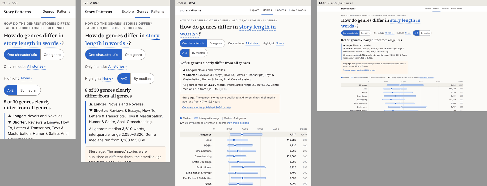
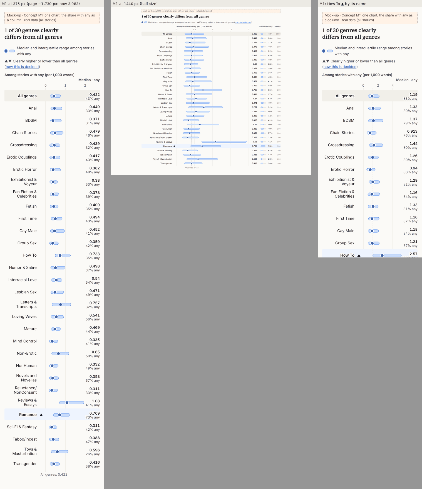
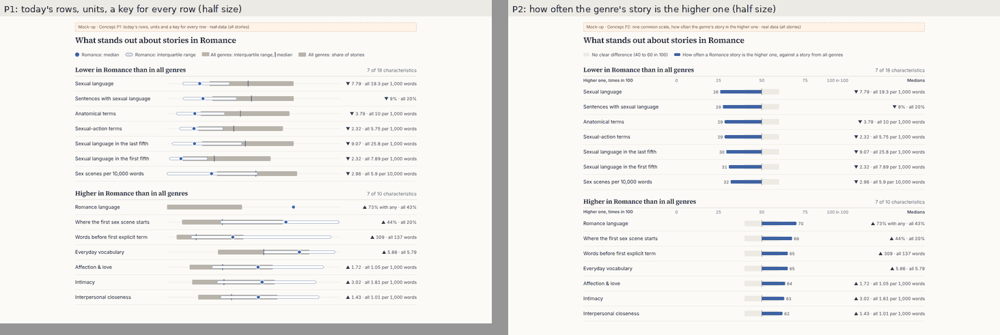
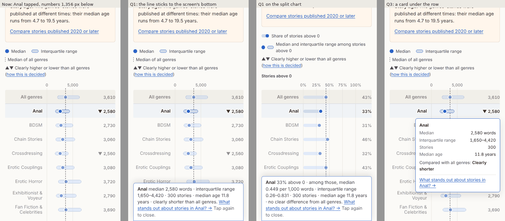
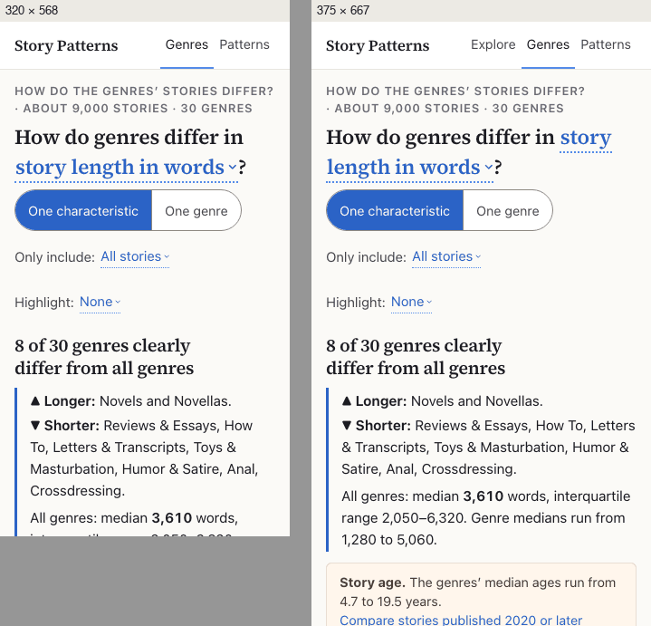
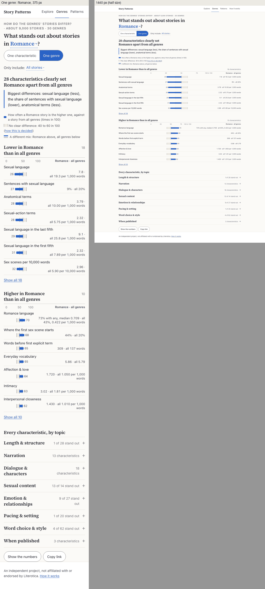

# The Genres page: an independent design review

*Phases 0–3 of `STAGE2_GENRES_PAGE_REVIEW_PROMPT.md`, October 9, 2026. Reviewed: branch `genres-page` at `c1ea0f5`
(10 commits on `main` at `a5118ce`; not merged, not pushed). **Status: approved and implemented** on branch
`genres-review` (October 10, 2026; not merged, not pushed), following `STAGE2_GENRES_REVIEW_IMPLEMENTATION_PROMPT.md`,
with the owner's decisions on section 8: keep the order toggle, with the order line (F75); r stays at two decimals
(a measurement since the review); View 2's Copy link and Show the numbers; titles from the question; concepts M1, P2
(with P1's units, key and mix label) and Q1; ideas I9 and I10, not I11; the wording as approved; the story-age note's
new coverage; one mark column beside the genre's name for every form. Sections 1–8 are the review as written; what
changed, with before and after numbers, is in section 10.*

- The design is in [`GENRES_PAGE_PROPOSAL.md`](GENRES_PAGE_PROPOSAL.md) (sections 1–12, mock-ups g01–g08) and what was
  built in its section 13. Rounds 1 and 2 of the site's review are [`DESIGN_REVIEW.md`](DESIGN_REVIEW.md) and
  [`DESIGN_REVIEW_2.md`](DESIGN_REVIEW_2.md); this review links to them rather than repeating them.
- **Screenshots** are in [`genres-review/`](genres-review/): `b…` the page as built, `m…` mock-ups, `a…` the page
  after the implementation (section 10). Phones at full size, 1440 px at half size, palette-compressed.
- **Mock-ups** draw the real aggregates. The static ones are in `Claude outputs/genres-review-mockups/` (`mock.html`
  and a README); the others inject CSS into the built page, or are a scratch build outside the repository. The
  measuring scripts I added, their raw outputs and every generated sentence are in
  `Claude outputs/design-review-2-tools/genres-review/` (listed at the end of the folder's `README.txt`); the
  implementation's scripts are in its `after/` subfolder.
- **Finding IDs** start at F60. Concepts use M, P and Q; ideas start at I9.
- "Measured" means a script or a screenshot backs it. Everything else is my judgment, and says so.

---

## 1. Verdict

The Genres page is a good page. It asks two clear questions, it answers each with a verdict heading and two short
lists, and it moves between "one characteristic" and "one genre" smoothly. Range and share rows are as clean as
Explore's. It loads without a single layout shift, never moves the page, and passes axe and Lighthouse's
accessibility audit. It belongs in the nav, and it reads as the same site.

Where it falls short is **honesty at the edges and distance on phones**. In small samples and in the split chart the
page says more than the data supports, in places the tests can't see. On a phone the evidence is a long way from the
answer: the chart starts 1.4 screens down, and a tapped genre's numbers can open two screens below the tap. None of the
fixes needs new data, a new rule or a new dependency.

| Area | Grade | In one line |
|---|---|---|
| Purpose and information architecture | **A−** | Two questions Explore can't answer, a clear switch, coherent links both ways; every tab and history entry has the same title. |
| Controls | **B** | The picker, the switch and the selects work and never move the page; three lines of controls on phones; the age note's button drops focus. |
| The answer above the chart | **B−** | Heading plus ▲▼ lists answer at a glance, but "of 30 genres" is wrong in 36% of charts, the lists' order is never explained, and the numbers mix their precision. |
| Range rows and share rows | **A−** | Clear and dense on desktop; the plot is narrow on phones (141 px at 375, 88 px at 320); no axis title. |
| 100% bars (named groups, bands) | **B** | Readable; colors alone say which group a segment is; the bands' light half is nearly one color; positions say "Higher / Lower". |
| The split chart (mostly zero) | **C+** | The right idea, but its ▲▼ sits beside the share above 0 and sometimes contradicts it; 3,933 px on a phone. |
| Details | **C+** | Complete numbers and a useful link, but on a phone they are out of sight for 23 of 31 rows; the desktop card covers 7–10 rows. |
| One genre (View 2) | **B−** | Strong lists and topics; a false "close to all genres" for small samples; a key that explains one of four row types. |
| Order and honesty | **B** | A–Z by default, D3 as opt-in, no causal words; the small-sample and split-chart issues above. |
| Words | **B** | Careful and non-causal; about a dozen generated sentences read badly. |
| Visual design | **A−** | Calm and editorial; desktop charts are the focus; on phones notes and controls push the chart down. |
| Accessibility | **B+** | One tab stop per chart, complete names, tables for every form, axe 0, Lighthouse 100; a focus drop, one label-in-name failure, color-only groups. |
| States and edge cases | **B** | Loading, errors and Retry are good; samples under 30 are mishandled in View 2's heading and View 1's count. |
| Performance | **B+** | First load untouched (152.1 KiB); a visit starting on Genres costs 203.5 KiB and 2.6 s on slow 4G, 0.4 s more than it needs. |
| Navigation and history | **A** | Addresses round-trip; Back, Forward and reload work; scroll is restored; the masthead link remembers. |
| Regressions elsewhere | **A** | None found on Explore, Patterns or How it works; one orphaned "→" on Explore at 375 px. |

**The three biggest problems**

1. **The page claims more than the data supports in three places.**
   - With "Published 2020 or later", View 2 says Chain Stories' 12 stories "are close to those of all genres on each of
     the 183 characteristics". None of them was compared: the rule needs 30 stories (F60).
   - In the split chart, ▲▼ sits beside the share above 0 even when that share goes the other way. How To reads
     "▼ 94%" against all genres' 75%, and "▲ 76%" against 83%. View 2 lists that second characteristic under "Higher in
     How To" with numbers that are lower (F61).
   - The heading says "of 30 genres" in 595 of 1,656 charts (36%) where fewer than 30 genres can be compared (F63).
2. **On phones the evidence is far from the answer.**
   - Tapping a genre puts its numbers in a line under the chart. For Anal that line is 1,356 px below the tap, two
     screens away. It is out of sight for 23 of the 31 rows (F62).
   - The split chart is 3,933 px long, and a genre's two halves are 1,459 px apart (F65).
   - The first genre row starts at 925 px at 375 × 667, and at 1,047 px at 320 (F69).
3. **The numbers look more, or less, precise than they are, and View 2's rows look comparable when they aren't.**
   - Three significant digits mix decimals in one column ("18" above "18.4", "0.769" next to "31.8").
   - Whole percents hide differences the marks point to: rare words read "▼ 2%" against all genres' 2%. That happens
     for 14 marked genres with all stories (F66).
   - In View 2, each row has its own scale, no ticks and no units, and the key explains one of the four row types
     (F67).

**What works: leave it alone**

- The two views, the switch between them and the links that join them. A link moves focus to the new question; Back
  returns with the scroll position restored.
- The verdict heading with its ▲▼ lists, and the D10 words. The answer is on a phone's first screen.
- Range and share rows: values printed, a Stories column, All genres first on its band, hatching for small groups.
- A–Z by default, with "By median" as an opt-in that keeps All genres first and breaks ties A–Z.
- The rule, and How it works' plain-words "60 times in 100".
- Loading: a placeholder that holds the place, no layout shift on arrival, no "Loading…" flash. The error and its
  "Try again".
- The masthead (D4) at every width from 320 to 1440 px. The Genres link remembers the last address and prefetches.
- One tab stop per chart, a full accessible name for every row, a table for every form, and forced colors.
- Zero page movement in 64 of 64 cases, and a first load that grew by only about 2.5 KiB (149.8 → 152.3 KiB on the
  Mac; 152.1 here).

---

## 2. Baseline (Phase 0)

### 2.1 How I tested

- **Code.** `genres-page` at `c1ea0f5`, exported with `git archive` into a Linux container. `main` is still at
  `a5118ce`, so nothing was merged.
- **Tests.**
  - `npm test`: 225 of 226 tests in 27 files passed. The real-data sentence scan in `genresWords.test.js` takes
    13.7 s on this 2-core container and timed out against Vitest's 5 s default; it passes with a longer timeout.
  - `npm run build` passes: the Genres chunk is 49.7 kB, 15.4 kB gzipped as Vite counts it.
  - `pytest tests/test_stage2_site_data.py`: 30 passed.
  - These are the counts section 13 reports.
- **Measuring.**
  - The build, frozen and served with gzip by `serve.mjs`.
  - Headless Chromium 1194 with Playwright 1.56 and axe-core 4.10.3, as in round 2, plus Lighthouse 12.8.
  - The widths, zoom levels and network profiles of rounds 1–2.
  - I ran the builder's scripts unchanged (`genres_acceptance.py`, `masthead`, `tapsgenres`, `snapgenres`, `clsgenres`,
    `heightsgenres`, `axegenres`, `forcedgenres`, `labelsgenres`, `firstbodies`). For everything else I wrote new
    scripts.
- **Fonts.** Here `system-ui` is Inter, as in round 2, not the Mac's San Francisco. Even so, the builder's page
  heights reproduce to the pixel. The wide-font check used DejaVu Sans, which is installed here.
- **Not done.**
  - A real phone, and the iOS Simulator. This session's shell on your Mac is a Linux VM, so it cannot start Xcode's
    Simulator, and I did not drive your screen.
  - VoiceOver, TalkBack and NVDA.
  - No Literotica page was opened. All data came from `site/public/aggregates/`.

### 2.2 Screenshots, and the build against the mock-ups

| View | Screenshot |
|---|---|
| First screens, `#/genres`, at 320, 375, 768 and 1440 px | [b01](genres-review/b01-first-screens-320-375-768-1440.png) |
| Numbers, Romance highlighted | [b02](genres-review/b02-numbers-highlight-375-1440.png) |
| Yes/no (How To: 119 stories) | [b03](genres-review/b03-yes-no-375-1440.png) |
| Named groups (narrative perspective with How To; pronoun composition) | [b04](genres-review/b04-named-groups-375-1440.png) |
| Ordered bands (author's story count; where sexual language peaks) | [b05](genres-review/b05-ordered-bands-375-1440.png) |
| Mostly zero, at 375, 759, 760 and 1440 px | [b06](genres-review/b06-mostly-zero-375-759-760-1440.png) |
| The split chart's mark beside a share that goes the other way | [b07](genres-review/b07-mark-beside-the-share.png) |
| Years, percentages, and rare words ("▼ 2%" against 2%) | [b08](genres-review/b08-years-percentages-rare-words.png) |
| 14 genres marked; none marked; talking to the reader | [b09](genres-review/b09-many-none-marked-1440.png) |
| By median, 2020 or later, Romance | [b10](genres-review/b10-by-median-2020-375-1440.png) |
| Small genres and "Fewer than 10 stories" | [b11](genres-review/b11-small-genres-375.png) |
| Long questions at 320 and 375 px | [b12](genres-review/b12-long-questions-320-375.png) |
| One genre: Romance, Show all, a topic open | [b13](genres-review/b13-one-genre-romance-375-1440.png) |
| One genre: How To (116), Fetish (none), Chain Stories 2020 (12 stories), fewer than 10 (an edited file through a Playwright route) | [b14](genres-review/b14-one-genre-edge-states-375.png) |
| One genre: share rows and "A different mix" | [b15](genres-review/b15-one-genre-mix-and-share-rows.png) |
| Explore's links: the D7 button, Keep exploring, the View 2 item | [b16](genres-review/b16-explore-links-375.png) |
| How it works, "Comparing genres" | [b17](genres-review/b17-how-it-works-genres.png) |
| The picker: empty, "romance", "month", a topic | [b18](genres-review/b18-picker-375-1440.png) |
| A tapped row on a phone: top, middle, last | [b19](genres-review/b19-tapped-rows-375.png) |
| The desktop card; the numbers table on a phone and a desktop | [b20](genres-review/b20-desktop-card-and-tables.png) |
| Loading on 3G, a new option loading, the error, 400% zoom | [b21](genres-review/b21-loading-error-zoom.png) |
| Forced colors (dark and light) | [b22](genres-review/b22-forced-colors-dark-375.png) |
| The masthead at 320–1440 px | [b23](genres-review/b23-masthead.png) |

**The build against the mock-ups (g01–g08)**

| Mock-up | Where the build departs | Better or worse |
|---|---|---|
| g01, g02 (one characteristic) | The heading puts the genres first ("8 of 30 genres clearly differ…") | Better: it reads naturally for plural nouns |
| | On phones the controls take three lines, not two: the D3 toggle, and "Only include" on its own line | Mixed: longer, but a longer option never re-wraps the controls below it |
| | The note under the chart ("Genres in alphabetical order. ▲▼ marks…") is gone | Worse: nothing says what order the rows, or the lists, are in (F75) |
| | "Open in Explore →" instead of "How story length in words relates to popularity →" | Shorter, but it no longer says why one would go |
| | No Menu button (D4) | Better: one tap less |
| g03, g04 (one genre) | Mostly-zero rows say "73% above 0 · all 43%", where the mock-up said "0.474 · all 0" | Better |
| | "Each genre is a random sample of about 300 stories" left out | Fine: How it works says it |
| g05 (yes/no) | The same | |
| g06 (named groups) | ≠ has its own column, and there is a Stories column | Better |
| g07 (mostly zero) | "Stories above 0" instead of "Stories with any"; the line under the chart that said why it splits is gone | Worse for first-time readers (F79) |
| | Side by side from 760 px, stacked below | As specified, but long on phones (F65) |
| g08 (alternatives) | Sorting by median is a toggle (D3) | As decided |

### 2.3 What the builder did not measure

**Time and bytes** (375 × 667; first chart = the first row drawn)

| Visit | Local | Fast 4G | Slow 4G (4× CPU) | 3G (4× CPU) |
|---|---|---|---|---|
| Starts on `#/genres` (203.5 KiB, 8 requests) | 0.58 s | 0.89 s | 2.63 s | 6.62 s |
| Starts on View 2 (Romance; the same files) | 0.55 s | 0.90 s | 2.50 s | 6.38 s |
| Starts on `#/explore`, for comparison (158.2 KiB with headers) | 0.28 s | 0.94 s | 2.33 s | 5.08 s |
| `#/genres`, file fetched at start (a scratch build, F68) | | 0.54 s | 2.21 s | 5.85 s |

| Change | Bytes | Fast 4G | Slow 4G | 3G |
|---|---|---|---|---|
| Another characteristic | 0 | 0.03 s | 0.15 s | 0.24 s |
| Another option (a new file) | 53.8 KiB | 0.14 s | 0.62 s | 1.60 s |
| The view switch | 0 | 0.11 s | 0.35 s | 0.38 s |

- The largest paint is the takeaway's first list (View 1) or the takeaway (View 2).
- Lighthouse 12.8 (mobile, simulated throttling):
  - View 1: 93 performance, 100 accessibility, 100 best practices, 100 SEO; largest paint 2.6 s, blocking time 200 ms.
  - View 2: 97, 100, 100, 100; largest paint 2.6 s.
  - Explore: 99, 100, 100, 100; largest paint 1.8 s.
- Both Genres runs fail Lighthouse's label-in-name check (F76).
- The longest request chain is the page itself → `index.js` → `GenresPage.js` → `genres/all.json`. The file waits for
  the page's code (F68).

**Responsiveness** (files cached; time to the next paint; longest task)

| Action at 375 px | 1× | 4× CPU | 6× CPU |
|---|---|---|---|
| Another characteristic (range rows) | 5 ms | 108 ms (one 109 ms task) | 172 ms (187 ms) |
| Another characteristic (split chart, named groups) | 22–36 ms | 180 ms (192 ms) | 276–280 ms (293 ms) |
| Order toggle | under one frame | worst frame 117 ms | worst frame 167 ms |
| Another option (file cached) | 23 ms | 79 ms | 76 ms |
| View switch | 24 ms | 93 ms | 157 ms |
| View 2, Show all | 1 ms | 23 ms | 59 ms |
| View 2, every topic of How To opened at once (271 rows) | 6 ms | 504 ms, 8 long tasks, worst frame 267 ms | 620 ms, 9 long tasks |
| Picker open | 1 ms | 65 ms | 140 ms |
| Picker, per key ("romance") | 46–80 ms | 115–257 ms | 165–348 ms |

- At 1440 px the numbers are similar, some lower and some higher: the picker's keys take 120–305 ms at 4× and
  182–392 ms at 6×; every topic at once takes 543 ms at 6×, with a worst frame of 400 ms.
- The picker is Explore's own. Measured the same way on Explore, a key takes 131–272 ms at 4× and 184–371 ms at 6×.
  Round 2's 4–33 ms used a different method (scripted input events), so the two sets of numbers can't be compared.

**Real glyph boxes with a wide font.** I ran the builder's `labelsgenres.mjs` on all 185 characteristics with All
stories, 2020 or later and Under 2,000 words, at 320, 375, 768 and 1440 px: 2,613 charts.

- **The site font** (Inter here) reports 3,698 contacts, all of one kind. A one-line genre name and its "N stories"
  line under it overlap by 2.0 px of em box, at 320 and 375 px. Nothing visibly collides, but the descenders of
  "Couplings" come within about a pixel of the digits.
- **DejaVu Sans:** nothing in View 1. In View 2 there are 8 one-pixel contacts between a plot's empty right edge and the
  values of "Pronoun composition", which don't show.
- **Two of the builder's checks** use a genre id that doesn't exist, `fan-fiction-and-celebrities` (the real one is
  `celebrity-stories`), in `tapsgenres.mjs` and `labelsgenres.mjs`. Those cases silently ran on the default genre.

**Where the details appear** (`detailsgenres.mjs`; the row tapped 300 px from the top of a 375 × 667 screen)

| Row tapped | Where its numbers are | In view? |
|---|---|---|
| Anal (top) | 1,356 px below the row | No |
| Interracial Love (middle) | 740 px below | No |
| Transgender (last) | 80 px below | Yes |

- **Phones.** The same holds for share rows, 100% bars and the split chart. Each half of the split chart has its own
  line: at about 2,250 px and about 3,710 px. Only about the last 8 rows show their numbers on screen.
- **Desktop.** The card is 208–297 px tall and covers 7–10 rows. For a row in the lower half of a 1440 × 900 screen it
  hangs below the screen.
- **Keyboard.** The focused row is never covered, so WCAG 2.4.11 passes. But stepping down with ↓, the card was below
  the screen in 3 of 4 sampled positions.

**Tap areas** (`taprows.mjs`, `elementFromPoint` every 2 px)

| Target, 320 and 375 px | Height | Owns its box |
|---|---|---|
| Chart rows, every form | 44 px | 100% |
| View 2 rows | 56 px | 100% |
| "Show all" | 44 × 79 px | 100% |
| Topic summaries | 52–73 px | 97% |
| The controls (`tapsgenres.mjs`) | | 94–100% (the worst: the question's word at 320 px, 34 px tall) |

**The accessibility tree** (aria snapshots; the full text is in `genres-review/a11y.txt` in the tools folder)

- **What works.**
  - The question is a group with a button named "Story characteristic: story length in words".
  - The switch and the order are radio groups.
  - Each chart is a group named by its question and heading, and every row is an image whose name holds all its
    numbers and the comparison.
  - The tables have captions and row headers.
  - View 2's rows are links with full names.
- **What doesn't.**
  - "Open in Explore →" is named "Open Word count in Explore", so the visible words are not in its name (F76).
  - On phones, the split chart's two plots repeat every genre's full name, so a screen reader hears each genre twice.
  - View 2's topic headings sit inside `
`, whose button role flattens them in some screen readers.

**Announcements** (the live region, after each control)

- After Highlight: nothing. Right, since the words don't change.
- After "By median": the whole heading and takeaway again, about 45 words, with nothing about the order (F75).
- After another option, another characteristic or the view switch: the new heading and takeaway. Good.

**Focus after each action**

| Action | Where focus lands |
|---|---|
| The view switch | Stays on the radio |
| A link between the views (a details link, a View 2 row) | The question, as designed |
| "Show all" and a topic | Stay on the control |
| "Try again" | The page's main area |
| "Open in Explore" | The body, on Explore's page (as any page link) |
| **The age note's "Compare stories published 2020 or later"** | **The body: the button is gone (F64)** |

**Contrast** (WCAG formulas, computed from the stylesheet's colors)

- **Text.** All of it passes. The lowest is the muted counts on the All genres band, at 4.58:1. The age note is 9.5:1.
  Shares printed on segments are 5.1–14.4:1.
- **Non-text (1.4.11).**
  - The interquartile capsule's outline is 3.26:1 on the page, but 2.96:1 on the All genres band.
  - View 2's gray band (#d9d5cc) is 1.40:1 against the page.
  - The genre's capsule fill against that band is 1.05:1, and its outline 2.33:1. The dot passes, at 3.87:1.
  - Named-group segments against the page: beige 1.68, near-white 1.13, light blue 2.01, orange 2.61, gray 2.44. The
    bar's outline is 1.50.
  - Neighboring band colors are 1.19–1.34:1 in the light half, 2.44:1 at the jump, and 1.28–1.65:1 in the dark half.

**Display settings.**

- Forced colors, light and dark: everything readable. Named groups keep their own colors, as intended.
- Reduced motion: nothing animates anyway (below).
- 200% zoom (720 px at scale 2) and 400% zoom (320 CSS px): no sideways scroll, and the picker's sheet works.

**History** (`history.mjs`)

- Back, Forward and reload give the right view after:
  - the view switch;
  - a link between the views;
  - arriving from Keep exploring.
- Controls replace the address, so Back skips them.
- Back after a View 2 row returns to its scroll position (600 px), and Back after a details link to its own (879 px).
- The masthead's Genres link returns to the last address.
- The age note's button replaces the address too, so Back cannot undo that comparison. That is consistent with
  Explore's "Switch to …", and fine once focus is fixed.

**Every generated sentence, read** (`sentences.mjs` wrote 5,148 lines: every characteristic with All stories and
with 2020 or later, and every genre's View 2). These read badly:

| Sentence | Where |
|---|---|
| "Genre medians run from middle to middle." | Where descriptive and sensory language peaks |
| "interquartile range 1–1" | A genre's number of pages |
| "interquartile range −0.333–0.0588"; "−2.12–8.51" | Hedging ↔ certainty; build-up of emotional language |
| "interquartile range -7%–11%. Genre medians run from -4% to 5%." (a hyphen, not a minus) | Build-up of dialogue |
| "74% of stories are above 0; among those, median 0.1%, interquartile range 0%–0.2%" | Unrecognized words |
| "median 21–50, interquartile range 6–20 to 51–100" (21–50 what?) | Author's story count |
| "▼ Lower: Non-Erotic, Reviews & Essays, How To." (for a position: earlier) | Where sexual language peaks (the other four peak positions have no marked genre) |
| "All genres: median 0.2 words, …" (the data's unit) | Subordinate clauses per sentence |
| "Biggest differences: publication year (older), story age (older), …" (one fact twice; also Transgender: newer, newer) | View 2 |
| "the use of ‘we / us / our’ (higher), the use of ‘we / us / our’ in the narration (higher)" | View 2, Loving Wives |
| "word variety (type–token ratio) (higher)" | View 2, Humor & Satire |
| "sexual language (less), the share of sentences with sexual language (lower), anatomical terms (less)" | View 2, Romance (D10 words mixed with generic ones) |
| "Its stories are close to those of all genres on each of the 183 characteristics." (12 stories, none compared) | View 2, Chain Stories, 2020 or later (on screen, [b14](genres-review/b14-one-genre-edge-states-375.png)) |
| "Options that would leave only one group of word count are turned off." | Hidden note (the label, not the noun) |
| "How common are stories whose title marks a chapter or part in each genre?" | Reads as "a part in each genre"; leave it |

The other questions, headings, lists and row names read well. Nothing is causal, and the spelling is US throughout.

---

## 3. The builder's claims, checked

### 3.1 Acceptance numbers (13.3) and measurements (13.4)

| Claim | Check |
|---|---|
| 185 characteristics: num 117, zero 45, bin 13, band 6, grp 4 | **Confirmed** (`genres_acceptance.py`) |
| 5,547 pairs; 922 clearly differ | **Confirmed** |
| Per genre 0 / 22 / 116 | **Confirmed**, with the caveat the builder gives: the true median of 30 counts is 20.5 (19 and 22) |
| Romance 28 (18 lower, 10 higher); anatomical terms third, from ties at two decimals | **Confirmed** |
| Fetish 0, How To 116, Reviews & Essays 115, Erotic Couplings 10, Anal 28 | **Confirmed** |
| Story length: 8 genres; Anal before Crossdressing (a tie) | **Confirmed** |
| First person 9; narrative perspective 9; romance language only Romance; 25 with no genre | **Confirmed** |
| First load 152.3 KiB in 6 requests | **Different: 152.1 KiB.** Node's gzip in this container makes `meta.json` 19.1 KiB; the requests are the same |
| Genres chunk 14.9 KiB, CSS 2.2, `genres/all.json` 51.8 KiB; a visit 203.6 KiB in 8 requests | **Confirmed within gzip noise:** 15.0, 2.2, 51.7; 203.5 KiB in 8 |
| Files 53.0–56.7 KB gzipped | **Confirmed** (pytest checks the real files) |
| axe: none in 32 runs | **Confirmed**: 32 runs, 0 violations |
| Glyph boxes: 0 problems in 2,613 charts | **Different** with this font: 3,698 em-box contacts of 2 px between a name and its count, none visible (section 2.3). With DejaVu Sans: nothing in View 1, and 8 one-pixel contacts in View 2 that don't show |
| Masthead: nothing wraps, clips or scrolls at 320–1440 px | **Confirmed** (1,121 widths) |
| Tap areas 90–100% | **Confirmed**: 94–100% |
| Page movement 0 px in 64 of 64 | **Confirmed** |
| Forced colors readable | **Confirmed** |
| Layout shift 0.000 / 0.001; 0.091 at 375 px after another option | **Confirmed**, to the third decimal |
| Heights: 2,502 / 1,803; first row at 881 / 659; split chart 3,933; View 2 2,194 / 1,838, 2,566 / 2,191, 1,109 / 1,046 | **Confirmed** to the pixel. "First row" is the All genres row; the first genre row starts 44 px lower (925 at 375 px) |

### 3.2 "Still open" (13.7) and "Things the builder noticed"

| Item | Check |
|---|---|
| Real devices, screen readers | Still open: I couldn't either (section 2.1) |
| First chart row at 881 px on 375 × 667 | **Confirmed.** The first genre row is at 925, and at 1,047 at 320 (F69) |
| Ties at two decimals | **Confirmed** (13.3). Three decimals would end them, but cost about 3 KB per file, not 1 (question 2) |
| Layout shift 0.091 after another option | **Confirmed** |
| Chunk 14.9 KiB against 6–9 KB estimated | **Confirmed.** It is lazy, so it costs only a visit to the page |
| Split chart 3,933 px; halves "about 1,700 px" apart | **Different: 1,459 px** between a genre's share row and its range row |
| Forced colors keep named groups' colors | **Confirmed** |
| Story-age note on every chart with All stories, same words | **Confirmed**, including publication year and story age, where it repeats the chart (F71) |
| Tapped details nothing scrolls into view; about 1,300 px below a top row | **Confirmed: 1,356 px** for Anal (F62) |
| Desktop card covers about seven rows | **Confirmed: 7–10 rows**, 208–297 px (F70) |
| Plot about 150 px at 375, two tick labels | **Confirmed: 141 px**, 0 and 5,000. **88 px at 320** |
| Dashed line labeled only under the axis | **Confirmed** |
| Three significant digits mix decimals | **Confirmed**, and whole percents hide marked differences (F66) |
| Lists ordered by size, never said | **Confirmed** (F75) |
| Heading always "of 30" | **Confirmed: wrong in 595 of 1,656 charts** (F63) |
| View 2 takeaway mixes D10 and generic words | **Confirmed** (F78) |
| View 2 values without units | **Confirmed** (F67) |
| "above 0" | Clear enough for rates, awkward for shares ("82% above 0" for the first-person share of pronouns). I'd go back to "with any" (F79) |
| Sentences read badly | **Confirmed**: about a dozen (section 2.3) |
| Same page title for every view | **Confirmed.** Explore names the chart in its title (F73) |
| Rank palette, near-white color, small segments, forced colors | **Confirmed**: 1.13:1 near-white, segments under 34 px unlabeled (F72) |
| Bands skip the middle blues | **Confirmed.** The order reads as two groups, light and dark, not a sequence: neighbors 1.19–1.34:1 (F72) |
| Palettes hard-coded in `genreLayout.js` | **Confirmed.** Move them to `styles.css` variables with F72 |
| View 2 rows on their own scale, capsule over the gray band | **Confirmed**: fill 1.05:1 against the band (F67) |
| "By median" order never explained | **Confirmed** (F75) |
| Nothing moves on a new order | **Confirmed**: the dots are at their new places 60 ms after the click (I10) |
| The view switch carries the genre silently; "Compare" only for screen readers | Confirmed. It works without being said; leave it |
| Controls take three lines on phones | **Confirmed**, and four at 320 px (F69) |
| A conflicting characteristic resets the option silently | Confirmed. It is Explore's behavior; leave it |
| The age note's button replaces the address | **Confirmed**, and it drops focus (F64) |
| View 2 has no Copy link and no table | Confirmed (question 3) |
| Rows focusable images; View 2 rows links; no real screen reader | Confirmed (section 2.3) |
| The live region repeats on an order change | **Confirmed** (F75) |
| Question's word 34 px, View 2's select 36 px on phones | **Confirmed** (34 and 36) |
| 203.6 KiB in 8 requests; `all.json` 51.8 KiB; slow networks not timed | **Timed** (section 2.3): 2.63 s on slow 4G, 6.62 s on 3G |
| Each other option about 55 KB | **Confirmed: 53.8 KiB** |
| View 2 with every topic open, about 200 plots | **271 rows for How To**; 504 ms at 4× CPU, 620 ms at 6× |

### 3.3 Judgment calls (13.6) I would reverse

| # | Call | Instead |
|---|---|---|
| 15 | The live region repeats the heading and takeaway when only the order changes | Say only what changed: "Genres in order of their median, highest first." / "Genres in alphabetical order." (F75) |
| 19 | Three significant digits rather than one number of decimals per column | One number of decimals per chart, as Explore prints; percentages with one decimal when they are small (F66) |
| 27 | The rank palette, with groups told apart by color alone | Keep the colors; name the groups on the All genres bar (F72) |
| 33 | View 2's key from g03 (num rows only) | A key that covers every row type shown (F67) |

The other 35 calls look right to me. Nos. 8, 14, 17, 24, 26 and 32 are good decisions.

---

## 4. The tasks (Phase 1)

**1. A curious first-time visitor on a phone taps "Genres".**

- **Phone.**
  - Within five seconds the kicker and the question say what the page answers: "How do the genres' stories differ?"
    and "How do genres differ in story length in words?".
  - The heading and the ▲▼ lists are on the first screen.
  - How the page differs from Explore is only implicit: there is no popularity measure in the question. The tab
    title still asks Explore's question, "What do popular Literotica stories have in common?" (F73).
  - The second view is easy to find: "One characteristic | One genre" is the first control.
  - Most people will read the lists and stop. The chart starts at 925 px (F69), and on a phone its plot is 141 px wide
    with two ticks.
- **Desktop.** The whole chart shows by 1,800 px, and the answer and the chart's top fit on one screen.

**2. A Romance writer wants to know what sets Romance stories apart.**

1. *Finding it.* "One genre" opens with Romance if they came from Explore with Romance. A first-time visitor gets
   Erotic Couplings (D8) and picks Romance from the select.
2. *Reading View 2.* "28 characteristics clearly set Romance apart from all genres" and the two lists read well. But
   "7.79 · all 19.3" has no unit (F67).
3. *One difference across all genres.* Tapping "Sexual language" opens View 1 with Romance highlighted and focus on
   the question. Romance's row is 2,073 px down on a phone (1,465 on a desktop). The ▼ Less list names it, but
   nothing takes the reader to the row (I9).
4. *Recent stories.* The age note isn't shown in View 2 for Romance (10.7 against 9.3 years). In View 1, "Compare
   stories published 2020 or later" switches the option, but it drops keyboard focus (F64).
5. *Popularity.* "Open in Explore →" opens Explore for sexual language in Romance, with the measure last used.
6. *Desktop.* The same, without the scrolling.

**3. A reader of a small genre (How To) wants to know whether its stories are longer or shorter.**

- *The answer.* "▼ Shorter: … How To …" answers at once, and How To's row reads "▼ 1,500".
- *Where it sits.* "By median" puts it 29th of 30.
- *A small option.* With "5,000 words or more" the chart conflicts and the option is turned off, which is right. With
  "Published 2020 or later" How To has 68 stories and is still compared.
- *Missing values.* For first-person narration, "119 stories" under How To's name explains the missing values well.
- *Small genres elsewhere.*
  - With "Published 2020 or later" the story-length heading still says "8 of 30" while Chain Stories (12 stories)
    is hatched and can't be compared (F63).
  - Its View 2 then says its stories are "close to those of all genres on each of the 183 characteristics" (F60).

**4. "Which genres have the most dialogue?"**

- *Finding the characteristic.* Typing "dialogue" puts Dialogue share first among 24 matches.
- *The answer.* "6 of 30 genres clearly differ", with "▲ More dialogue: Novels and Novellas".
- *The order.* "By median" is easy to find next to Highlight. It reads as a league table: Novels and Novellas 25% at
  the top, and unmarked genres ranked by single points.
  - The marks show which genres clearly differ from all genres, but nothing says that neighbors in the order may not
    differ from each other (F75).
- *The other chart forms.*
  - Yes/no rows are immediately clear.
  - Narrative perspective's 100% bars need the five-color legend. The blue changes meaning from chart to chart (F72).
  - The split chart's "Stories above 0" needs a moment for "romance language"; for the first-person share of pronouns
    it doesn't parse (F79).

**5. A skeptic.**

| Question | Can they find the answer? |
|---|---|
| What does "clearly differ" mean? | Yes: "how this is decided" in the legend leads to "Comparing genres", whose "60 times in 100" is good. On phones it is the fourth legend line |
| Why does Fetish have nothing? | The sub-line says its stories are close to all genres', which is fair for 300 stories, but no reason is given |
| Why compare with all genres, which include the genre? | Not answered anywhere. How it works says "the stories of all genres" without saying the genre is in them, or that Erotic Couplings is 11.7% of the total (F74) |
| How many stories is a number based on? | Yes: the Stories column, counts under names on phones, the details and the table |
| Why is a genre whose median looks far off not marked? | Partly. "20 percentage points" explains Gay Male's unmarked 75% first-person stories against 57%. Nothing explains why How To is ▼ beside a share of 94% against 75% (F61), or ▼ beside the same "2%" as all genres (F66) |

**6. Keyboard-only and screen-reader users.**

- *What works.*
  - The question's word opens the picker with Enter.
  - The switches are radio groups (arrows switch at once).
  - The selects are native.
  - Each chart is one tab stop with ↑ ↓ Home End. Tab reaches the details' link, and Escape returns.
  - Every row says all its numbers. The 100% bars' names list every share; the table has every number.
  - View 2's rows are links with full names. "Show all" says its state; the topics open with Enter.
- *Where it breaks.*
  - After the age note's button, focus falls to the page (F64).
  - The split chart on phones is two tab stops, and every genre is said twice (F65).
  - "By median" re-reads about 45 words (F75).
  - "Open in Explore" can't be found by voice by its visible words (F76).

**7. A 15-minute explorer between Explore and Genres.**

- The journey holds together:
  - "See this pattern in every genre" stays in Explore (popularity);
  - Keep exploring's new item goes to Genres;
  - "Open in Explore" comes back;
  - Back retraces every step, with scroll restored;
  - the masthead's Genres link returns to where they were.
- The two ways of comparing genres are told apart by their words ("pattern" against "stories"). I didn't see them
  being confused.
- *Fishing.* Switching characteristics while watching the heading's count is the obvious way to fish. The counts are
  honest about how many genres differ, and View 2's lists rank characteristics within one genre only. I think it
  stays within the rules.

**8. Someone shares two links; the friend opens them on a phone.**

- *View 1, Romance highlighted, by median.* The friend sees the question, the controls (Highlight: Romance, By median),
  the heading and the lists. Romance's highlighted row is wherever its median puts it, below the first screen.
- *View 2 Romance.* It opens to the same heading as the sender's.
- *Out of context.* The answer survives: heading and lists don't depend on the sender's scroll.
- *The tab title.* It is "Genres · What do popular Literotica stories have in common?" for both (F73).
- *Link previews.* They can't be specific: the address after `#` never reaches a server, so every preview shows the
  site's card.
- *Copying the link.* View 2 has no Copy link, so on a phone the sender needs the browser's share sheet (question 3).

**9. A slow phone (slow 4G, 4× CPU) opens a shared View 2 link, switches to recent stories and opens three topics.**

- Its first paint arrives at 2.5 s.
- "Published 2020 or later" costs 54 KiB and about 0.6 s, with the old answer dimmed meanwhile. The visit itself
  shifts nothing (0.000). I measured an option change only in View 1: 0.091 at 375 px, under the 0.1 limit.
- Each topic opens in 70–150 ms (the 62 rows of Word choice & style take the longest). Every topic at once takes
  0.5 s.
- Nothing here needs fixing beyond F68.

---

## 5. Findings (Phase 2)

Each finding gives the evidence, why it matters, a fix, and **impact / effort**.

- "(needs your approval)" marks a change of wording or meaning.
- "(revisits an owner decision)" marks a challenge to one of D1–D10 or to a decision that stands.
- "(touches a hard rule)" marks the hard rules' territory.

### High impact

**F60. View 2 calls a genre's stories "close to all genres" when there were too few to compare.** *High / small.*
*(needs your approval)*
- *Evidence (measured).*
  - `#/genres?view=genre&genre=chain-stories&include=y2020`: "No characteristic clearly sets Chain Stories apart from
    all genres. Its stories are close to those of all genres on each of the 183 characteristics." Chain Stories has
    12 stories there, and the rule needs 30, so not one characteristic was compared
    ([b14](genres-review/b14-one-genre-edge-states-375.png)).
  - The same happens for Transgender with "Published 2000–2009" (19 stories), and for How To (13), Letters &
    Transcripts (29) and Reviews & Essays (15) with "5,000 words or more".
- *Why.* This is the page's only flatly false sentence, in the place a skeptic checks first.
- *Fix.*
  - Treat fewer than `rule.min_n` (30) stories like fewer than 10: the heading "Fewer than 30 stories in Chain
    Stories match “Published 2020 or later”: too few to compare." and the "Show all stories" button. That is today's
    "too few" sentence with the rule's number.
  - Keep the topics below, hatched, since their numbers exist for 10 or more stories.

**F61. In the split chart, ▲▼ sits beside the share above 0, which can go the other way; View 2 then lists the
characteristic under the wrong-looking numbers.** *High / small to medium.*
- *Evidence (measured).*
  - `#/genres?var=pov_first_singular_narr_per_1k&include=short&genre=adult-how-to` at 1440 px: How To reads "▼ 94%"
    against all genres' 75%. Humor & Satire reads "▼ 74%" against 75%.
  - `var=rep_repeated_5gram_per_1k`: How To reads "▲ 76%" against 83% ([b07](genres-review/b07-mark-beside-the-share.png)).
  - The mark comes from the rank-biserial r on every story, zeros included. The share above 0 is only half of that
    picture.
  - Marked genres whose share is on the other side of all genres', or within 5 points of it: 3 of 153 with All stories,
    41 with "5,000 words or more", 9 with "At least 10,000 views", 7 with 2020 or later, 4 with Under 2,000 words.
  - View 2 shows only the share for these rows. So "Higher in How To than in all genres" lists "Repeated five-word
    phrases · 76% above 0 · all 83%" ([b15](genres-review/b15-one-genre-mix-and-share-rows.png)).
- *Why.* A reader checks a mark against the number beside it. Here the number says the opposite.
- *Fix.*
  - **(a)** Put the mark in its own column beside the genre's name, as named groups do (the ≠ column), in both
    halves. No wording changes.
  - **(b)** In View 2, give mostly-zero rows the median among stories above 0 as well:
    "76% above 0, median 2.57 · all 83%, 1.19". Draw them as num rows, on the stories above 0 with the share as a
    second value.
  - Concept M (section 7) does both.

**F62. On a phone, a tapped genre's numbers open out of sight.** *High / small.* *(revisits an owner decision: the
place of K1's line on this page)*
- *Evidence (measured).*
  - At 375 × 667, tap Anal 300 px from the top. Its line opens 1,356 px below, two screens down. The screen shows only
    the dimmed chart with Anal bold.
  - Middle rows: 740 px below. Only about the last 8 of 31 rows show their numbers
    ([b19](genres-review/b19-tapped-rows-375.png)).
  - On Explore, K1's line is at most 12 rows away (the months). Here a chart has 31 rows of at least 44 px.
- *Why.* The tap looks broken, and "What stands out about stories in Anal? →" is unreachable.
- *Fix.*
  - Concept **Q1**: keep K1's line, but make it stick to the screen's bottom while its chart is on screen. That is
    `position: sticky; bottom: 0`, the treatment the compare table's tapped cell already has (F53, `.cell-detail`).
  - Measured with the CSS injected, the line sits at 548–667 px right after the tap
    ([m06](genres-review/m06-concept-Q-tapped-row-375.png)).

**F63. "of 30 genres" when fewer can be compared.** *High / small.* *(needs your approval)*
- *Evidence (measured).*
  - 595 of the 1,656 View 1 charts have fewer than 30 genres with 30 or more stories.
  - That is every chart with "Published 2000–2009", "Published 2020 or later" and "5,000 words or more" (550), 31 with
    Under 2,000 words, and 14 in the other options.
  - Example: `…&include=y2020` says "13 of 30 genres clearly differ from all genres" while Chain Stories (12, hatched)
    can't be compared ([b10](genres-review/b10-by-median-2020-375-1440.png)).
- *Why.* The denominator is the claim's base. "13 of 30" implies 17 were compared and found close.
- *Fix.* Count only the genres compared, and name the others after the lists:
  - "13 of 29 genres clearly differ from all genres."
  - "Too few stories to compare: Chain Stories (12)."

  This reuses the page's own phrase "too few stories to compare".

**F64. The age note's button drops keyboard focus.** *High / small.*
- *Evidence (measured).* After "Compare stories published 2020 or later", in View 1 or View 2, `document.activeElement`
  is the body. The button vanishes: the note shows only with All stories. This is round 2's F37 again.
- *Fix.*
  - Move focus to the panel's heading (`tabIndex={-1}`, `preventScroll`), whose new words the live region also says.
  - In View 2, as Back can't undo it, consider pushing a history entry: it is a comparison the reader may want to
    leave.

### Medium impact

**F65. The split chart is 3,933 px on a phone, and a genre's two halves are 1,459 px apart.** *Medium-high / medium.*
- *Evidence (measured).*
  - `#/genres?var=rel_romance_per_1k` at 375 px: page 3,933 px.
  - Anal's share row is at 898 px and its range row at 2,357. Romance's are at 1,998 and 3,457.
  - Each half is its own tab stop, with its own details line (at about 2,250 and 3,710 px)
    ([b06](genres-review/b06-mostly-zero-375-759-760-1440.png)).
- *Why.* Nobody compares a genre's two numbers across three screens. Readers will see one half and miss the other.
- *Fix.* Concept **M1**: one chart, one row per genre, with the range among stories with any and both numbers. 1,731
  px for the page at 375 px ([m02](genres-review/m02-concept-M1-one-chart.png)).

**F66. Numbers are more precise than they look in some places, and less in others.** *Medium / small.*
- *Evidence (measured).*
  - **Mixed decimals.** Three significant digits mix them in one column and one sentence:
    - "18" above "18.4", "0.769" beside "31.8" ([b10](genres-review/b10-by-median-2020-375-1440.png));
    - "median 43 words, interquartile range 31.7–62.2. Genre medians run from 36.3 to 64";
    - "88" beside "88.4" ([b07](genres-review/b07-mark-beside-the-share.png)).
  - **Whole percents hide marked differences.** 14 marked genres with All stories print the same median as all genres:
    - rare words: five genres "▼ 2%" against 2%;
    - repeated three-word phrases: three genres "▼ 2%" against 2%;
    - pages: four genres "▼ 1" against 1.
  - **"0%" inside "above 0"**: "among those, … interquartile range 0%–0.2%".
  - **Negatives.**
    - Percentages use a hyphen for minus ("-7%"), while numbers use "−".
    - A range with a negative end reads "−0.333–0.0588".
- *Why.* Explore prints one number of decimals per column. Here a reader sees precision change from row to row, and a
  ▼ beside a number that equals the reference.
- *Fix.*
  - One number of decimals per chart, set by the All genres median at three significant digits ("43.0" → "43",
    "31.7" → "32"), with no fewer than two significant digits for any value.
  - Percentages get one decimal when the All genres median is under 10% ("1.9%" against "2.3%").
  - Never "0%" for a value above 0: write "<0.1%".
  - "−" in percentages.
  - "to" between the ends of a range when either is negative ("−0.333 to 0.059").
  - The table and the details follow the chart. No wording changes.

**F67. View 2's rows look comparable but aren't, and the key explains one row type of four.** *Medium / medium.*
*(needs your approval)*
- *Evidence (measured).*
  - **The key.** It says gray is "All genres: interquartile range, | median". In yes/no and mostly-zero rows the gray
    bar is a share from 0, and the dot a share.
  - **Mix rows.** "A different mix" draws two thin 100% bars with no word for which is the genre. Colors are re-ranked
    per characteristic.
  - **Scales and units.** Each row runs from all genres' 10th to 90th percentile, and nothing says so. There are no
    units ("7.79 · all 19.3").
  - **Contrast.** The gray band is 1.40:1 against the page, and the genre's capsule fill 1.05:1 against the band
    ([b15](genres-review/b15-one-genre-mix-and-share-rows.png)).
  - **Lengths mislead.** A gap of 0.07 on everyday vocabulary (5.86 against 5.79, r 0.30) draws as long as one of 11.5
    on sexual language (r −0.48).
- *Why.* The lists are ordered by the size of the difference, but the drawings don't show that size, so the order looks
  arbitrary and short gaps look big.
- *Fix.* Concept **P** (section 7). At least P1:
  - units in the values;
  - a key line for share rows and for mix rows ("upper bar: Romance");
  - an outline for the gray band (1 px #8f8a80, 3.29:1 against the page), and for the genre's capsule (1.5 px
    #2b63c6, 3.87:1 against the band). No single gray can reach 3:1 against both the page and the blue, so the
    outlines carry the contrast.

  P2, my recommendation, draws every row on one common scale: how often the genre's story is the higher one.

**F68. The genres file waits for the page's code.** *Medium / small.*
- *Evidence (measured).*
  - The requests form a chain: page → `index.js` → `GenresPage.js` → `genres/all.json` (Lighthouse's request tree,
    and the order of the requests in `perfgenres.mjs`).
  - In a scratch build that fetches the file and the code as soon as the app starts on `#/genres` (three lines in
    `App.jsx`'s first route; +20 bytes to the main chunk), the first chart comes sooner:

    | Network | Now | File fetched at start |
    |---|---|---|
    | Fast 4G | 0.89 s | 0.54 s |
    | Slow 4G | 2.63 s | 2.21 s |
    | 3G | 6.62 s | 5.85 s |

  - View 2 gains the same.
- *Why.* The page starts 0.3 s behind Explore on slow 4G and 1.5 s behind it on 3G.
- *Fix.* As tested: `prefetchGenres(sub)` and `GenresPage.preload()` when the first route is the Genres page.

**F69. On phones the notes and controls push the chart 1.4 screens down.** *Medium / small.* *(needs your approval for
the shorter age note)*
- *Evidence (measured).*
  - At 375 × 667 the first genre row is at 925 px: the controls are 148 px, the age note 133, the legend 93.
  - At 320 × 568 it is at 1,047 px, with the controls on four lines (198 px)
    ([b01](genres-review/b01-first-screens-320-375-768-1440.png)).
  - CSS and markup injected into the build ([m01](genres-review/m01-phone-first-screen-now-and-compact.png)):

    | Change | 375 px | 320 px |
    |---|---|---|
    | Now | 925 | 1,047 |
    | A two-line age note and a two-line legend | 829 | 947 |
    | Plus the order toggle on a line of its own above the rows | 875 | 943 |

    At 375 px Highlight keeps its line, so the toggle's new line costs 46 px; at 320 px it only moves a line (947 → 943).
- *Why.* The lists answer on the first screen, which is right. But the evidence should start within a short scroll.
- *Fix.*
  - The age note in one short paragraph: "**Story age.** The genres' median ages run from 4.7 to 19.5 years. Compare
    stories published 2020 or later" (the button inline).
  - The legend in two lines on phones.
  - Move the order toggle only together with F75's order line ("Genres in alphabetical order · A–Z | By median"
    above the rows), which needs that line anyway.
  - Even so, the first row stays below 667 px. I don't recommend shortening the answer to reach it.

**F70. The desktop card covers 7–10 rows and can hang below the screen.** *Medium / small.*
- *Evidence (measured).*
  - Hovering a row: the card is 208–230 px tall for yes/no and numbers, and about 295 for named groups and the split
    chart, covering 7–10 rows.
  - For a row near the bottom of a 1440 × 900 screen it ends below the screen.
  - A two-column layout (label, value, label, value) brings it to 138 px and 5 rows (CSS injected:
    `.genre-tip dl { grid-template-columns: repeat(4, auto) }`).
- *Fix.* The compact layout. For named groups, the shares in two columns.

**F71. The age note is the same 25 words on every chart, including the two that are the age.** *Medium / small.*
*(touches a hard rule: where the story-age note shows)*
- *Evidence (measured).*
  - With All stories, it shows on all 185 charts. That includes publication year and story age, whose charts are the
    ages it describes (and whose button is left out).
  - With "Under 2,000 words" the genres' median ages run from 6.1 to 20.2 years, with "5,000 words or more" from 4.4
    to 19.2, with "At least 25 ratings" from 5.0 to 19.6. Those spreads are as wide as with All stories (4.7 to 19.5),
    yet no note shows.
- *Why.* A note that never changes stops being read (round 2, F40). And the confound it describes doesn't go away with
  the Length or Readership options.
- *Fix.*
  - Leave it out on publication year and story age.
  - Show it whenever the genres' median ages span 5 years or more, whatever the option. The button shows only where
    "Published 2020 or later" can be chosen.
  - Combined with F69's shorter wording it costs three lines.

**F72. Named groups and bands: colors carry identity, and positions say "Higher / Lower".** *Medium / small to medium.*
*(needs your approval for the words)*
- *Evidence (measured).*
  - **Color alone.** Which group a segment is can be told only by color: shares are printed only in segments 34 px or
    wider, and they are numbers without names. That is WCAG 1.4.1, with the table as the only alternative.
  - **The rank palette.** The same blue is "First person (I)" in one chart and "Mostly she/her" in the next.
  - **Faint colors.** The near-white segment is 1.13:1 against the page.
  - **Bands.** Neighbors in the light half are 1.19–1.34:1, so the order reads as light against dark.
  - **Positions.** Where sexual language peaks says "▼ Lower: Non-Erotic, Reviews & Essays, How To", meaning their
    stories peak earlier ([b05](genres-review/b05-ordered-bands-375-1440.png)). Where descriptive and sensory
    language peaks says "Genre medians run from middle to middle".
- *Fix.*
  - Write each group's name above the All genres bar, over its segment where it fits and in the legend's order
    otherwise, so position as well as color identifies it.
  - Give near-white a 1 px #a5a29a outline.
  - Bands: evenly spaced lightness. A segment's share prints in white or ink only where it reaches 4.5:1; elsewhere
    only in the table and the details.
  - Direction words "Later / Earlier" for the five peak positions, as `sex_first_scene_position` already has (an
    addition to D10).
  - Drop the "run from … to …" sentence when both ends are the same band.
  - Move both palettes into `styles.css` variables.

### Lower impact

**F73. Every view has the same title, and it asks the popularity question.** *Low-medium / small.* *(needs your
approval)*
- *Evidence.* Tabs, history and bookmarks all read "Genres · What do popular Literotica stories have in common?".
  Explore's title is its chart's own heading.
- *Fix.* Use the question as the title:
  - "How do genres differ in story length in words? · Story Patterns";
  - "What stands out about stories in Romance? · Story Patterns".

**F74. No axis title, and How it works leaves out two answers a skeptic needs.** *Low / small.* *(needs your
approval)*
- *Evidence.*
  - View 1's plots have ticks but no title. The value column has no heading, while the Stories column does. Explore has
    an axis title.
  - "Comparing genres" doesn't say that all genres includes the genre itself, nor that a mark follows every story
    rather than the medians.
- *Fix.*
  - A value-column heading from the table's own words ("Median", "Share", "Above 0").
  - Two sentences in How it works:
    - "All genres includes the genre's own stories; the largest genre, Erotic Couplings, is about 12% of it."
    - "The comparison uses every story, so a genre can clearly differ while its median is close to all genres', or
      the reverse."

**F75. The order of the rows and the lists is never said, and an order change re-reads about 45 words.** *Low-medium /
small.* *(needs your approval)*
- *Evidence.*
  - The lists are ordered by the size of the difference. "Reviews & Essays, How To, Letters & Transcripts, Toys &
    Masturbation, Humor & Satire, Anal, Crossdressing" looks random.
  - "By median" turns the chart into a ranking with no words on screen.
  - The live region re-reads the heading and the takeaway after each order change.
- *Fix.*
  - Under the chart's top, in the axis-title style: "Genres in alphabetical order" / "Genres by median, highest first".
  - Say the same in the live region instead of the takeaway.
  - In the lists: "largest difference first", once, after the lists, or in How it works.

**F76. "Open in Explore →" and View 2's rows fail label-in-name (WCAG 2.5.3).** *Low / small.*
- *Evidence.*
  - "Open in Explore →" is named "Open Word count in Explore", which doesn't contain its visible words.
  - A View 2 row shows "Sexual language 7.79 · all 19.3", but its name is "Sexual language: Romance median 7.79 per
    1,000 words, …", without "· all 19.3".
  - Lighthouse flags both.
- *Fix.*
  - `aria-label="Open in Explore: story length in words"`, with the noun, as the question has it.
  - For the rows, drop the `aria-label` and put the long description in a visually hidden span after the visible
    text, so the name starts with what is on screen.

**F77. The picker on this page says nothing for what the page leaves out.** *Low / small.* *(needs your approval)*
- *Evidence (measured).*
  - "month" and "weekday": "No matches. Browse a topic instead". Its When published topic still says "Year, month,
    weekday, years online · 3".
  - "rating": no matches and no word. On Explore the same query says it is a popularity measure
    ([b18](genres-review/b18-picker-375-1440.png)).
- *Fix.*
  - On this page, for those queries: "Publication month and weekday aren't compared on this page." and "“Average
    rating” is a popularity measure: see Explore →".
  - Topic blurbs built from the characteristics the page keeps.

**F78. View 2's takeaway repeats one fact and mixes its words.** *Low / small.* *(needs your approval)*
- *Evidence.*
  - "publication year (older), story age (older)": Chain Stories; Transgender says newer twice.
  - "the use of ‘we / us / our’ (higher), the use of ‘we / us / our’ in the narration (higher)": Loving Wives.
  - "word variety (type–token ratio) (higher)".
  - "sexual language (less), the share of sentences with sexual language (lower)".
- *Fix.*
  - Skip story age when publication year is already among the three.
  - Use "(higher / lower)" for every item, keeping the D10 words for headings and lists. Or the reverse: D10 words
    everywhere and "higher / lower" only where there is none.
  - Put the word before a noun that ends in parentheses ("higher word variety (type–token ratio)").

**F79. "above 0" is clear for rates and odd for shares.** *Low-medium / small.* *(needs your approval)*
- *Evidence.*
  - "Stories above 0" and "82% above 0" for the first-person share of pronouns.
  - "48% above 0" for very long paragraphs.
  - The proposal's "with any" read more naturally (g07).
- *Fix.* "Stories with any", "Among stories with any", "73% with any · all 43%", and "43% of stories have any; among
  those, median …".

**F80. View 2 can't be shared or read as a table.** *Low-medium / small.* *(needs your approval)*
- *Evidence.* It has no Copy link and no numbers. On a phone the sender needs the share sheet, and a screen-reader user
  has only the rows' long names.
- *Fix.* "Copy link" and "Show the numbers" under the lists. The table has one row per characteristic in the lists:
  genre median, all genres median, comparison.

---

## 6. Quick wins

Small and safe, no wording changes; I would make them straight away.

1. Focus after the age note's button goes to the panel's heading (F64).
2. Fetch the genres file and the page's code at once when a visit starts on the page (F68).
3. Give the split chart's ▲▼ its own column beside the name (F61a).
4. Number formats (F66):
   - one number of decimals per chart;
   - one decimal for small percentages;
   - "<0.1%" instead of "0%" above 0;
   - "−" in percentages;
   - "to" in ranges with a negative end.
5. The compact desktop card (F70).
6. The label-in-name fix for "Open in Explore" (F76).
7. Outlines for View 2's gray band (#8f8a80) and the genre's capsule (#2b63c6), so both pass 3:1 (F67).
8. One more pixel between a one-line genre name and its "N stories" line: count at `first + 15`, since rows have the
   room.
9. A no-break space before "→" in Keep exploring. At 375 px, "How do genres differ in story length in words? →" puts
   the arrow on a line of its own ([b16](genres-review/b16-explore-links-375.png)).
10. A 30 s timeout on the real-data sentence scan in `genresWords.test.js`, which takes 13.7 s on a 2-core machine.

---

## 7. Concepts (larger changes)

### 7.1 M · The mostly-zero chart (F61, F65)

| | **M1. One chart** (recommended) | M2. One half at a time on phones | M3. Today's chart, mended |
|---|---|---|---|
| What | One row per genre: name, mark, the range among stories with any, then the median and the share with any. Desktop draws the share as a 40 px bar too | Phones get a two-way switch, "Stories with any / Among those", over one plot with the same rows. Desktop unchanged | Today's halves with a mark column (F61a) and "with any" (F79) |
| Phone page (romance language) | **1,731 px** (now 3,933) | 1,779 px | 3,933 px |
| A genre's two numbers | On one row | On the same row, one tap apart | 1,459 px apart |
| Mark | Beside the name | Beside the name | Beside the name |
| Cost | A new layout in `genreLayout.js`; one tab stop | A switch and a state; the second half is hidden by default | Small |
| Against | The share is a number, not a bar, on phones | One more control; the hidden half is easy to miss | Still three screens |

Mock-ups: [m02](genres-review/m02-concept-M1-one-chart.png) (M1 at 375 and 1440 px, and How To's ▲ for repeated
five-word phrases beside its name) and [m03](genres-review/m03-concept-M2-one-half-at-a-time.png) (M2's two states).
Source: `mock.html?c=M1`, `c=M2share`, `c=M2range`.

### 7.2 P · One genre's rows (F67)

| | P1. Today's rows, mended | **P2. One common scale** (recommended) |
|---|---|---|
| What | The two-layer plot on its own scale; outlined bands; values with units ("7.79 · all 19.3 per 1,000 words"); a key line for share rows | Each row's bar shows **how often the genre's story is the higher one** against a story from all genres, out of 100 (the rule's own measure: 50 × (1 + r)). A shaded zone from 40 to 60 is "No clear difference". Values keep the medians with units |
| Comparable across rows | No: each row has its own scale | Yes: one scale, with the rule's thresholds drawn |
| The lists' order | Looks arbitrary | Visible: bars shorten down each list |
| Skeptic's "why is this marked" | Not answered | Answered: the bar leaves the zone |
| Data | None new | None new (r is in the file, at two decimals) |
| Mix rows | Unchanged, with "upper bar: Romance" | Unchanged (the total variation distance is not a "higher one"), with "upper bar: Romance" |
| Wording | Units only | New key words (needs your approval) |

Mock-ups at 1440 and 375 px: [m04](genres-review/m04-concept-P-one-genre-1440.png),
[m05](genres-review/m05-concept-P-one-genre-375.png). Source: `mock.html?c=P1`, `c=P2`. (The P1 mock-up tries a
darker gray, 2.0:1; the outlines above do better.)

My recommendation is P2. It shows the quantity the page decides by, it makes 28 rows comparable at a glance, and it
needs no new data. P1's fixes (units, key, contrast) are worth having either way.

### 7.3 Q · A tapped genre on a phone (F62)

| | **Q1. The line sticks to the screen's bottom** (recommended) | Q2. The row opens in place (round 2's K2) | Q3. A card under the row |
|---|---|---|---|
| What | K1's line, with `position: sticky; bottom: 0` while its chart is on screen; the compare table's tapped cell does this already | The tapped row grows by the details' lines; rows below move down | The desktop card, under the tapped row |
| In view after tapping Anal | **Yes** (548–667 px) | Yes | Yes (346–577 px) |
| Covers | The bottom 120–140 px of the screen | Nothing; the page below moves | 230 px, about 5 rows |
| Owner's decision | Keeps K1's line, changes only where it sits | Reverses K1 (declined in round 2) | A new phone pattern |

Mock-ups: [m06](genres-review/m06-concept-Q-tapped-row-375.png) (now, Q1 on range rows and on the split chart, and
Q3). Q1 and the compact card are CSS on the built page; Q3 is a scratch build.

### 7.4 Ideas (each needs your yes)

- **I9. The highlighted genre, repeated under All genres.** When a genre is highlighted, View 1 repeats its row right
  under All genres, shaded the same, as well as in its place. A reader arriving from View 2, or from a shared link,
  sees Romance against all genres on the first screen. It doesn't reorder anything.
- **I10. Rows glide to their new places when the order changes.** As genres glide on Explore, so that a reader can
  follow Romance from A–Z to By median. 300 ms, off with reduced motion.
- **I11. The names in the ▲▼ lists highlight their genre.** Tapping "How To" in "▼ Shorter: …" sets Highlight to How
  To, and I9 then shows it at the top.

---

## 8. Questions for you

1. **The order toggle (D3).** Keep it, with a line that says the order (F75)? I'd keep it. It's opt-in and honest
   once labeled.
2. **r to three decimals** in the genres files? It would end the ties in 13.3. *(touches a hard rule: the file format)*
   - The builder estimated about 1 KB more per file. Measured after this review (a third digit added to every r in
     today's files), it is 2.8–3.2 KB gzipped per file, which would bring "At least 10,000 views" to 59.8 KB of its
     60 KB cap.
   - My advice is no: the ties change the order of only a few lists, and P2 draws well enough from two decimals.
3. **View 2: Copy link and Show the numbers** (F80)?
4. **Page titles** from the question (F73)?
5. **Concepts.** M1 for the mostly-zero chart, P2 (with P1's fixes) for View 2, Q1 for phones? And which of I9–I11?
6. **New or changed wording** (none causal; each would pass the scans):
   - the small-sample heading (F60);
   - "of 29 … too few stories to compare" (F63);
   - the shorter age note (F69);
   - the value-column heading and the two How it works sentences (F74);
   - the order lines (F75);
   - the picker's lines (F77);
   - the takeaway's words (F78);
   - "with any" (F79);
   - "Later / Earlier" for the five peak positions (F72, an addition to D10);
   - P2's key.
7. **The story-age note** shown for every option where the genres' ages span 5 years or more, and left out on
   publication year and story age (F71)? *(touches a hard rule)*
8. **A real phone.** Could you try three things on your iPhone and send screenshots?
   - The Highlight select on `#/genres`: does the native picker cover the chart, and does the page move when it
     closes?
   - Tap Anal in the chart and scroll to its line: confirm F62.
   - With VoiceOver, swipe through three rows of the narrative perspective chart: are the names useful?
9. **Git.** As before, git needs to delete its lock files when it commits. I'll request deletion for the project
   folder before the first commit on `genres-review`.

---

## 10. Before and after

Implemented on branch `genres-review`, made from `genres-page` at `c1ea0f5` (the review itself is its first commit,
`cce206f`), following `STAGE2_GENRES_REVIEW_IMPLEMENTATION_PROMPT.md`: 18 commits after the review's own, the last one
this write-up, not pushed. The section is numbered as in `DESIGN_REVIEW_2.md`. At the last commit all three checks
pass: `npm test` (276 tests in 28 files, was 226 in 27), `npm run build`, and `python -m pytest
tests/test_stage2_site_data.py` (30 tests, as before). `site-data` ran once, offline, for phase 2's direction words:
only `meta.json` changed (the five word pairs and `generated_at`), and the fixtures' `meta.json` (`generated_at`).

**How it was measured.** Copies of the review's scripts and of round 2's, run from a scratch folder outside the
repository with playwright-core 1.56, axe-core 4.10.3 and Lighthouse 12.8, in the headless Chromium (build 1243,
Chrome 153) cached on this Mac, against frozen builds served with gzip. In the copies, the paths are this Mac's, and
`fan-fiction-and-celebrities` is `celebrity-stories` (in `tapsgenres`, `labelsgenres`, `taps` and `labelsfont`). This
Mac's `system-ui` is San Francisco, not the review's Inter, and the machine is faster than the review's container, so
the table gives three columns where it matters: the review's number, **`c1ea0f5` measured again on this Mac** with
the same scripts, and after. The wide font is Verdana, standing in for DejaVu Sans, which is not installed here. The
new scripts, and the copies I changed, are in `Claude outputs/design-review-2-tools/genres-review/after/`, listed in
the folder's `README.txt`.

### 10.1 Headline numbers

| Measure | Review (Linux) | `c1ea0f5` on this Mac | After |
|---|---|---|---|
| First load (HTML, JS, CSS, font, `meta.json`, first chart), gzip bodies; budget 155 KiB | | 152.3 KiB, 6 requests | **152.5 KiB, 6 requests** |
| A visit that starts on `#/genres` | 203.5 KiB, 8 requests | 203.6 KiB, 8 requests | 207.9 KiB, 8 requests: the page's code 17.9 KiB (was 14.9), its CSS 3.4 (2.2); `genres/all.json` is requested before `meta.json` |
| The Genres chunk, as Vite counts it | 49.7 kB, 15.4 kB gzipped | | 60.5 kB, 18.5 kB gzipped (its CSS 13.9 kB, 3.5 kB) |
| First chart, View 1: local / fast 4G / slow 4G / 3G | 0.58 / 0.89 / 2.63 / 6.62 s | 0.40 / 0.83 / 2.06 / 6.00 s | **0.08 / 0.49 / 1.68 / 5.46 s** |
| First chart, View 2 (Romance) | 0.55 / 0.90 / 2.50 / 6.38 s | 0.39 / 0.87 / 2.03 / 5.97 s | **0.08 / 0.45 / 1.67 / 5.45 s** |
| Largest paint, View 2, same profiles | the takeaway | 0.34 / 0.70 / 1.58 / 4.55 s (the question) | 0.05 / 0.41 / 1.49 / 4.76 s: on 3G the file now shares the line with `meta.json`, so the question paints 0.2 s later and the chart arrives 0.5 s sooner |
| Lighthouse (mobile), View 1 | 93 / 100 / 100 / 100; largest paint 2.6 s; blocking 200 ms; label-in-name fails | 97 / 100 / 100 / 100; 2.6 s; 0 ms; fails | **97 / 100 / 100 / 100; 2.4 s; 0 ms; passes** |
| Lighthouse, View 2 | 97 / 100 / 100 / 100; 2.6 s; fails | 97 / 100 / 100 / 100; 2.6 s; fails | **97 / 100 / 100 / 100; 2.4 s; no failure** (no row has an `aria-label` left to check) |
| Another characteristic / another option / the view switch (`perfgenres`), fast 4G | 0.03 / 0.14 / 0.11 s | 21 / 139 / 56 ms | 22 / 135 / 50 ms |
| The same on slow 4G (4× CPU) | 0.15 / 0.62 / 0.35 s | 25 / 458 / 100 ms | 28 / 463 / 121 ms |
| Layout shift (`clsgenres`): first load / another option at 375 px / at 1440 px | 0.000 / / | 0.000 / 0.091 / | 0.000 / **0.058** / 0.009 |
| The page moving after a control (`snapgenres`) | 0 px in 64 of 64 | the same | 0 px in 64 of 64, the order switch in its new place and Highlight with I9's row included |
| First genre row, 375 × 667 / 320 × 568 | 925 / 1,047 px | 925 / 1,047 px | **861 / 948 px** |
| Controls at 320 px; the age note and the legend at 375 px (numbers) | 4 lines (198 px); 133 px and 93 px | the same | 3 lines; 85 px and 36 px (two lines) |
| Page height at 375 / 1440 px: story length | 2,502 / 1,803 | 2,502 / 1,803 | 2,437 / 1,806 |
| The same: romance language (the split chart, then M1) | 3,933 / 1,773 | 3,933 / 1,773 | **2,409 / 1,768** |
| The same: View 2, Romance / How To, topics closed, 375 px | 2,194 / 2,566 | the same | 2,461 / 2,801: P2's key, the lists' scale rows and two-line values |
| A tapped genre's numbers, 375 × 667, the row tapped 300 px from the top | Anal: 1,356 px below the row | the same | **on screen** for every form (Anal: 548–667 px); a second tap or Escape closes them; the page never moves |
| The desktop card | 208–297 px tall, covers 7–10 rows | | numbers and yes/no 138 px, 5 rows; named groups 202 px, 7; mostly zero 220 px, 8 |
| Stepping with ↓ at 1440 × 900 | the card below the screen in 3 of 4 positions | | 2 of 4; never over the focused row |
| The live region after an order change | the heading and the takeaway again, about 45 words | | "Genres by median, highest first." |
| Focus after the age note's button / after "Try again" | the body / the page's main area | the body / the body (a click on the sentence above the button gives the main area) | **the answer's heading / the heading of the answer it brings** |
| "of 30 genres" when fewer were compared | in 595 of the 1,656 charts | | none: the heading counts the genres compared |
| Marked genres printing the same median as all genres | 14 (All stories) | | 4 (pages on site, where both medians are exactly 1) |
| Real glyph boxes, the site font | 3,698 contacts in 2,613 charts (a one-line name and its count line, 2 px) | | **0 problems** in 1,472 charts (every characteristic with All stories and 2020 or later, at 320, 375, 768 and 1440 px), also with Romance highlighted; View 2: 0 in 18,485 rows |
| The same, the wide font | DejaVu Sans: 8 one-pixel contacts in View 2 | Verdana: 431 (304 in View 2, a plot over its values; 127 names and count lines 2 px apart) | **0** in the same 1,472 charts and in View 2 |
| axe-core (WCAG 2.0–2.2 A/AA and best practice) | none in 32 runs | 3 at 768 px: View 1's wide tables scroll in a box without a tab stop | **none in 84 runs** (28 states at 375, 768 and 1440 px: M1, I9's row, the order line, the small-sample View 2, View 2's table and the picker's notes included) |
| Forced colors, light and dark | readable | | readable; every mark draws, P2's zone as its two edges, the group names, the sticky line with its border |
| Tap targets | rows 44 px, 100% of their box; View 2's rows 56 px; controls 94–100% | | the same; View 2's rows 56–86 px, 100%; the order switch and the age note's button 45 px, 96–100% |
| Time to the next paint at 4× CPU, 375 px (`respgenres`): another characteristic; the view switch; the picker, per key | 108 ms; 93 ms; 115–257 ms | 46 ms; 12 ms; 49–66 ms | 46 ms; 11 ms; 49–63 ms |
| Every topic of a genre opened at once (271 rows): worst frame at 4× / 6× CPU | 267 / 400 ms (8 long tasks) | 67 / 117 ms | 117 / 167 ms (one 61 ms task at 6×); opening one topic (62 rows) at 6×: 72 ms to paint, no long task (54 before) |
| Every generated sentence, read | 5,148 lines; 15 that read badly | | 4,124 lines (the same coverage, written differently): one regression, "median 1 pages", fixed (`ba876ae`); every printed "0%" is an exact 0 (172 of them); four of the review's 15 remain (10.5) |

On this Mac the review's Linux numbers for time and responsiveness don't compare: the same build measured again
(the middle column) is what each change is set against.

### 10.2 Every finding, concept and idea

| ID | What changed | Commit | Before → after |
|---|---|---|---|
| F60 | View 2 with 10–29 stories in the option: "Fewer than 30 stories in Chain Stories match “Published 2020 or later”: too few to compare.", then the story-age note where it is due, "Show all stories" and the topics with every number; no lists, no sub-line. "Close to all genres" counts the characteristics compared | 55cc3e3, 47bcd7d | "close to those of all genres on each of the 183 characteristics" for 12 stories → "too few to compare" |
| F61 | (a) ▲ ▼ ≠ in an 18 px column beside the genre's name, on every form; the value column holds only the number. (b) View 2's mostly-zero rows give both numbers, with units | f142a1a, 9bde82b | the mark beside a share that can go the other way → beside the name ([a03](genres-review/a03-mostly-zero-M1-375-1440.png)) |
| F62 | Concept Q1: on phones a tapped genre's line sticks to the bottom of the screen while its chart is in view, and stays a line under the chart in the document; a row focused from the keyboard is scrolled clear of it | 5c87e4e | 1,356 px below the tap → on screen ([a04](genres-review/a04-tapped-row-375.png)) |
| F63 | The heading counts the genres compared (at least 30 stories with the characteristic in the option); "Too few stories to compare: Chain Stories (12)." after the All genres line; the chart's name and the live region say the same | 55cc3e3 | "of 30" in 595 charts → the genres compared |
| F64 | Focus moves to the answer's heading, without scrolling, after the age note's button and "Show all stories"; also after "Try again" | 4079701, 4713b08 | the body → the heading |
| F65 | Concept M1: one chart for mostly-zero characteristics at every width | f142a1a | 3,933 → 2,409 px at 375 px; a genre's two halves 1,459 px apart → one row |
| F66 | One number format per chart (`numberFormat`): one number of decimals; percentages whole, or with one decimal when All genres' median is under 10%; shares with one decimal under 1% and "<0.1%" above 0; "−" everywhere; "to" in a range with a negative end | 0e46e4a, ba876ae | "2%" against "2%" → "1.8%" against "2.4%"; "18" above "18.4" → "18.0"; marked genres printing all genres' median 14 → 4 |
| F67 | Concept P2, with P1's units, key and mix-row label: every row but named groups draws how often the genre's story is the higher one, out of 100, on one scale with the 40–60 zone; the key says so | 9bde82b | rows that looked comparable and weren't → one scale ([a07](genres-review/a07-one-genre-romance-375-1440.png)) |
| F68 | A visit that starts on the page fetches its code and its file while the app starts, before `meta.json` | 4079701 | first chart on fast 4G 0.83 → 0.49 s (this Mac) |
| F69 | The age note in one paragraph with an inline button; the legend in two lines on phones; the order switch on the order line | 72f8bea | first genre row 925 → 861 px; controls 4 → 3 lines at 320 px ([a01](genres-review/a01-first-screens-320-375.png)) |
| F70 | The compact desktop card: two pairs of columns, as wide as its content up to 420 px; shares two to a line | 4079701 | 230 px and 8 rows → 138 px and 5 rows for numbers ([a05](genres-review/a05-compact-card-1440.png)) |
| F71 | The age note wherever the genres' median ages span 5 years or more, in any option, but not on publication year and story age; in View 2 wherever the genre's and all genres' differ by 3 years; its button only with All stories | 72f8bea, 47bcd7d | the same 25 words on every chart, the age charts included → only where it adds something |
| F72 | The groups' names over All genres' bar; a 1 px outline on the near-white group; band palettes on even steps of contrast (3 to 8 bands); "Later / Earlier" for the five peak positions; no "Genre medians run from X to X" | 75c4b3e, 7cae52e | band neighbors 1.19–2.44:1 → 1.61–1.66:1 (5 bands), 1.36–1.40:1 (7); "▼ Lower" → "▼ Earlier" ([a06](genres-review/a06-named-groups-and-bands.png)) |
| F73 | The tab is named after the question on screen | 16c08ac | "Genres · What do popular Literotica stories have in common?" everywhere → the question |
| F74 | The value column's heading ("Median", "Share"; M1 "Median" and "With any"); How it works: the largest genre's share of All genres, and that the comparison uses every story | 72f8bea, 16c08ac | no heading → headed columns |
| F75 | The order line above the chart, with its switch; an order change announces only its words; How it works says the lists' order | 72f8bea, 16c08ac | about 45 words re-read → 6 ([a10](genres-review/a10-order-line-by-median-375-1440.png)) |
| F76 | "Open in Explore →" is named "Open in Explore: story length in words"; View 2's rows are named from their visible text, the description after it | 4079701 | label-in-name fails → passes in both views |
| F77 | The picker's notes for month and weekday, and for a measure, with "See it in Explore →"; topic blurbs without the left-out characteristics | 16c08ac, 423c3d0 | nothing → a note ([a11](genres-review/a11-picker-month-rating.png)) |
| F78 | View 2's takeaway skips story age when publication year is among the three; a noun ending in a parenthesis takes its word after a comma | 9bde82b | "publication year (older), story age (older)" → the next difference |
| F79 | "with any" for mostly-zero characteristics everywhere, How it works included | f142a1a, 16c08ac | "above 0" → "with any" |
| F80 | View 2's "Show the numbers" (every characteristic, topic by topic, in a table that opens under its button) and "Copy link" | 9bde82b, 62d7279, 8fc09cf, 4713b08 | neither → both ([a09](genres-review/a09-one-genre-table-375-1440.png)) |
| Quick wins | 1 F64; 2 F68; 3 F61a; 4 F66; 5 F70; 6 F76; 7 moot (P2 replaces the gray band and the capsule; named groups' bars keep their 1 px strokes); 8 the count line 15 px under a genre's name; 9 a no-break space before Keep exploring's "→" on Explore (lone arrows 10 and 17 → 0 at 320 and 375 px); 10 a 30 s timeout on the real-data sentence scan | 4079701, 0e46e4a, f142a1a | |
| M1 | One row per genre: name, mark, the range and median among stories with any on the plot's own scale, then "Median" and "With any" (a 40 px bar on wider charts) and Stories | f142a1a | [a03](genres-review/a03-mostly-zero-M1-375-1440.png) |
| P2 | As F67; values with units; the key; Show the numbers and Copy link | 9bde82b | [a07](genres-review/a07-one-genre-romance-375-1440.png), [a08](genres-review/a08-one-genre-small-sample-and-a-topic-375.png) |
| Q1 | As F62 | 5c87e4e | [a04](genres-review/a04-tapped-row-375.png) |
| I9 | A highlighted genre drawn again right under All genres, on every form, for the eye only (hidden from screen readers, outside the keyboard's sequence; a tap shows its details) | 4150467 | [a02](genres-review/a02-story-length-romance-375-1440.png) |
| I10 | Rows glide to a new order in 300 ms; they jump under reduced motion | 72f8bea | |
| I11 | Not built (the owner's no) | | |
| Decision 2 | r stays at two decimals; the file format doesn't change | | |
| Found in the final checks | View 2's table drawn when shown (view switch 36 → 17 ms); the picker's left-out check searches only those two (per key back to the baseline's 33 ms); View 2's table fits its box, and a box that scrolls takes a tab stop; the table opens under its button; focus after "Try again"; "median 1 page"; the age note in the small-sample state | 62d7279, 423c3d0, 8fc09cf, 4713b08, ba876ae, 47bcd7d | |

### 10.3 After screenshots

Phones at full size; 1440 px at half size (View 2's table at 0.6). Palette-compressed.

| View | Screenshot |
|---|---|
| First screens at 320 and 375 px | [a01](genres-review/a01-first-screens-320-375.png) |
| Story length with Romance highlighted: the mark column, the order line, the value heading, I9 | [a02](genres-review/a02-story-length-romance-375-1440.png) |
| M1: romance language (Romance) and repeated five-word phrases (How To's ▲ beside its name) | [a03](genres-review/a03-mostly-zero-M1-375-1440.png) |
| A tapped genre on a phone (Q1) | [a04](genres-review/a04-tapped-row-375.png) |
| The compact desktop card | [a05](genres-review/a05-compact-card-1440.png) |
| Named groups with their names; bands (where sexual language peaks; the author's story count) | [a06](genres-review/a06-named-groups-and-bands.png) |
| View 2 for Romance (P2) | [a07](genres-review/a07-one-genre-romance-375-1440.png) |
| View 2 for Chain Stories with 2020 or later; How To with a topic open | [a08](genres-review/a08-one-genre-small-sample-and-a-topic-375.png) |
| View 2's table | [a09](genres-review/a09-one-genre-table-375-1440.png) |
| The order line after "By median" | [a10](genres-review/a10-order-line-by-median-375-1440.png) |
| The picker for "month" and "rating" | [a11](genres-review/a11-picker-month-rating.png) |

### 10.4 Judgment calls

Decisions the implementation prompt left open, with one line of reasoning each.

1. **Open in Explore's name** uses the characteristic's noun, or for a yes/no characteristic the subject its question
   uses ("Open in Explore: first-person stories"), so the name reads as the question does.
2. **"Show all stories"** is left out when all stories are shown already: it did nothing there.
3. **A genre whose count the file leaves out** (fewer than 10 stories) reads "(fewer than 10)" in the too-few line, as
   there is no count to print; the real data never has one.
4. **F63 with All stories** changes two charts, not one: the adverbs in speech tags ("of 28", as the prompt said) and
   where the first sex scene starts ("6 of 29": one genre has fewer than 30 stories with a sex scene).
5. **View 2's small-sample state** has no key and no lists, since nothing was compared; it keeps the story-age note
   where the rule asks for it (without its button, as a small sample is never one of All stories).
6. **F66's two significant digits** apply only where the chart's decimals would lose a value (one that would round to
   0 or to one significant digit); a value written exactly keeps the chart's format ("1 page"). Read literally ("any
   value with one significant digit"), the rule would change 644 values with All stories instead of 36.
7. **The copy's examples follow the rules** where they differ: "7.8 · all 19.3" (the copy said 7.79, but all genres'
   quartiles give one decimal), "Mixed 0.8%" (1%), "76% with any, median 2.570 · all 83%, 1.190" (2.57, 1.19: the
   chart's three decimals come from all genres' quartiles).
8. **"Median under 10%"** in the percentage rule uses the median's absolute value, so negative build-ups get one
   decimal too ("−6.7% to 11.1%").
9. **M1's heading** is HTML over the plot, not SVG text, so it wraps on a narrow phone; "Fewer than 10 stories with
   any" wraps inside the plot where it must.
10. **M1's page is 2,409 px at 375 px**, not the prompt's "about 1,730": that was the review's mock-up page, without
    the controls, the takeaway, the age note, the legend and the footer.
11. **The legend on phones** leaves out "Median of all genres" below 560 px, the prompt's fallback: with it, numbers
    took three lines; the dashed line is labeled under the chart and runs through All genres' dot.
12. **View 2's age note** became one paragraph with an inline button, like View 1's (its sentence is unchanged), so
    the two views read alike.
13. **The age note's inline button** gets its 44 px target from an invisible extension, so the paragraph keeps its
    line height.
14. **The order switch** is 36 px to the eye with a 44 px target, as specified; its labels have rounded corners, so the
    compact switch still reads as the view switch's sibling.
15. **Order-only announcements**: the live region keys its text by characteristic and option; when only the order
    changes it says the order line's words, with a period.
16. **I10's glide** sets transforms on the rows' elements directly, with the explorer's easing, so nothing renders or
    lays out again per frame; All genres and I9's copy stay put.
17. **The value column's heading** widens the column to fit "Median" or "Share", and the plot gives way so its last
    tick keeps 10 px from the heading.
18. **Band palettes** for every band count from 3 to 8 (the data has 5 and 7), so a characteristic added later keeps
    even steps; the middle colors follow an OKLCH path, so they stay blue.
19. **Group names on bands too**: the prompt named the groups; bands get the same rule (a name only where its
    segment is wide enough), since position helps there as much.
20. **P2's number** is rounded away from 50 (a bar never reads 50), and printed inside the bar near the scale's ends
    (at 15 or below, 85 or above) so it never leaves the plot.
21. **P2's mix line** always shows in the key: every genre's topics hold named groups, which open there.
22. **P2's values column** is sized per list and per open topic: one line when the plot keeps 200 px, else two lines
    (at the point between the genre's and all genres'), else words wrap. A column grows only where a word is wider
    than its estimate (a wider font).
23. **P2 on phones**: the label on its own line, then the plot and the values; values take at most 58% of the row, so
    a plot keeps about 110–150 px.
24. **P2's ticks** show only over a list or topic with bars ("0 25 50 75 100 in 100"; on phones, or a plot under 320
    px, "0 50 100"); a list of mixes has the values heading alone.
25. **P2's geometry** is in percent of the plot cell, so the plot takes whatever width its grid cell gets, with no
    measuring.
26. **Rows not compared** keep their values, muted, as small groups are elsewhere.
27. **View 2's table, named groups**: each cell gives every group's share (the copy gave the columns); a number keeps
    its unit and a group its share on its line (no-break spaces), so the table wraps to fit its box at every width.
28. **View 2's table is drawn when shown** (`62d7279`): with its 185 rows always in the page, switching to View 2 took
    twice as long; the rows' names give every number meanwhile. View 1's 31-row table stays in the page, as before.
29. **View 2's table opens under its buttons** (`4713b08`), unlike View 1's: at 8,000 px or more, a table above them
    sent the focused button out of sight.
30. **A table box that scrolls sideways takes a tab stop** named by its caption (`8fc09cf`): View 1's tables with many
    groups already scrolled between 560 and 1,024 px, and axe flagged it at 768 px in `c1ea0f5` too.
31. **View 2's phone layout** follows the chart's own width (under 560 px), like the other forms, not the window's.
32. **Genre names break after "/"** in the Genres page's selects (a zero-width space), so "Reluctance/NonConsent" fits a
    narrow phone; `SlotWords`, shared with Explore, cuts at a space or that character, and Explore's names have none.
33. **Q1 and the keyboard**: a row focused from the keyboard is scrolled clear of the sticky line; a tap never scrolls.
34. **Titles** are the question alone, without the site's name, as the copy gives them.
35. **The picker's measure note** matches against every characteristic (so "month" stays a characteristic search
    even here, where month is left out), and its link keeps the current characteristic, highlighted genre and option.
    The left-out note searches only the two left-out characteristics (`423c3d0`), which gives the same answer.
36. **How it works**: the largest genre's sentence ends the first paragraph, and the two new sentences the second.
37. **I9 on every form**, named groups and bands included, as the idea describes View 1's rows in general; the copy
    does not glide with a new order.
38. **"Try again"** (`4713b08`) moves focus to the heading it brings, by F64's mechanism: the button goes away when
    the file arrives, which left focus on the body in `c1ea0f5` too.
39. **Two test races** fixed in the tests only: `ratingsFirst` and `App.test` read the page's title before the effect
    that sets it, so they now wait for it.
40. **Tests**: the D10 count goes from 20 to 25 in pytest and in `genresForms`; the real-data sentence scan has its
    30 s timeout.
41. **The tools**: copies of the review's scripts were changed to this Mac's paths, the right genre id and the
    page's new selectors; new scripts are in the tools folder's `genres-review/after/`, never in the repository.

### 10.5 Still open

- **A real phone and screen readers**: everything was checked in headless Chromium (touch emulation, emulated forced
  colors) and with Testing Library; not on an iPhone or Android phone, and not with VoiceOver, TalkBack or NVDA. The
  owner will try a phone separately (decision 8).
- **Wide fonts and a highlighted long name**: in Verdana, standing in for DejaVu Sans, a highlighted long genre name
  runs past the chart's left edge at 640–768 px, where the SVG clips it (Fan Fiction & Celebrities by 23 px at 640,
  Reluctance/NonConsent by 22). It does exactly the same in `c1ea0f5`; I9's copy repeats it. The label column is sized
  from San Francisco's and Inter's estimates; with the site font nothing touches.
- **Trailing zeros**: one number of decimals per chart, as the prompt's rule sets it, writes "2.570 · all 1.190" and
  "Genre medians run from 0.00 to 3.02" where all genres' quartiles have three or two decimals. Dropping them would
  need a per-number rule.
- **Four marked genres** still print the same median as all genres (pages on site: both medians are exactly 1); the
  comparison uses every story, as How it works now says.
- **M1's desktop card** is 220 px tall and covers 8 rows; for a row low on a 900 px screen it can end 9 px below it.
  Stepping with ↓, the card is below the screen in 2 of 4 sampled positions (3 of 4 before); it never covers the row.
- **View 2 on phones**: plots are about 110–150 px wide beside two-line values.
- **Opening every topic at once** (271 rows): worst frame 117 ms at 4× CPU (67 before), 150–167 ms at 6× with one
  61 ms task, since P2's rows hold about five more elements each (4,473 nodes, 3,045 before). Readers open one topic
  at a time, which stays smooth.
- **View 2's question on 3G** paints 0.2 s later than before (4.76 s), since the genres file now loads beside
  `meta.json` (F68); the chart arrives 0.5 s sooner, and on fast and slow 4G both come earlier.
- **The near-white group's outline** (#a5a29a, as specified) is 2.4:1 against the page, under 3:1; its segments also
  carry their shares and, where they fit, their names.
- **Four of the review's sentences that read badly** were outside every finding and are unchanged: "interquartile
  range 1–1" (How To's pages); "median 21–50, interquartile range 6–20 to 51–100" (the author's story count: the
  bands have no unit); "median 0.200 words" for subordinate clauses per sentence (the unit `wording.py` gives it, now
  with three decimals); and Loving Wives' takeaway naming "we / us / our" twice, overall and in the narration (F78's
  fix, as specified, treats only publication year and story age as one fact). The hidden note "Options that would
  leave only one group of word count are turned off." still uses the label, as Explore's does.
- **Band rows' names** say "median Middle" with the label's capital (the All genres line says "median middle"), as
  in `c1ea0f5`.
- **View 2's topic headings** are still `h4` elements inside `
`, whose button role flattens them in some
  screen readers, as the review noted.
- **`generated_at`** in `meta.json` changed with phase 2's `site-data` run, as in round 2.

### 10.6 Not done, on purpose

- **Decision 2: r stays at two decimals.** A third decimal would add 2.8–3.2 KB to each gzipped genres file, bringing
  "At least 10,000 views" to 59.8 KB of its 60 KB cap. Ties keep their deterministic order (the topics', then A–Z),
  and the file format doesn't change.
- **I11**: the names in the ▲▼ lists don't set Highlight. It would turn the answer's lists into up to 16 extra tab
  stops for a small gain (the owner's no).
- **Q1 on Explore**: Explore's K1 line stays as it is; Q1 is for the Genres page only (the owner's decision).
- **A history entry for the age note's button**: it keeps `replaceState`, as Explore's "Switch to …" does; only
  focus changed (the owner's decision).
- **Quick win 7** (outlines for View 2's gray band and the genre's capsule): P2 replaced both; named groups' two bars
  keep their 1 px strokes.
- **M2, M3, P1 beyond its units, key and mix label, Q2 and Q3**: not chosen.
