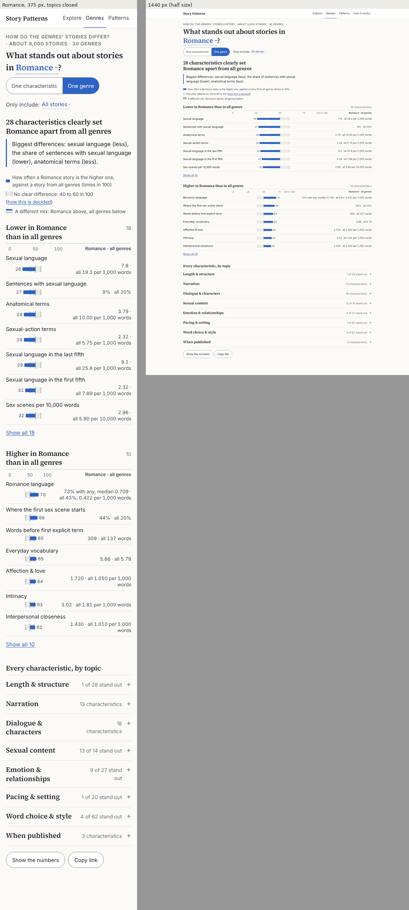
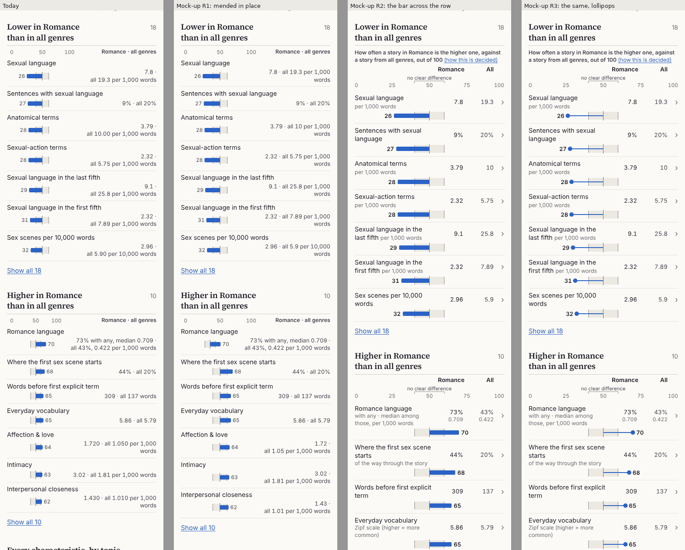
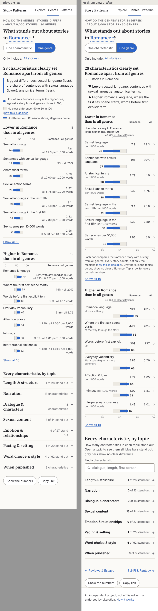
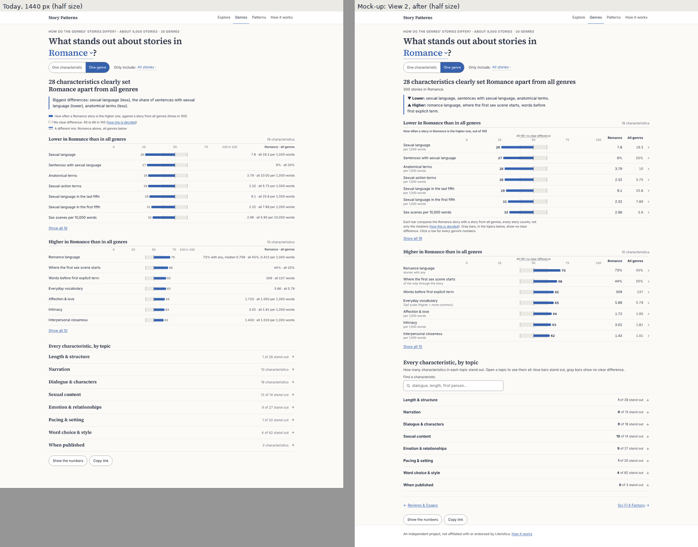

# View 2 ("One genre"): a review of how easy it is to use and how good it looks

*Phases 0–3 of `STAGE2_ONE_GENRE_REVIEW_PROMPT.md`, October 10, 2026. Reviewed: `main` at `692939e` ("Stage 2 genres
review: before and after, the README and the prompt"). **Status: review only.** Nothing in `site/`, `litcorr/` or
`tests/` changed, and nothing was committed.*

- **A branch to know about.** While I wrote this, your working copy moved to `simplify-png`: eleven commits after
  `692939e`, since merged into `main` as `0d8611d`. On View 2 it removes three things this review covers:
  - "Show the numbers" and its table. F95, I14, b09, the table in tasks 10 and 11, and the table half of F92 have
    nothing left to fix. F93 gets stronger: the table was one of the two places the genre's sample size appeared.
  - The story-age note (task 1's first screen).
  - Romance's highlight when a row opens View 1 (task 8, b07).

  It leaves the rows, the top of the answer, the key and the topics as they are at `692939e`, so concepts R, S and T
  and the "after" stand. Its README gives the first load as 148.5 KiB (152.5 at `692939e`); I didn't measure it.
- The last round is [`GENRES_PAGE_REVIEW.md`](GENRES_PAGE_REVIEW.md) (concept P2 is its section 7.2; what was built is
  its section 10). The site's rounds 1 and 2 are [`DESIGN_REVIEW.md`](DESIGN_REVIEW.md) and
  [`DESIGN_REVIEW_2.md`](DESIGN_REVIEW_2.md). This review links to them rather than repeating them.
- **Screenshots** are in [`one-genre-review/`](one-genre-review/): `b…` is the page as it is, `m…` mock-ups. Phones are
  at full size and 1440 px at half size unless a label says otherwise. All are palette-compressed.
- **Mock-ups** draw the real aggregates. They are not static pages: a script injects new markup and CSS into the built
  page, using copies of the site's own helpers (`genres.js`, `format.js`, `wording.js`), so everything a concept doesn't
  touch is exactly what the site draws. The script, the helper copies and a README are in
  `Claude outputs/one-genre-review-mockups/`.
- **Scripts and raw outputs** are in `Claude outputs/design-review-2-tools/one-genre-review/`, listed in that folder's
  `README.txt`. The fresh-eyes answers are in its `fresh-eyes/` subfolder.
- **IDs.** Findings start at F81. Concepts are R, S and T, and ideas start at I12.
- "Measured" means a script or a screenshot backs it. Everything else is my judgment, and says so.
- **The fresh eyes are stand-ins.** There was no user testing. Each stand-in was a subagent shown only screenshots, by
  file path, with a one-line situation. Models read static images differently from people and can't tap or scroll.
  Their answers show where the page is ambiguous; they don't prove it is clear.

---

## 1. Verdict

View 2 is built on a good idea, and the stand-ins suggest it works. All six read "26" correctly as "a Romance story
is the higher one 26 times in 100". All six used the 40–60 zone to explain why 58 isn't listed and 62 is. All six
judged which difference is bigger by distance from 50. P2's one scale is understood. Keep it.

What lets the page down is **how the rows are drawn and laid out**:

- **On a phone, the chart is the smallest part of a row.** The plot is 95–148 px wide beside up to two lines of
  numbers. Romance's first seven bars differ by 6–9 px.
- **The scale changes.** On desktop each list sizes its own plot, so 50 sits at x 734 in one list and x 645 in the
  next. "Show all" then redraws the list a third narrower.
- **The numbers collide with the lines.** At 375 px, 62% of the numbers printed on bars are crossed by a zone edge or
  the 50 line, and every stand-in noticed it.
- **The values beside the bars are hard to read.** Some cells hold two numbers ("73% with any, median 0.709 · all 43%,
  0.422 per 1,000 words"). The unit is printed once, after all genres' number. A quarter of values end in a trailing
  zero.
- **Wayfinding is weak.** Nothing says a row is a link. Coming back from View 1 closes the topic the reader was in.
  Finding a characteristic outside the lists means guessing its topic.

The look is calm and clearly the same site, but it reads more like a dense table than like a chart. None of the fixes
needs new data, a new rule or a new dependency.

### Grades

| Area | Grade | In one line |
|---|---|---|
| **User-friendliness, overall** | **B−** | The idea and the heading land; the rows, the key and the way back cost readers effort. |
| First impression | B | The heading and the takeaway give a finding in five seconds (6/6 stand-ins). The takeaway shows one direction for Romance, and no chart row is on a phone's first screen (it starts at 666 px). |
| The encoding (bar, number, zone, key) | B− | Understood by 6/6, but "times in 100" took effort for all six. The key's mix line confused 6/6. |
| The values | C | 6/6 couldn't parse the mostly-zero cells. 3/6 phone readers assumed 7.8's unit, and 26% of values carry trailing zeros. |
| The words | B− | Careful, but "How often a Anal story" (and nine other names), a takeaway that repeats itself, and topic counts worded two ways. |
| Structure and wayfinding | C+ | Rows don't look like links (2/6 mentioned the row, both as a maybe). Back loses the open topic. The topics are 2.7 screens down on a phone. |
| Finding and comparing | C | There's no search and no next genre. A characteristic outside the lists means guessing its topic. The phone table is 31,450 px. |
| Controls and feedback | A− | The genre select, the switch and "Only include" never move the page; Copy link confirms. |
| Edge states | B | Fetish and Chain Stories (2020) read as answers. Fetish shows a three-line key with nothing to key, and offers no next step. |
| Consistency with View 1 and Explore | B− | The same type and controls. The printed numbers differ: 13 px semibold ink there, 12–13 px regular gray here. |
| Accessibility as usability | B | 10 tab stops to the first row. Each row's name runs about 45 words and never says the bar's number. The key's link is 17 px tall. |
| **Aesthetic appeal, overall** | **C+** | Restrained and recognizable, but the bars are the least visible thing on a phone, and the grid doesn't hold between lists. |
| Focal point and hierarchy | C+ | Squinted, the gray values and the eight serif topic names outweigh the bars. |
| Typography | B− | 17 text styles, fewer than View 1 (25) and Explore (27). The values and topic counts break badly (section 2.4). |
| Layout and grid | C | Three plot widths on one page. At 1440 px the values sit 250–434 px from their bars. |
| Spacing and rhythm | B | Rows of 44 px (desktop) and 56–69 px (phone) are even, and the topics are evenly spaced. |
| Color | B | One accent, used for everything; it doesn't say which topic rows stand out. The named groups' colors have no legend here. |
| The craft of the chart | C | Numbers on the lines, "100 in 100", and half of each list's scale always empty. |
| The components | B− | The key is three lines before any chart. The takeaway's box and the disclosures are fine. |
| Motion and changes of state | A− | Instant (under 110 ms at normal speed), with nothing animating. Only "Show fewer" drops the reader 11 rows down. |
| Polish | B− | "all 1 pages", "1.720", "per 1,000 words" printed twice in one row. |
| The whole | B− | It is the same site and it is calm, but it is not yet the chart people screenshot. |

### The three biggest problems

1. **The chart doesn't carry the rows** (F81, F82, F83).
   - On phones the plot is 95–148 px. The values take up to 58% of the row, and the first seven bars differ by 5.7–8.9
     px.
   - On desktop every list has its own scale. "Show all" redraws the list from 522 px to 344 px.
   - At 375 px, 3,710 of 5,982 printed numbers are crossed by a line (b03, b04).
2. **The numbers beside the bars are hard to read, and easy to misread** (F84, F85).
   - The cells with two numbers, the units printed once, and the trailing zeros all cost effort.
   - In the topics, a row that doesn't stand out draws the same blue bar as one that does. Its medians can differ
     ("Dialogue share 23% · all 17%"), and only the zone says there is no clear difference.
   - With "Under 2,000 words", 200 bars leave the zone without standing out.
3. **Wayfinding** (F86–F89, F91).
   - Rows don't look like links: 2 of 6 stand-ins mentioned tapping one, both only as a maybe.
   - Back from View 1 closes the open topic and lands the reader 521 px from where they were.
   - Topic counts are worded two ways, and a characteristic outside the lists means guessing its topic.

### What works: leave it alone

- **P2's measure and its zone.** The stand-ins read them correctly every time (section 3), and the lists' order
  matches the bars.
- **The verdict heading,** the two lists and the edge states' sentences.
- **The genre select in the question,** the view switch and "Only include".
  - Changing the genre or "Only include" keeps the page in place, with the open topics and "Show all" as they were.
  - Either repaints in 37–49 ms, with a layout shift of 0.041 at most.
- **Folded topics, Copy link and its confirmation,** the table opening under its button, loading and errors, zoom to
  400%, forced colors and reduced motion.
- **Calm color and type,** recognizably the same site as Explore and View 1.

---

## 2. Baseline (Phase 0)

### 2.1 How I tested

- **Builds and tests.** `npm test` passed 276 tests in 28 files, the same as the last round's end. `npm run build`
  passed: the Genres chunk is 60.49 kB (18.52 kB gzipped), with CSS of 13.94 kB (3.46 kB). `python -m pytest
  tests/test_stage2_site_data.py` passed 30 tests. All three ran on a copy of the repository in a Linux container.
- **The browser.** The repository's files came to the container through the desktop app's file bridge. The
  measurements ran there, outside the repository, in headless Chromium 141 (Playwright build 1194) with
  playwright-core 1.56.0, against a frozen build served with gzip (`serve.mjs`).
  - The system sans here is Inter, and the wide font is DejaVu Sans. The last round used the Mac's San Francisco and
    Verdana.
  - Romance's page at 375 px measures 2,461 px, exactly as in the brief. How To measures 2,835 px against the brief's
    2,801: the font is the difference.
- **No iOS Simulator.** This session reaches the Mac only through its file bridge and a Linux shell, so it could not
  drive Xcode's Simulator. The phone checks are Chromium with touch emulation. I downloaded nothing.
- **Fresh eyes.** Six stand-ins per page, three with phone screenshots and three with desktop screenshots, all asked the
  same ten questions. That covered today's page, seven concept alternatives and two versions of the "after" page: 60
  runs (section 3).

### 2.2 Screenshots

| | Screenshot |
|---|---|
| First screens at 320, 375, 768 and 1440 px | [b01](one-genre-review/b01-first-screens-320-375-768-1440.png) |
| Romance, the whole page, at 375 and 1440 px | [b02](one-genre-review/b02-romance-whole-page-375-1440.png) |
| The two lists' scales, and "Show all" redrawing one | [b03](one-genre-review/b03-lists-two-scales-375-1440.png) |
| Numbers on the zone's lines in an open topic | [b04](one-genre-review/b04-numbers-on-the-lines-375-1440.png) |
| Bad breaks: the key, the values, the topics | [b05](one-genre-review/b05-wraps-375.png) |
| Edge states: How To, Fetish, Chain Stories (2020 or later), fewer than 10, "5,000 words or more" | [b06](one-genre-review/b06-edge-states-375.png) |
| Into View 1 and back | [b07](one-genre-review/b07-into-view-1-and-back-375.png) |
| The ways in: the view switch, View 1's tapped row, Explore's Keep exploring | [b08](one-genre-review/b08-ways-in-375.png) |
| The table, and Copy link's confirmation | [b09](one-genre-review/b09-table-and-copy-375-1440.png) |
| Loading on 3G, the error, 200% and 400% zoom, forced colors | [b10](one-genre-review/b10-loading-error-zoom-forced.png) |
| Long genre names at 320 px | [b11](one-genre-review/b11-long-names-320.png) |
| Squint and grayscale | [b12](one-genre-review/b12-squint-and-grayscale-375-1440.png) |

The rest of the states in the brief's table were shot too; the raw files are in the tools folder's
`one-genre-review/raw/`. They include hover and keyboard focus on a row, focus on a topic, every topic open, "Show
all", How To at 1440 px, the 768 px pages, and Romance with "5,000 words or more". Two of the brief's states can't be
shown:

- **The genre select open.** Headless Chromium draws no native picker.
- **The Simulator's picker.** No Simulator was reachable (2.1).

### 2.3 The anatomy of a row (measured)

Romance, All stories, each list showing 7 rows (`anatomy.mjs`). "Spread" is the difference in length between the
longest and the shortest of the first seven bars.

| Width | Plot, Lower / Higher list | Share of the row | Spread, Lower / Higher | Plot's end to the values | 50 sits at x | Values' lines |
|---|---|---|---|---|---|---|
| 320 | 95 / 95 px | 33% | 5.7 / 7.6 px | 32–145 px | 71 / 71 | 1–3 |
| 375 | 148 / 118 px | 43% / 34% | 8.9 / 9.4 px | 37–169 px | 97 / 82 | 1–2 |
| 768 | 210 / 231 px | 29% / 32% | 12.6 / 18.5 px | 73–246 px | 398 / 409 | 1–2 |
| 1440 | 522 / 344 px | 51% / 33% | 31.3 / 27.5 px | 118–434 px | 734 / 645 | 1 |

- **After "Show all".** Once both lists show every row, the Lower list's plot is redrawn at 344 px at 1440 (it was
  522) and at 118 px at 375 (it was 148). Its bars shrink by a third under the reader's eye.
- **Text sizes.** The smallest text is 12 px: the ticks and the bars' numbers. Text runs from 12 to 26 px, and the
  question is 37 px at 1440.
- **The mock-up "after", for comparison** (`mockmeasure.mjs`). At 375 px the plot is 339 px wide, 99% of the row. The
  spread is 20.3 / 27.1 px, and 50 sits at x 188 in both lists. At 1440 px the plot is 564 px in both lists, with 50
  at x 750 in both.

### 2.4 The shape of the page, the visual system and the text (measured)

**The page's shape** (`shape.mjs`, Romance unless named).

| | 375 × 667 | 1440 × 900 |
|---|---|---|
| Heading / takeaway / key | 297 / 356 / 450–563 px | 280 / 357 / 429–501 px |
| First row | 666 px: none on the first screen | 580 px: seven rows on the first screen |
| The "Higher" list / the topics / the actions | 1,202 / 1,788 / 2,302 px | 954 / 1,392 / 1,864 px |
| Page height, topics closed → all open | 2,461 → 14,231 px | 2,000 → 10,455 px |
| How To / Fetish, topics closed | 2,835 / 1,235 px | 2,331 / 1,127 px |
| How To / Fetish, all open | 15,110 / 12,866 px | 10,787 / 9,581 px |

- **At 320 px** the first row is at 755 px, and the key is 153 px tall.
- **How To.** The first row is at 784 px at 375. "Show all 75" adds 4,298 px.

**The visual system** (`inventory.mjs`, computed styles).

- **Text styles.** View 2 uses 17 text styles; View 1 uses 25 and Explore 27.
- **Eleven elements share serif 19 px 600:** the lists' titles, "Every characteristic, by topic" and the eight topic
  names. The section heading is therefore no bigger than the items under it.
- **The printed numbers differ.** View 1 and Explore print their values in 13 px 600 in ink (#1c1c22). View 2's bar
  number is 12 px 400 in the second ink, and its values are 13 px 400 in the second ink.
- **Left edges.** At 375 px text starts at x 16 and 33. The right-aligned values start anywhere from x 192 to 345,
  which makes the ragged column in b05.

**Bad breaks** (`wraps.mjs`, all 30 genres, both lists in full and every topic open, read word by word).

| Width | What breaks badly (Inter) |
|---|---|
| 375 | 700 values end with "words" alone on a line; 106 value lines start with "·"; 57 topic names ("Dialogue & / characters") and 57 topic counts ("18 / characteristics", "9 of 27 stand / out"); 15 keys before "(how this is decided)"; 41 values headings for long names |
| 320 | 1,816 values ending in a lone word; 180 topic names; 156 topic counts |
| 1440 | 126 labels ending in a lone word ("Vocabulary variety (moving / average)"); 6 keys ending "(times in / 100)" |
| 375, DejaVu Sans | 2,358 values ending in "words"; 120 topic counts |

The "7.8 · / all 19.3 …" split is the design's intended break, and I don't count it.

**Every sentence View 2 can show** (`v2sentences.mjs` writes 2,277 lines, for 30 genres with All stories and with
"Published 2020 or later", plus all 5,550 row values). What reads badly:

- **The key's first line misreads for 10 of 30 genres.**
  - Five names start with a vowel: "How often a Anal story", "a Erotic Couplings story", "a Erotic Horror story",
    "a Exhibitionist & Voyeur story", "a Interracial Love story".
  - Five are plural names: "a Chain Stories story", "a Letters & Transcripts story", "a Novels and Novellas story",
    "a Reviews & Essays story", "a Toys & Masturbation story".
  - The site's own rule is "stories in {genre}" (the grammar note in `STAGE2_GENRES_PAGE_PROMPT.md`).
- **The takeaway repeats itself.**
  - Loving Wives names "we / us / our" twice. Romance, Non-Erotic and Sci-Fi & Fantasy name "sexual language" twice.
  - Gay Male and Lesbian Sex list three versions of one fact: "the feminine share of he/she pronouns (lower), the use
    of 'she / her / hers' (lower), pronoun composition (different mix)".
  - Humor & Satire reads "word variety (type–token ratio), higher, vocabulary variety (higher)".
- **The values.**
  - 1,418 of 5,550 values (26%) carry a trailing zero ("1.720 · all 1.050", "median 36.800").
  - 150 rows print "per 1,000 words" after a label that already says it ("Name mentions per 1,000 words … 11.40 ·
    all 19.10 per 1,000 words").
  - "all 1 pages" appears in every genre.
  - The longest value runs to 70 characters ("You / your in narration: 95% with any, median 36.800 · all 64%, 1.080 per
    1,000 narration words").

### 2.5 Effort, feel and the basics (measured)

- **Keyboard** (`effort.mjs`, 1440 px, topics closed). It takes 10 tab stops to the first row, 27 to the first topic,
  35 to "Show the numbers" and 36 to Copy link.
- **Phone.** The topics start 1,788 px down (2.7 screens). Every characteristic outside the lists sits there.
- **What a change keeps.**
  - Changing the genre or the option keeps `scrollY`, the open topics, "Show all" and the table.
  - A row's link to View 1, then Back, loses all three. At 375 px the scroll position goes from 2,315 to 1,794 (the
    shorter page's maximum). At 1440 px it goes from 1,300 to 909 (b07).
- **Feel** (`feel.mjs`, 375 px). Times are to the next paint, at normal CPU speed and then 4× slower:

  | Action | Normal | 4× slower |
  |---|---|---|
  | "Show all 18" | 106 ms | 225 ms |
  | Opening a 62-row topic | 69 ms | 192 ms |
  | Changing the genre | 37 ms | 135 ms |
  | "Show the numbers" | 103 ms | 354 ms |

  - Nothing animates, so reduced motion changes nothing.
  - Changing the genre shifts the layout by 0.041.
  - "Show fewer" sends its own button 1,156 px up, off the screen.
- **Tap areas** (`taps.mjs`, 375 px, `elementFromPoint`).
  - Rows answer on 100% of their 343 × 69 px box, and topics on 100% of 343 × 52 px.
  - "Show all" is 80 × 44 px, "Show the numbers" 95% of its box and Copy link 92%.
  - The genre word is 116 × 34 px, as in the last round.
  - **The key's "how this is decided" is 119 × 17 px.**
- **Contrast** (`contrast.py`).
  - Every text color passes: the second ink is 9.07:1 against the page and 7.81:1 against the zone, the third ink
    5.05:1, and white on the bar 5.67:1.
  - The bar is 5.43:1 against the page and 4.68:1 against the zone.
  - The zone's fill is 1.16:1 against the page; its edges carry the contrast at 3.29:1.
  - The named groups' colors run from 1.13:1 to 2.61:1 against the page, and neighbors differ by 1.30–3.24:1.
- **Focus.** A row shows a 2 px inset outline, and a topic a 2 px outline. Both are visible.
- **What a screen reader hears** (`aria.mjs`). A row is named like this:

  > "Sexual language 7.8 · all 19.3 per 1,000 words . Romance median 7.8 per 1,000 words, interquartile range
  > 3.8–14.9; all genres median 19.3 per 1,000 words, interquartile range 10.1–30.1; clearly less. Opens every
  > genre's numbers."

  - That is about 45 words. It gives the medians twice and never says 26.
  - A topic is heard as a group with a level-4 heading and "1 of 28 stand out".
  - After a genre change, the live region reads the heading and the takeaway.
- **Squint and grayscale** (b12).
  - Blurred, the phone page is a column of gray value text and eight heavy serif topic names; the bars are short blue
    dashes.
  - On desktop the question and the bars lead, but the two lists' bars sit at different x.
  - In grayscale nothing is lost: the bar (gray 103) stands well apart from the zone (gray 232).

---

## 3. Fresh eyes (stand-ins)

**Who and how.**

- **Ten pages:** today's page, each concept alternative (R1, R2, R3, S1, S2, T1, T2) and two versions of the "after"
  page.
- **Six stand-ins per page:** three saw phone screenshots (the page scrolled, plus an open topic) and three saw desktop
  screenshots. Each got a one-line situation ("A friend sent you this link; you've never seen the site") and nothing
  else.
- **The same ten questions on every page:**
  1. What is this page telling you?
  2. What does the row "Sexual language" say?
  3. More or less sexual language?
  4. What do 26, 7.8 and 19.3 each mean, and what unit is 7.8 in?
  5. Is dialogue higher or lower, where did you look, and how sure are you?
  6. Are Romance stories longer, and where would you look?
  7. Why is "Interpersonal closeness" at 62 listed while "Dialogue share" at 58 isn't, and what does "40 to 60 in 100"
     mean?
  8. Which difference is bigger?
  9. What would you tap for another genre, for every genre's sexual language, and for the table?
  10. Rate the page from 1 to 5, and say what confused you and what looks cluttered.

The answers are verbatim in `fresh-eyes/today.md`, and the scoring with excerpts for every page is in
`fresh-eyes/scores.md`.

**Scoring.**

- **Q4:** 26 read right, 7.8 and 19.3 read as Romance's and all genres' figures, and the unit stated without "I
  assume". A half point where the unit was only assumed.
- **Q5:** right if the stand-in says dialogue is not a clear difference.
- **Q9b:** right if the stand-in names the row; a half point for a "maybe".

### 3.1 Scores

| Page | Q1: a finding in both directions | Q1: "the sex comes later" | Q4 | Q5 | Q7 | Q8 | Q9b: the row | The mix line confused them | Topic counts confused them | Desktop: "the scales differ" |
|---|---|---|---|---|---|---|---|---|---|---|
| Today | 6/6 | 0/6 | 4.5/6 (median: 0/6) | 6/6 | 6/6 | 6/6 | 1/6 | 6/6 | 5/6 | 3/3 |
| R1 · mended in place | 6/6 | 0/6 | 5/6 | 6/6 | 6/6 | 6/6 | 0.5/6 | 4/6 | 4/6 | 0/3 |
| R2 · bar across the row | 6/6 | 1/6 | **6/6** | 6/6 (gray bar read: 5/6) | 6/6 | 6/6 | 3/6 | 6/6 | 5/6 | 0/3 |
| R3 · lollipops | 6/6 | 3/6 | **6/6** | 6/6 | 6/6 | 6/6 | 3/6 | 6/6 | 6/6 | 0/3 |
| S1 · two directions | 6/6 | **6/6** | 5/6 | 6/6 | 6/6 | 6/6 | 0/6 | **0/6** | 5/6 | 3/3 |
| S2 · lists first | 6/6 | 4/6 | 4.5/6 | 6/6 | 6/6 | 6/6 | 3/6* | **0/6** | 5/6 | 3/3 |
| T1 · topics mended | 6/6 | 1/6 | 5/6 | 6/6 ("0 of 18": 6/6) | 6/6 | 6/6 | 3/6 | 6/6 | **0/6** | 3/3 |
| T2 · T1 + find + next genre | 6/6 | 2/6 | 4/6 | 6/6 | 6/6 | 6/6 | 3/6 | 6/6 | **0/6** | 3/3 |
| After, first version | 6/6 | **6/6** | **6/6** (median: 4/6) | 6/6 | 6/6† | 6/6 | **6/6** | **0/6** | **0/6** | 0/3 |
| After, second version | 6/6 | **6/6** | **6/6** (median: 4/6) | 6/6 | 6/6 | 6/6 | **6/6** | **0/6** | **0/6** | 0/3 |

\* In S2's open-topic shots the pointer was left over a row, so one label showed its hover underline; four stand-ins
used it as a cue.
† Four of six said they never saw "40 to 60" written down. The second version labels the zone "40–60: no clear
difference", and none said it.

**Scores that didn't move.**

- Q3 ("less") and Q6 were the same everywhere. For Q6, every stand-in would open "Length & structure"; in T2 and the
  "after", all six would also type "length" into the find box.
- Every one of the 60 runs rated its page **3 out of 5**. The rating doesn't separate the pages; the comments do.

### 3.2 What recurred on today's page (excerpts)

- **"Times in 100" takes effort (6/6).** "It took me a while to get the 'times in 100' idea." Every stand-in still read
  26 correctly in the end.
- **Two kinds of number (3/6).** "Each row mixes two kinds of numbers: the one by the bar and the ones on the right."
- **The unit is printed once (3/3 phone).** "The unit is only printed after 19.3, so I'm assuming it also applies to
  7.8."
- **Averages or medians (6/6).** All six said they couldn't tell which 7.8 and 19.3 are. One desktop stand-in wrote "On
  average Romance has 7.8".
- **The mixed cell (6/6).** "73% with any, median 0.709 · all 43%, 0.422 per 1,000 words" was called hard to parse.
- **"44% of what?" (4/6)**, about "Where the first sex scene starts 44% · all 20%".
- **Small medians, clear difference (3/6).** "'Everyday vocabulary 5.86 · all 5.79' has no unit and looks identical,
  yet it's rated 65, a clear difference."
- **The mix line (6/6).** "The 'A different mix: Romance above, all genres below' key item made no sense to me." Romance
  has no mix list.
- **Topic counts (5/6).** "Some topics say 'X of Y stand out' and others just say '18 characteristics.' I had to work
  out that the second kind means none stand out."
- **Numbers on the lines (6/6).** "The middle line cuts through the small scores ('4|9', '5|0')." "Number labels
  collide with tick marks ('5|8', '4|2', '|44', '59|')."
- **Rows as links (0/6 chose the row).** For every genre's sexual language, all six named the "One characteristic"
  toggle. Two added the row as a maybe: "Clicking the 'Sexual language' row might also work."
- **Desktop: the scales (3/3).** "I couldn't judge by bar length, because the scale moves between sections: 50 sits in
  a different place in each section."
- **Desktop: empty space (3/3).** "a big empty gap between the bars and the numbers on the right".
- **Dialogue looks higher (5/6).** "It also seems odd that 23% vs 17% isn't 'clear.'"

### 3.3 What the alternatives changed (excerpts)

- **R2 and R3.**
  - The unit is now read with confidence by all six; no one assumes it.
  - Most stand-ins read the gray bar in a topic as "not a real difference" without being told: "the bar is grey instead
    of blue".
  - R3's two dots confused 3/6: "Filled dots versus hollow dots aren't explained."
  - R2's phone header confused one stand-in: "The 0–25–50–75–100 scale sits right above the 'Romance' and 'All' column
    headings, so at first I thought 7.8 and 19.3 were on that 0–100 scale." The "after" puts the axis under the rows.
- **S1.** All six now report "the sex comes later", which is the second item of the Higher list. Today's takeaway
  shows only Romance's three lower items, and 0/6 reported it. The mix line, shown only with a mix list, confused
  no one.
- **T1.** All six answered the dialogue question from the topic's count: "the topic says '0 of 18 stand out' and the bar
  is grey, so the site treats it as no clear difference."
- **T2.** "I'd open the 'Length & structure' topic or type 'length' in the 'Find a characteristic' box" (6/6). All six
  also offered the next-genre links for Q9a.
- **After.** All six named the row for Q9b: "I'd tap the 'Sexual language' row, since the note says 'Tap a row for
  every genre's numbers.'" Four of six inferred medians from the note: "The footnote mentions medians, so I think
  they're typical values." Four of six called the page clean, unprompted:
  - "Otherwise the page looks clean and uncluttered."
  - "Clean and calm overall."
  - "Looks-wise it's mostly clean."
  - "The page looks clean and calm."
- **What the "after" didn't fix.**
  - "Zipf scale" and "ratio (1 = random order)" are jargon (5–6/6). These are the data's own unit texts.
  - "Everyday vocabulary" still looks backwards to 2–4/6.
  - "Only include" isn't explained (2–3/6).
  - The empty 0–25 part of the axis (3/6).
  - "Higher" for where the first sex scene starts reads oddly (4/6). In the second version I added the D10 word to the
    row ("later · of the way through the story"), and 4/6 found that hard to read too. I took it out again (section 8).

---

## 4. The tasks (Phase 1)

Phone means 375 × 667 with touch; desktop means 1440 × 900. The stand-ins' answers are in section 3; what follows is
measured, or my reading of the screenshots.

1. **The first look.** A friend sends a phone user the Romance link.
   - **Phone.** The first screen holds the question, the controls, the heading, the takeaway and the three-line key.
     The first row starts at 666 px, so no chart is on the first screen. The takeaway gives a finding in five seconds
     ("sexual language (less)"), but only lower ones for Romance: "more romance language" is 1,202 px down.
   - **Desktop.** Seven rows are on the first screen, with the bars 250–371 px from their values.
   - **Exactly what does the first row mean?** "26" needs the key. The unit has to be inferred: it is printed after
     "all 19.3", on the second line.
2. **The curious writer.** All three answers are in topics, behind a guess at which one. On a phone the topics are
   1,788 px down, and each answer takes a tap on a topic plus scrolling:
   - **Dialogue:** "Dialogue & characters" (third topic), "Dialogue share 58 · 23% · all 17%".
   - **Length:** "Length & structure", "Word count 56 · 4,390 · all 3,610 words".
   - **First person:** "Narration", "First-person narration 52 · 60% · all 57%".

   **The misreading risk is real.** The medians say "longer by 780 words" and "more dialogue". The page says "no clear
   difference" only through the zone: the row has no mark, the bar is the same blue as a stand-out's, and the topic
   header says "18 characteristics" (F84).
3. **Two genres.** Romance → Loving Wives → Romance, using the select in the question.
   - The page stays put, and the open topics, "Show all" and the table stay as they were.
   - The heading and lists change in about 40 ms, with a layout shift of 0.041.
   - Nothing marks what changed, which is acceptable: the heading carries the genre's name.
   - Returning means the select again; there is no "previous" step (F91).
4. **The overwhelmed reader.** How To has 116 stand-outs.
   - The gist is on the first screen: "116 characteristics…", a four-line takeaway and the story-age note.
   - The first row is at 784 px.
   - "Show all 75" adds 4,298 px of rows, a wall of 75 near-identical blue bars on 118 px plots. With "Find a
     characteristic" (T2) the reader at least has another way in.
5. **The empty answer.** On Fetish:
   - The heading and its sub-line read as an answer.
   - A three-line key explains bars that don't appear unless a topic is opened.
   - The topics say "28 characteristics" rather than "0 of 28 stand out".
   - There is nothing to do next except the select.
6. **The small sample.** Chain Stories with "Published 2020 or later".
   - The three-line heading, "Show all stories" and the topics are right.
   - The 12 stories are never shown as a number, only as "Fewer than 30" (F93).
7. **The skeptic.**
   - **"26"** is answered by the key's first line.
   - **58 against 62** is answered by the zone.
   - **"40 to 60 in 100"** is one tap away, through a 17 px-tall link.
   - **The key overstates at the edges.** It says 40 to 60 is "No clear difference", but 35 stand-outs print 40 or 60
     with All stories. With "Under 2,000 words", 200 bars leave the zone without standing out, because the rule also
     needs the 99.9% level (F84).
8. **Into the evidence and back.** Tap a row in an open topic, then press Back (b07).
   - **Phone:** the topic is closed, and the scroll position goes from 2,315 to 1,794 px, 521 px from where the reader
     was.
   - **Desktop:** the scroll position goes from 1,300 to 909 px.
   - "Show all" and the table are reset too (F88).
9. **Sharing.** Copy link confirms in its button ("Link copied") for 2 s.
   - The tab title is the question.
   - The friend's first screen is task 1's, with nothing open.
   - The finding survives out of context through the heading. The link preview's title is the site's generic question:
     the page is static, so it can't change per address.
10. **The desktop scanner.** Every topic open is 10,455 px (11.6 screens of 900 px).
    - Each row puts its label at x 204 and its values at x 1,028–1,236.
    - The eye travels about 800 px per row, past a plot that is half empty.
    - The table is 8,600 px and doesn't include the bar's number. Neither is efficient. The "after"
      puts the numbers right after the plot (F94).
11. **Keyboard and screen reader.**
    - It takes 10 tab stops to the first row and 27 to the topics.
    - A row's name is about 45 words with the medians said twice, and never says "26".
    - A topic is a group with a heading inside a summary, as noted in the last round's 10.5.
    - The table can be reached, but it is 185 rows long (F92).

---

## 5. Findings (Phase 2)

Each finding gives the evidence, why it matters, a fix, and **impact / effort**.

- "(needs your approval)" marks a change of wording or meaning.
- "(revisits an owner decision)" marks a challenge to a decision that stands.
- "(touches a hard rule)" marks the hard rules' territory.

### High impact

**F81. Each list draws its own scale, and "Show all" redraws it.** *High / small.*

- *Evidence (measured).*
  - At 1440 px the Lower list's plot is 522 px wide with 50 at x 734; the Higher list's is 344 px with 50 at x 645.
    At 375 px they are 148 and 118 px.
  - After "Show all 18" the Lower list is redrawn at 344 px (b03).
  - The cause is that `valuesWidth` sizes the values column from the rows a list shows, and the plot takes what's
    left.
  - 3/3 desktop stand-ins on every page with today's rows noticed: "the bars in the 'Lower' and 'Higher' sections use
    different scales, so I wouldn't trust bar length to compare them".
- *Why it matters.* P2's promise is one scale. With the same "26" drawn at two lengths, bars can't be compared across
  lists, and a reader who taps "Show all" watches the chart shrink.
- *Fix.*
  - Give the values one width per breakpoint for every list and open topic: R2's two number columns of 76 px each, or
    a fixed 300 px column in R1 (which unifies 1440 px, but at 375 px the longest values still widen their column:
    `r1measure.mjs`).
  - The plot then has one width and 50 one x on the whole page.
  - "Show all" adds rows without redrawing.

**F82. On phones the bar is the smallest part of the row.** *High / medium.*

- *Evidence (measured).*
  - The plot is 95 px at 320 and 118–148 px at 375, 33–43% of the row. The values take up to 58%, often on two lines.
  - Romance's first seven bars differ by 5.7 px (320) and 8.9 px (375).
  - Squinted, the phone page is gray value text with blue dashes (b12).
  - Two of three phone stand-ins on today's page: "The bars are tiny."
- *Why it matters.* The page is meant to be carried by its charts. On a phone they are decoration beside the numbers.
- *Fix.* Concept **R2** (section 7.1). The label and the two numbers share the first line, and the bar takes the row's
  full width under them.
  - That gives 339 px at 375 px and 284 px at 320.
  - The first seven bars then differ by 20.3 px.

**F83. The bars' numbers sit on the zone's lines.** *High / small.*

- *Evidence (measured, `numcross.mjs`, every genre, every topic open).* 3,710 of 5,982 printed numbers (62%) at 375
  px, and 1,187 (20%) at 1440, are crossed by a zone edge or the 50 line. The crossed numbers run from 43 to 58 at
  375 px, and 41–46 and 54–59 at 1440 (b04). All six stand-ins on today's page named it ("5|8", "4|2", "|44").
- *Why it matters.* It looks broken, and it makes the most-read number in a topic the hardest to read.
- *Fix.*
  - Draw a halo of the page's color behind each number (`paint-order: stroke`, 4 px).
  - Print a number that would fall inside the zone just outside its edge, on its bar's side.
  - In the "after", no stand-in mentioned collisions.

**F84. In the topics, a row that doesn't stand out looks like one that does, and the zone's words don't match the page
at its edges.** *High / small.* *(needs your approval)*

- *Evidence (measured).*
  - Every bar is the accent blue. In an open topic only the zone and a ▲▼ next to the values say what stands out.
  - 5/6 stand-ins thought dialogue's "23% · all 17%" "looks like a real gap". Task 2's "Word count 4,390 · all 3,610
    words" invites "Romance stories are longer".
  - The key says "No clear difference: 40 to 60 in 100", but with All stories 35 stand-outs print 40 or 60, and 128
    rows that don't stand out also print 40 or 60.
  - With the options, bars leave the zone without standing out, since the rule also needs the 99.9% level
    (`zonecheck.mjs`):

    | Option | Bars outside the zone that don't stand out |
    |---|---|
    | Under 2,000 words | 200 |
    | Published 2000–2009 | 160 |
    | 5,000 words or more | 66 |
    | Published 2020 or later | 44 |
    | Published 2010–2019 | 23 |
    | 2,000–5,000 words | 18 |
    | All stories | 1 |
- *Why it matters.* The page's verdict should be visible on every row, not inferred from a zone whose words are wrong
  in hundreds of rows.
- *Fix.*
  - Draw a row that doesn't stand out as a thin 4 px bar in a warm gray (#857f75: 3.80:1 against the page, 3.27:1
    against the zone). Stand-outs keep the 10 px accent bar and their ▲▼ beside the label.
  - The color and the mark carry the verdict, so the zone can stay "40 to 60".
  - The key, or the "after"'s note, adds: "Gray bars … show no clear difference."
  - In R2, R3 and the "after" the gray bar was read right by 5–6/6, and the second "after" said "blue bars stand out,
    gray bars show no clear difference" outright.
  - No numbers, rule or data change.

**F85. The values are hard to read.** *High / medium.* *(needs your approval; the mostly-zero part revisits an owner
decision: F61b)*

- *Evidence (measured).*
  - **The two-number cells.** "73% with any, median 0.709 · all 43%, 0.422 per 1,000 words": 6/6 stand-ins called it
    hard to parse, and so did every page that kept it.
  - **The unit.** It is printed once, after all genres' number, so 3/3 phone stand-ins only assumed 7.8's unit.
  - **Trailing zeros.** 1,418 of 5,550 values (26%) carry one.
  - **Breaks.** At 375 px, 700 values end with "words" alone and 106 lines start with "·" (2.4).
  - **Missing units.** Rows like "Everyday vocabulary 5.86 · all 5.79" have no unit; the data's unit text is "Zipf
    scale (higher = more common)".
- *Why it matters.* The values are how a reader checks a bar in real units. Today they are the densest, noisiest text
  on the page, and the stand-ins spent most of their effort on them.
- *Fix.* Concept R2's columns:
  - A "Romance" column and an "All genres" column of numbers in tabular figures, right after the plot.
  - The unit under the label in 12.5 px third ink, and only once: never one the label already names.
  - Each number trimmed of trailing zeros on its own ("1.72", "10").
  - Mostly-zero rows show the share of stories with any in both columns. The median among them goes to the row's
    name, the table and View 1. This is where it **revisits F61b**: the median was added so that a share going the
    other way from the bar would not mislead. Among stand-outs that happens in 0–2 rows per option (`zerodir.mjs`).
    For those few rows keep the median as a second small line.
  - Where the data's unit text explains a scale ("Zipf scale (higher = more common)", "ratio (1 = random order)"),
    print it under the label. The stand-ins called these jargon (5–6/6), but missing units were a complaint too
    (3/6). Question 4 in section 9.

### Medium impact

**F86. The key: a mix line on every genre, "a Anal story", and a link that wraps and is 17 px tall.** *Medium /
small.* *(the wording needs your approval)*

- *Evidence (measured).*
  - **The mix line.** It shows for every genre (the last round's judgment call 21), but only 12 of 29 compared genres
    have a mix list, and Romance doesn't. It confused 6/6 stand-ins on today's page and 4/6 or 6/6 on every page that
    kept it; 0/6 where it showed only with a mix list (S1, S2, the "after").
  - **Grammar.** "How often a {genre} story" misreads for 10 of 30 genres (2.4).
  - **The wrap.** At 375 px, "(how this is decided)" breaks after its opening parenthesis in 15 keys.
  - **The link.** It is 17 px tall (2.5).
  - **The empty key.** On Fetish the three-line key explains bars that aren't there.
- *Fix.*
  - Show the mix line only with a mix list. In an open topic that holds a named-group row, the topic header says it
    instead, with the same approved words.
  - "How often a story in Romance is the higher one" *(needs your approval)*.
  - A no-break space inside the parenthesis.
  - An invisible 44 px tap extension, as the age note's button has.
  - No key at all while no list is shown.
  - The "after" goes further: the key becomes the axis title over the first list, and a note under it.

**F87. Rows don't look like links.** *Medium / small.* *(the hint needs your approval)*

- *Evidence.* For "how every genre compares on sexual language", two of six stand-ins mentioned the row, both as a maybe.
  The others picked the "One characteristic" toggle, which opens View 1 on another characteristic.
  - A "›" at the row's end (T1, T2, R2, R3): 6/6 said "maybe the '>' arrow".
  - The chevron plus "Tap a row for every genre's numbers." (the "after"): 6/6 named the row.
- *Why it matters.* The row link is the way into the evidence, and it is invisible until hovered on a desktop.
- *Fix.* A "›" in the third ink at the end of every row, and the hint once, in the note under the first list.

**F88. Into View 1 and back loses the reader's place.** *Medium / medium.*

- *Evidence (measured).*
  - Open topics, "Show all" and the table are component state. After a row's link and Back they are gone, and the
    scroll position is clamped to the shorter page: 2,315 → 1,794 px at 375, 1,300 → 909 at 1440 (b07).
  - Separately, "Show fewer" moves its own button 1,156 px up, out of sight, and leaves the reader 11 rows further
    down.
- *Fix.*
  - Keep the open topics, "Show all" and the table in `history.state` (`replaceState` on each change; no address
    change, so every address keeps working). Restore them before the scroll position is restored.
  - After "Show fewer", if the button has left the screen, bring the list's heading into view: instantly under
    reduced motion, and without moving focus.

**F89. Topic counts are worded two ways, and topic names weigh as much as the section.** *Medium / small.* *(the count
wording needs your approval)*

- *Evidence (measured).*
  - "1 of 28 stand out" sits beside "13 characteristics"; 5/6 stand-ins had to work out that the second means none.
  - At 375 px the counts break in 57 places ("9 of 27 stand / out").
  - "Every characteristic, by topic" and the eight topic names are all serif 19 px 600. In the squint, the topics are
    the page's heaviest block after the question.
- *Fix (concept T1).*
  - "{k} of {m} stand out" always, including "0 of 13 stand out", with *k* in 650 weight.
  - Topic names in 16 px sans 600, and the section heading 23 px.
  - A line under the heading: "How many characteristics in each topic stand out. Open a topic to see them all."
  - With T1, 6/6 stand-ins answered the dialogue question from "0 of 18 stand out", and none were confused by the
    counts.

**F90. The takeaway shows one direction, mixes its words and repeats itself.** *Medium / small.* *(needs your
approval)*

- *Evidence (measured).*
  - Romance's takeaway is three lower items, "sexual language (less), the share of sentences with sexual language
    (lower), anatomical terms (less)", mixing less and lower and naming sexual language twice.
  - Six genres repeat one fact (2.4).
  - No stand-in on today's page mentioned "the sex comes later".
- *Fix (concept S1).* Two lines that use the lists' own words and labels:
  - "▼ Lower: sexual language, sentences with sexual language, anatomical terms."
  - "▲ Higher: romance language, where the first sex scene starts, words before first explicit term."
  - "≠ A different mix: …" when there is one.
  - With it, 6/6 stand-ins reported a finding in each direction, including "the sex comes later".

**F91. Finding a characteristic outside the lists, or another genre, means hunting.** *Medium / medium.* *(new wording
and a new control: needs your approval)*

- *Evidence.*
  - The 185 characteristics sit in eight folded topics with no search; the reader must guess "Word count" is in "Length
    & structure".
  - The only way to another genre is the select at the top.
  - Fetish's page ends with nothing to do next.
- *Fix (concept T2).*
  - **"Find a characteristic"**, a 44 px field over the topics. It filters the 185 labels and nouns as the reader types,
    and shows the matching rows with the same marks and bars. With it, 6/6 stand-ins would type "length".
  - **The genre before and after in A–Z order,** over the actions: "← Reviews & Essays · Sci-Fi & Fantasy →". With
    them, 6/6 stand-ins offered these links for "another genre".
  - These never rank genres: the order is alphabetical, and nothing sorts by a result.

**F92. Screen readers never hear the bar's number, and the table doesn't have it.** *Medium / small.* *(needs your
approval)*

- *Evidence (measured).*
  - A row's name gives the medians twice and never "26" (2.5). The key's "times in 100" therefore names nothing a
    screen-reader user can find.
  - The table's columns are Characteristic, Romance, All genres, Stories and Compared with all genres.
  - Topic names are `h4` inside `
` (still open from the last round).
- *Fix.*
  - A row's name: "Sexual language: 26 in 100; Romance 7.8, all genres 19.3 per 1,000 words; clearly less. Opens every
    genre's numbers."
  - A table column "Higher one, in 100".
  - Drop the `h4` inside `summary`: the summary is named by its text, "Length & structure, 1 of 28 stand out".

**F93. The genre's sample size isn't on View 2.** *Medium / small.* *(needs your approval)*

- *Evidence.* "300 stories" appears only in the table and the row names. The kicker gives "about 9,000 stories · 30
  genres". Chain Stories' 12 stories in 2020 or later appear nowhere.
- *Why it matters.* The hard rules ask that sample sizes stay visible. A skeptic's first question is "out of how
  many?"
- *Fix.* One line under the heading: "300 stories in Romance." In the small-sample state: "12 stories in Chain Stories
  match “Published 2020 or later”." With it, 4/6 stand-ins repeated "300 Romance stories" unprompted.

### Lower impact

**F94. On desktop the values sit far from their bars, and the heading wraps beside empty space.** *Low-medium / small.*

- *Evidence (measured).*
  - At 1440 px the values start 250–434 px after the drawn plot.
  - The heading breaks into two lines at 40ch ("28 characteristics clearly set / Romance apart from all genres").
  - The first screen's right half above the lists is empty; 3/3 desktop stand-ins mentioned it.
- *Fix.*
  - R2's number columns go right after the plot, at about 70 px.
  - The heading may run to 62ch from 1,000 px, so it takes one line.
  - The question keeps the site's 34ch, for consistency with View 1 and Explore.

**F95. The table on phones is 185 cards, 31,450 px long.** *Low-medium / medium.* *(needs your approval)*

- *Evidence (measured).* At 375 px "Show the numbers" adds about 31,450 px (47 screens). Each card has four lines and
  repeats "Stories in Romance 300". At 1440 px it is 8,600 px.
- *Fix.* Idea I14 (section 7.4).

**F96. Polish.** *Low / small.* *(the tick label needs your approval)*

- "all 1 pages" in every genre: the values build "all {value} {unit}" without `withUnit`'s singular.
- "per 1,000 words" printed after labels that say it (150 rows).
- "100 in 100" on the ticks: the axis title says "out of 100" once instead.
- The bar's number switches sides with the bar's direction. Three stand-ins in the "after" mentioned it. I'd keep it:
  it always sits at the bar's end.
- The named groups' six colors have no legend in this view. They are 1.30–3.24:1 apart, and the values name one group.
  The "after" names the group under the label.
- View 2 prints its numbers in 12–13 px regular gray; View 1 and Explore print theirs in 13 px 600 ink. The "after"
  uses 13 px 600 ink for a stand-out's bar number.

---

## 6. Quick wins

Small and safe, with no wording changes. I would make these straight away:

1. A halo behind the bars' numbers, and a number that would fall inside the zone printed just outside its edge (F83).
2. One values-column width per breakpoint for every list and topic, so the plot and its 50 line never move (F81).
3. Each value trimmed of trailing zeros on its own ("1.72 · all 1.05") (F85).
4. A no-break space inside "(how this is decided)" and a 44 px tap target for it (F86).
5. The key's mix line only with a mix list, using its approved words; the same words over an open topic that holds a
   named-group row (F86).
6. Open topics, "Show all" and the table kept in `history.state` and restored on Back. After "Show fewer", the list's
   heading brought into view (F88).
7. Thin gray bars for rows that don't stand out (F84's visual part, which needs no words).
8. Topic names in 16 px sans 600 and the section heading 23 px (F89's visual part).
9. No unit after a label that already names it, and "1 page" in the values (F96).
10. The heading up to 62ch wide from 1,000 px (F94).

---

## 7. Concepts (larger changes)

### 7.1 R · The row

| | R1. Mended in place | **R2. The bar across the row** (recommended) | R3. R2 with lollipops |
|---|---|---|---|
| What | Today's grid, with one values width per breakpoint, number halos, trimmed zeros and "100" for "100 in 100" | Phones: the label and two number columns on line one, the unit under the label, the bar across the full row under them. Desktop: label (with its unit) · plot · Romance · All genres · "›" | R2's layout; a 2 px stem from 50 with a 10 px dot at the value; rows that don't stand out get a hollow gray dot |
| Plot at 375 / 1440 px | 166 and 120 / 444 and 444 px (at 375 the longest values still widen their column) | **339 / 564 px** | 339 / 564 px |
| First seven bars' spread at 375 | 10.0 px | **20.3 px** | 20.3 px (the dots) |
| Same 50 line on the whole page | At 1440; not at 375 (x 106 and 83) | Yes | Yes |
| Phone row | 56–69 px | 57–92 px at 375, most 76 (up to 108 at 320) | the same |
| Stand-ins: Q4 with the unit | 5/6 | **6/6** | **6/6** |
| Stand-ins: the gray "no clear difference" bar | (no gray bars) | 5/6 read it unprompted | 6/6 read it unprompted; 3/6 asked what hollow and filled dots mean |
| Against | Leaves the phone's plot small and, at 375, still two scales; the stand-ins scored it like today's page | The page gets longer on phones (2,461 → about 2,960 px with the rest of the "after") | Dots read like View 1's median dots, which they are not; the hollow/filled distinction needs a key |

Mock-ups: [m01](one-genre-review/m01-concept-R-rows-375.png) (the lists at 375 px),
[m02](one-genre-review/m02-concept-R-rows-1440.png) (1440 px) and
[m03](one-genre-review/m03-concept-R-in-a-topic-375.png) (an open topic).

**My recommendation is R2.** It gives the phone's plot two to three times the width (148 and 118 px → 339 at 375; 95 →
284 at 320), puts one scale on the whole page and reads with confidence.
A bar from 50 is the right mark for "how far from even"; a lollipop's dot competes with View 1's dots for meaning.

- At 768 px R2's desktop row gives the plot 252 px. The stacked phone row would give it 720 px. I'd switch to the
  stacked row below a chart width of 900 px rather than 560.

### 7.2 S · The top of the answer

| | **S1. Two directions** (recommended) | S2. The lists first |
|---|---|---|
| What | "▼ Lower: … ▲ Higher: …" (and "≠ A different mix: …"), up to three labels each, as the lists word them; the key in two lines, with no mix line unless there is a mix list | No takeaway and no key; the lists start under the heading; the key's words become a caption over the first list |
| First row at 375 px | 684 px (today 666) | **508 px** |
| Stand-ins: a finding in both directions / "the sex comes later" | 6/6 / **6/6** | 6/6 / 4/6 |
| The mix line confused them | **0/6** | **0/6** |
| Against | No chart row on a phone's first screen | A phone's first screen shows one direction only. The zone lost its swatch, and 2/6 asked what the gray box is |

Mock-up: [m04](one-genre-review/m04-concept-S-the-top-375-1440.png).

**My recommendation is S1,** with the key folded into the first list's axis title and a note under it, as the "after"
does. That brings the first row back to 655 px at 375. S2 is the better choice if you would rather see a chart than a
sentence on a phone's first screen. The stand-ins found the gist either way.

### 7.3 T · Finding and wayfinding

| | T1. The topics mended | **T2. T1, plus find and the next genre** (recommended) |
|---|---|---|
| What | "{k} of {m} stand out" always; topic names as items (16 px sans) under a 23 px section heading; a line saying what the counts are; "›" on every row; thin gray bars for rows that don't stand out; open topics and "Show all" kept through Back (F88) | T1, plus "Find a characteristic" over the topics, and the genres before and after in A–Z order over the actions |
| Stand-ins: Q5 from the count | 6/6 | 6/6 |
| Stand-ins: Q6 "type 'length'" | — | **6/6** |
| Stand-ins: the next-genre links for Q9a | — | **6/6** |
| Topic counts confused them | **0/6** | **0/6** |
| Cost | CSS and wording; `history.state` | About 1 KB more code (a filter over 185 labels and nouns, no new data); the find field must keep the page from moving when it opens results |

Mock-up: [m05](one-genre-review/m05-concept-T-topics-375.png) shows T1, T2 and T2's results for "dialogue".

**My recommendation is T2.** The find box answers task 2 without guessing a topic. The A–Z links answer "another
genre?" and give Fetish a next step, without ranking anything.

### 7.4 Ideas (each needs your yes)

- **I12. The takeaway's items link to their rows.** Tapping "romance language" scrolls to its row and focuses it,
  instantly under reduced motion. No new words.
- **I13. One plain sentence for the top stand-out,** for readers who skip the axis title: "Pick a Romance story and a
  story from any genre: 74 times in 100, the other one has more sexual language." It is P2's number in How it works's
  own phrasing. *(needs your approval)*
- **I14. On phones, "Show the numbers" folded by topic.** The topics as disclosures, each card in two lines ("Word
  count · Romance 4,390 words · all genres 3,610 words · no clear difference"), and "Stories" shown only when it
  differs from the genre's number. I estimate that at about a tenth of today's 31,450 px, with every topic closed. *(needs your
  approval)*

---

## 8. View 2, after

R2, S1 and T2 together, with every quick win, at 375 and 1440 px beside today's page:
[m06](one-genre-review/m06-view-2-after-375-beside-today.png) and
[m07](one-genre-review/m07-view-2-after-1440-beside-today.png).
[m08](one-genre-review/m08-view-2-after-states.png) shows the "after" for "dialogue" in the find box, How To, Fetish,
Chain Stories (2020 or later) and Romance at 320 px, and
[m09](one-genre-review/m09-view-2-after-768-and-find-1440.png) shows 768 px and the find results at 1440.

**From the top.**

1. **The masthead, the question and the controls** are unchanged.
2. **The heading.** "28 characteristics clearly set Romance apart from all genres", on one line at 1440 px.
3. **The sample size.** "300 stories in Romance." (F93)
4. **The takeaway.** "▼ Lower: sexual language, sentences with sexual language, anatomical terms." and "▲ Higher:
   romance language, where the first sex scene starts, words before first explicit term." (S1)
5. **No separate key.**
6. **The first list.**
   - The title. On phones, "Romance · All" sit on the title's line, and the lone "18" goes ("Show all 18" keeps it).
   - The axis title: "How often a story in Romance is the higher one, out of 100".
   - A bracket over the zone: "40–60: no clear difference".
   - The rows, then the axis "0 25 50 75 100" under the last row on phones.
   - A note: "Each bar compares the Romance story with a story from all genres; every story counts, not only the
     medians (how this is decided). Gray bars, in the topics below, show no clear difference. Tap a row for every
     genre's numbers."
7. **The rows (R2).**
   - The label, with its unit under it; the two numbers; a "›".
   - The bar from 50: 10 px in the accent for a stand-out, 4 px warm gray otherwise.
   - The number at the bar's end, 13 px 600 ink, with a halo. In the zone it is moved just outside the edge.
   - Mostly-zero rows show the share with any (F85).
8. **The topics (T2).**
   - "Every characteristic, by topic" at 23 px, with "How many characteristics in each topic stand out. Open a topic to
     see them all: blue bars stand out, gray bars show no clear difference."
   - "Find a characteristic", then the topics as 16 px sans items with "1 of 28 stand out".
9. **The genres before and after,** then "Show the numbers" and "Copy link".

**Measured on the mock-up** (`mockmeasure.mjs`).

| | Today | After |
|---|---|---|
| Plot at 375 / 1440 px | 148 and 118 / 522 and 344 px | 339 / 564 px, the same in both lists |
| 50 at x, both lists, 1440 px | 734 and 645 | 750 and 750 |
| First seven bars' spread, 375 px | 8.9 px | 20.3 px |
| First row at 375 × 667 | 666 px | 655 px (its bar at 708 px) |
| Page height, 375 / 1440 px, topics closed | 2,461 / 2,000 px | 2,960 / 2,248 px |
| Numbers on the zone's lines | 62% / 20% | none: inside the zone they move outside its edge |

**What it costs.**

- **Length.** The phone page is 20% longer: the rows are 76 px instead of 56–69, and the find field and the genre
  links are new. I think the wider bars and the cleaner rows are worth it.
- **Code.** I estimate 2–3 KiB more JavaScript in the Genres chunk (today 17.9 KiB) and 0.5–0.8 KiB more CSS (today
  3.4 KiB). That covers the new row, the find filter, the `history.state` restore and the links.
  - The first load doesn't change, because the chunk is lazy.
  - No data file changes.
  - This is an estimate, to be measured when it is built.
- **The hard rules.**
  - Everything comes from today's files: `n`, the units, the labels and nouns.
  - The page's order is A–Z for genres, and by size within one genre, as today.
  - No causal words, and no chance notes. "Every story counts, not only the medians" is How it works's approved
    sentence, shortened.
  - Every proposed sentence passes `CAUSAL`, `UK_SPELLINGS` and the median scan (`copyscan.mjs`).
- **The stand-ins.**
  - First version: every question right, and all six named the row for Q9b. "I never saw '40 to 60'" (4/6) and
    "nothing says gray means not different" (3/6) led to the second version.
  - Second version: both complaints gone. The D10 word I tried under the label ("later · of the way through the story")
    read worse, so the mock-up shown drops it.

---

## 9. Questions for you

1. **The concepts.**
   - **R2** for the rows?
   - **S1** or S2 for the top: a sentence or a chart on a phone's first screen?
   - **T2** for the topics, with the find field and the A–Z genre links?
   - Which of **I12–I14**?
2. **New and changed wording.** None is causal, and each passes the scans:
   - "300 stories in Romance." (F93)
   - "▼ Lower: …", "▲ Higher: …" and "≠ A different mix: …" (F90)
   - "How often a story in Romance is the higher one, out of 100", the zone's bracket "40–60: no clear difference",
     and the note under the first list (F84, F86, F87)
   - "{k} of {m} stand out", including "0 of 13 stand out", and the topics' line (F89)
   - "Find a characteristic" and its placeholder "dialogue, length, first person…" (F91)
   - "0 25 50 75 100" without "in 100" (F96)
   - The rows' screen-reader names and the table's "Higher one, in 100" column (F92)
3. **F61b.** Mostly-zero rows would show the share with any in both columns, with the median among them only where a
   stand-out's share goes the other way from its bar (0–2 rows per option)? *(revisits an owner decision)*
4. **Unit text under the labels.** Show the data's own unit text where it explains a scale ("Zipf scale (higher = more
   common)", "ratio (1 = random order)")? Or show only plain units, and let View 1 explain the rest? The stand-ins
   complained both ways.
5. **Length on phones.** Is a page about 20% longer (76 px rows) acceptable for a bar two to three times as wide?
6. **768 px.** Use the stacked row below a chart width of 900 px, which gives the plot 720 px at 768 instead of 252?
7. **A real phone and a screen reader.** These are still untested: View 2 on an iPhone (the native genre picker,
   "Show all", a topic, Copy link) and VoiceOver on three rows.
8. **`simplify-png`.** If it merges, I'd drop F95, I14 and the table half of F92. F93's line matters more then: only
   the rows' screen-reader names would still give the genre's sample size.
