# Trends page: proposal for architecture and design

Status: proposal, for the owner's decisions (section 11).
Date: 2026-10-11. Data: handoff `litcorr_stage2_handoff_20261008.zip` (read-only), 8,996 included stories in 30 genres,
published 2000–2026.

Every number and chart in this proposal is real. The summaries were computed from the handoff with the project's own
code (`make_bins`, `genre_kind`, `value_style`, `weighted_quantiles`, `weighted_auc`, `rank_biserial_se`, `effective_n`,
`sig`, `_genre_shares`) by a prototype of the proposed builder. Only group summaries were written: quartiles and shares
for groups of 10 or more stories, and counts of stories. The mock-ups were drawn with the site's built stylesheets (the
main one and the Genres page's) at 1440 and 375 px. Section 12 lists the files and scripts.

---

## 1. Summary

**What the page answers.** Two questions the site can't answer today:

1. *How has [a characteristic] changed over time, in [All genres or one genre]?* One characteristic, five periods of
   publication years (figures t01–t06).
2. *What has changed in stories in [All genres or one genre]?* Every characteristic, the largest changes first (t07,
   t08).

Like the Genres page, this page is about the stories themselves, not popularity. Explore can already chart popularity
by publication year, and "Only include" can limit any chart to one decade, but no page shows a characteristic across
time.

**Recommendations in brief**

| # | Recommendation |
|---|---|
| R1 | One new page, `#/trends` ("Trends"), with the two views above behind a "One characteristic / What changed" switch. It is built like the Genres page, and its second view is "One genre" with other labels. |
| R2 | Time in five-year periods of publication year: 2000–04, 2005–09, 2010–14, 2015–19, and 2020 to the newest story (2020–26 today). The same five periods for All genres and for every genre. |
| R3 | A verdict heading built on a "clearly changed" rule: the Genres page's rule, applied to stories published 2020 or later against stories published 2000–2009 (the site's own "Published" options). In plain words, a newer story is the higher one at least 60 times in 100, or the lower one at least 60 times in 100. |
| R4 | Four chart forms on one time axis, chosen by the characteristic's kind: range columns (numbers), share columns (yes/no), 100% columns (named groups and bands) and the split chart (mostly zero). The two compared windows are bracketed under the axis, with the medians and story counts printed under each period. |
| R5 | A check on the genre mix, which moved a lot (§2). For All genres the builder also compares the two windows with each genre's share of stories held fixed. When that changes the verdict, one line under the heading says so (t12). Today it changes 2 of the 180 verdicts. |
| R6 | One small lazy file per "Only include" option and genre, `trends/<included>/<genre>.json`: 124 files, 9–13 KB gzipped each for All stories. The site's first load grows only by the masthead link and the route. |
| R7 | "Only include" offers All stories and the three Length options. The Published options would cut the time axis, and the Readership options select old and new stories differently (§3.4). |
| R8 | A lazy `TrendsPage` chunk that reuses the Genres page's parts. The rows, lists and topics of "One genre" move into a shared `ComparisonProfile`, which both pages use. |
| R9 | The masthead keeps every page, with no menu: How it works leaves below 640 px, Explore below 412 px, Patterns below 350 px, and the footer lists every page (t09). |
| R10 | A "Changes over time" section in How it works: the periods, the rule, and what the data can't tell (stories removed from the site, site changes, today's genres). |

**Decisions needed from you** are collected in §11. The three that shape the page: the new aggregate file family (D1),
the rule and its threshold (D2), and the masthead (D7).

---

## 2. What the data supports (and the facts that shaped the design)

| Fact | Number | Design consequence |
|---|---|---|
| Years | Stories published 2000–2026. Per year from 56 (2000) to 650 (2024); 2026 has 205, up to the collection (October 1–8, 2026) | Single years are too thin for a genre (about 11 stories per genre per year). Periods it is (R2), and the last one runs to the newest story. |
| Five periods | All genres: 903 / 1,658 / 1,524 / 1,565 / 3,346 stories (after weighting, an effective 470 / 741 / 824 / 980 / 2,061) | All genres is steady in every period. |
| Genres × periods | 22 of 150 cells have fewer than 30 stories and 4 fewer than 10. 14 of the 22 are 2000–04 | The existing small-sample marks (hatching under 30, nothing drawn under 10) are needed, mostly in the first period. |
| Other period schemes | Three-year periods: 117 of 270 cells under 30 (17 under 10). Five-year periods with 2025–26 on its own: 23 of the 30 genres have fewer than 30 stories in 2025–26 | R2: five-year periods, with 2020 onward as one period (§5.4). |
| The two compared windows | 2,561 stories from 2000–2009, 3,346 from 2020 or later. Per genre from 19 (Transgender, 2000–2009) and 12 (Chain Stories, 2020 or later) up to 226 and 189 | Two genres can't be compared today. The page needs a "too few to compare" state (t06, right). |
| The genre mix changed | Share of new stories (weighted): Erotic Couplings 16.2% in 2000–2009 → 10.0% in 2020 or later; Gay Male 3.2 → 7.1; Sci-Fi & Fantasy 2.3 → 6.5; Fetish 3.0 → 6.1; Transgender 0.7 → 4.2; Mind Control 0.9 → 3.0; Novels and Novellas 4.7 → 2.0 | An All-genres change could come from the mix alone. Holding each genre's share fixed moves r by at most 0.014 for the 26 clear changes, and only touch words and the build-up of sexual language drop under 0.20 (to 0.199 and 0.192). So the changes happened inside genres, and the check (R5) needs a line only for those two. |
| How much changed | All genres: **26 of 180** characteristics clearly changed (21 rose, 5 fell; no named-group mix changed). The largest is the number of paragraphs (r +0.351, median 56 → 102). Per genre: 302 of 5,005 comparable pairs, from 2 (BDSM, First Time, Gay Male, Humor & Satire) to 23 (Reluctance/NonConsent); median 9.5 of the 28 that can be compared | A verdict heading carries information, and "What changed" has a real list to show. The changes are moderate: the largest \|r\| is 0.351. |
| Stories got longer | Median 2,810 words in 2000–2009, 4,100 in 2020 or later. Of the 26 changes, 6, 13 and 13 stay clear inside the three Length options (which find 8, 16 and 15 changes in all). Dialogue share stays clear in none of them | Many changes go with length (paragraphs, sentences, unique words, pages, names). The Length options answer "is it just length?" (R7). |
| Readership and age | 99% of stories from 2000–2009 have at least 10,000 views, against 56% of stories from 2020 or later (at least 25 ratings: 90% and 84%) | "At least 10,000 views" would keep almost every old story but only the better-read new ones. The Readership options are left out (§3.4). |
| A site change | Median number of tags: 10 for 2000–04, then 4 for 2005–09 (5, 6, 6 after) | Tag count shows the site's tagging, not the writing. It is left out, and so is the author's story count, which is measured when collected (§6.5). |
| A visible change the rule doesn't call clear | Stories with an author's note: 18% → 33% (r +0.145). Consent and check-in language: 11% → 21% of stories have any (r +0.092) | Decision D2. Whatever the rule, the takeaway prints both numbers for numbers, yes/no and mostly-zero characteristics (t03, t05). |
| Genre-level sensitivity | With about 100 stories per window, a genre needs \|r\| ≈ 0.27 to be clear at the 99.9% level (for characteristics without ties; §5.1). With 600 stories per genre it needs ≈ 0.19. The collection under way aims at 600: `config.toml` has `max_stories_per_category = 600`, and today's collector log shows about 7,350 stories queued | Within a genre, only large changes are clear today: 22 of the 26 All-genres changes are smaller than 0.27. A genre's "no clear change" mostly means too few stories, so the page doesn't list genres under All genres (§5.5). |
| Files | 124 files (4 options × All genres and 30 genres), 18–44 KB raw, 1.6–12.9 KB gzipped, 3.9 MB raw in all (today's aggregates: 68 MB) | One small fetch per genre (R6). |

---

## 3. Page design

### 3.1 Structure and navigation

```
#/trends                                                → View 1: story length in words, All genres, All stories
#/trends?var=dlg_word_share&genre=adult-romance&include=medium
#/trends?view=changes&genre=all&include=all             → View 2

Masthead:  Story Patterns   Explore · Genres · Trends · Patterns · How it works

Trends page
├─ kicker:   HOW HAVE THE STORIES CHANGED? · ABOUT 9,000 STORIES · 2000–2026
├─ question: "In [All genres ▾], how has [story length in words ▾] changed over time?"   (View 1)
│            "What has changed in stories in [All genres ▾]?"                           (View 2)
├─ controls: [One characteristic | What changed]   Only include: [All stories ▾]
└─ answer:   heading · takeaway · legend · chart (View 1) or lists and topics (View 2) · actions
```

* **Nav order:** Explore · Genres · Trends · Patterns · How it works. Trends sits next to Genres because both describe
  the stories rather than their popularity.
* **The view switch** is the Genres page's two-option switch. It keeps the genre and the option. View 2 keeps the
  characteristic in memory for the way back, as "One genre" does.
* **The genre** is a slot in the question on both views (`InlineSelect`: All genres, then the 30 genres A–Z). The page
  opens on All genres (D9).
* **The tab's title** is the question on screen, as on the Genres page.

### 3.2 View 1: one characteristic over time

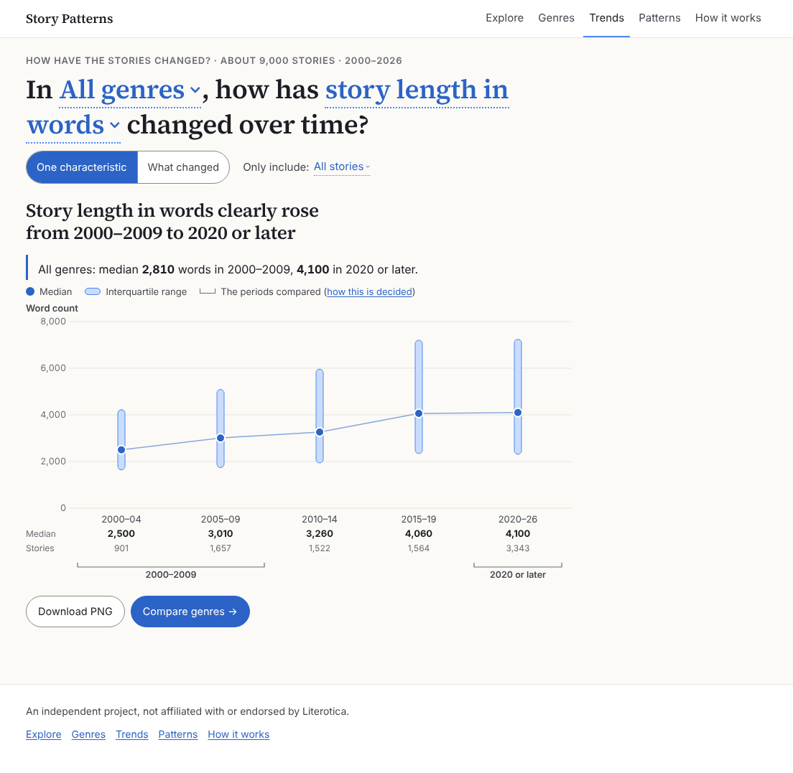

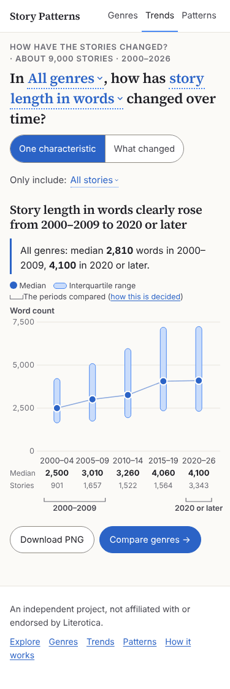

From top to bottom:

1. **Question** with two slots. The characteristic slot reuses `CharacteristicPicker` with
   `exclude={TREND_PAGE_EXCLUDED}` (§6.5), as the Genres page passes its own list. Its `withoutExcluded` then
   replaces the Length & structure topic's blurb with its remaining 26 labels, as it does for "When published" on the
   Genres page; a short written blurb for that case would read better. For yes/no characteristics the sentence asks
   about the share: "how has the share of [stories with an author's note] changed over time?" The slot shows
   `yes_subject`, since "how has has an author's note changed" doesn't read.
2. **Controls:** the view switch and "Only include" (§3.4).
3. **Verdict heading** (§8.1): "Story length in words clearly rose from 2000–2009 to 2020 or later", "Average paragraph
   length clearly fell …", "No clear change in …", or the too-few sentence.
4. **Takeaway:**
   * The two windows' numbers: "All genres: median **2,810** words in 2000–2009, **4,100** in 2020 or later."
   * For All genres, and only when holding each genre's share fixed changes the verdict (R5): "Holding each genre's
     share of stories fixed, the change is not clear." (touch words, t12) or "…, it clearly rose." Today this line
     appears for 2 characteristics with All stories, and for 1, 5 and 4 with the Length options.
   * Named groups and bands have no numbers line: their shares are in the chart.
5. **Legend:** Median · Interquartile range · Fewer than 30 stories (only when drawn) · ⎵ The periods compared (how
   this is decided).
6. **Chart** (§3.2.1–3.2.4).
7. **Actions:** Download PNG, then "Compare genres →", which opens the Genres page's "One characteristic" for the same
   characteristic (and the same option, which the Genres page has too).

**Details** (the card on wide screens, the line under the chart on phones): "2015–19 · median 4,060 words ·
interquartile range 2,340–7,200 · 1,564 stories". The chart is one tab stop. ↑ ↓, Home and End move between the
periods, as they move between rows in every chart on the site. ← → would be new: they suit columns, and
`useRowDetails` would gain them.

#### 3.2.1 Numbers: range columns (t01, t02)

The site's marks, turned upright: one column per period, the interquartile range as a capsule, the median as a dot,
and a thin line through the medians, so the trend reads as a slope.

* **Y axis:** three to five ticks, titled with the characteristic's label (and its unit when it is a rate: "Sexual
  language, per 1,000 words"). The domain runs from the lowest quartile to the highest, from 0 when the lowest is within
  half the span: the Genres page's rule.
* **Under the plot, aligned with the columns:** the period ("2000–04"), the median in bold, and the number of stories.
  This replaces the Genres page's Median and Stories columns, and it is what the PNG keeps.
* **The two compared windows** are brackets under the numbers: "2000–2009" under the first two periods and "2020 or
  later" under the last. The heading compares exactly these stories.
* **Small samples:** a period with fewer than 30 stories gets the hatched capsule and the hollow dot, and its count an
  asterisk; under 10 nothing is drawn and the column says "Fewer than 10" (t06, right).
* **Width:** five columns don't need the page's 1,032 px, so the chart stops at 760 px on wide screens. On phones the
  columns are 54–58 px wide at 320–375 px. Below about 58 px the period labels go on two lines ("2000" over "–04"),
  and the "2020 or later" label keeps inside the chart (t02 shows both are tight). `trendLayout.js` checks it as
  `rangeLayout.js` does for Explore (§7.6).

#### 3.2.2 Yes/no characteristics: share columns (t03)

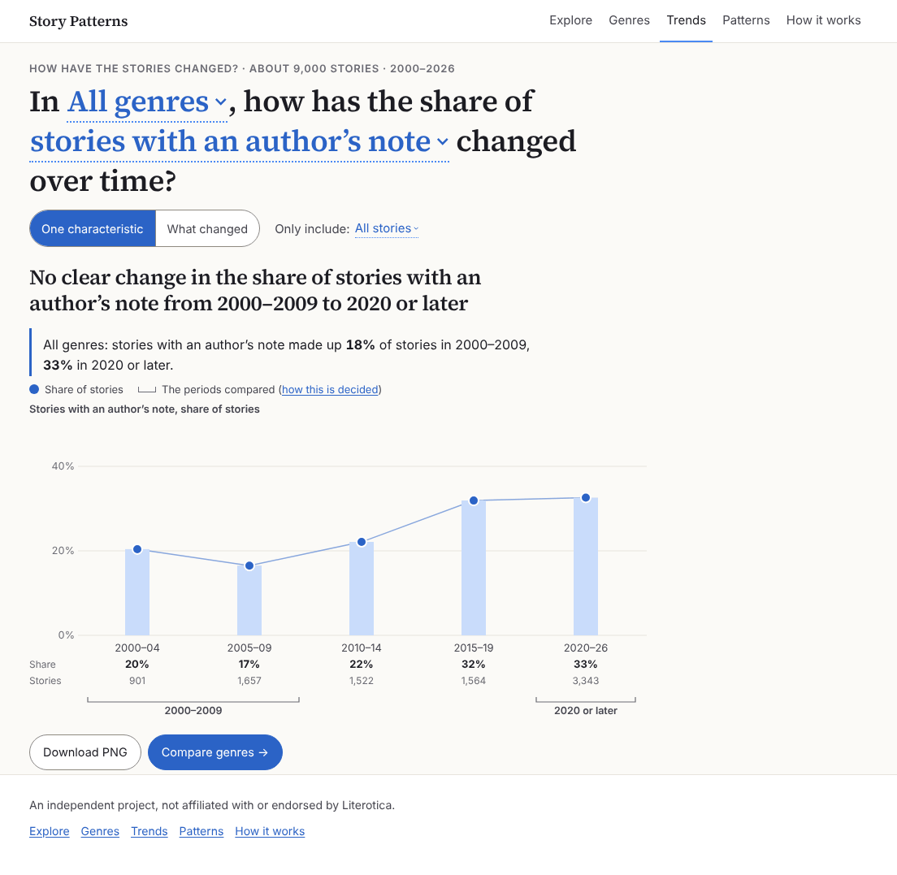

A bar from 0 to the share, with a dot on top and the same thin line. The axis runs from 0 to the smallest of 25%, 50%,
75% and 100% that holds every share. Under the plot, "Share" replaces "Median".

The example is the case §5.3 is about: stories with an author's note went from 18% to 33%, a change of 15 points. The
rule asks for 20 points, so the heading says "No clear change in the share of stories with an author's note from
2000–2009 to 2020 or later". The takeaway still gives both shares.

#### 3.2.3 Named groups and bands: 100% columns (t04)

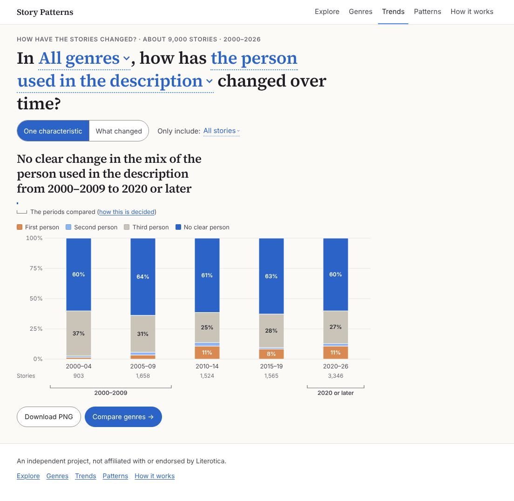

* One 100% column per period, with the groups in their own order. The colors are the Genres page's: the rank palette
  for named groups (`mixColors`, the darkest blue for the largest group) and light-to-dark blues for ordered bands. The
  key sits above the chart, because a column is too narrow for names.
* Shares are printed inside segments at least 16 px tall. Every share is in the details.
* The heading says "The mix of … clearly changed" or "No clear change in the mix of …". There is no numbers line;
  the shares are in the chart.
* The example: descriptions written in the first person went from 1% (2000–04) to 11% (2020–26), but the mix as a
  whole moved by a total variation distance of 0.08, under the 0.20 the rule asks for. No named group changed clearly
  for All genres; this one changed clearly in two genres (Exhibitionist & Voyeur, Letters & Transcripts).

#### 3.2.4 Mostly-zero characteristics: the split chart (t05)

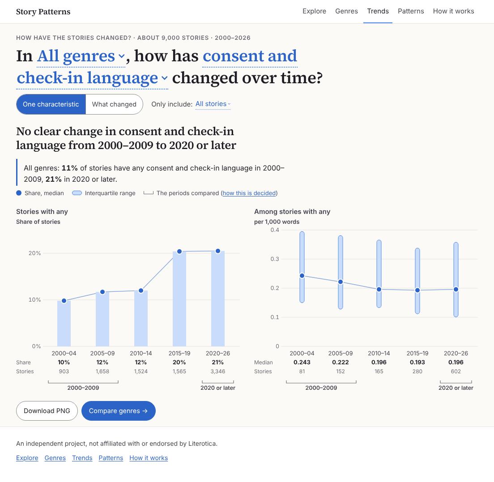

The Genres page's answer to characteristics where most stories score 0, on the time axis: "Stories with any" (share
columns) and "Among stories with any" (range columns). It applies to the same 45 characteristics (`ZERO_BIN_SHARE`).
The halves sit side by side from a 760 px screen and are stacked below. Consent and check-in language: 11% of stories
have any in 2000–2009 and 21% in 2020 or later; among those, the median falls from 0.229 to 0.196 per 1,000 words.

#### 3.2.5 One genre, and too few stories (t06)

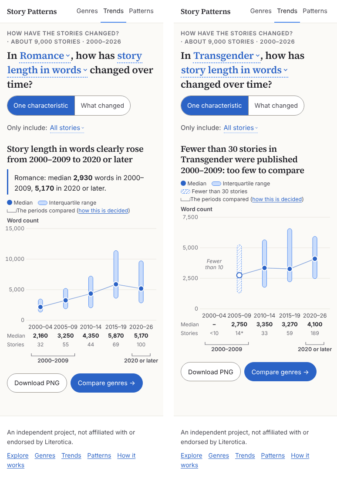

* **A genre** (left: Romance) has the same chart and takeaway, without the mix line (R5 is about All genres).
  Romance's stories rose from a median of 2,930 words to 5,170 (r +0.385). Its periods have 32–100 stories, so nothing
  is hatched. Romance has 14 clear changes in all.
* **Too few to compare** (right: Transgender, 19 stories from 2000–2009). The heading becomes "Fewer than 30 stories
  in Transgender were published 2000–2009: too few to compare", in the words of "One genre"'s too-few sentence. It
  gives no count, so it never shows a number under 10. The chart is still drawn: 2000–04 has fewer than 10 stories and
  2005–09 has 14 (hatched), and the legend adds the hatching key. Chain Stories is the other case today (12 stories
  from 2020 or later).

### 3.3 View 2: what changed (t07, t08)

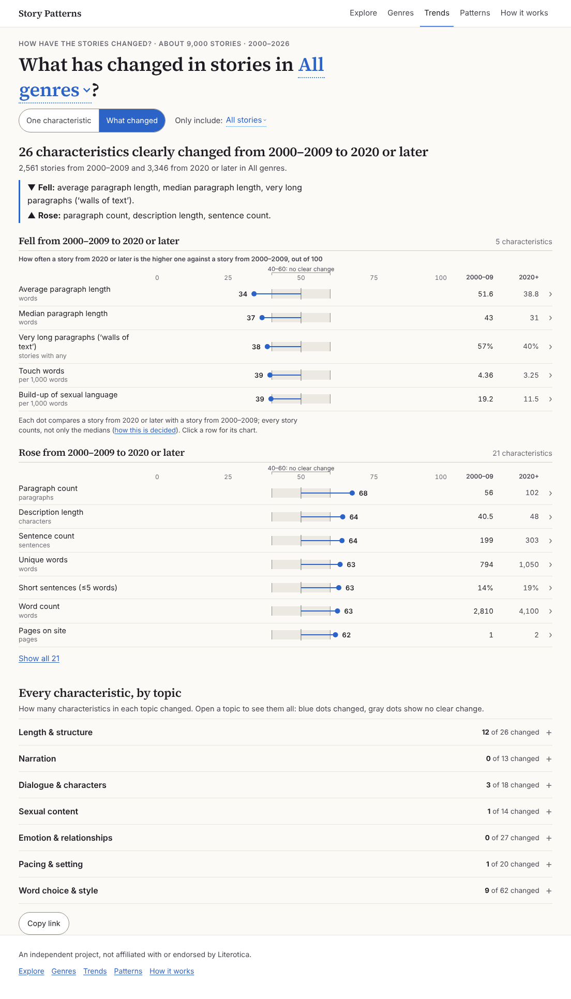

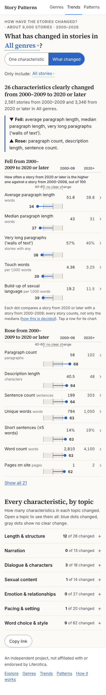

This is "One genre" as approved in its review (rows R3, the top S1, topics T1), with the two sides renamed: a story
from 2020 or later against a story from 2000–2009, instead of a genre's story against a story from all genres.

1. **Question:** "What has changed in stories in [All genres ▾]?"
2. **Heading:** "26 characteristics clearly changed from 2000–2009 to 2020 or later", then the sample line: "2,561
   stories from 2000–2009 and 3,346 from 2020 or later in All genres."
3. **Takeaway,** in "One genre"'s order (▼ first): "▼ Fell: average paragraph length, median paragraph length, very
   long paragraphs ('walls of text')." and "▲ Rose: paragraph count, description length, sentence count."
4. **Lists,** in the same order: "Fell from 2000–2009 to 2020 or later" (5), "Rose …" (21) and "A different mix …"
   when there is one, each with its first seven rows and "Show all 21". The first list carries the axis title ("How
   often a story from 2020 or later is the higher one against a story from 2000–2009, out of 100"), the zone's bracket
   ("40–60: no clear change") and, under it, the note. The number columns are "2000–09" and "2020+".
5. **Every characteristic, by topic:** seven topics (When published is not on this page), each with "12 of 26 changed".
6. **Copy link,** as on "One genre".

Rows open View 1 for their characteristic, genre and option. The ordering rule is "One genre"'s: characteristics are
ranked by the size of their change inside one group of stories; genres are never ranked.

Two details for the shared component, which help "One genre" too:

* **A clear change never prints 40 or 60.** Build-up of sexual language (r −0.206, a clear change) sits at 39.7 and
  rounds to "40", the edge of "40–60: no clear change"; it should print 39, as t07 does.
* **Percentages that would print the same get one decimal.** `numberFormat` already gives one decimal when All genres'
  median is under 10% (long words print 4.8% and 5.4%). Shares printed with `formatPercent` (yes/no and "stories with
  any") don't have that rule, and two windows can print the same whole percentage across a clear change.

### 3.4 "Only include"

| Option | On this page | Why |
|---|---|---|
| All stories | Yes (default) | |
| Under 2,000 words · 2,000–5,000 words · 5,000 words or more | **Yes** | "Did it change, or did stories just get longer?" Inside the three options, 8, 16 and 15 characteristics change clearly, against 26 for all stories. Off for story length, as everywhere (`subsetConflict`) |
| Published 2000–2009 · 2010–2019 · 2020 or later | No | They would cut the time axis to one or two periods |
| At least 10,000 views · At least 25 ratings | No | Old stories have had longer to collect views: 99% of stories from 2000–2009 pass 10,000 views, against 56% from 2020 or later. A trend inside the option would partly be that selection |

The cost: inside a Length option most genres have too few stories in a window. With "2,000–5,000 words", 16 genres
can't be compared, and with the other two, 24 and 29. These genres get the too-few state of §3.2.5. With 600 stories
per genre (every window doubled) that falls to 2 for 2,000–5,000 words, 10 under 2,000 words and 16 for 5,000 words or
more (D6).

### 3.5 Masthead and phones (t09)

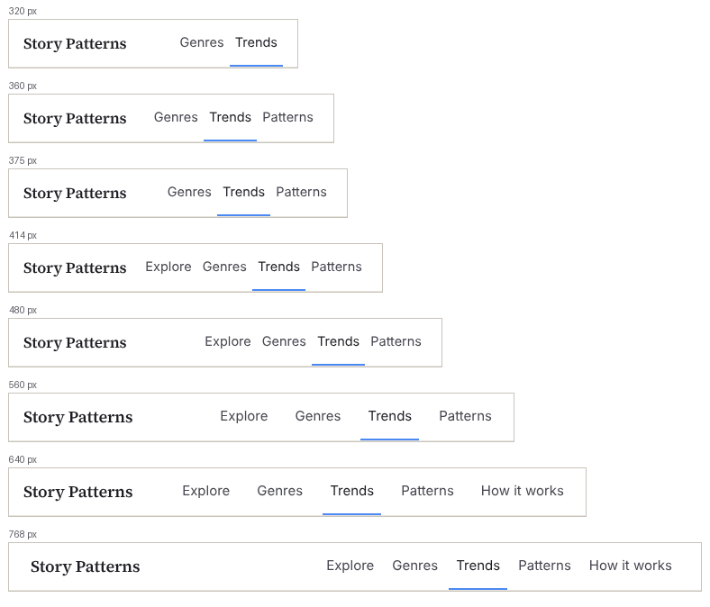

I measured the built site's masthead in this environment's Chromium. A fifth link, "Trends", is 59 px wide at the
phone size (14.5 px type). It doesn't fit as things are:

| Width | Today | With Trends added |
|---|---|---|
| 320 | Genres, Patterns: 32 px to spare | 28 px short, even without Explore |
| 375 | Explore, Genres, Patterns: 23 px to spare | 36 px short |
| 480 | 76 px to spare | 3 px short |
| 560 | All four links: 34 px to spare | 45 px short |

**Recommendation (D7):** keep the owner's D4 approach (no menu) and move the breakpoints:

* below 640 px How it works leaves the masthead (today: below 560);
* below 490 px the links tighten to 14.5 px type and 6 px padding (today: below 420);
* below 412 px Explore leaves (today: below 360); the name already links to Explore;
* below 350 px Patterns leaves too;
* the footer gets a line with every page, so nothing is out of reach at any width.

The mock-up uses exactly these breakpoints (t09). This Chromium measures the text wider than the Mac did: it leaves 8 px
at 360 px today, where the Genres page's as-built measurements (its §13.4) record 24. So the breakpoints should be measured
again on the Mac with `masthead.mjs` and may come out lower. The alternative is the Genres proposal's Menu button below
560 px, which the owner declined then (D4).

### 3.6 Links in and out

| From | Link |
|---|---|
| Masthead | "Trends", which preloads the page's chunk and `trends/all/all.json` on hover or focus, like Genres |
| Explore, "Keep exploring" | One item: "How has [noun] changed over time?" It is left out for the characteristics this page doesn't show |
| Genres page | Nothing new in phase 1. Optional: "See it over time →" next to "Open in Explore →" (D11) |
| How it works | The new "Changes over time" section, and the legend's "how this is decided" |
| View 1 | "Compare genres →"; the genre slot for one genre's chart |
| View 2 | Each row opens View 1 for its characteristic |

---

## 4. Alternatives considered

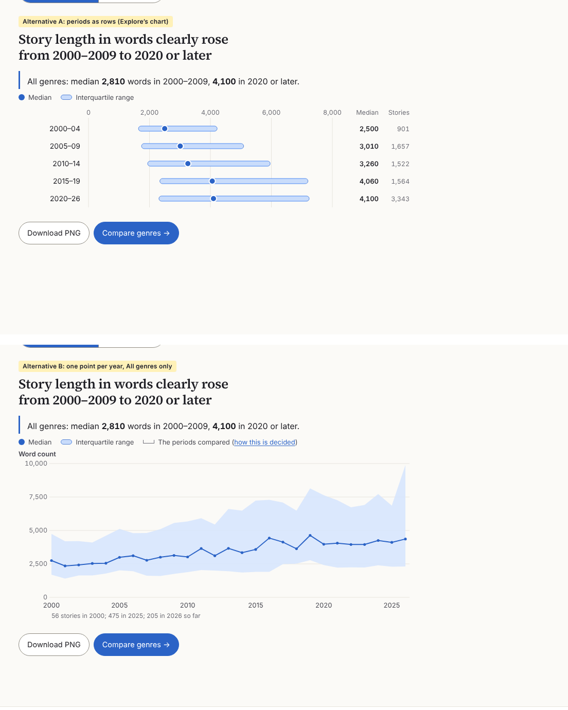

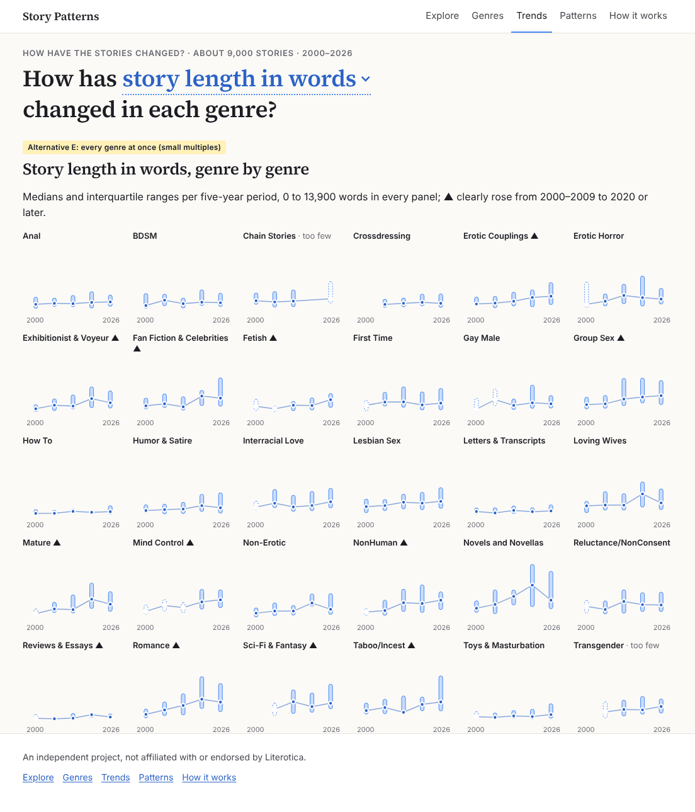

| Alternative | For | Against | Verdict |
|---|---|---|---|
| **A. Periods as rows** (Explore's range chart; t10, top) | Reuses `RangeChart` and `rangeLayout` almost as they are; works on phones | Time runs down the page, so a trend reads as a lean, not a slope. The compared windows have no natural place | The fallback if effort must be the smallest (D4) |
| **B. One point per year** (t10, bottom) | Detail: 27 points | Noisy. In 2026, 205 stories push the upper quartile from 6,860 words (2025) to 9,890. Impossible for genres (about 11 stories per genre per year). Two time axes for one page | No |
| **C. Three-year periods** | Nine columns, more shape | 117 of 270 genre cells under 30 stories; the periods don't line up with the decades the rule compares | No |
| **D. A trend rule over all years** (weighted Spearman with the publication year: the size the Explore pattern rule asks for, 0.1, at 99.9%) | Uses every year; the same statistic as "tend to" | No "60 in 100" sentence, and no dot for View 2's rows. At \|ρ\| ≥ 0.1 it flags 53 characteristics for All genres, closer to a 0.1 threshold than to the Genres page's 0.2 | No (§5.2) |
| **E. Every genre at once** (small multiples; t11) | Shows where a change happened | 30 panels; on one shared scale most are flat (Novels and Novellas stretches it), and on phones they are tiny. With about 100 stories per window a genre's line is rough, and its marks (▲) say little (§5.5) | Possible phase 3, desktop only, after the 600-per-genre handoff |
| **F. All genres as a faint line behind a genre's chart** | Context for a genre | A second file per view; the owner removed the highlighted genre this month for the sake of simplicity | Not in phase 1 |
| **G. The genre mix over time** ("which genres grew") | A real finding (Erotic Couplings 16.2% → 10.0% of new stories) | It ranks genres, which the site avoids; it isn't a story characteristic | Later, if wanted |
| **H. Time inside Explore** | No new nav item | Explore's question is about a popularity measure; this page has none | No |

---

## 5. "Clearly changed": the rule

### 5.1 Definition

For a characteristic and a group of stories (All genres or one genre, in the chosen option):

* **then** = stories published 2000–2009, **now** = stories published 2020 or later. These are the site's own options
  `y2000` and `y2020`, and the first two and the last of the chart's periods.
* **Numbers, yes/no, mostly zero and bands:** r = 2·AUC − 1, where AUC = P(a story from *now* is the higher one than a
  story from *then*) + ½·P(tie). All genres weights both sides by `sampling_weight`; within a genre every story counts
  the same. The standard error is `rank_biserial_se` on the two effective sizes.
  * *Clearly changed* = |r| ≥ 0.20 **and** |r| / SE ≥ 3.29 (the 99.9% level), with at least 30 stories on each side.
  * `rank_biserial_se` is the standard error for data without ties. Where many stories tie (yes/no, mostly zero,
    bands, small whole numbers such as pages), the true standard error is smaller, so the test is stricter than 99.9%.
    The Genres page works the same way. A tie-corrected standard error would be a change for both pages, not this one
    alone.
  * For yes/no, r is the change in the share, so the rule reads "at least 20 percentage points".
  * Bands (where sexual language peaks, and so on) use their order.
* **Named groups:** a total variation distance of at least 0.20 between the two mixes, and a two-sample chi-square test
  at the 99.9% level on the effective sizes, with groups under 1% pooled (the Genres page's table of critical values).

The thresholds are the Genres page's, so "clearly" means the same thing on both pages. Plain-words version for How it
works: *"Pick one story published in 2020 or later and one published 2000–2009 at random. A characteristic clearly
changed when the newer story is the higher one at least 60 times in 100, or the lower one at least 60 times in 100
(ties count as half)."*

### 5.2 Why compare two windows

* It is one sentence, the same as the Genres page's, and the row's dot in View 2 is the same scale as "One genre"'s.
* The windows are options readers already know from "Only include".
* Each window pools its years, so one thin year (2000 has 56 stories) can't swing the verdict. The windows do weight
  the years by their stories: 2022–25 make up 68% of the newer window.
* **Cost:** the 2010s don't count, and a characteristic that rose and fell back would read "No clear change". The chart
  shows the whole shape, so a reader can still see it.

A trend over all years (alternative D) avoids the first cost, but it has no plain sentence and no dot for View 2.

### 5.3 The threshold, and changes that look large but aren't clear

The number of characteristics that clearly changed for All genres (of 180), at the 99.9% level:

| Threshold \|r\| | All genres | Genre pairs (28 genres) |
|---|---|---|
| 0.10 (Explore's "tend to" size) | 74 (41%) | 299 |
| 0.15 | 42 (23%) | 299 |
| **0.20 (recommended, the Genres page's)** | **26 (14%)** | **299** |
| 0.30 | 2 (1%) | 246 |

(Named groups, which use the total variation distance, are not in this table; none changes clearly for All genres.)

* The threshold matters only for All genres. Inside a genre the 99.9% test already asks for about 0.27 with today's
  100 or so stories per window, so 0.10, 0.15 and 0.20 flag the same 299 pairs.
* At 0.20, "What changed" lists 26 characteristics: enough to describe the change without listing half the site.
* **The cost is the reader's eye.** Some changes look large in the numbers but stay under the rule:

  | Characteristic | 2000–2009 | 2020 or later | r |
  |---|---|---|---|
  | Stories with an author's note | 18% | 33% | +0.145 |
  | Stories in a series | 47% | 62% | +0.1497 |
  | Sexual language, median per 1,000 words | 22.3 | 18.2 | −0.147 |
  | Consent and check-in language, stories with any | 11% | 21% | +0.092 |

  For yes/no characteristics the rule asks for 20 points, whatever the starting share. For mostly-zero ones the many
  zeros count as ties and dilute r. The Genres page has the same property ("no clear difference" for 30% against 45%),
  and the owner accepted it there.

**Recommendation:** 0.20, and the takeaway prints both numbers, so the reader sees "18% … 33%" next to "No
clear change". A lower threshold helps less than it seems:

* 0.15 (42 changes) flags none of the four: they are all just under it (0.092 to 0.1497, stories in a series).
* 0.10 (74 changes, 41% of the characteristics) flags the first three, but not consent language. "What changed" then
  lists most of the site, and "clearly" means less here than on the Genres page.
* Two words, from the site's own strength bands ("clearly rose" from 0.20, "rose" from 0.10), bring back the conflict
  with View 2's "40–60: no clear change" for dots between 55 and 60.

So the honest fix is in the copy, not the threshold: both numbers shown, and How it works saying that "clearly"
needs a change of 20 points for a yes/no characteristic (D2).

### 5.4 The periods

| Scheme | Columns | Genre cells under 30 / under 10 | Lines up with the windows |
|---|---|---|---|
| Single years | 27 | (about 11 stories per genre per year) | Yes |
| Three-year periods | 9 | 117 / 17 of 270 | No |
| Five-year periods, 2025–26 on its own | 6 | 45 / 8 of 180; 23 of 30 genres under 30 in 2025–26 | Yes |
| **Five-year periods, 2020 to the newest story as one (recommended)** | **5** | **22 / 4 of 150** | **Yes: the last column is the "now" window** |

The last period is longer (seven years today, the last one partial), and the label says so ("2020–26"). The builder
takes the periods from the data: five-year periods from the first year up to 2019, then 2020 to the newest story. Once
a collection reaches 2030, the "now" window would span a decade and should be revisited (D3).

### 5.5 All genres: weights and the genre mix

* **Weights.** Each genre's sample is random over all of the genre's stories, whatever their year. So the existing
  `sampling_weight` (genre size ÷ sampled stories) already makes each period's All-genres figures an estimate for all
  stories on the site that were published then. No new weights are needed.
* **The mix.** The genres' shares of new stories changed a lot (§2). An All-genres change could come from more stories
  in a genre that was always different, without any genre changing. The builder checks this by comparing the windows a
  second time with each genre's share of both windows held at its share of all the option's stories (weighted by genre
  size): `rm` and `fm` in the file.
  * With all stories, r moves by at most 0.014 for the 26 clear changes (dialogue share 0.215 → 0.204, story length
    0.250 → 0.246, paragraphs 0.351 → 0.351). Two drop just under 0.20: touch words (0.199) and the build-up of
    sexual language (0.192).
  * With the Length options, the check changes 1, 5 and 4 verdicts. In "5,000 words or more" it goes the other way
    four times: the changes are clear only with the mix held fixed.
  * The page shows the check only when it changes the verdict, in one line (t12).
* **Why not list the genres?** An earlier draft listed the genres where a change is clear on its own ("Clearly rose in
  12 of the 28 genres compared"). But a genre needs |r| ≈ 0.27 with today's samples, more than 22 of the 26 changes.
  A change as large in every genre as in All genres would still be "clear" in only a few, and the list would read as
  the opposite of what the check shows. Dialogue share, for example, rises in 26 of the 28 genres but is clear in 5.

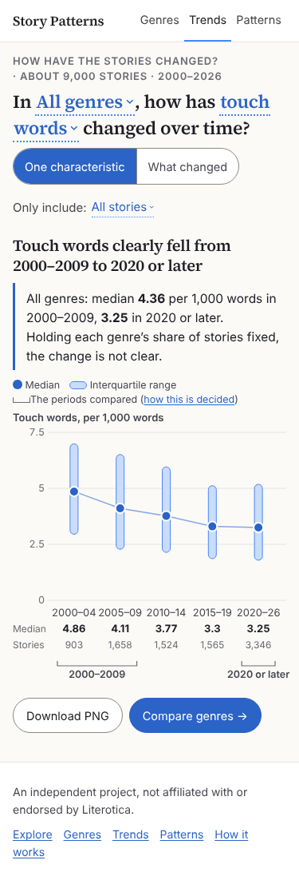

---

## 6. Data architecture

### 6.1 Options

| Option | What ships | Size | Serves | Verdict |
|---|---|---|---|---|
| **T1. One file per option and genre:** `aggregates/trends/<included>/<genre>.json` | 124 files | 9–13 KB gzipped each for All stories (1.6–12.6 KB for the Length options); 3.9 MB raw in all | Both views for one genre in one fetch. Changing the characteristic or the view needs no fetch; changing the genre fetches about 10 KB | **Recommended** |
| T2. One file per option with every genre | 4 files | About 320 KB gzipped for All stories, 190–260 KB for the Length options | Everything at once | Too big for one visit |
| T3. One file per option and characteristic | 717 files, plus an index for View 2 | About 5 KB each | View 1 with smaller fetches | Two formats, many files |
| T4. New fields in the `v/` or `genres/` files | — | — | Those files are per characteristic or have no periods | No |

### 6.2 File format (`trends/<included>/<genre>.json`)

This is the format the prototype wrote, which produced every number here. It is compact like the `genres/` files.

```jsonc
{
  "s": "all", "g": "all",                          // the "Only include" option and the genre
  "periods": [[2000, 2004], [2005, 2009], [2010, 2014], [2015, 2019], [2020, 2026]],
  "then": [2000, 2009], "now": [2020, 2026],
  "n": [903, 1658, 1524, 1565, 3346],              // stories per period in this option and genre
  "c": {
    "story_words": {
      "k": "num", "fmt": "num",
      "q": [[901, 1640, 2500, 4220], …],            // per period: n, p25, median, p75 (null under 10 stories)
      "t": [2558, 1680, 2810, 4760],                // the 2000–2009 window, in the same form
                                                    //   (the "now" window is the last period)
      "r": 0.25, "f": 1,                            // now against then; f: +1 rose, -1 fell, 1 a different mix, 0 neither
                                                    //   r null: too few stories to compare
      "rm": 0.246, "fm": 1                          // all.json only: the same with each genre's share held fixed (§5.5)
    },
    "story_has_author_note": { "k": "bin", "q": [[901, 0.204], …], "t": [2558, 0.181], "r": 0.145, "f": 0 },
    "rel_consent_per_1k": { "k": "zero", "fmt": "num",
      "q": [[903, 81, 0.098, 0.15, 0.243, 0.395], …],   // n, stories above 0, (All genres only: their weighted share),
                                                         //   then p25, median, p75 among them (left out under 10)
      "t": [2561, 233, 0.11, 0.144, 0.229, 0.388], "r": 0.092, "f": 0 },
    "desc_pov": { "k": "grp", "q": [[903, 0.014, 0.012, 0.373, 0.601], …], "r": 0.084, "f": 0 }   // n, a share per group
  }
}
```

**Rounding:** quartiles to 3 significant digits, shares to 3 decimals (rounded by largest remainder so a column adds up
to 1). **r to 3 decimals**, not the Genres page's 2: that page's as-built notes record ties at 2 decimals reordering its
lists. Here it adds about 9 KB raw over all 124 files. Ties that remain keep the topics' order, as on "One genre". A
genre's share above 0 is worked out on the page from its two counts, as on the Genres page; All genres keeps its
weighted share.

### 6.3 Builder

* A new module, `litcorr/stage2/trends.py`, so that `site_data.py` (700 lines) doesn't grow. It holds `trend_periods`,
  `_trend_cell`, `_trend_compare`, `_trend_task` (one characteristic, every option and genre) and `build_trends`.
  `build_site_data` submits its tasks to the same process pool as the `v/` and `genres/` tasks, inside the pool's
  `with` block (the pool closes before the `genres/` files are written), and writes the files after the `genres/`
  ones. It reuses what the characteristics loop already computes: the codes, the kind (`genre_kind`) and the number
  style (`value_style`). The mix check (§5.5) is one more comparison per characteristic for All genres.
* **Constants**, next to the Genres page's: `TREND_PERIOD_YEARS = 5`, `TREND_THEN = (2000, 2009)`,
  `TREND_NOW_FROM = 2020`, and `TREND_MIN_R`, `TREND_Z` and `TREND_MIN_TVD` (0.20, 3.29, 0.20). They are kept apart
  from `GENRE_*` so that D2's alternatives change one line.
* **`wording.py`:** `TREND_PAGE_EXCLUDED` (§6.5) and `TREND_SUBSETS = ["all", "short", "medium", "long"]`.
* **Runtime:** the prototype wrote all 124 files from the handoff in about 8 seconds on one core.

### 6.4 meta.json additions

```json
"trend": {"periods": [[2000,2004],[2005,2009],[2010,2014],[2015,2019],[2020,2026]],
          "then": [2000,2009], "now": [2020,2026],
          "rule": {"min_r": 0.2, "level": 0.999, "min_tvd": 0.2, "min_n": 30},
          "subsets": ["all","short","medium","long"],
          "excluded": ["pub_year","age_years","pub_month","pub_weekday","pub_is_weekend","meta_tag_count","author_stories_count"]}
```

About 350 bytes raw. How it works and the page shell read it, so no number in the page's text is a literal (the
kicker's "2000–2026" too). Nothing else in `meta.json` changes.

### 6.5 Which characteristics

180 of the 187. Seven are left out (D5):

| Left out | Why |
|---|---|
| Publication year, years online | They are the time axis |
| Publication month, weekday, published on a weekend | The rest of "When published": the site's publishing calendar, not the writing |
| Number of tags | The site's tagging changed: stories from 2000–04 carry a median of 10 tags, from 2005–09 a median of 4 |
| Author's story count | Measured when collected, not when published: an author from 2005 has had 20 years to write more |

Other characteristics can also reflect the site, such as formatting that changed over time. The paragraph counts are an
example where the data can't tell a writing change from a formatting change. How it works says so in one sentence
rather than leaving more out (§8.3).

### 6.6 Privacy and the hard rules

* Like the `v/` and `genres/` files, the new files hold only summaries of groups: quartiles and shares for groups of 10
  or more stories, r for windows of 30 or more, and counts of stories, which can be smaller (Transgender has 5 stories
  in 2000–04; the `genres/` files carry such counts too). No minimum, maximum or per-story value. Publication years
  appear only as five-year periods, which is coarser than the handoff's year.
* **This adds a new aggregate file family**, which needs your approval (D1). The test that lists the allowed files under
  `aggregates/` must be updated with it.

### 6.7 Adding stories later

Everything comes from `meta.genres`, the handoff and the data's own years. The collection now running to 600 stories
per genre roughly doubles every window. The too-few states will shrink, genre-level changes will need smaller r to be
clear (about 0.19 instead of 0.27), and genres' own charts will show more clear changes. Every count in this proposal
will change; the rule stays.

---

## 7. Front-end architecture

### 7.1 New and changed files

| File | Purpose |
|---|---|
| `components/pages.js` | `export const TrendsPage = lazyPart(() => import("./TrendsPage.jsx"))` |
| `components/TrendsPage.jsx` | The page: question, view switch, "Only include", loading (it keeps the shown file until the next arrives), live region, tab title, the too-few states |
| `components/TrendAnswer.jsx` | View 1: heading, takeaway (with the mix line), legend, the chart for its form, actions |
| `components/TrendChart.jsx` | Range columns (num), share columns (bin) and the split chart (zero) |
| `components/TrendMix.jsx` | 100% columns (grp, band) |
| `components/ComparisonProfile.jsx` + `profile.css` | The rows, lists, topics, notes and "Copy link" moved out of `GenreProfile.jsx`, given the two sides' names, the list titles, the axis title and the zone's words as props. "One genre" and View 2 both use it, in the same order (▼ first) |
| `lib/trends.js` | Reading the file; headings, takeaway, the mix line, details, accessible names, the PNG's file name |
| `lib/trendLayout.js` | The columns' geometry, pure and tested: domain, ticks, two-line period labels, the brackets, overlap checks at 320–1440 px |
| `lib/data.js` | `loadTrends(sub, genre)` and `prefetchTrends(sub, genre)`, through the same cache |
| `lib/urlState.js` | `page: "trends"`; `TREND_PARAMS = { view, v: "var", genre, sub: "include" }`; `sanitizeTrends`; `onTrendsPage`; `TREND_PAGE_EXCLUDED` |
| `lib/chartImage.js` | The Trends chart's title, subtitle and key; `trends-<var>-<genre>-<include>.png` |
| `App.jsx` | Route, masthead link with preload, kicker title, a visit that starts on `#/trends` fetching the chunk and the file at once (as the Genres page does) |
| `components/Explorer.jsx` | The Keep exploring item |
| `components/Methodology.jsx` | "Changes over time" |
| `styles.css` | Masthead breakpoints (D7) and the footer's page line |
| `trends.css` | The page's styles, loaded with its code (like `genres.css`) |
| `vite.config.js`, `site/README.md` | `LAZY` entries; the lazy-parts table, file map, budget line and design notes |

### 7.2 Address and state

* View 1: `#/trends?var=<id>&genre=<id>&include=<id>`. View 2: `#/trends?view=changes&genre=<id>&include=<id>`.
* `sanitizeTrends`:
  * an unknown or left-out characteristic becomes story length in words;
  * an unknown genre becomes All genres;
  * an option the page doesn't offer (an Explore link's `y2020`, say) becomes All stories, and so does a Length option
    with story length.
* A control replaces the address and a link to the other view adds a history entry, as on the Genres page. View 2 keeps
  its open topics and lists in the history entry's state, through the shared component.
* The page opens on All genres, not the genre remembered from other pages (D9).

### 7.3 Loading and performance

| Measure | Estimate |
|---|---|
| First load of the site | +about 1 KB of script (the masthead link, the route, the address rules); 148.5 KiB today, budget 155 |
| The page's own code | 12–16 KB gzipped of new code. Vite puts `ComparisonProfile` and the shared helpers in a chunk shared with the Genres page (whose chunk is about 18.5 KB gzipped in a build of today's source) |
| A visit that starts on `#/trends` | About 180 KiB: the first load, the chunk, its CSS and `trends/all/all.json` (13 KB). The Genres page's is 204.1 KiB |
| Changing the characteristic or the view | No fetch |
| Changing the genre | One file of about 10 KB; the chart stays until it arrives |
| Changing the option | One file |

### 7.4 Accessibility and motion

* Each chart is one tab stop. ↑ ↓, Home and End move between periods, and Escape hides the details
  (`useRowDetails`, which works on any list of items). ← → are new and would be added to `useRowDetails` for columns.
* Each period has a full accessible name: "2015–19: median 4,060 words, interquartile range 2,340–7,200, 1,564
  stories". The numbers under the plot and the brackets are hidden from screen readers, since the names and the heading
  carry them.
* Forced colors: capsule outlines, bar outlines, segment outlines and the hatching, as in `GenreChart` and `GenreMix`.
* Motion: another genre glides the dots and capsules on one scale in every frame (`useGlide`); another characteristic
  cross-fades; nothing moves under reduced motion. Opening the pickers never moves the page.
* Tap targets are at least 44 px.

### 7.5 Download PNG

The same function as "One characteristic": the question as the title; the heading and "All genres · All stories" as the
subtitle; the key (without "how this is decided"); the chart with its numbers and brackets; the credit. File name
`trends-<var>-<genre>-<include>.png`. View 2 has "Copy link", as "One genre" does.

### 7.6 Tests

**Python** (`tests/test_stage2_site_data.py`):

* 4 × 31 files, and only the allowed file families under `aggregates/`.
* Arrays as long as `periods`; non-null cells have n ≥ 10; p25 ≤ median ≤ p75; shares of a column add up to 1.
* `t` matches a direct computation of 2000–2009, and the last period of 2020 onward.
* r and f match a direct recomputation for a few characteristics; r is null exactly when a window has fewer than 30.
* `rm` and `fm` in `all.json` match a direct computation with each genre's share held fixed.
* Left-out characteristics and the story-length × Length combinations are absent.
* Each file is at most 16 KB gzipped; the output is deterministic; no story-level fields.
* The `v/` files, `genres/` files and `patterns.json` are unchanged byte for byte.
* The synthetic handoff needs publication years across 2000–2026 and one characteristic that changes over time on
  purpose (its `extended=True` mode already adds publication years).

**Front end** (Vitest):

* Address round trip and `sanitizeTrends`.
* Heading variants: rose, fell, a different mix, no clear change, too few; the yes/no wording.
* Takeaway, and the mix line shown exactly when `f` and `fm` differ.
* Chart form by kind; hatching and "Fewer than 10".
* `trendLayout` overlaps at 320, 375, 768 and 1440 px.
* View 2's order (by r to 3 decimals, ties in the topics' order), a clear change never printed as 40 or 60, and one
  decimal for shares that would print the same.
* A fingerprint test that "One genre" renders the same before and after `ComparisonProfile` is extracted.
* The PNG's pure parts; the banned-word and US-spelling scans over every new string; the lazy chunk; the masthead.

**Browser** (the existing tools): `axe`; the label checks for every characteristic with the four options for All
genres and five genres at 320, 375, 768 and 1440 px; `taps`; `snap`; forced colors in light and dark; layout shift on
slow 4G; `firstload`; and `masthead.mjs` at every width from 320 to 1440.

---

## 8. Wording (copy deck)

No causal words: stories "rose", "fell" and "changed"; authors never "chose" or "moved". No notes about chance on the
page, and no correlation reminders.

### 8.1 View 1

| Place | Text |
|---|---|
| Kicker | How have the stories changed? · about 9,000 stories · 2000–2026 |
| Question | In **[All genres]**, how has **[story length in words]** changed over time? |
| Question (yes/no) | In **[All genres]**, how has the share of **[stories with an author's note]** changed over time? |
| Heading (rose / fell) | Story length in words clearly rose from 2000–2009 to 2020 or later · Average paragraph length clearly fell from 2000–2009 to 2020 or later |
| Heading (yes/no) | The share of stories with an author's note clearly rose … · No clear change in the share of stories with an author's note from 2000–2009 to 2020 or later |
| Heading (named groups, bands) | The mix of narrative perspectives clearly changed … · No clear change in the mix of narrative perspectives … |
| Heading (no change) | No clear change in story length in words from 2000–2009 to 2020 or later |
| Heading (too few) | Fewer than 30 stories in Transgender were published 2000–2009: too few to compare |
| Numbers line | All genres: median **2,810** words in 2000–2009, **4,100** in 2020 or later. |
| Numbers line (yes/no) | All genres: stories with an author's note made up **18%** of stories in 2000–2009, **33%** in 2020 or later. |
| Numbers line (mostly zero) | All genres: **11%** of stories have any consent and check-in language in 2000–2009, **21%** in 2020 or later. |
| Mix line (only when it changes the verdict) | Holding each genre's share of stories fixed, the change is not clear. · Holding each genre's share of stories fixed, it clearly rose (fell, changed). |
| Legend | Median · Interquartile range · Fewer than 30 stories · ⎵ The periods compared (how this is decided) |
| Under the chart | Median (or Share) · Stories · 2000–2009 · 2020 or later |
| Split chart | Stories with any · Among stories with any |
| Details | 2015–19 · median 4,060 words · interquartile range 2,340–7,200 · 1,564 stories |
| Actions | Download PNG · Compare genres → |
| View switch | One characteristic · What changed |

### 8.2 View 2

| Place | Text |
|---|---|
| Question | What has changed in stories in **[All genres]**? |
| Heading | 26 characteristics clearly changed from 2000–2009 to 2020 or later · 1 characteristic clearly changed … · No characteristic clearly changed from 2000–2009 to 2020 or later |
| Sample line | 2,561 stories from 2000–2009 and 3,346 from 2020 or later in All genres. |
| Takeaway | ▼ Fell: average paragraph length, median paragraph length, very long paragraphs ('walls of text'). ▲ Rose: paragraph count, description length, sentence count. |
| List titles | Fell from 2000–2009 to 2020 or later · Rose from 2000–2009 to 2020 or later · A different mix from 2000–2009 to 2020 or later |
| Axis title | How often a story from 2020 or later is the higher one against a story from 2000–2009, out of 100 |
| Zone | 40–60: no clear change |
| Columns | 2000–09 · 2020+ |
| Note | Each dot compares a story from 2020 or later with a story from 2000–2009; every story counts, not only the medians (how this is decided). Click a row for its chart. (Phones: "Tap".) |
| Topics | Every characteristic, by topic · How many characteristics in each topic changed. Open a topic to see them all: blue dots changed, gray dots show no clear change. · 12 of 26 changed |

### 8.3 How it works: "Changes over time" (draft)

> **Changes over time.** The Trends page groups stories by the year they were published: 2000–04, 2005–09, 2010–14,
> 2015–19, and 2020 to the end of the collection (October 2026). For each period it shows the median and the
> interquartile range, or the share of stories, with All genres counting each genre by its size on Literotica, as
> everywhere on the site. A characteristic *clearly changed* when, picking one story published in 2020 or later and one
> published 2000–2009 at random, the newer story would be the higher one at least 60 times in 100, or the lower one at
> least 60 times in 100 (ties count as half), clear at the 99.9% level, with at least 30 stories on each side. That is
> the Genres page's rule. For yes/no characteristics it means a change of at least 20 percentage points; for
> characteristics with named groups, at least 20% of the newer stories would have to change group to match the mix of
> 2000–2009. The share of each genre among new stories changed too; for All genres the page also checks each change
> with every genre's share held fixed, and says so when that check gives another answer. The stories are the ones still
> on Literotica when they were collected, in today's categories: stories removed from the site are not in the sample.
> Two characteristics are not on this page: the number of tags, which jumps between stories published before 2005
> (a median of 10) and after (4), and the author's number of stories, which was counted when the stories were
> collected, not when they were published.

---

## 9. Phases and effort

| Phase | Contents | Size |
|---|---|---|
| **1** | Builder, `meta.trend` and the Python tests (D1–D5); the shell: address, masthead and footer (D7, D8), lazy page, loading and errors; View 1 for numbers and yes/no; How it works; the Explore item | Large: about one long Claude Code session |
| **2** | View 1 for named groups, bands and mostly-zero characteristics; `ComparisonProfile` taken out of `GenreProfile` (with the fingerprint test), then View 2; the links between the views | Medium: one session |
| 3 (optional) | Every genre at once on desktop (alternative E); a small trend line in View 2's rows; the genre mix over time (G) | Small to medium |

Each phase ends with the full browser tool set run against the build, and screenshots in `docs/stage2/trends-page/`.

---

## 10. Risks

| Risk | Mitigation |
|---|---|
| Readers read a change as a cause or as authors' intent ("authors now write longer stories because …") | The wording describes stories, never authors or causes, and the banned-word tests cover the new strings |
| The old stories are survivors: stories removed from the site are not in the sample | How it works says so. This data can't correct it |
| Site changes over time (tags, formatting, page splitting) | Tag count and author's story count are left out; How it works names the problem. Paragraph changes can't be told apart from formatting changes |
| Genres are today's categories (a story moved into a newer category counts there) | How it works |
| A change in the genre mix reads as a change in writing | The mix check (R5): today it changes 2 of 180 verdicts, and the page says so for those |
| Many changes go with story length | The Length options |
| The rule says "No clear change" while the numbers moved (18% → 33%) | Both numbers are printed (named groups: in the chart); How it works explains the 20 points; D2 |
| The last period is partial and keeps growing | Its label says "2020–26"; the builder ends it at the newest story; D3 for 2030 |
| Rounded shares hide a change (two windows print the same whole percentage) | One decimal when two values would print the same (`numberFormat` already does this for medians under 10%) |
| Flags change with the 600-per-genre collection | Expected: the rule is fixed and published, the numbers move with the data |
| The test treats tied data as untied (yes/no, mostly zero, bands), so it is stricter than 99.9% there | As on the Genres page; a tie-corrected standard error would be a change for both pages (§5.1) |
| The masthead breakpoints were measured in this environment's Chromium | Measure again on the Mac with `masthead.mjs` (§3.5) |

---

## 11. Decisions for you

| # | Decision | Recommendation |
|---|---|---|
| **D1** | Allow a new aggregate file family, `trends/<included>/<genre>.json` (124 files, at most 13 KB gzipped each) | **Yes.** Without it the page can't exist |
| **D2** | "Clearly changed": stories from 2020 or later against stories from 2000–2009, with the Genres page's thresholds (\|r\| ≥ 0.20 at 99.9%, 30 stories a side; named groups: total variation distance ≥ 0.20 and chi-square) | **Yes as written.** Alternative: 0.10 on this page only (74 changes for All genres instead of 26; 0.15 gives 42 but flags none of §5.3's examples) |
| **D3** | Periods: 2000–04, 2005–09, 2010–14, 2015–19, and 2020 to the newest story | **Yes**, revisited when the data reaches 2030 |
| **D4** | Chart form: upright range columns with time left to right (new `TrendChart`), or the periods as rows (Explore's chart, alternative A) | **Columns** |
| **D5** | 180 characteristics: leave out "When published", the number of tags and the author's story count | **Yes** |
| **D6** | "Only include": All stories and the three Length options | **Yes.** Alternative: All stories only until the 600-per-genre handoff |
| **D7** | Masthead with five pages: new breakpoints and a footer line with every page (no menu) | **Yes**, measured again on the Mac. Alternative: a Menu button below 560 px |
| **D8** | Name and place: "Trends", between Genres and Patterns; kicker "How have the stories changed?" | **Yes** |
| **D9** | The page opens on All genres, not the genre chosen on another page | **Yes** |
| **D10** | View 2 in phase 2, sharing "One genre"'s rows, lists and topics through `ComparisonProfile` | **Yes** |
| **D11** | Links in: Explore's Keep exploring item; nothing new on the Genres page | **Yes.** Option: "See it over time →" on the Genres page's "One characteristic" |
| **D12** | The mix check for All genres (`rm`, `fm` in `all.json`), shown in one line only when it changes the verdict; no list of genres under All genres (§5.5) | **Yes** |

---

## 12. Files behind this proposal

* `docs/stage2/TRENDS_PAGE_PROPOSAL.md`: this document.
* `docs/stage2/trends-page/t01–t12.png`: the mock-up screenshots (palette-compressed; desktop figures cropped to the
  page's width).
* `Claude outputs/trends-page-mockups/`: `mock.html` (the static mock-up; parameters `view=chart|changes|alt-rows|
  alt-years|alt-multiples`, `var`, `genre`, `inc`), `setup.sh` and a README on how to serve it.
* `Claude outputs/trend-profiles/` (not for committing):
  * `tp_build.py`: the prototype builder. It writes `aggregates/trends/<included>/<genre>.json` in the format of §6.2,
    and `aggregates/years-all.json` for alternative B.
  * `tp_numbers.py`: the numbers in §2–§6 and both appendices, from the handoff and the prototype files (about 10
    seconds). The masthead widths in §3.5 come from the built site instead, measured in a browser.
  * `aggregates/`: their output, which the mock-up reads.

  Both scripts read the handoff zip read-only through the project's own loader and write only group summaries. Neither
  runs `probe`, `collect`, `process` or `export-handoff`, and neither contacts any website.

### Appendix A: the 26 characteristics that clearly changed (All genres, all stories)

Ordered by the size of the change (r to 3 decimals). "Dot" is View 2's number: how often a story from 2020 or later is
the higher one against a story from 2000–2009, out of 100. "Mix held fixed" is the same r with each genre's share of
both windows held fixed (§5.5).

| Characteristic | 2000–2009 | 2020 or later | r | Dot | Mix held fixed |
|---|---:|---:|---:|---:|---:|
| Paragraph count | 56 | 102 | +0.351 | 68 | +0.351 |
| Average paragraph length (words) | 51.6 | 38.8 | −0.322 | 34 | −0.323 |
| Description length (characters) | 40.5 | 48 | +0.286 | 64 | +0.278 |
| Sentence count | 199 | 303 | +0.281 | 64 | +0.278 |
| Unique words | 794 | 1,050 | +0.268 | 63 | +0.263 |
| Median paragraph length (words) | 43 | 31 | −0.267 | 37 | −0.268 |
| Short sentences (≤5 words) | 14% | 19% | +0.259 | 63 | +0.259 |
| Word count | 2,810 | 4,100 | +0.250 | 63 | +0.246 |
| Pages on site | 1 | 2 | +0.236 | 62 | +0.233 |
| Description word count | 7 | 8 | +0.235 | 62 | +0.227 |
| Questions per 1,000 words | 3.36 | 4.97 | +0.235 | 62 | +0.228 |
| Very long paragraphs ('walls of text'), stories with any | 57% | 40% | −0.231 | 38 | −0.231 |
| Dialogue segments per 1,000 words | 12.6 | 16.7 | +0.228 | 61 | +0.220 |
| Recurring names | 3 | 4 | +0.225 | 61 | +0.216 |
| Quotation marks (per 1,000 words) | 23.9 | 32.7 | +0.225 | 61 | +0.218 |
| Long (3+ syllable) words | 4.8% | 5.4% | +0.224 | 61 | +0.220 |
| Vocabulary variety (moving average) | 48% | 49% | +0.224 | 61 | +0.223 |
| Title length (characters) | 20 | 24 | +0.217 | 61 | +0.225 |
| Dialogue share | 13% | 19% | +0.215 | 61 | +0.204 |
| Question sentences | 4.8% | 6.5% | +0.215 | 61 | +0.208 |
| Dialogue in the last fifth | 11% | 18% | +0.215 | 61 | +0.210 |
| Title word count | 4 | 5 | +0.214 | 61 | +0.213 |
| Touch words (per 1,000 words) | 4.36 | 3.25 | −0.213 | 39 | **−0.199** |
| Commas (per 1,000 words) | 47.2 | 54.9 | +0.210 | 61 | +0.219 |
| Build-up of sexual language (per 1,000 words) | 19.2 | 11.5 | −0.206 | 39 | **−0.192** |
| One-sentence paragraphs | 18% | 24% | +0.205 | 61 | +0.207 |

Medians, except where the row says "stories with any"; percentages with one decimal where All genres' median is under
10%, as `numberFormat` prints them. The dots follow §3.3: rounded to the nearest whole number, except that a clear
change never prints 40 or 60. In bold, the two changes that are not clear with the genre mix held fixed.

### Appendix B: changes per genre (all stories)

| Genre | Stories 2000–2009 / 2020+ | Changed | Rose / fell / mix | | Genre | Stories 2000–2009 / 2020+ | Changed | Rose / fell / mix |
|---|---:|---:|---|---|---|---:|---:|---|
| Anal | 95 / 109 | 10 | 7 / 3 / 0 | | Lesbian Sex | 90 / 110 | 18 | 9 / 9 / 0 |
| BDSM | 75 / 116 | 2 | 0 / 2 / 0 | | Letters & Transcripts | 136 / 62 | 5 | 3 / 1 / 1 |
| Chain Stories | 226 / 12 | too few | | | Loving Wives | 87 / 120 | 19 | 6 / 13 / 0 |
| Crossdressing | 38 / 146 | 8 | 6 / 2 / 0 | | Mature | 72 / 112 | 14 | 9 / 5 / 0 |
| Erotic Couplings | 104 / 103 | 22 | 17 / 5 / 0 | | Mind Control | 34 / 172 | 7 | 6 / 1 / 0 |
| Erotic Horror | 70 / 126 | 6 | 5 / 1 / 0 | | Non-Erotic | 105 / 100 | 4 | 2 / 2 / 0 |
| Exhibitionist & Voyeur | 80 / 109 | 15 | 12 / 2 / 1 | | NonHuman | 47 / 106 | 7 | 6 / 1 / 0 |
| Fan Fiction & Celebrities | 87 / 103 | 9 | 8 / 1 / 0 | | Novels and Novellas | 117 / 80 | 13 | 10 / 3 / 0 |
| Fetish | 48 / 156 | 20 | 16 / 4 / 0 | | Reluctance/NonConsent | 68 / 120 | 23 | 15 / 8 / 0 |
| First Time | 75 / 124 | 2 | 2 / 0 / 0 | | Reviews & Essays | 141 / 81 | 11 | 8 / 3 / 0 |
| Gay Male | 44 / 157 | 2 | 2 / 0 / 0 | | Romance | 87 / 100 | 14 | 11 / 3 / 0 |
| Group Sex | 95 / 103 | 17 | 13 / 4 / 0 | | Sci-Fi & Fantasy | 33 / 152 | 8 | 8 / 0 / 0 |
| How To | 136 / 68 | 11 | 8 / 2 / 1 | | Taboo/Incest | 73 / 124 | 22 | 18 / 4 / 0 |
| Humor & Satire | 101 / 103 | 2 | 2 / 0 / 0 | | Toys & Masturbation | 105 / 87 | 8 | 3 / 5 / 0 |
| Interracial Love | 73 / 96 | 3 | 3 / 0 / 0 | | Transgender | 19 / 189 | too few | |

## 13. As built

*Since then:* the page's design review is built; what changed (it opens on all changes, View 1's brackets and rail,
View 2's values first, Download PNG for the lists, no Copy link) is in [TRENDS_REVIEW.md](TRENDS_REVIEW.md). On
October 12 the owner took the fixed-mix check ("borderline") and the length-band line off the page, so neither is
shown any more: section 10 there.

Built on branch `trends-page`, made from `one-genre` at `1756a39` (the proposal is its first commit, `62d8cee`),
following `STAGE2_TRENDS_PAGE_PROMPT.md`: thirteen commits, the last one this write-up with the prompt, not pushed. At
every commit `npm test`, `npm run build` and `.venv/bin/python -m pytest tests/test_stage2_site_data.py` pass; at the
last one `npm test` runs 456 tests in 35 files (360 in 29 at `1756a39`) and the Python suite 213 tests (204). The
only `site-data` run is the data commit's: 124 new files under `site/public/aggregates/trends/` and `meta.trend`.

**How it was measured.** Copies of the earlier rounds' scripts (axe-core, the glyph checks, taps, snap, layout shift,
forced colors, the masthead, first-load bodies) and three new ones, run from a scratch folder outside the repository
with playwright-core in the headless Chromium (build 1243) cached on this Mac, against frozen builds served with gzip.
This Mac's sans is San Francisco.

### 13.1 Commits

| Commit | What |
|---|---|
| `62d8cee` | The proposal and its mock-ups (t01–t12) |
| `16562fb` | The data: `litcorr/stage2/trends.py`, `trends/<included>/<genre>.json`, `meta.trend`, the Python tests, the fixtures |
| `e37ecd8` | The shell: addresses, the masthead with five pages and its measured breakpoints, the footer's page line, the lazy page, "Only include" shared with the Genres page |
| `cfdcb37` | The footer's links spaced as mock-ups t07 and t08 draw them |
| `f1b9fe7` | View 1 for numbers and yes/no: `trendLayout.js`, the chart, heading, takeaway, fixed-mix line, key, details, keyboard, actions, the PNG |
| `a7697af` | View 1 for named groups and bands (100% columns) and mostly-zero characteristics (the split chart); the palettes shared |
| `efbc842` | "One genre" moved into `ComparisonProfile.jsx` unchanged, with its fingerprint and a shared `comparison.css` |
| `65fd166` | The two shared fixes (a clear change never prints 40 or 60; shares that would print the same get one decimal) |
| `3c8ad87` | View 2, what changed |
| `231b2b8` | Explore's "Keep exploring" item, How it works' "Changes over time", the READMEs |
| `a3bc1e7` | Four fixes from the finishing measurements (13.5) |
| `f03f60b` | Number charts drawn on their domain, not their outer ticks (13.5) |
| this one | This write-up, the screenshots and the prompt |

### 13.2 The acceptance numbers, as built

Every number of the prompt's §1.7 reproduces from the built files:

* 180 characteristics: num 114, zero 45, bin 12, band 5, grp 4. 124 files, 3.93 MB raw, **1,642–12,973 bytes
  gzipped** (All stories: 8,871–12,973). The prompt's 1.6–12.9 KB (8.8–12.9) came from the prototype's files, about 35
  bytes smaller each: the built files carry the rule (`rule`), as §1.2's format has them. The largest is a fifth under
  the 16 KB budget.
* Stories per period, All genres: 903, 1,658, 1,524, 1,565, 3,346. Genre × period cells: 22 of 150 under 30, 4 under 10.
* All genres, all stories: 26 of 180 clearly changed (21 rose, 5 fell, no named group). The largest: paragraph count, r
  +0.351 (median 56 → 102). Story length r +0.250 (then 2,810; periods 2,500, 3,010, 3,260, 4,060, 4,100).
* Not clear: author's note r +0.145 (18.1% → 32.6%); consent language r +0.092; narrative perspective tvd 0.023.
* Fixed-mix check: 2 verdicts change with all stories (touch words −0.213 → −0.199; build-up of sexual language −0.206
  → −0.192), and r moves by at most 0.014 among the 26. With the Length options 1, 5 and 4; in "5,000 words or more"
  all four become clear only with the mix held fixed.
* Length options, All genres: 8, 16 and 15 of 179 clearly changed.
* Genres, all stories: 302 of 5,005 comparable pairs; per genre from 2 (BDSM, First Time, Gay Male, Humor & Satire) to
  23 (Reluctance/NonConsent), median 9.5. Chain Stories and Transgender can't be compared. Romance: 14, story length r
  +0.385 (2,930 → 5,170).
* Genres that can't be compared under the Length options: 24, 16 and 29.

Seventeen of the 124 files differ from the prototype's stored output only where a value sits on a rounding midpoint;
the prototype run again on this Mac gives the built files exactly. The tag counts in How it works, which describe the
handoff, were checked against it: a median of 10 tags in 2000–04 and 4 in 2005–09, weighted or not (stories from 2005 on
as a whole: 6), so "before 2005 (a median of 10) and after (4)" stands for the jump.

### 13.3 Measurements

| Measure | Result |
|---|---|
| First load (HTML, main script, CSS, font, `meta.json`, the first chart's file) | **149.5 KiB in 6 requests** (148.5 before; budget 155). The Trends page's own code loads only when it is opened |
| A visit that starts on the page | Trends (either view) **171.1 KiB in 9 requests**; Genres 207.1 KiB in 9 (204.4 in 8 before: the code the two pages share is a chunk of its own) |
| Trends files | at most **12,973 bytes gzipped** (budget 16 KB) |
| axe-core (WCAG 2.0–2.2 A/AA, best practice), at 375 and 1440 px | **none in 34 runs**: every View 1 form, a period's details, the fixed-mix line, a genre, too few (Transgender), nothing drawn (How To, 5,000 words or more), the picker open; View 2 for All genres, with a topic open and "Show all", Romance with every topic open, too few (Chain Stories), a link copied; the error |
| Glyph boxes, View 1: every characteristic × the four options × All genres, Romance, How To, Chain Stories, Transgender and Fan Fiction & Celebrities × 320, 375, 768 and 1440 px | **0 problems in 17,208 charts** (num 10,400, zero 4,128, bin 1,104, grp 368, band 460, too few to draw 748): no text on another, every text inside its chart, every share inside its segment, every mark inside its plot, no sideways scroll |
| Glyph boxes, View 2: the same genres and options at the same widths, every topic open and every list in full | **0 problems in 96 pages**: 12,480 rows, 12,160 dots' numbers (none on a line or past its plot), 256 mix lines in topics, 272 swatches and 272 keys in place |
| The chart's own geometry (unit tests): every real number, yes/no, 100% and split chart at 288, 343, 736 and 760 px (split: 288, 343, 712, 720, 1032) | no label on another or outside the chart; every number axis 3–5 ticks with the data on at least 80% of its height |
| The masthead (`masthead.mjs`), every width from 320 to 1440 px | **no problems at 1,121 widths**; How it works leaves below 602 px, the links tighten below 484, Explore leaves below 414, Patterns below 352; least 8.3 px to spare |
| Tap areas at 320 and 375 px | every control at least 44 px tall: the key's link 118 × 44, a period's column 47 × 201 (all of it answers), the buttons 44, View 2's rows 75–95, topics 50, the masthead's links 52, the footer's 44. The question's two words are 34–35 px tall, as on the Genres page (the shared sentence) |
| The page moving after a control (375, 768, 1280, 1440 px) | **nothing a reader is looking at moves in 80 cases** (the picker opened, used and picked from; "Only include"; the genre, on both views; a topic; "Show all"). "Show fewer" moves the page on purpose, as on "One genre" |
| Layout shift on slow 4G | **worst 0.021** in 16 runs: visits that start on either view, Explore then the masthead's link and the "Keep exploring" item, the view switch, another genre or option on both views |
| Forced colors, light and dark (375 px) | every mark draws: capsules, dots, the line, bars, segments and their shares, brackets, the split chart's halves, hatching, View 2's dots, stems, zone edges, bars, swatches and keys; the key with system colors |
| Page height, 375 / 1440 px | View 1: story length 1,076 / 1,004; author's note 1,158 / 1,078; person of the description 1,057 / 970; where sexual language peaks 1,024 / 921; consent (split) 1,537 / 1,000. View 2, All genres: 2,518 / 1,934 (every topic open 16,422 / 10,730); Romance 2,311 / 1,841 |
| Words (unit tests): every sentence of both views for every characteristic, genre and option | no causal word, UK spelling, gap or note about chance; "clearly" only through the flags; no year written in the page's code |

### 13.4 Screenshots

View 1, numbers (story length), 1440 px:

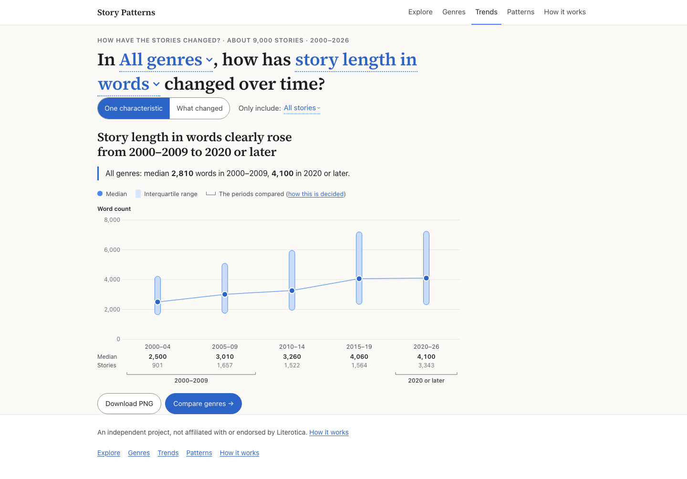

Yes/no (author's note), named groups (person of the description), bands (where sexual language peaks) and mostly zero
(consent and check-in language, the split chart), 1440 px:

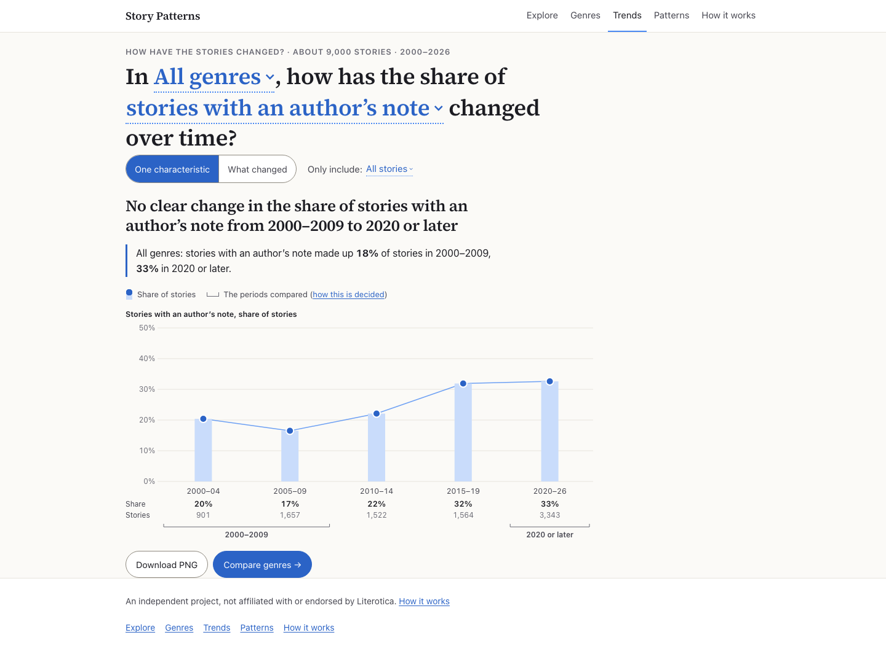

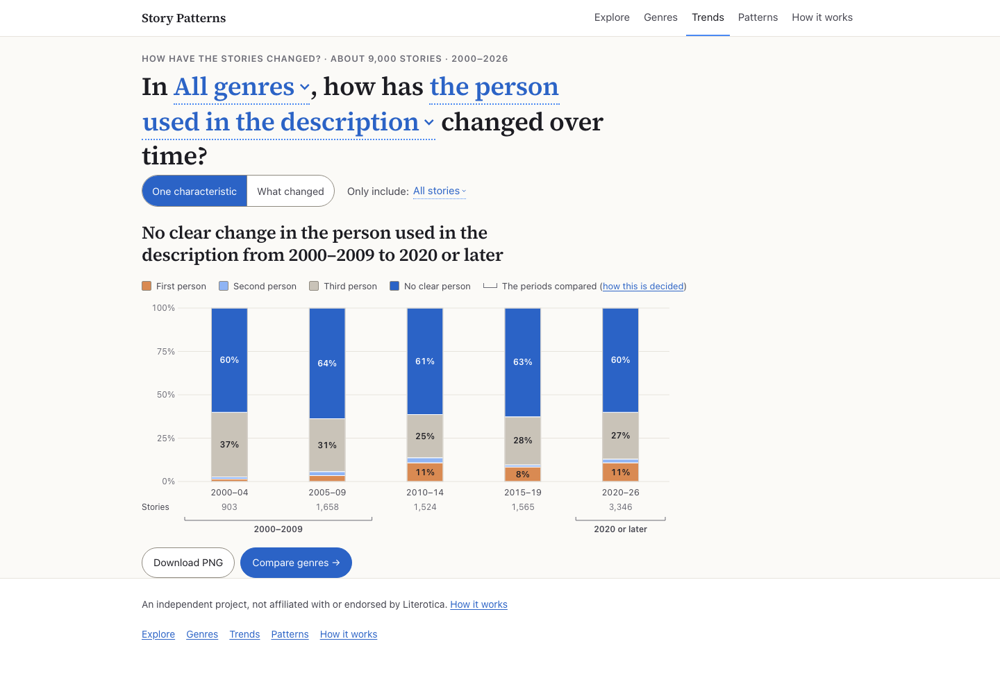

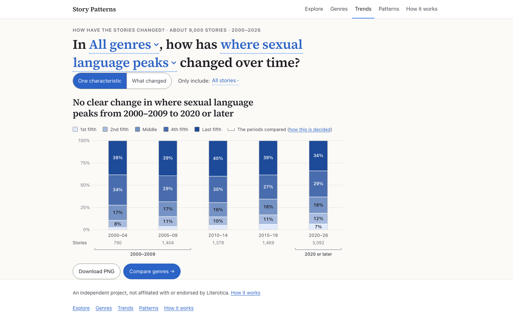

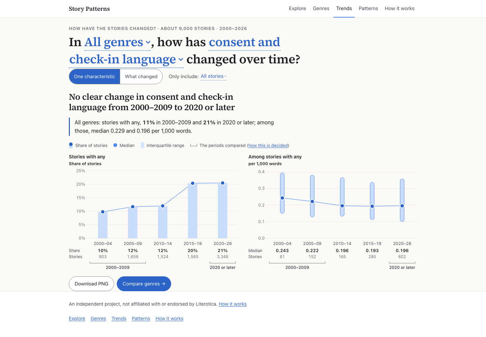

Numbers at 375 px, and a genre with too few stories (Transgender, 19 from 2000–2009):

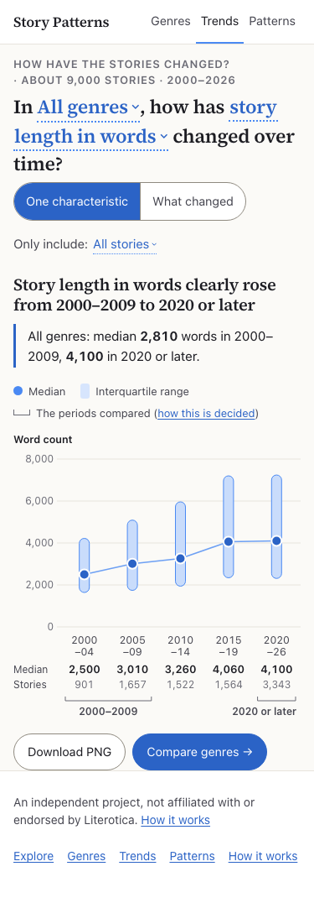

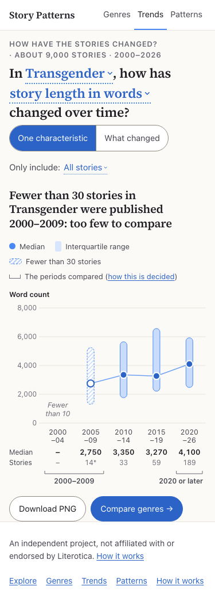

The fixed-mix line (touch words):

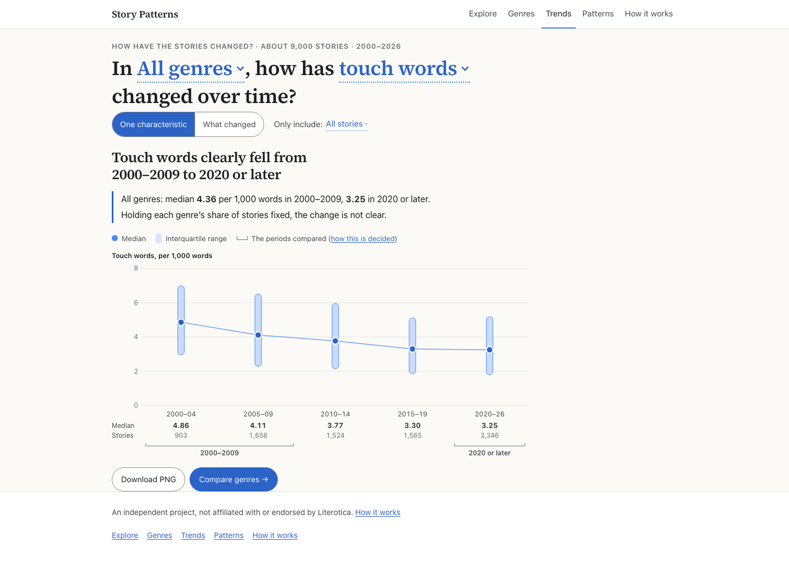

View 2 at 1440 and 375 px:

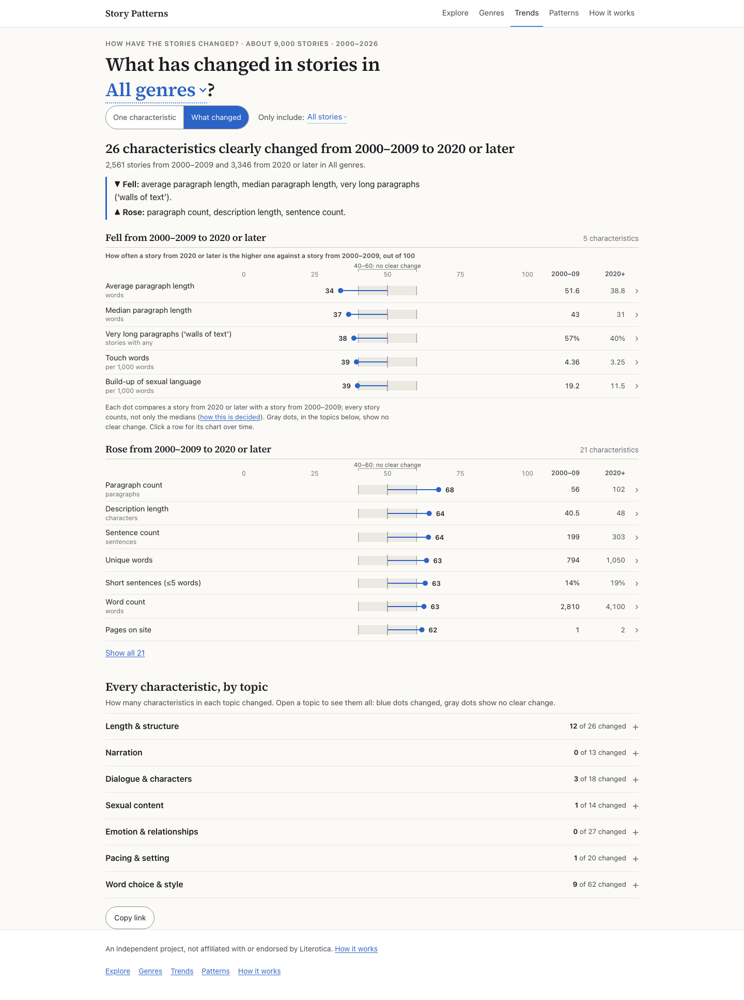

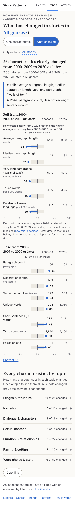

The masthead at 320, 375, 560 and 768 px, the footer, and Explore's new item:

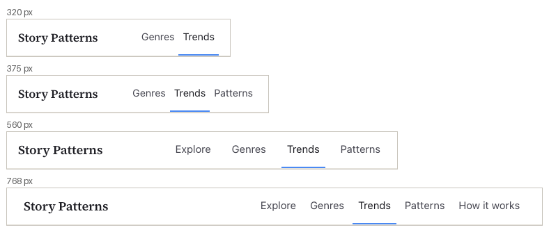

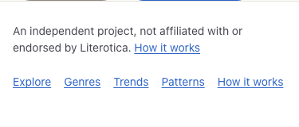

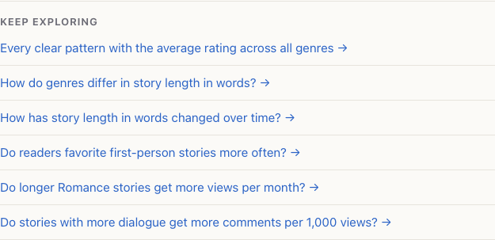

A downloaded PNG (`trends-story_words-adult-romance-all.png`):

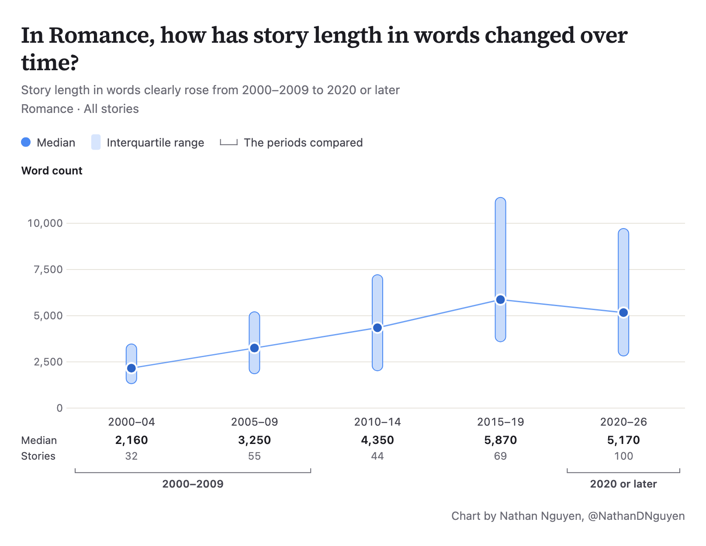

### 13.5 Found and fixed while building

* **The details card sat half its width to the left** of its column (`.range-chart .chart-tip` centers the explorer's
  cards and outranked `.trend-tip`): fixed in `a7697af`.
* **The comparison's code was in the first load** at the two commits that first extracted it: `ComparisonProfile.jsx`
  wasn't among `vite.config.js`'s lazy parts, which pulled it and the Genres page's helpers into the main script (about
  160 KiB, over the budget). Nothing was pushed, so the one-line fix went into the extraction's commit (`efbc842`); no
  commit is over the budget.
* **Number charts were drawn on their outer ticks' scale** from `a7697af` to `a3bc1e7`: where the ticks sit inside the
  domain (the domain kept when growing it to the next tick would leave the data under 80% of the plot), values above
  the last tick rose past the plot's top, by up to 110 px, in 8,504 of 19,623 number axes. The downloaded PNG of
  Romance's story length showed it; fixed in `f03f60b`, with a test and a glyph check of every mark.
* From the finishing measurements (`a3bc1e7`): the key's "how this is decided" answered taps only 17 px tall and broke
  inside its parentheses at 320 px; a tap on the table under the plot didn't reach its column; the browser anchored the
  scroll position on a word of the question, so another genre could move the answer by a line at 1440 px; and the key's
  dot, capsule and hatching drew in the page's color in forced colors.

### 13.6 Judgment calls

**Data and fixtures**

* The periods start at the data's first year, as the prompt words it (2000 today, a five-year boundary either way).
* The test fixtures get their designed change by reassigning each genre's publication years by dialogue share, so
  dialogue rises; a new fixture characteristic would have changed `exploreLayoutGuard.test.js`'s fingerprint, which must
  stay. No fixture genre's mix changes a verdict, so the tests change `fm` to show the fixed-mix line.
* The thresholds (`TREND_*`) live in `trends.py`, beside the builder.

**The shell**

* The masthead's breakpoints were measured on this Mac with `masthead.mjs`: 602, 484, 414 and 352 px (the proposal's
  estimates 640, 490, 412 and 350). "To spare" is the room left beyond the row's own 12 px gap.
* "Only include" moved unchanged from `GenresPage.jsx` to `IncludeSelect.jsx`, used by both pages.
* The picker's Length & structure topic keeps its own blurb on this page (`keepBlurbs`): without the number of tags and
  the author's story count it still fits.
* The kicker holds figure spaces where the years go until `meta.json` arrives, so no year is written in the code.
* The footer's page line follows mock-ups t07 and t08 (spaced links, no "·").

**View 1**

* One number format per chart, from its own quartiles, as F66 does, but never more decimals than the chart's largest
  quartile needs for three significant digits (a quartile of 0.993 beside a median of 63.6 doesn't print "63.600").
  Shares as `formatPercent` writes them, all with one decimal when the chart's largest share is under 10%.
* The table's values step down from 13 to 12 and 11.5 px (the site's smallest text) where long numbers would crowd a
  phone's columns (145 of 15,531 charts at 320 px); where even 11.5 px would (3 charts at 320 px, "0.00060" beside
  "0.0032"), every other value drops a line.
* Number axes keep three to five ticks; the domain grows to its outer ticks only when the data keep at least 80% of the
  plot (mock-up t01 grows story length's to 8,000), else the ticks sit inside it (t05 keeps 0 to 0.4, as the Genres
  page's axes do). The yes/no axis runs to 50% where mock-up t03 drew 40%: the prompt's rule wins.
* "Fewer than 10" wraps to as many lines as a column needs, its number kept with its word.
* The yes/no wording takes its phrase from `yes_subject` ("32% with an author's note"; "first-person"), a grammar fix
  from the data's own field; the yes/no axis title is "{yes_subject}, share of stories", as t03.
* The numbers line shows only when the windows were compared; with too few in every period the button offers all
  stories when an option is on, else All genres.
* A period's details are a card beside its column (at the plot's top, on the side with more room), the line under the
  chart on phones; the periods take two lines below 58 px columns (375 px).
* Named groups and bands stack bottom-up in their own order, their shares in segments at least 16 px tall with an ink;
  they have no axis title (t04). The key is one list (groups, hatching, brackets), so the PNG keeps it; t04 drew the
  brackets' line first. A named group's colors rank its shares in 2000–2009, so View 1 and View 2 color each group
  alike (by all periods when 2000–2009 has too few stories); ranks differ by genre, so a group's color can change with
  the genre.
* The split chart is one svg, so the PNG keeps both halves; side by side when the chart is at least 712 px wide (728 on
  a 760 px screen, 713 just above it, where the page's sides grow from 16 to 24 px). A period is one row across both
  halves, its details in the Genres page's words ("11% with any · among those, median …"), its card beside the half
  under the pointer. The halves' axis titles are "Share of stories" and the plain unit (t05), else the label.
* The key's "Share of stories" is a bar with its dot (t03 drew a dot, which the split chart's median needs); the split
  chart's key is Share of stories · Median · Interquartile range (t05's "Share, median" isn't in the copy).
* The palettes moved from `genres.css` to `palettes.css`, and "One genre"'s styles to `comparison.css`, both imported by
  `genres.css` and `trends.css`, so each page loads what it did; the Genres page renders pixel for pixel as before in 14
  views (named groups, bands, a Length option; "One genre" for Romance, How To, Fetish and Chain Stories with every
  topic open, at 1440 and 375 px).

**The shared comparison and View 2**

* The fingerprint covers Romance, How To, Fetish and Chain Stories, each with all stories and with "Published 2020 or
  later", wide and stacked, every topic closed and then one open (a different topic per genre, for every kind of row);
  for the open state it stores the topic's own markup. 16 files, 788 KB.
* A row's link is a function the page passes (`row.link`), so every row keeps the same element.
* `comparisonBar` takes the row's flag and the zone. The shares fix also pairs every group's two shares in a named
  group's row name, so the name still says each visible number (F92); 82 of the 946 Genres rows it changes still read
  the same with one decimal.
* View 2's mix line is "One genre"'s, relabeled from the windows: "A different mix: 2020 or later above, 2000–2009
  below" over its list, "2020 or later above, 2000–2009 below" over a row in a topic. The copy table has no line for
  it; its words are the sides' names.
* View 2's columns run in time's order (2000–09, then 2020+, the second muted, as t07). A list's title breaks after
  "2000–" at 375 px, as t08 shows.
* Too few for View 2 comes from the windows' counts; there is no "close to all genres" line (the heading says "No
  characteristic clearly changed").

**Links in and words**

* Explore's item takes its words from `wording.js`, so the first load gains only the item (+0.13 KB gzipped).
* A word joiner keeps each range of years in How it works on one line.
* The words scan bans "at random" and "randomly" rather than "random", which the data's own unit "ratio (1 = random
  order)" uses.
* The question is no longer a scroll anchor on this page (`overflow-anchor: none`).

### 13.7 Still open

* **A real phone and VoiceOver.** Everything above ran in headless Chromium; the sticky details line, the tap targets
  and the live region's words want an iPhone with VoiceOver and an Android phone with TalkBack.
* **Safari for the PNG.** "Download PNG" was checked in Chromium only; Safari may open the image instead of saving it.
* **The tie-uncorrected standard error** (§5.1): `rank_biserial_se` assumes no ties, so where many stories tie (yes/no,
  mostly zero, bands, small whole numbers) the test is stricter than 99.9%, on this page and the Genres page alike; a
  tie-corrected standard error would be a change for both.
* **The question's words** are 34–35 px tall tap targets on every page with the sentence.
* **A named group's color** can change when the genre does, since its colors rank its shares in the genre's 2000–2009.
* **82 rows** of the Genres page (and some of View 2) read the same even with one decimal.
* **A visit that starts on the Genres page** makes one more request than before (the chunk it shares with this page).
