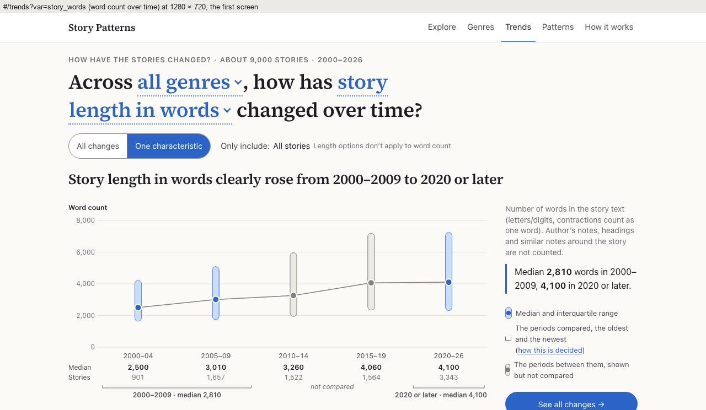
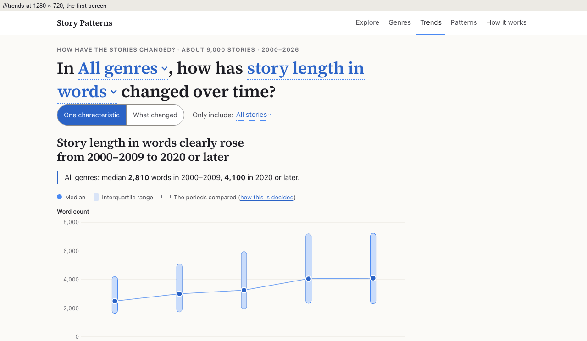
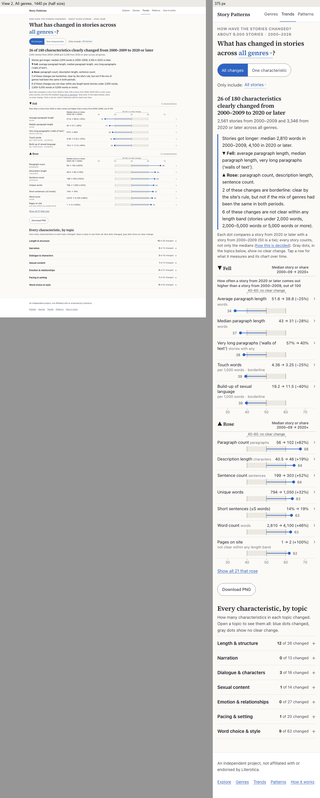

# The Trends page review, as built

Implemented on branch `trends-review`, made from the tip of `trends-page` (`e634304`), since `main` (`0d8611d`)
contains neither `trends-page` nor `one-genre`. It follows `STAGE2_TRENDS_REVIEW_IMPLEMENTATION_PROMPT.md`, which is
in the last commit: twelve commits, the last one this write-up. Not pushed. At the last commit all three checks pass:
`npm test` (503 tests in 36 files; 456 in 35 at `e634304`), `npm run build`, and `.venv/bin/python -m pytest` (218
tests; 213). `site-data` ran once, offline, from `litcorr_stage2_handoff_20261008.zip` (phase 1). Only `meta.json`
changed; every `v/`, `genres/` and `trends/` file and `patterns.json` is byte-identical.

## Summary

The page now opens on **All changes** (View 2), the switch reads "All changes · One characteristic", and Copy link is
gone from the site. Each comparison view (this one and the Genres page's "One genre") has one **Download PNG** for its
lists.

**View 1** (one characteristic):

- The chart tells the same story as its verdict. Each bracket carries its window's number ("2000–2009 · median
  2,810"). The periods between the windows are gray and marked "not compared". A path line names a dip or rise in
  between ("In between, it dipped to 5% in 2010–14."). "Borderline" replaces the fixed-mix line where the two checks
  disagree.
- On a desktop, the takeaway, key and actions sit in a rail beside the chart, and the brackets now fit on the first
  screen at 1280 × 720.

**View 2** (all changes):

- Its heading gives a denominator ("26 of 180 characteristics clearly changed…"). The takeaway starts with the length
  line and ends with the length-band line.
- Each row reads values first ("51.6 → 38.8 (−25%)"), with its dot on a scale zoomed to the view.

**Site-wide:** "has/have" follows the noun, "across all genres" replaces "In All genres", the kicker never starts or
ends a line with "·", and every page keeps clear space above the footer.

The final checks found and fixed defects in this round's own work, the main ones:

- **A crash.** View 1's word count → "See all changes" → "5,000 words or more" → Back showed "We couldn't load the
  data".
- **A shifting answer.** Picking from word count moved the answer 15 px on a phone.
- **Labels past the chart's edge.** At 320 and 375 px a bracket's number ended 1 px past the chart.
- **Tick labels under the zone's bracket.** View 2's "40" and "60" sat under the bracket's ends at desktop widths.

## 1. What changed, with its commit

| Phase · item | What changed | Commit |
|---|---|---|
| 0 | The before screenshots b01–b13 | `5f2747d` |
| 1 · O5 | `plural: true` on 78 characteristics in `meta.json` (`wording.py`'s `PLURAL`, by head word); `meta.trend.too_few` per option, ids A–Z (2 / 24 / 16 / 29); the extended synthetic handoff gains commas (a plural noun); +238 B gzipped | `b985b6e` |
| 2 · item 8 | "how have" for plural nouns in View 1's question, the tab's title, the PNG's title, the live region and Explore's Keep exploring item | `d758f3a` |
| 2 · quick win | "Across [all genres ▾], …" / "In [Romance ▾], …"; "What has changed in stories across [all genres ▾]?"; the slot lower case; the takeaway without "{genre}:"; the sample line ends "across all genres." / "in Romance." | `d758f3a` |
| 2 · site-wide | The kicker in pieces: no line starts or ends with "·", the counts on a line of their own when it wraps; O3's footer space (64 px, 48 at ≤ 760 px) on every page; the footer sentence without its link; the page list in balanced lines | `d758f3a` |
| 3 · items 1, 5 · O4 | `#/trends` (and `?genre=…&include=…` without `var`) opens View 2; `var=` opens View 1; `view=changes` still works; the switch "All changes · One characteristic"; "See all changes →" primary (named "See all changes in {genre}"), "Compare genres →" secondary; the Trends link returns to the address shown | `4542a80` |
| 3 · O2 | Copy link out of `ComparisonProfile` (Trends View 2 and "One genre"); `CopyLink.jsx`, `.copy-link`, `.copy-manual` and its test deleted | `4542a80` |
| 4 · item 2 | The brackets' numbers ("2000–2009 · median 2,810", "· 9%", "· 57% with any"), on a second line where they don't fit | `3c677f9` |
| 4 · item 3 | The middle periods in `--quiet-mark` gray, the line gray throughout, "not compared" between the brackets; the path line (8 of 180) | `3c677f9` |
| 4 · item 3 · O6 | "Borderline" heading and line where `f` and `fm` disagree (2 / 1 / 5 / 4); `mixFixedLine` gone | `3c677f9` |
| 4 · item 10 | Yes/no as a dot on the line (no share bar); the key's "Share of stories", "Median and interquartile range" and "Fewer than 30 stories (*)"; "Other" for groups under 3% everywhere; the line breaks where a period isn't drawn | `3c677f9` |
| 5 · item 9 | The desktop rail from a 1,008 px page; the fold at 1280 × 720 (`plotHeight`); 16 px between the question and the controls; the question as the page's `h1`, the kicker a `p` | `3983d7a` |
| 6 · items 4, 7 | View 2's heading with its denominator; the length line, the ▼/▲/≠ lines and the length-band line; the row tags "· not clear within any length band" and "· borderline"; the note above the first list; "▼ Fell", "▲ Rose", "≠ A different mix"; values first; the zoomed scale (50 ± d); named groups' bars in time's order | `260739a` |
| 6 · O2 | One "Download PNG" after the lists on both comparison views, drawn from the lists' plan (760 CSS px at 2×) | `260739a` |
| 7 · items 5, 6 | The picker's "Clearly changed in …" group; "{name} (too few to compare)" in the genre list; View 2's too-few state with its stories per period and "One characteristic over time →"; Only include leaves out options that don't apply (plain words when none is left) | `cb66cd5` |
| 8 · found | Bracket labels set against the chart's edge; View 2's tick labels 4 px lower under the zone bracket's ends; stacked rows on one baseline with the values as wide as their own; percents grouped ("+23,640%") | `4d35dd3` |
| 8 · found | The crash after Back (View 1 drew from a file without its characteristic) | `18cdac8` |
| 8 · found | Only include's two forms the same height, and the scroll anchored on its row | `1e116a5` |
| 8 | This write-up, the after screenshots a01–a16, the README and the pointers | the last commit |

## 2. Not done, on purpose

- **O1.** "Interquartile range" stays. The key reads "Median and interquartile range", "middle half" appears nowhere,
  and the copy scans still ban it.
- **O2.** No Copy link anywhere, View 1 included. View 2's and "One genre"'s were removed, and each now has one
  "Download PNG" for its lists.
- **O3.** The footer is never flush with the content above it. Every page keeps at least 64 px above the footer's line
  (48 px at 760 px or less). Nothing else about the footer changed beyond phase 2.

## 3. Before and after

Phones at full size; 1440 px at half size. Palette-compressed to 64 colors. The "before" panels are `e634304`; the
"after" panels are the final build, `04fb6a6`, with your follow-up (section 9).

| View | After | Before |
|---|---|---|
| `#/trends` at 1440 and 375 px: now All changes (the default), before word count | [a01](trends-review/a01-trends-default-1440-375.png) | [b01](trends-review/b01-trends-default-1440-375.png) |
| Word count over time, the first screen at 1280 × 720 (a02's address is `?var=story_words`: `#/trends` now opens View 2) | [a02](trends-review/a02-trends-default-1280x720.png) | [b02](trends-review/b02-trends-default-1280x720.png) |
| All changes, All genres | [a03](trends-review/a03-all-changes-1440-375.png) | [b03](trends-review/b03-all-changes-1440-375.png) |
| All changes with "Dialogue & characters" open | [a04](trends-review/a04-topic-open-1440-375.png) | [b04](trends-review/b04-topic-open-1440-375.png) |
| The continuation | [a05](trends-review/a05-continuation-1440-375.png) | [b05](trends-review/b05-continuation-1440-375.png) |
| Touch words (borderline) | [a06](trends-review/a06-touch-words-1440-375.png) | [b06](trends-review/b06-touch-words-1440-375.png) |
| Very long paragraphs | [a07](trends-review/a07-very-long-paragraphs-1440-375.png) | [b07](trends-review/b07-very-long-paragraphs-1440-375.png) |
| Narrative perspective | [a08](trends-review/a08-narrative-perspective-1440-375.png) | [b08](trends-review/b08-narrative-perspective-1440-375.png) |
| Chain Stories, both views | [a09](trends-review/a09-chain-stories-both-views.png) | [b09](trends-review/b09-chain-stories-both-views.png) |
| Romance, 2,000–5,000 words, dialogue share | [a10](trends-review/a10-romance-medium-dialogue-1440-375.png) | [b10](trends-review/b10-romance-medium-dialogue-1440-375.png) |
| The picker open | [a11](trends-review/a11-picker-1440-375.png) | [b11](trends-review/b11-picker-1440-375.png) |
| The footer on long pages | [a12](trends-review/a12-footer-long-pages.png) | [b12](trends-review/b12-footer-long-pages.png) |
| "One genre" for Romance, its lists and end | [a13](trends-review/a13-one-genre-romance-1440-375.png) | [b13](trends-review/b13-one-genre-romance-1440-375.png) |
| View 2's PNG, All genres | [a14](trends-review/a14-all-changes-png.png) | |
| "One genre"'s PNG, Romance | [a15](trends-review/a15-one-genre-png.png) | |
| The too-few state, 375 px | [a16](trends-review/a16-too-few-375.png) | [b09](trends-review/b09-chain-stories-both-views.png) |

## 4. Measurements

Copies of the earlier rounds' scripts, adapted to the new markup and run here against frozen builds served with gzip:
`e634304` (before) and this branch at `1e116a5` (after). They used playwright-core 1.56 and axe-core 4.10 in the
cached headless Chromium 1243. The wide font is Verdana standing in for DejaVu Sans. The scripts and their outputs
are in `Claude outputs/design-review-2-tools/trends-review/` (`tools/`, `measure/`), not committed.

| Measure | Before (`e634304`) | After |
|---|---|---|
| Fold, word count, All genres: the brackets' bottom at 1280 × 720 / 1440 × 900 | 805 of 720 / 805 of 900 | **700 of 720 / 720 of 900** (plot 230 / 250 px) |
| Word count's heading at 1280 and 1440 px | 2 lines | **1 line** |
| Between the question's last line and the controls | 2 px (View 1) / 4 px (View 2) | **16 px** below the dotted underline (18 px margin) |
| Content width, View 1 and View 2, at 1440 / 1280 / 1024 px | 1,032 / 1,032 / 976 | 1,032 / 1,032 / 976 (unchanged; the switch never changes the width) |
| Space above the footer's line, every page, 375 / 1440 px | 0 px (Explore 40) | **48 / 64 px** (Explore 88 / 104; View 1 130 at 1440, `min-height`) |
| Kicker lines starting with "·" (phones); a page link alone in the footer list | yes; at 362–370 px | **none** at 320–1440 px, both fonts |
| Glyph boxes, View 1: 180 characteristics × All genres and Romance × 4 options × 320, 375, 768, 1280 and 1440 px (7,170 charts) | site font 0; Verdana 3,942 ("2020 or later" past the chart, and 3 values at 320) | **site font 0; Verdana 3** (the same 3 values, Still open) |
| Glyph boxes, View 2: 31 genres × 4 options × the 5 widths, every topic open, lists in full | 0 and 0 | **0 and 0** (9,930 rows a width) |
| Breaks: "·" at a line's start or end; a value broken; a unit or tag broken or leaving a word alone (980 states at 320–1440 px) | | **0 of 1,483 visible "·"; 0 of 69,510 values; 0 units** (Verdana: 3, Still open) |
| Values inside their column (124 files × 5 widths) | | 0 overflow with the site font; Verdana: 70 rows at 1280 and at 1440 px run 8–9 px into the 12 px gap (Still open) |
| A control moving the page (375 / 768 / 1280 / 1440, from the top and from 300 px down) | 8 of 32 moved (the switch) | **8 of 144** (the same switch cases: a new view starts at the top, as on the Genres page) |
| Layout shift on slow 4G, worst | 0.021 (View 1, another genre, 1440) | 0.021 (the same); a View 2 visit 0.004–0.006 (the band line arriving) |
| "Loading…" flashes; the length files and View 2's first paint | none | none; drawn at 1.47 s, the length files done at 1.81 s |
| Taps at 320 and 375 px | ≥ 44 px but the question's slots (34–35) | the same; the new buttons and links 44 px |
| axe (WCAG 2.0–2.2 A/AA, best practice) | 51 runs, none | **63 runs, none** (both views, Romance, Chain Stories, a topic open, the picker open with its group and "Show all", One genre) |
| Label in name (axe's rule as Lighthouse runs it) | | none on 12 pages |
| Forced colors, light and dark | | every mark draws: the gray middle periods, "not compared", the brackets, hollow dots, "Other", View 2's values; the zone's fill doesn't (nor before), its edges do |
| Contrast | | "not compared" 5.05:1; the middle periods' marks 3.80:1 (3.27:1 against their capsule); "Other" 3.29:1 |
| First load (budget 155 KiB) | 149.5 KiB, 6 requests | **149.7 KiB, 6** (`meta.json` 19.1 → 19.3) |
| A visit to `#/trends` | 171.1 KiB, 9 (View 1) | 213.0 KiB, 12 (View 2, with the three length files' 37.1 KiB after the first paint) |
| A visit to View 1 (word count) / to "One genre" | 171.1 / 207.1 KiB | 176.0 / 208.7 KiB |
| The Trends chunk (Vite, gzipped) | JS 12.62 kB, CSS 3.09 | JS 15.22 kB, CSS 3.94 |
| Shared and lazy chunks (gzipped) | `IncludeSelect` 11.72; `chartImage` 4.65; main 88.04 | 13.16; 7.53 (only on Download PNG); 87.87 |
| Page height, 375 / 1440 px (`min-height` off) | `#/trends` 1,076 / 1,004; View 2 2,518 / 1,934 | `#/trends` (now View 2) 2,635 / 2,083; View 1 1,207 / 924 |
| PNGs | | View 1: word count, the continuation, very long paragraphs, narrative perspective (1616 px wide, as before); View 2: All genres folded and "Show all", Romance; "One genre": Romance folded and "Show all", How To (1520 px wide on every screen). All looked at |

**Acceptance numbers** (real data):

| | Expected | Built |
|---|---|---|
| Clearly changed, All genres | 26 of 180 (21 rose, 5 fell); 8, 16, 15 of 179 | the same |
| `too_few` | 2; 24; 16; 29 | the same (Chain Stories and Transgender with All stories) |
| Plural nouns | about 64 of 180 | **78** (section 5) |
| Borderline | 2 (touch words, build-up of sexual language); 1, 5, 4 | the same |
| Length-band tags | 6 rows | the same: Pages on site, Dialogue share, Recurring names, Question sentences, Questions per 1,000 words, Dialogue in the last fifth |
| Path line | the continuation (5.2% in 2010–14), not word count; at most 45 of 180 | the continuation and 7 others: **8 of 180** (28, 20, 12 with the Length options); 2,061 across every genre's file with All stories (232, 68, 115) |
| *d*, All genres with All stories | 25 (dots 34 to 68) | **25**; over the 53 files that can be compared: 20 ×2, 25 ×18, 30 ×26, 35 ×6, 40 ×1 |

## 5. The plural list and the shared wording

**78 plural nouns.** Each is decided by its head word. Seven are two nouns joined by "and", which read plural ("how
have affection and love changed"). That accounts for most of the difference from "about 64". Yes/no characteristics
are asked through "the share of", which is singular.

- **Length:** one-sentence paragraphs; very long paragraphs; scene breaks per 1,000 words.
- **Dialogue:** dialogue segments per 1,000 words; questions in dialogue; exclamations in dialogue; untagged speech
  lines; adverbs in speech tags; name mentions per 1,000 words.
- **Style:**
  - Punctuation and sentences: ellipses; dashes; semicolons; colons; commas; quotation marks; parentheses; question
    sentences; exclamation sentences; questions per 1,000 words; exclamations per 1,000 words; commas per sentence;
    subordinate clauses per sentence; long sentences (>30 words); short sentences (≤5 words).
  - Words: syllables per word; long (3+ syllable) words; unique words; rare words; unrecognized words; long words
    (7+ letters); ALL-CAPS words; -ly adverbs; physical action verbs; descriptive words; italics; stretched words (like
    ‘sooo’); writing slips; thinking verbs; perception verbs; ‘filter’ words; distancing phrases; immediacy words;
    modal verbs.
  - Repetition: repeated word pairs; repeated three-word phrases; sentences starting the same way; doubled words;
    repeated five-word phrases.
  - The senses: touch words; sight words; sound words; smell words; taste words; physical sensation words.
- **Sex:** anatomical terms; sexual-action terms; general sexual words; words before the first explicit term; sex
  scenes; sex scenes per 10,000 words.
- **Emotion:**
  - Feelings: emotional words; affection and love; anxiety and fear; excitement and arousal; shame and embarrassment;
    jealousy and envy; humor and laughter.
  - Agency: passive constructions; passive sentences; words for deciding and trying; control and restraint; spoken
    commands.
- **Pacing:** home settings; public settings; outdoor settings; action verbs in the first fifth; action verbs in the
  last fifth; time jumps.

**The shared wording fixed:**

- View 1's question, and with it the tab's title, the PNG's title and the live region.
- Explore's "Keep exploring" item: `changedOverTime`, "How have very long paragraphs changed over time?".

Every other template that puts a characteristic's noun before a verb was already right. The Trends headings use the
past tense ("rose", "fell", "changed", "No clear change in …"). Every `yes_subject` and "more" subject is plural
("First-person stories tend to …", "… make up 18% of stories").

## 6. Fresh eyes

*Since October 12, two more rounds on the follow-up: section 9.*

Six stand-ins, three on a phone and three on a desktop. Each was shown only screen-sized captures of the after build
by file path, with the earlier rounds' situation line ("a friend sent you this link…"; "you have no background in
statistics") and the prompt's five questions. Their answers, verbatim, are in `Claude outputs/design-review-2-tools/
trends-review/fresh-eyes.md`.

| Question | Got it | What tripped them |
|---|---|---|
| 1. What changed, in one sentence | 6/6: longer stories (2,810 → 4,100 words), more and shorter paragraphs, 26 of 180 | "not clear within any length band" never explained (6/6); "description length": of what? (3/6); "Show all 21" under a heading of 26 (2/6, phones) |
| 2. The continuation | 6/6: no clear change, 9% and 9%, dipped to 5% in 2010–14 and came back | 5/6 noticed 2000–04's 11% pooled into 2000–2009's 9% |
| 3. Gray periods and "not compared" | 6/6: shown, but not part of the comparison | gray means "no clear change" in View 2 and "not compared" here (6/6; the label set them straight); why the middle years are left out isn't on screen (6/6) |
| 4. "Average paragraph length" read aloud | 6/6: 51.6 → 38.8, a quarter shorter, 34 in 100, outside 40–60, a clear drop | "is the higher one" took two reads (5/6); average or median, and how it differs from the median row (4/6) |
| 5. "Borderline" on touch words | 6/6: passes the site's rule, not once each genre's share is held fixed | "held fixed" (6/6); from View 2's dot at 39 alone they'd read "borderline" as "only just past 40" (6/6); "clearly fell" beside "borderline" (2/6); "interquartile range" (3/6) |

## 7. Judgment calls

1. **Plural by head word.** Two nouns joined by "and" are plural ("affection and love have"). That gives 78, not
   about 64.
2. **`too_few` lists ids A–Z.** "all" is listed too when All genres can't be compared, as in the fixtures' Under 2,000
   and 5,000+ words.
3. **The synthetic plural noun (commas) is only in the extended handoff.** The site's default handoff can't gain a
   characteristic without changing `exploreLayoutGuard`'s fingerprint, so site tests set `plural` on a copy and also
   check the real `meta.json`.
4. **View 1's takeaway without "{genre}:"** starts with a capital ("Median …", "Stories with any, …"). This is grammar
   built from the data's own fields.
5. **Both views' live regions start with the question**, since the takeaway no longer names the genre.
6. **View 2's sample line with an option** ends "… across all genres match “Under 2,000 words”.": the two forms plus
   the existing match clause.
7. **The kicker is flex pieces with leading separators**, each clipped at a line's start. Its text is unchanged.
8. **The footer list uses inline items and `text-wrap: balance`** (3 + 2 at 320–360 px, one line from 375). The
   space is `main.wrap`'s bottom padding, 64 / 48 px.
9. **View 2's canonical address is `#/trends?genre=…&include=…`.** No `view`, since no `var` means all changes.
   `view=changes` is still read; with a `var`, it opens all changes and keeps the characteristic for the way back.
10. **Found in phase 3:** `sanitizeTrends` applied word count's Length-option conflict to View 2. It would have reset
    "Under 2,000 words" on every default visit. Fixed.
11. **The Trends link in the masthead and footer** goes to the address shown on the page (it lagged one change), and
    to the last address elsewhere.
12. **"See all changes in all genres"** for All genres, in the slot's words. The actions run See all changes, Compare
    genres, Download PNG everywhere.
13. **`ChartLink` moved to `TrendAnswer.jsx`**, so both views use it without a circular import.
14. **Bracket numbers appear only where the windows were compared**, as in the takeaway. Both labels take two lines
    unless the one-line labels sit at least 12 px apart inside the chart.
15. **"not compared" sits at the brackets' height, between them.** There's room there at 320 px; the label row has
    none.
16. **The path line's units:** "the median rose to 4,700 words" (`withUnit`). Shares and mostly zero read "it dipped
    to 5%", with the share with any.
17. **The split chart's share half drops its bar too**, since it reads as yes/no.
18. **The small key:** numbers get a hatched capsule, yes/no a hollow dot, mostly zero both. "Other" is #8f8a80 and
    sits last, at the top of the column.
19. **A sign flip** (`f` = −`fm`, none in the data) would read as the first borderline form.
20. **Forced colors:** the brackets' words (which had no rule before) and "not compared" are CanvasText. The dead
    key-median rule is gone.
21. **The rail starts at a 1,008 px page** (an answer of 960). It's a grid with named areas, so the source order stays
    takeaway, key, chart, actions. In the rail, the actions stack full width.
22. **The split chart stays in the chart column.** Its halves sit side by side at 760 px, with the brackets' numbers
    on two lines.
23. **The fold:** `plotHeight` = the window's height − 490, between 200 and 250 px on non-phones (230 at 720 px tall).
24. **The gap is an 18 px margin**, which leaves 16 px below the 2 px dotted underline. The rail's first line sits
    level with the axis title.
25. **The question is the `h1`, named by a hidden span with its words.** Otherwise the name included "Story
    characteristic: …". The kicker is a `p` on Trends only.
26. **"1 of these changes is not clear …"** when there is one: grammar built from the count.
27. **The length files are fetched after the main file** (All genres with All stories only). There is no band line or
    tag until they arrive.
28. **Tags reuse the kicker's clipped separators.** The unit stays whole, and "·" never starts or ends a line.
29. **Percents read "+" and "−"** ("+82%", "−25%"), on the row and in its name.
30. **The values column (wide)** is the widest value's estimate + 8 px, between 120 and 180. Stacked, it's the row's
    own width (phase 8).
31. **Values are left-aligned wide and right-aligned stacked.** The tagged unit lines live in `trends.css` only.
32. **The PNG is 760 CSS px wide**, including 24 px of padding. The title is 24 px and the subtitle 14 px.
    `numberPlace` comes in the plan, so `chartImage.js` stays lazy (importing `genres.js` had pulled it into that
    chunk).
33. **The image shows each list's count** at the right of its title, as the wide page does.
34. **The picker's group follows View 2's order** (by size, ties in topic order). Chips read "▲ label" with a hidden
    ", rose". "Show all {k}" reveals the rest in place.
35. **The too-few table is an HTML table** captioned "Stories per period". Its link is a new history entry. It opens the
    remembered characteristic, else word count, and paragraph count when a Length option is on.
36. **Only include's plain form** shows a note built from the conflicting options' group, lower case.
37. **"(too few to compare)" also marks "All genres"** where it can't be compared (in the fixtures only).
38. **Phase 8, brackets at the edge.** A bracket's lines sit against the chart's edge where, centered, they'd reach
    it, all lines alike. The fit allows 10% slack, since Verdana is 9% wider than `textWidth`'s estimate.
39. **Phase 8, tick labels.** Every rule's zone is 40–60, so View 2's ticks every 10 always put 40 and 60 under the
    bracket's ends. Every label stays ("ticks go every 10"), 4 px lower; the image does the same. "One genre" is
    unchanged.
40. **Phase 8, stacked rows.** Line 1 reads on one baseline, as "line 1 holds the label…, the values and ›" asks. A
    word too wide for its cell breaks; only Verdana at 320 px needs that.
41. **Phase 8, the crash fix.** While another file loads, the answer is the last one its file can draw: a
    characteristic, or all changes.
42. **Phase 8, Only include.** Its two forms are the same height on phones, and the row itself, not its words, is
    the scroll anchor. Excluding all the controls from anchoring broke 7 cases where the question re-wraps.
43. **The view switch stays a navigation** that starts the other view at the top, as the Genres page's does and as
    before.
44. **a02 shows word count**, b02's content, since `#/trends` now opens View 2 (a01).

## 8. Still open

- **A real phone, Safari and screen readers.** Everything was checked in headless Chromium with emulated touch and
  forced colors. Safari couldn't be driven here: `safaridriver` needs Safari's remote automation turned on, a setting
  for you, and Playwright's WebKit isn't installed. VoiceOver, TalkBack and NVDA are untested.
- ~~**Fresh eyes, all in approved copy, so your call:** "not clear within any length band" never explained (6/6); gray
  meaning "no clear change" in View 2 and "not compared" in View 1 (6/6); "held fixed" (6/6); "· borderline" read as
  "near the zone's edge" (6/6); "is the higher one" (5/6), average or median (4/6), "Show all 21" under 26 (2/6).~~
  Addressed on October 12 at your word, and checked by two more rounds: section 9.
- **Percents on the build-ups.** The rule gives a percent to every number with a plain unit. "Build-up of …" (last fifth
  minus first fifth, per 1,000 words) qualifies, and near-zero medians make it huge: 15 of the 4,015 rows with a
  percent reach 1,000% or more, up to "0.0034 → 5.1 (+149,028%)" (How To). Leaving signed differences without a percent would change what is
  shown, so I left it for you.
- ~~**The borderline line's "it"** with a plural noun ("… it clearly fell …").~~ The line names the noun now ("By the
  site’s rule touch words clearly fell, …"): section 9.
- **Verdana only, all at 320 px or in the gap:**
  - 3 of 7,170 View 1 charts: two pairs of period values touch and one ends 2 px past the chart. Verdana's "%" is
    1.27 em ("10.0%" is 49 px against 39 estimated). The same 3 were there before.
  - 70 rows' values run 8–9 px into the 12 px gap at chart widths of 900 px or more. Nothing overlaps; measuring the
    widest value in the page's font would fix it.
  - "per 1,000 narration words" leaves "words" alone in 3 rows, forced by a 108 px cell.
  - "Subordinate" breaks inside its word in 15 rows.
- **The middle periods' hatching** (small samples between the windows) is #d9d4ca, 1.41:1, a texture inside a 3.80:1
  outline. The table's asterisk says the same.
- **The view switch from a scrolled page** opens the other view at the top. The Genres page's switch does the same,
  and so did this page before. Keeping the place would be a change to both pages.

## 9. Your follow-up: what tripped the stand-ins (October 12)

You asked for the stumbles in section 6 to be addressed by my judgment. Built in `04fb6a6`, checked by two more rounds of
six stand-ins (the same brief, the same five questions, new screen-sized captures each time), then measured again. This
write-up and the redone after screenshots are the commit after it. Not pushed.

### 9.1 What changed

| Stumble (round 1) | What changed | Where |
|---|---|---|
| "not clear within any length band" never explained (6/6) | The band line names the bands: "6 of these changes are not clear within any length band (stories under 2,000 words, 2,000–5,000 words or 5,000 words or more)." It comes last in the takeaway, and its place is held (hidden) until the Length options' files arrive, so nothing moves when it comes | View 2's takeaway |
| "held fixed" (6/6); "not once" read as "never" | The fixed-mix check in the readers' own words, "if the mix of genres had been the same in both periods": "By the site’s rule touch words clearly fell, but not if the mix of genres had been the same in both periods (how this is decided)." The noun, not "it", so a plural one reads right | View 1's borderline line |
| "· borderline" read as "near the zone's edge" (6/6) | What it means, once, in the takeaway: "2 of these changes are borderline: clear by the site’s rule, but not if the mix of genres had been the same in both periods." With 5,000 words or more, whose 4 are in the topics only: "4 characteristics, in the topics below, are borderline: not clear by the site’s rule, but clear if …" | View 2's takeaway |
| Gray means "no clear change" in View 2 (6/6); why the middle isn't compared (6/6) | The key: "The periods compared, the oldest and the newest (how this is decided)" and a gray entry, "The periods between them, shown but not compared" (numbers, yes/no and mostly zero; named groups and bands keep their colors) | View 1's key |
| "is the higher one" took two reads (5/6) | "How often a story from 2020 or later comes out higher than a story from 2000–2009, out of 100"; the note adds "(50 is a tie)" | View 2's axis title and note |
| Average or median? (4/6) | The values' head in two lines: "Median story or share" over "2000–09 → 2020+" (the image too) | View 2's head row |
| "description length": of what? (3/6) | What the characteristic measures, under the heading (the rail's first line on a desktop), from meta's description as Explore shows it; none where it only repeats the label and the unit (9 of 180, such as "Touch words per 1,000 words."). The note says where to find it: "Tap a row for what it measures and its chart over time." | View 1; View 2's note |
| "Show all 21" read against the heading's 26 (2/6, phones) | "Show all 21 that rose", "Show all 5 that fell" | View 2's lists |
| (all of the above point to "how this is decided") | How it works says why only the two windows are compared (the oldest and the newest, each pooling several years, so that no thin year can swing the verdict), what borderline means in the same words, and what the length bands are | How it works, "Changes over time" |

### 9.2 Fresh eyes, three rounds

Round 1 is section 6. Round 2 tested the first pass ("if every genre had the same share of stories in both periods",
"scores higher than", "Median or share", the tautological definitions shown). Round 3 tested the final words, except
"comes out higher than", which replaced "scores higher than" after it. Answers verbatim in `Claude outputs/
design-review-2-tools/trends-review/fresh-eyes.md`.

| Stumble | Round 1 | Round 2 | Round 3 |
|---|---|---|---|
| Each question's point came across | 6/6 each | 6/6 each | 6/6 each |
| "length band" not understood | 6/6 | 0/6 | 1/6 |
| "Show all 21" against 26 | 2/6 | 0/6 | 0/6 |
| The genre-mix check unclear, or misread as "all genres the same size" | 6/6 unclear | 3/6 misread | **0/6** |
| Average or median? | 4/6 | 6/6 ("Median" over "Average …") | 3/6; 4/6 read "the middle story's average" outright |
| "is the higher one" / "scores higher" made them pause | 5/6 | 2/6 | 3/6 (one: "scores" sounds like ratings, hence "comes out higher") |
| Gray means two things | 6/6, the label resolved it | 6/6, the key resolved it | 6/6, the key resolved it |
| Why only the two ends: not on the screen | 6/6 | 6/6 | 6/6 (all point to "how this is decided", which now says) |
| "borderline" could read as "only just past 40" | 6/6 | 6/6 noted, all took the page's meaning | 5/6 noted, all took the page's meaning |
| "description length": of what? | 3/6 | 1/6 | 3/6 (all desktop; the definition is a tap away) |
| What counts as a "touch word"? | 0/6 | 5/6 | 6/6 |
| "interquartile range" (O1 keeps it) | 3/6 | 2/6 | 5/6 |

- **What it fixed:** the length band, "Show all 21", the genre-mix check (no one misreads it now), and "borderline" (every
  reader takes the page's meaning, though most still note that its two rows sit at 39).
- **What it made visible:** once the continuation has a one-line definition, touch words' lack of one gets noticed (0/6,
  then 5/6 and 6/6). Meta's description for 9 characteristics only repeats the label; a real one (the word list's gist,
  say) would answer it, and that is a `meta.json` change, so it's yours (9.6).
- **Unchanged:** the gray (every reader notes it; the key settles it); the reason for comparing only the two ends (now in
  How it works, which no stand-in could open).

### 9.3 Measurements, the final build against `a1cfa0b`

| Measure | `a1cfa0b` | Final (`04fb6a6`) |
|---|---|---|
| Glyph boxes, View 2 (31 genres × 4 options × 320–1440 px, every topic open): site font / Verdana | 0 / 0 | **0 / 0** (with the two-line head; it keeps 28 px from the plot, 10 in Verdana) |
| Glyph boxes, View 1 (7,170 charts): site font / Verdana | 0 / 3 | 0 / 3 (the same) |
| Breaks (980 states a font) | 0 / 3 | 0 / 3 (the same) |
| axe; label in name | 63 runs, none; 12 pages, none | the same |
| Forced colors, light and dark | every mark draws | and the key's gray entry and the definition line |
| Fold at 1280 × 720 / 1440 × 900 | 700 / 720 | 700 / 720 (the definition sits in the rail) |
| A control moving the page | 8 of 144 (the switch) | the same |
| Layout shift, a View 2 visit (slow 4G), 375 / 1440 px | 0.004 / 0.006 | **0.000 / 0.000** (the band line's place held); worst 0.021 as before |
| First load | 149.7 KiB, 6 | 149.7 KiB, 6 |
| A visit to `#/trends`; to View 1; to "One genre"; to How it works | 213.0; 176.0; 208.7 KiB | 213.7; 176.7; 208.8; 141.2 KiB |
| Chunks (bytes, `gzip -9`): Trends JS, CSS; How it works; `IncludeSelect`; `chartImage`; the main script | 15,083, 3,914; 8,027; 13,078; 7,495; 86,746 | 15,561, 4,045; 8,344; 13,142; 7,539; 86,748 |
| Page height, 375 / 1440 px: `#/trends` (View 2); View 1, word count | 2,635 / 2,083; 1,207 / 924 | 2,754 / 2,162; 1,339 / 1,036 (the takeaway's two lines; the definition and the key's entries) |
| PNGs | | View 2's: the new axis title and the two-line head; View 1's key: both new entries ("(how this is decided)" left out); "One genre"'s: pixel-identical |

Tests: 508 (503 before), stable over three runs.

### 9.4 Judgment calls

1. **The readers' words over mine.** "If the mix of genres had been the same in both periods" is how rounds 1 and 2
   paraphrased the check; my first phrase, "if every genre had the same share of stories", was misread by 3 of 6.
2. **"Median story or share", not "typical".** An earlier round banned "typical story" from the site (a scan enforces
   it), and "Median or share" over "Average paragraph length" read as a contradiction to 6 of 6. "Median story" says
   both levels: the median story's average.
3. **"Comes out higher", not "scores higher"**, which on a site about ratings read as a rating. This one change wasn't
   tested by a round.
4. **The band line last, its place held.** The prompt had it last; it arrives after the first paint, so a hidden copy
   (with a one-digit count) keeps its height until then. If no change misses every band (none in the data), the copy
   goes and the page moves once.
5. **A definition only where it says more than the label.** The 9 that repeat the label and unit are left out, since
   they read as a definition and give none.
6. **The definition at the rail's top on a desktop**, not under the heading, so the chart keeps its place on the first
   screen.
7. **The key's gray entry only for the forms drawn gray** (numbers, yes/no, mostly zero), as the prompt keeps named
   groups' and bands' colors.
8. **"Show all … that rose" on Trends only**, through an opt-in, so "One genre" is unchanged.
9. **How it works says why the two ends**, from the proposal's reason (5.2), with the bands and the borderline check
   in the page's own words.
10. **The gray color stays**, as your design gives it ("as View 2's gray dots"); the key and the label explain it.

### 9.5 Not done, on purpose

- **"interquartile range"** stays (O1), though 5 of 6 in round 3 didn't know it.
- **"typical story"**, banned by an earlier round's decision.
- **Data:** no new definitions in `meta.json` (beyond O5).
- **"One genre"**: unchanged, though it has the same "is the higher one" axis title; the same change would apply there if
  you want the two comparisons to read alike.

### 9.6 Still open

- **Definitions for the 9** whose description only repeats the label: the five senses' words, physical sensation words,
  semicolons, colons and commas. A sentence each in the pipeline's wording (`litcorr/stage2/wording.py`, then
  `site-data`) would let View 1 show them; it changes `meta.json`, so it's your call.
- **"description length"**: 3 of 6 desktop readers guess it's the blurb. Its definition ("Number of characters in the
  author’s short description.") is one tap away; a clearer label would also be a `meta.json` change.
- **"interquartile range"** (O1) and **the reason for comparing only the two ends**, which now waits behind "how this is
  decided": both are noticed by most readers.
- Section 8's other items stand: Safari and screen readers, the build-up percents, the Verdana-only leftovers, the
  hatching, and the switch.
